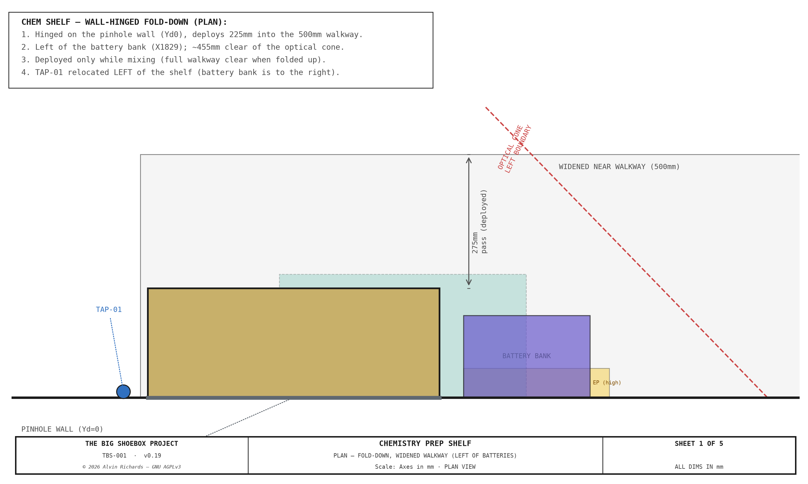
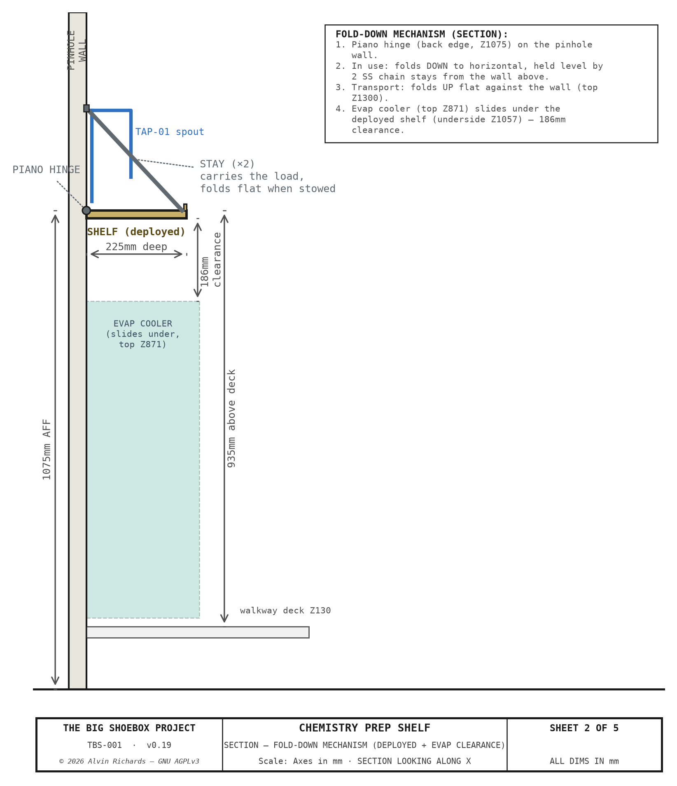
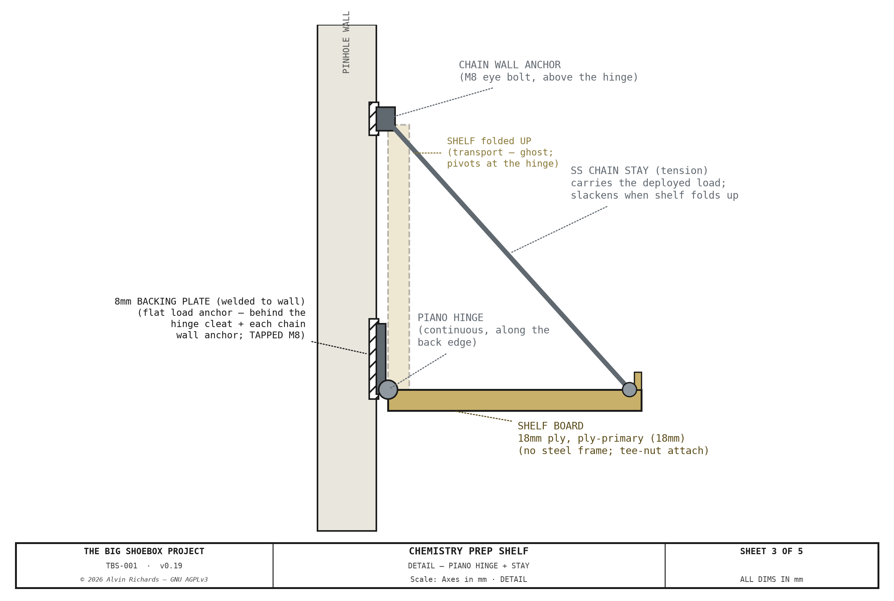
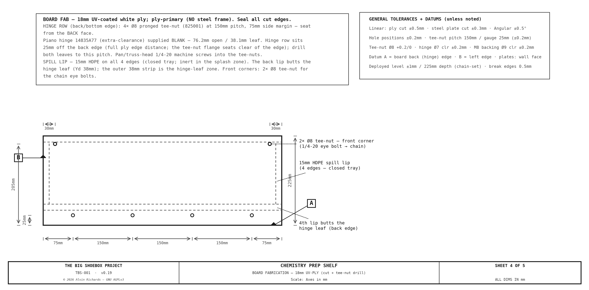
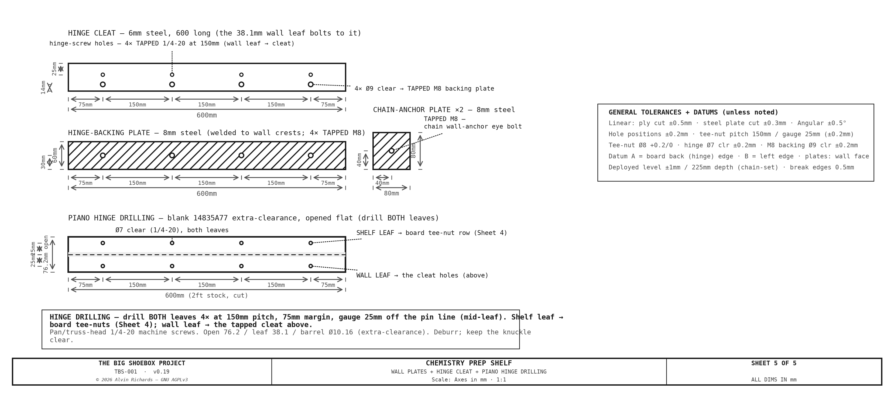

<!-- SPDX-License-Identifier: AGPL-3.0-only -->
<!-- © 2026 Alvin Richards -->
# Chemistry Prep Shelf

## 1. Purpose

Cyanotype processing requires a clean, stable work surface for:

- Mixing sensitizer chemistry (ferric ammonium oxalate + potassium ferricyanide)
- Measuring and dispensing solutions (graduated cylinders, digital scale)
- Staging materials (bottles, pH meter, gloves, timer)
- Post-exposure citric acid wash preparation

Chemistry is mixed **before exposure**, so the shelf is a **wall-hinged fold-down** in the
widened near walkway: down to counter height while mixing, up flat against the pinhole wall
for exposure and transport. It is only down while the film plane is parked, so it never
meets the film-plane swing.

Water tap TAP-01, on the pinhole wall **left of the shelf** (the battery bank is to the right),
supplies filtered Blue water for mixing and wash-down. Its riser tops at the stowed-shelf height
and the spout reaches over the board; ball valve BV-04 on the ¾" branch shuts it off from the
prep position.

---

## 2. Location and Spatial Constraints

The shelf is in the **widened near walkway** (<!-- BEGIN fact:walkway_near_wide_w_mm -->500<!-- END fact:walkway_near_wide_w_mm --> mm deep), hinged on the
pinhole wall left of the battery bank. Deployed, it projects 225 mm into the walkway; folded
up, the walkway is clear.

### 2.1 Film-Plane Swing and Optical Cone

**Film-plane swing.** The shelf is down only while mixing, with the film plane parked, and
folded flat whenever the plane tilts or swings, so it places no limit on the swing.

**Optical cone.** Even deployed, the shelf is clear of the optical cone. Its right edge
sits left of the cone's left boundary at the shelf's deepest point (Yd 225):

    cone_left(225) = PH_X + (FP_X_L − PH_X) × 225 / FP_Y
                   = 2,454 + (260 − 2,454) × 225 / 2,262
                   = 2,454 − 218 = 2,236 mm

The shelf right edge (X 1,780) is **456 mm** left of the cone, so it cannot vignette at any
film-plane position.

### 2.2 Spatial Constraints

| Constraint | Value |
|-----------|-------|
| Deployed footprint | Hinged on the pinhole wall, projects 225 mm |
| Stowed (transport) | Vertical against the wall, ~25 mm proud |
| Work surface height | 935 mm above the 140 mm walkway deck |
| Walkway (widened) | <!-- BEGIN fact:walkway_near_wide_w_mm -->500<!-- END fact:walkway_near_wide_w_mm --> mm deep — ~275 mm pass when deployed, full clear when stowed |
| Evap cooler (stow) | Slides under the deployed shelf |
| Optical cone | 456 mm clear |

---

## 3. Design Specification

### 3.1 Shelf Board

| Parameter | Value |
|-----------|-------|
| Width (X) | 600 mm |
| Depth (Yd, deployed) | 225 mm |
| Work surface height | 935 mm above the walkway deck |
| Thickness | 18 mm UV-coated white ply — **ply-primary (no steel frame)** |
| Work surface area | 600 × 225 = 0.135 m² |

**Work surface:** 18 mm UV-coated white plywood ([Home Depot BPI6WUV2I](https://www.homedepot.com/p/302874373)):
resistant to cyanotype solutions and pH 3–4 citric acid, non-absorbent, wipe-clean, and white so the
chemistry is easy to see. The plywood is the whole structure (no frame); every attachment lands in a
**pronged 1/4-20 tee-nut in the ply underside**, the project's ply-mount standard.

**Spill lip:** a 15 mm **HDPE** lip closes all four sides: front and both ends at the board edge,
and the back lip against the hinge leaf (~38 mm in). HDPE, an offcut of the light-trap stock, is
inert in the splash zone.

### 3.2 Fold-Down Mechanism

**Piano hinge:** a 304 SS extra-clearance continuous hinge ([McMaster 14835A77](https://www.mcmaster.com/14835A77-14835A33/),
76.2 mm open) runs the full 600 mm back edge. The shelf leaf screws (1/4-20 SS) into a row of ply
tee-nuts; the wall leaf is tapped 1/4-20 into a 6 mm cleat. The wide 38.1 mm leaf puts the tee-nut row
**25 mm** in from the board edge; a 1 in-open hinge would leave only ~7 mm of ply. The pinhole wall is
corrugated, so the cleat and both chain anchors bolt (M8×25) into **flat 8 mm steel backing plates
welded to the wall crests and tapped M8**, giving flat anchors with nothing loose behind the wall.
The board swings between horizontal (deployed) and vertical (stowed); the chains slacken as it folds up.

**Stays:** two **304 SS chains** run from M8 eye bolts ~230 mm above the hinge to a **1/4-20 steel shoulder eye
bolt** in each front corner. Deployed, they carry the front edge in tension; quick-links at the ends
set the length, and with it the level.

**Transport latch:** a **cam latch** at the top holds the folded board against the wall: the
hinged panel's [McMaster 1619A74](https://www.mcmaster.com/1619A74/), reused as a standard part.

### 3.3 Load Rating

Design load **25 kg** (bottles, cylinders, roller tray, scale), carried by the **2 chain stays**
(front edge, tension) and the **piano hinge** (back edge). Computed in
[`chem_shelf_load.py`](https://github.com/alvinr/tbs/blob/main/src/generators/chem_shelf_load.py):

<!-- BEGIN chem-shelf-load -->
| Element | Demand | Capacity | SF |
|---|---|---|---|
| Board bending (18mm ply, 600 wide, 225mm span, 25kg UDL) | 7.3 N·m | 324 N·m | **44** |
| Board midspan deflection | 0.02 mm (L/11930) | — | — |
| Chain stay tension (per chain, 46° from horizontal) | 91 N | 5,338 N (WLL) | **59** |
| Front-corner eyebolt (1/4-20 shoulder, ~45° off-axis, 30% of in-line rating) | 91 N | 667 N | **7** |
| Front-corner tee-nut pull-out (1/4-20 4-prong, 18mm ply) | 65 N | 1,300 N | **20** |
<!-- END chem-shelf-load -->

Every element clears with a large margin; the front-corner eyebolts (SF 7) are the governing element.

### 3.4 Leveling

Each chain sets its own front corner, so the board is leveled at install by choosing the link each
quick-link engages.

### 3.5 Fabrication Detail

Sheet 4 gives the board cut and tee-nut positions; Sheet 5 the wall plates, hinge cleat and hinge
drilling. The hinge is supplied **blank**: both leaves are drilled 4× at the same 150 mm pitch (25 mm
off the pin line), so hinge, tee-nuts and cleat align, 8 screws in all.

---

## 4. Transport Mode

The shelf folds UP flat against the pinhole wall and latches.

| Check | Status |
|-------|--------|
| Walkway clearance | Folded up, ~25 mm proud of the wall — full walkway clear ✓ |
| Film-plane clearance | Folded flat — never in the swing envelope ✓ |
| Overhead clearance | Stowed top at Z1,300 — well below the ceiling-corner cable trunking ✓ |
| Evap stow | Evap tucks below the folded board ✓ |
| Vibration | Board latched flat against the wall; no loose span ✓ |

---

## 5. Operator Access

The operator stands on the widened walkway at the shelf midpoint, facing the wall. The surface,
935 mm above the deck, is counter height and its full depth is in reach; the tap, left of the shelf,
fills containers on the board.

Deployed, the board leaves ~275 mm of the 500 mm walkway: room to work but not to pass. That is
acceptable because the shelf is down only while mixing.

---

## 6. Assembly Sequence

1. Cut the 18 mm ply board to 600 × 225; seal the cut edges; fit the 15 mm HDPE spill lip to all four edges (the back lip butts the hinge leaf).
2. Set the pronged tee-nuts into the ply underside — the hinge screw row along the back edge + one at each front corner.
3. Weld the 8 mm backing plates to the pinhole-wall crests (behind the hinge cleat + one per chain anchor); tap them M8; bolt the 6 mm hinge cleat on (M8×25 into the tapped plate).
4. Bolt on the piano hinge: wall leaf to the cleat, shelf leaf into the back-edge tee-nut row (1/4-20 SS screws).
5. Thread a 1/4-20 steel shoulder eye bolt into each front-corner tee-nut; cap/grind the ~7 mm protruding tip.
6. Fit an M8 eye bolt into each chain wall anchor ~230 mm above the hinge; hang a chain (quick-links) from each wall eye to the shelf eye.
7. Deploy; set each chain link so the board sits level on a spirit level, then lock.
8. Fit the cam latch (1619A74) + keeper; verify the board folds up flat and latches clear of the wall equipment.
9. Verify: deployed level + rigid under load; folded-up clear of the evap stow and walkway.

---

## 7. Parts List

See the **[Master Shopping List, filtered to the shelf system](master-shopping-list.md?system=shelf)** for the same parts with suppliers, current prices, and click-to-sort/filter.

*TAP-01 and BV-04 are carried in the water-system BOM; the shelf system adds only the ~1.3 m
blue-trunk extension that reaches them.*

---

## 8. Maintenance

The shelf has no consumables: the ply surface wipes clean, the hinge, chains and fasteners are
stainless, and the chain links set the level (§3.4). The deploy, stow and inspection steps are in
the [Operating Manual](operating-manual.md).

---

## 9. Source References

1. [McMaster-Carr 14835A77](https://www.mcmaster.com/14835A77-14835A33/) — 304 SS extra-clearance continuous hinge, 76.2 mm open, 38.1 mm leaf.
2. [McMaster-Carr 1619A74](https://www.mcmaster.com/1619A74/) — lift-and-turn cam latch (transport latch).
3. [Home Depot BPI6WUV2I](https://www.homedepot.com/p/302874373) — 18 mm UV-coated white plywood (work surface).
4. [Walkway System Report](walkway-report.md) — walkway deck height and the widened near-walkway section.
5. [Equipment Layout Report](equipment-layout-report.md) — optical cone clearance and pinhole-wall zones.
