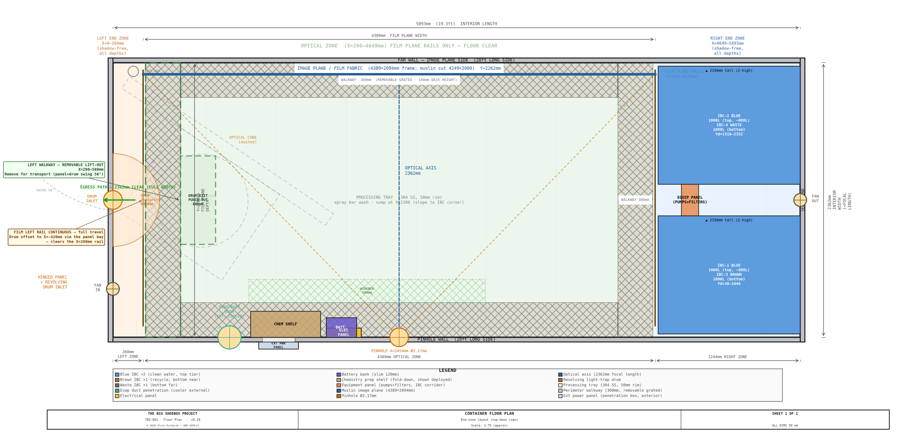
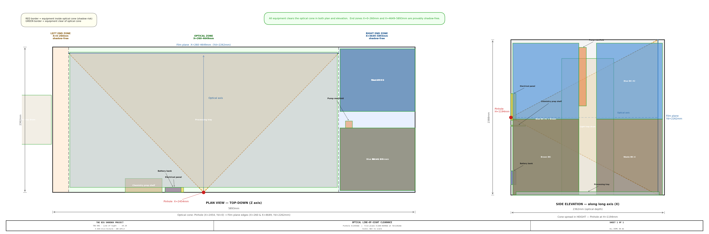

<!-- SPDX-License-Identifier: AGPL-3.0-only -->
<!-- © 2026 Alvin Richards -->
# Equipment Layout — Shadow-Free End-Zone Design

## 1. Design Principle — Shadow-Free End Zones

The optical cone from the pinhole narrows toward the pinhole wall and widens toward the
film plane. Any equipment standing inside the cone casts a shadow on the film plane — an
unexposed void in the image. The layout follows one governing rule: **keep the cone empty,
and put everything else where the cone cannot reach.**

Reducing the active film plane from the full
<!-- BEGIN fact:container_interior_length_mm -->5,893<!-- END fact:container_interior_length_mm -->mm
container width to a <!-- BEGIN fact:film_plane_width_mm -->4,389<!-- END fact:film_plane_width_mm -->mm
span opens two **provably shadow-free end zones**, one at each end of the container, where
equipment sits at any depth without entering the cone. The pinhole wall face is shadow-free
too — the cone collapses to a point there. Those three surfaces, plus the floor beneath the
cone, carry all the equipment; the optical zone itself holds only the film-plane rails.

### Zone Definitions

| Zone | X range | Shadow-free? | What it holds — and why |
|------|---------|--------------|--------------------------|
| **Left end zone** | 0–260mm | Yes, at all depths | Hinged panel + revolving-drum light lock — the door-end entry, kept clear for egress |
| **Pinhole wall face** | Y=0 surface | Yes (cone collapses to a point) | Electrical panel, battery, inverter, cable + pipe runs — the service wall, shortest runs |
| **Optical zone** | 260–4,649mm | No | Film plane + rails only; the tray and walkway lie on the floor, below the cone |
| **Right end zone** | 4,649–5,893mm | Yes, at all depths | 2×2 IBC stack + plumbing corridor + pump/filter panel — the tall, heavy water plant, clear of the cone |

---

## 2. Zone-by-Zone Layout

The floor plan is the layout of record — it carries every position, the optical cone, and
the zone boundaries to scale. This section gives only *what* goes in each zone and *why*;
read the positions off the drawing.

**Floor plan**

### 2.1 Left End Zone — the door-end entry

The cargo-door end holds the hinged light-trap panel and, in its center, the revolving drum
that is the camera's light-tight entry and exit. Nothing else goes here: the zone is
deliberately empty at floor level so it doubles as the egress path — full container-width
when the panel is open. For transport the panel + drum swing ~56° inboard about the shared
film-plane pivot post, clearing the door plane. The panel construction, swing pivot, seals,
and the emergency-egress assessment are in the
[Hinged Panel Report](hinged-panel-report.md); the drum light lock is in the
[Light Trap Selection](light-trap-selection.md).

### 2.2 Pinhole Wall Face — the service wall

At the pinhole wall the cone has collapsed to a point, so the whole wall face is shadow-free
at any height. It carries the services: the electrical panel and battery bank (a slim column
that clears the cone), the cooler inverter, the full-length cable trunking, and the Blue
supply pipe running to the spray-bar feed. Mounting them on this wall keeps every cable and
pipe run short and out of the optical zone. The evaporative cooler sits on the ground
outside, ducted through a wall stub. Circuit and wiring detail is in the
[Electrical Report](electrical-report.md); the supply pipe in the
[Plumbing Report](plumbing-report.md).

### 2.3 Optical Zone — rails only, floor clear

The optical zone is **not** shadow-free, so nothing stands up into it. Only the film-plane
depth rails live here, at the two zone boundaries. The processing tray and the perimeter
walkway lie flat on the floor, below the cone — the tray clears the film-plane carriage
blocks even at full tilt, so it never reaches into the optical path. Tray and walkway detail
are in the [Processing Tray Report](processing-tray-and-spray-bar.md) and the
[Walkway Report](walkway-report.md).

### 2.4 Right End Zone — the water plant

Shadow-free at all depths, the right end zone takes the tall, heavy water plant: the four
IBC totes, the plumbing corridor, and the pump/filter panel. The totes stack **2×2,
right-justified to the end wall** — a side-by-side spread would need ~2,400mm of X, but the
zone is only 1,244mm wide, so the totes go two columns wide and two tiers high instead. The
two columns are separated by a
<!-- BEGIN fact:corridor_width_mm -->270<!-- END fact:corridor_width_mm -->mm plumbing
corridor, which carries the Corridor Plumbing Panel (pumps + filters) on the IBC frame's
back uprights. The restraint frame, tote roles, stacking, and water balance are in the
[IBC Stacking Report](ibc-stacking-report.md) and the
[Water System Report](water-system-report.md); the pumps and filters in the
[Plumbing Report](plumbing-report.md).

---

## 3. Line-of-Sight Verification

**Optical line-of-sight**

The line-of-sight analysis confirms zero equipment intersects the optical cone in either the
plan (top-down) or elevation (side) view. The shadow-free claim is geometry-limited — an
exact cone fit at the film-plane edges.

---

## 4. Transport-Mode Positions

Two items move for transport. The hinged panel + drum swing ~56° inboard about the pivot
(see the [Hinged Panel Report](hinged-panel-report.md)). The evaporative cooler, which
operates on the ground outside, stows on the near-walkway wide section — clearing both the
panel swing and the tray zone; its base plate, straps, and stow sequence are in the
[Operating Manual](operating-manual.md).

---

## 5. Source References

1. [ISO 668:2020](https://www.iso.org/standard/76912.html) — Series 1 freight containers: Classification, dimensions and ratings.
2. [Schütz Ecobulk MX 1000L](https://www.schuetz-packaging.net/schuetz-usa/en/ibcs/ecobulk/ecobulk-mx/) — 1,000L caged composite IBC tote specifications and cage dimensions (~65 kg tare; a 600L caged tote does not exist).
3. [Light Trap Selection Report](light-trap-selection.md) — Revolving drum specification and panel integration.
4. [Hinged Panel Report](hinged-panel-report.md) — Stepped panel construction, swing pivot, and emergency-egress assessment.
5. [Water System Report](water-system-report.md) — IBC layout, plumbing manifold, and pump positions.
6. [Walkway System Report](walkway-report.md) — Perimeter walkway dimensions and cantilever bracket design.
