<!-- SPDX-License-Identifier: AGPL-3.0-only -->
<!-- © 2026 Alvin Richards -->
# Film Plane — Mechanism Design

## 1. Purpose

The photosensitive film plane sits against one of the container's 20ft long-side walls, opposite the pinhole wall. This report describes a **view-camera-style moveable film plane** — a mechanism with **four corner carriages** (TL, TR, BL, BR) driven in **coordinated pairs**, carrying a **fixed-size rigid** plane that changes only its angle — allowing tilt, swing, and limited combined movements comparable to a large-format view camera's rear standard.

**System context — container floor plan:**
The floor plan below shows the film plane rail positions in the context of the complete TBS-001 interior, including left end zone (light trap), processing tray and perimeter walkway in the optical zone, and right end zone (4× IBCs in 2×2 stack, pump manifold on the Corridor Plumbing Panel and the filter skid on the Pinhole Wall Plumbing Panel).

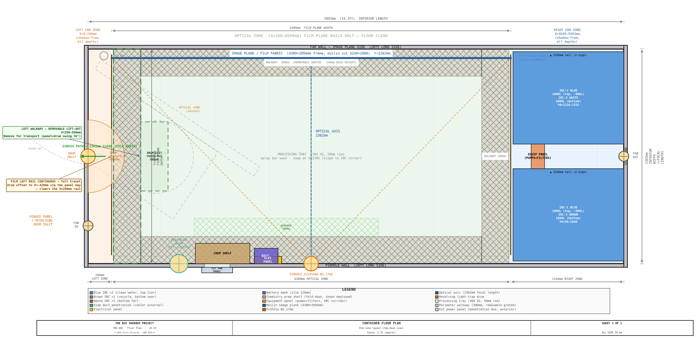

<!-- brochure:skip -->
**Interactive 3D model** — the fixed-size rigid film plane on its four slide-and-clamp corner carriages, shown against a ghost of the perimeter walkway and the IBC frame. Drag to orbit, scroll to zoom; the **Movement** and **whole-plane** scenes let you click a corner — or the whole frame — to cycle it through a tilt or swing, and the per-corner detail scenes show each 6061 Al U-channel depth rail, acetal skate, Z/X cross-slide, and the single U-joint.

  

    <iframe title="TBS-001 Articulated Film Plane Model" frameborder="0" allowfullscreen mozallowfullscreen="true" webkitallowfullscreen="true" allow="autoplay; fullscreen; xr-spatial-tracking" execution-while-out-of-viewport execution-while-not-rendered web-share src="https://sketchfab.com/models/572b4aaa2d394de1b8852160d7cdcfc3/embed" style="position:absolute;top:0;left:0;width:100%;height:100%;border:0;"></iframe>
  

  
<a href="https://sketchfab.com/3d-models/tbs-001-articulated-film-plane-model-572b4aaa2d394de1b8852160d7cdcfc3?utm_medium=embed&utm_campaign=share-popup&utm_content=572b4aaa2d394de1b8852160d7cdcfc3" target="_blank" rel="nofollow" style="font-weight: bold; color: #1CAAD9;">TBS-001 Articulated Film Plane Model</a> by <a href="https://sketchfab.com/alvin91403?utm_medium=embed&utm_campaign=share-popup&utm_content=572b4aaa2d394de1b8852160d7cdcfc3" target="_blank" rel="nofollow" style="font-weight: bold; color: #1CAAD9;">alvin91403</a> on <a href="https://sketchfab.com?utm_medium=embed&utm_campaign=share-popup&utm_content=572b4aaa2d394de1b8852160d7cdcfc3" target="_blank" rel="nofollow" style="font-weight: bold; color: #1CAAD9;">Sketchfab</a>

<!-- brochure:endskip -->

---

## 2. Container Reference Geometry

| Dimension | Value | Notes |
|-----------|-------|-------|
| Interior length | <!-- BEGIN fact:container_interior_length_mm -->5,893<!-- END fact:container_interior_length_mm -->mm (19 ft 4 in) | Film plane spans this direction |
| Interior width | <!-- BEGIN fact:container_width_mm -->2,362<!-- END fact:container_width_mm -->mm (7 ft 9 in) | Optical axis runs across it |
| Focal length | <!-- BEGIN fact:focal_length_mm -->2,338<!-- END fact:focal_length_mm -->mm | Pinhole (24.5mm inboard of the pinhole wall) to the far wall |
| Interior height | <!-- BEGIN fact:container_height_mm -->2,388<!-- END fact:container_height_mm -->mm (7 ft 10 in) | |
| Film plane height | <!-- BEGIN fact:film_plane_height_mm -->2,094<!-- END fact:film_plane_height_mm -->mm (6 ft 10 in) | |
| Pinhole position | X = <!-- BEGIN fact:pinhole_x_mm -->2,454<!-- END fact:pinhole_x_mm -->mm on one 20ft long-side wall, centered on the active film plane | |
| Nominal film plane | Opposite 20ft long-side wall | flush to wall |
| Structural ribs | Every <!-- BEGIN fact:container_rib_spacing_mm -->457<!-- END fact:container_rib_spacing_mm -->mm (18 in) along length | Rail mounting points |

---

## 3. Movement Axes

The four-corner mechanism provides tilt, swing and back focus. Corners are labeled TL (top-left), TR (top-right), BL (bottom-left), BR (bottom-right) — where left/right refers to the rail span direction and top/bottom to the height direction.

| Axis | Corners Controlled | Max Travel | Effect |
|------|--------------------|-----------|--------|
| **Tilt (top)** | TL + TR together | 100–2,262mm | Perspective convergence, keystone |
| **Tilt (bottom)** | BL + BR together | 100–2,262mm | Perspective convergence, keystone |
| **Swing (left)** | TL + BL together | 100–2,262mm | Left-right perspective skew |
| **Swing (right)** | TR + BR together | 100–2,262mm | Left-right perspective skew |
| **Compound (limited)** | Tilt + swing together | 100–2,262mm | Combined tilt+swing — limited range; plane stays **flat** (no twist) |
| **Back focus** | All 4 together | 100–2,262mm | Uniform magnification change |

**Maximum tilt angle** (single-axis): **<!-- BEGIN fact:film_plane_max_tilt -->40<!-- END fact:film_plane_max_tilt -->°** — set by the cross-slide Z travel (245mm); the depth rails alone would allow ~65°.

**Maximum swing angle** (single-axis): **<!-- BEGIN fact:film_plane_max_swing -->28<!-- END fact:film_plane_max_swing -->°** — rail-depth limited ≈ 28.7°.

Swing is the binding limit because the plane is <!-- BEGIN fact:film_plane_width_mm -->4,389<!-- END fact:film_plane_width_mm -->mm wide — the same depth travel over a wider span sweeps the corner further along the rail. Combined tilt+swing is further limited — see §5.

Because the plane is a **fixed-size rigid rectangle**, its physical height stays **2,094mm at every angle** — it does not grow. Corner **cross-slides** absorb the rigid-rotation arc travel instead, so a single rigid backing panel suffices.

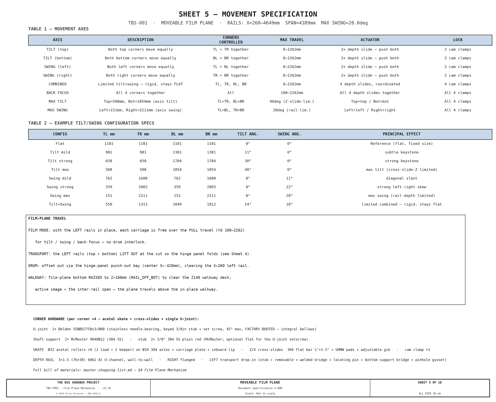

---

## 4. Mechanism Design

> **Note:** The drawings and distortion renders show **axis tilt/swing** — the rigid plane rotates about its center and **foreshortens** (it never grows), illustrated about the mid-rail position (the film back-focuses anywhere along the rail; flat-at-far-wall is the max-focal-length extreme). The interactive 3D model `models/film-plane-mechanism.skp` also reflects this.

### 4.1 Four-Corner Frame

Each corner of the film plane frame rides on its own carriage assembly - driven in coordinated pairs, not independently:

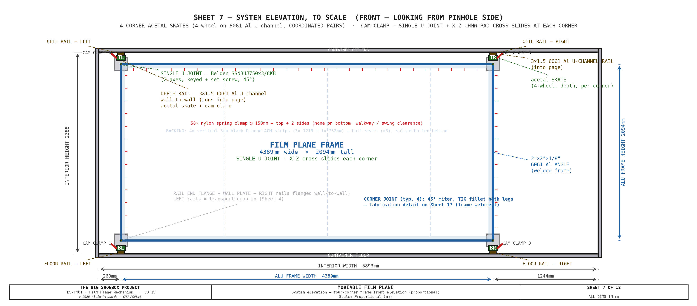

- **4 depth rails** — 3×1½" (76×38mm) **6061-T6 aluminum U-channel** — its yield exceeds annealed 304 so strength holds, the ~1mm sag over 2.36m is optically irrelevant at f/<!-- BEGIN fact:f_number -->1087<!-- END fact:f_number -->, and flatness is carried by the ACM backing — one at each corner, running wall-to-wall (<!-- BEGIN fact:container_width_mm -->2,362<!-- END fact:container_width_mm -->mm) along the optical axis. An acetal skate rides inside each; sliding it sets that corner's **depth** (focus / back-focus). The **right** rails are permanently flanged to their wall seats; each **left** rail has a removable section that lifts out for transport. Every rail, removable section and stub included, is cut from one 8 ft stick with no length splice, so the skate rolls on an unbroken channel.
- **4 acetal skates** — a 4-wheel skate per corner: **Ø32 acetal load rollers** gravity-seated on the channel's bottom flange plus **Ø20 keeper rollers** captive under the top flange, all on **Ø10 304 axles**, carrying the corner's carriage plate.
- **12 cam clamps** — three per corner. Each corner is slid by hand into position, then a **cam-lever rail brake** locks the skate to the U-channel — there are no leadscrews. The lock holds for the exposure and for transport.
- **8 corner cross-slides** — a **Z (tilt)** slide plus an **X (swing)** slide at each corner, each a **304 stainless flat bar (¼"×1½")** captured on **UHMW self-lube pads** with an adjustable brass-tip **gib**. The Z slide (~345mm) and X slide (~365mm) absorb the in-plane arc travel that a **rigid** rotation forces on each corner (≈245mm in Z at max tilt, ≈257mm in X at max swing — the bar length = that travel + the carriage, so it can reach the full ±40°/±28°), so the film plane stays a **fixed-size flat rectangle** instead of stretching; the gib drag holds the gravity-loaded vertical axis while the clamp is set.
- **Film plane frame** — welded 2"×2"×1/8" plain-6061 aluminum angle, kept as an **expendable part** (bare 6061 corrodes slowly in the splash-not-immersed cyanotype zone, so the angle is replaced when it pits; the ACM backing carries the flatness), a **FIXED-SIZE rigid rectangle, <!-- BEGIN fact:film_plane_width_mm -->4,389<!-- END fact:film_plane_width_mm -->mm × <!-- BEGIN fact:film_plane_height_mm -->2,094<!-- END fact:film_plane_height_mm -->mm** (rail span × film-plane height). Each corner connects to its cross-slide stack through a **single universal joint** (Belden SSNBUJ750x3/8KB, stainless, with an integral factory boot). The U-joint supplies the two angular degrees of freedom (tilt + swing) while the cross-slides supply the translation. The joint bolts to the frame through a **304 stainless corner gusset** (a flat ¼" L-plate, detailed below) and to the X-slide carriage on 3/8" 304 stub shafts held in McMaster 4040N12 supports (see Sheet 3). Together they let the rigid plane tilt and swing without the frame ever changing size. The following diagrams show the range of movements of the film plane.

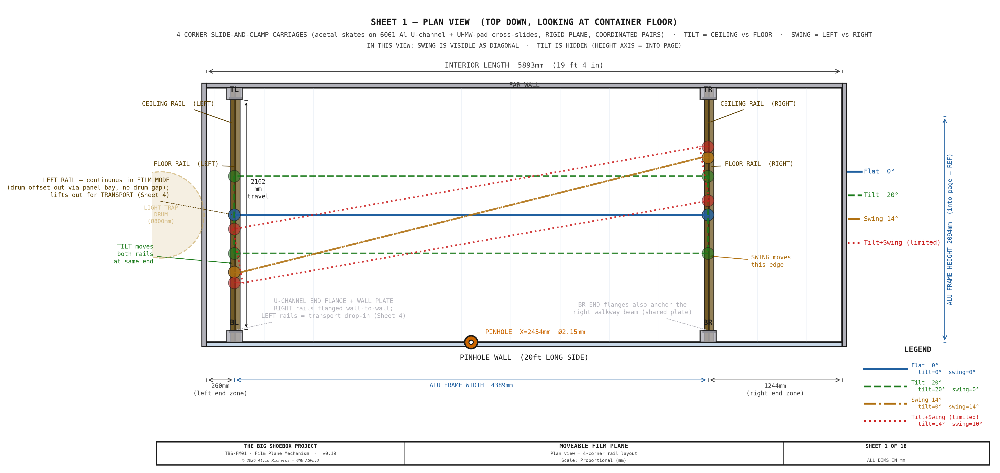

The plan view shows the full swing range. Both side rails give the same range, so the plane can swing equally either way.

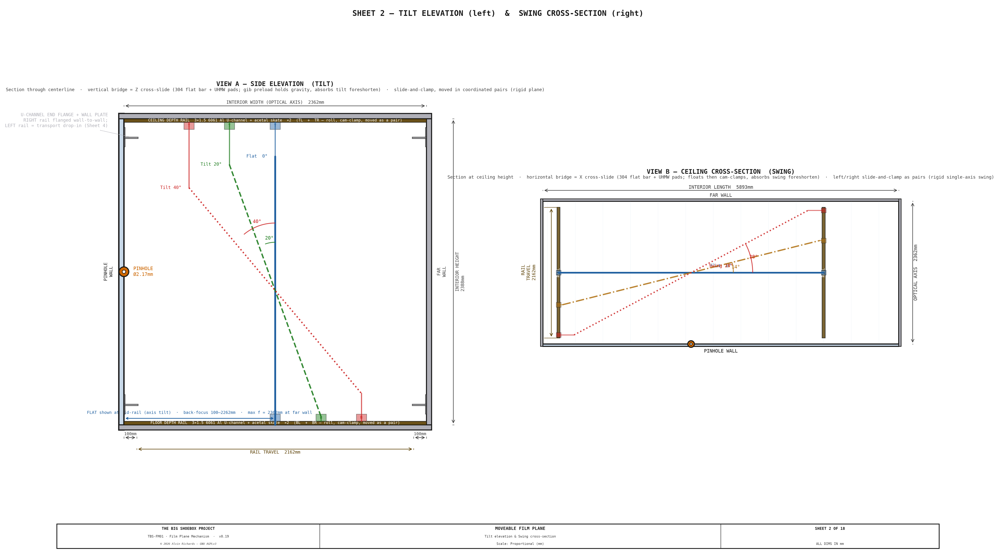

The side elevation shows the full tilt range. The top and bottom rails give the same range, so the plane can tilt equally either way.

### 4.2 Mechanism Components
Sheet 3 is the master hardware drawing; the sections below cover each part.

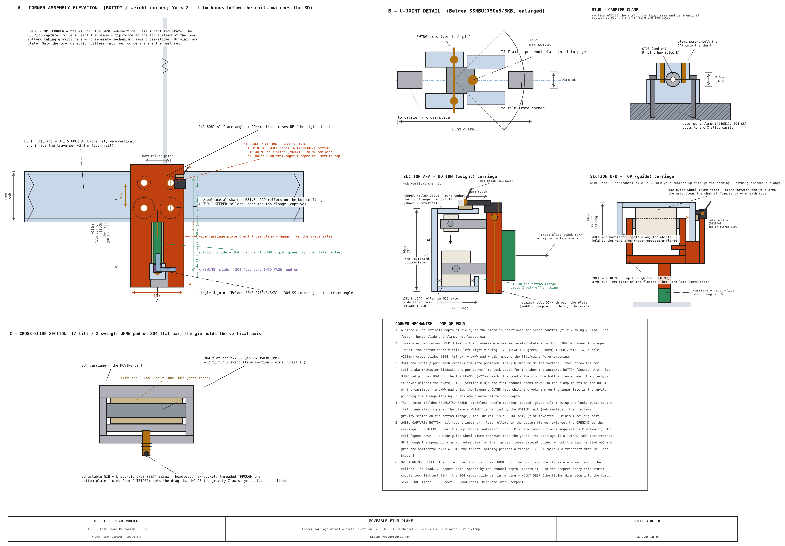

### 4.3 Why a U-Joint + Cross-Slides

The film plane is a **fixed-size rigid rectangle**; tilt and swing are a true **rigid-body rotation** of that rectangle. A rigid rotation moves each corner along an arc — partly along its depth rail and partly *across* it (in X and Z). The **2-axis cross-slide** absorbs that across-rail travel, and the **single universal joint** (Belden SSNBUJ750x3/8KB, 45° per axis) takes up the angular change so nothing binds. This pairing is what lets a rigid plane tilt and swing **without stretching**, and keeps the plane a single flat rectangle at every angle.

Each corner connects to that mechanism through a **304 stainless corner gusset** — a flat ¼" L-plate lying on the frame back, bolted to both 6061 frame members; it carries the U-joint, whose other yoke mounts on the **X (swing) slide** — so the corner is *carried by* the slide **through** the U-joint, never bolted to it directly. The gusset is steel because the U-joint funnels the whole corner load into a few bolts, and stainless for a galvanic/wet-zone match to the 303 SS U-joint. It is a flat laser-cut plate with both legs in the frame plane, so nothing projects into the cross-slide and carriage space. Sheet 9 details this connection square-on and in section.

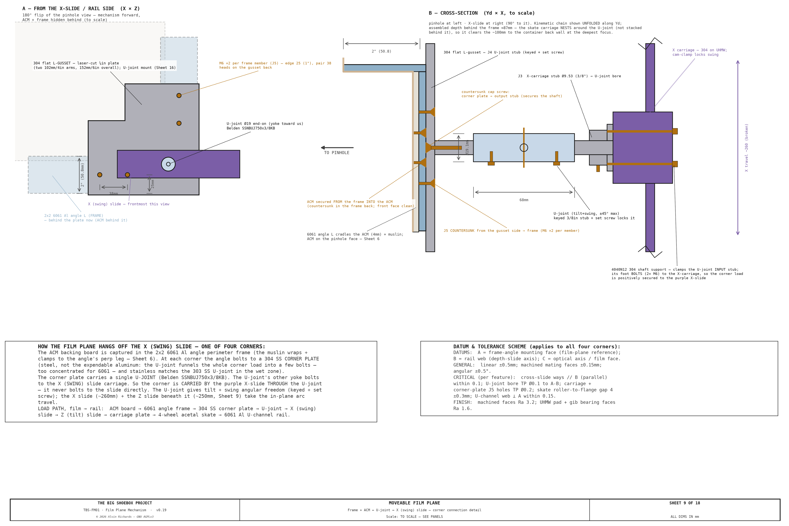

Sheet 4 sections the universal joint itself — the yokes, the cross/trunnion, and the factory boot — showing how the two angular axes (tilt + swing) both pass through the one joint.

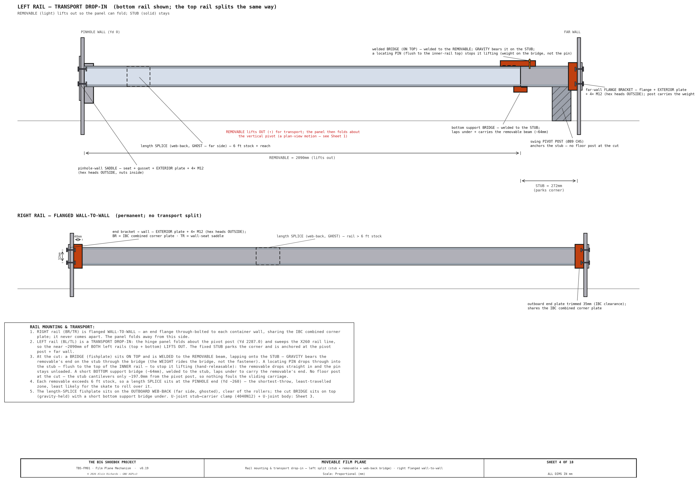

### 4.4 Cross-Slide Load Case

The cross-slide travel and load follow from the rotation geometry and the moving mass (Sheet 10):

- **Travel** — the Z (tilt) and X (swing) strokes = (half-dimension) × (1 − cos angle), rotating about the plane center: Z = (FP_H/2)(1 − cos 40°) = **245 mm** and X = (FP_W/2)(1 − cos 28°) = **257 mm**, matching `XSLIDE_Z_TRAVEL` / `XSLIDE_X_TRAVEL` exactly.
- **Load** — the ~51 kg moving plane puts ~W/4 = **124 N** on each corner. The governing case is the horizontal X (swing) slide in bending at full extension (the Z slide takes gravity axially). **The cross-slide bars are mounted deep** — the 38.1 mm dimension in the load direction — giving σ ≈ 21 MPa, **safety factor ≈ 10**, deflection ≈ 0.1 mm. Mounted flat the bar is marginal (SF ≈ 1.7, failing under a 2× dynamic/asymmetry factor), so **deep mounting is specified**.

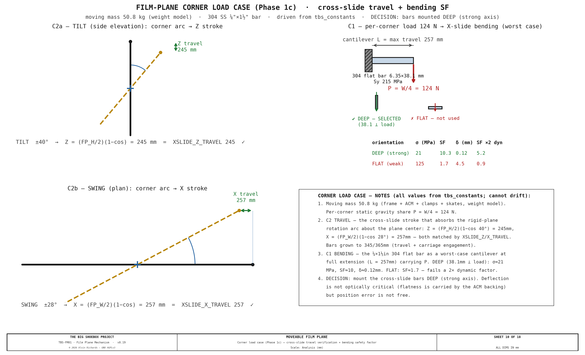

- **Rear-corner attachment** — the two far-left (rear) rail ends land at the Ø89 pivot post, which carries their weight (the stub is anchored to it). Each is tied to the far wall by a **flange + exterior backing plate + 4× M12×75** (the 50mm grip is too long for the M12×70 used elsewhere) — the rail END butts the flange's inner face — with the bolt gauge narrowed so the bolts clear the post, and the bracket kept below the roof-mount plate (a full saddle would foul it). No seat/gusset: it's a lateral tie, not a load-bearing seat.

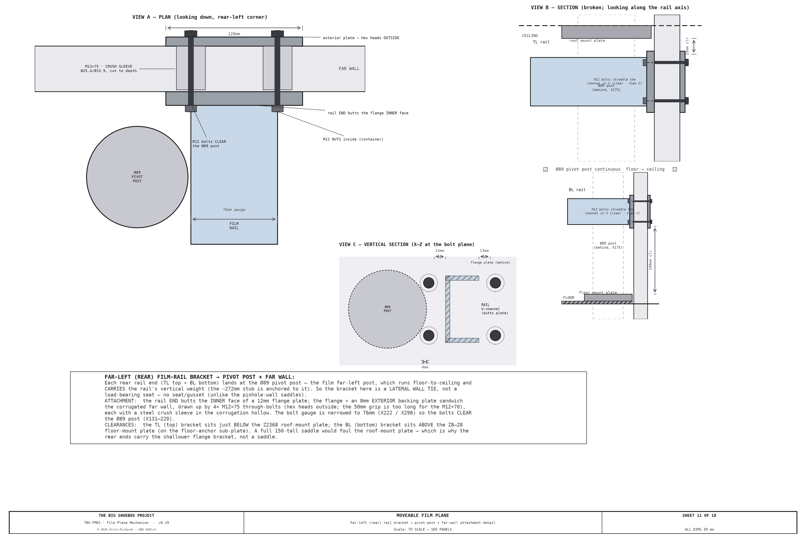

### 4.5 Positioning

Each corner is positioned by hand: the acetal skate rolls along its U-channel to the target depth, the Z and X cross-slides take up the rotation arc, and the **cam clamp** locks the skate to the rail. The gib drag holds the vertical (Z) axis while the clamp is set, and the U-joint's twist-lock holds the angle.

The setting procedure is in [Operating Manual §1.9](operating-manual.md#19-film-plane-tilt-swing-and-focus).

**Named movement modes:**
- **Pure tilt**: the two top corners (TL + TR) move together to one depth; the two bottom corners (BL + BR) together to another.
- **Pure swing**: TL and BL move together; TR and BR move together.
- **Back focus**: all four corners move by the same amount.
- **Compound (limited)**: all four sit at a coordinated set of depths — the rigid plane stays flat (no twist).

All four corners lock independently on their own cam clamps, so a set position holds through the exposure and through transport.

### 4.6 Fixed-Size Plane — No Variable Geometry

Because the plane is a **fixed-size rigid rectangle**, its physical dimensions never change: the along-plane height stays **2,094mm at every tilt angle**. The arc travel that the rotation forces on each corner is taken up entirely by the **cross-slides** (≈245mm Z at max tilt, ≈257mm X at max swing), not by the frame.

**Single rigid backing panel:** the backing is **one flat ACM (aluminum composite) sheet, <!-- BEGIN fact:film_plane_width_mm -->4,389<!-- END fact:film_plane_width_mm -->mm × <!-- BEGIN fact:film_plane_height_mm -->2,094<!-- END fact:film_plane_height_mm -->mm**, bonded to the rear of the angle frame — the panel simply rotates with the rigid plane.

### 4.7 Fabrication Detail Sheets

Sheets 12–18 take each corner-mechanism part to shop-buildable detail — cut lengths, section profiles, hole coordinates, weld schedules, and the corner fastener schedule. (The cam rail-brake and the U-joint are purchased parts already detailed in-assembly on Sheets 3 and 9, so they get no standalone sheet.)

The color assembly/mechanism views come first; the monochrome single-part dimensional layouts close the set (Sheets 15–18 are the pure single-part fab sheets).

- **Sheet 12 — Corner assembly:** the exploded build sequence and the full corner fastener schedule.
- **Sheet 13 — Depth rail:** 3×1½" 6061-T6 U-channel (Grainger 795M51), cut wall-to-wall from 8 ft stock, section + fixed/drop-in end conditions.
- **Sheet 14 — Acetal skate:** the axle-saddle retention detail + the 6061 carriage-plate hole coordinates.
- **Sheet 15 — Cross-slide stack:** the Z (tilt) and X (swing) 304 flat bars, the deep-mount section (SF≈10 vs 1.7 flat), gib, and stroke.
- **Sheet 16 — Corner gusset:** the laser-cut ¼" 304 flat L-plate profile + drilling layout with hole coordinates — the U-joint mount (lies flat on the frame back, bolts to both frame members).
- **Sheet 17 — Frame weldment:** the 2×2×⅛" 6061 angle frame to scale, the 4 corner welds (the only joints), and the member section with ACM backing.
- **Sheet 18 — Wall-seat saddle (ICP-11):** the A36 8/10mm plate saddle assembly, cut pieces, and M12 wall mount.

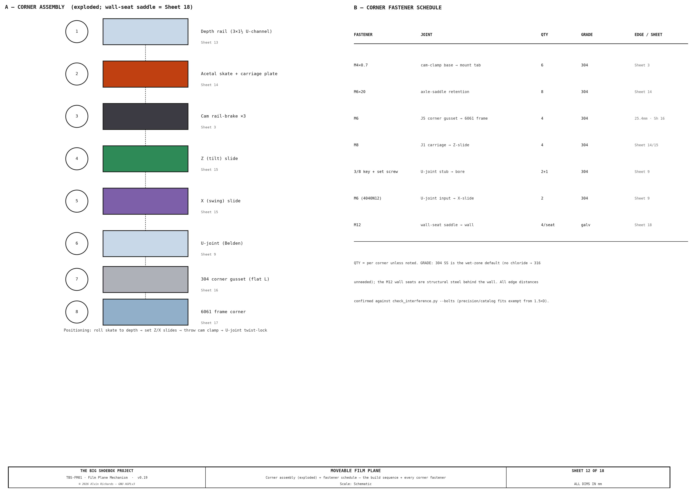

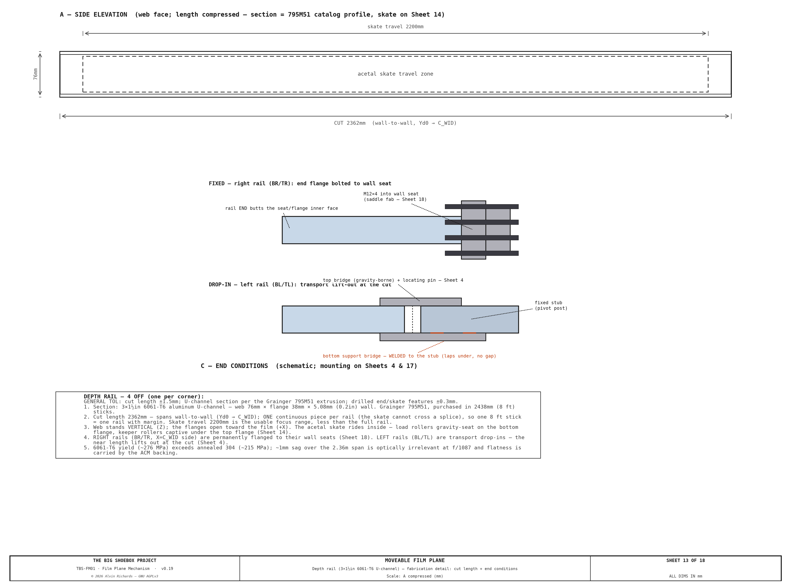

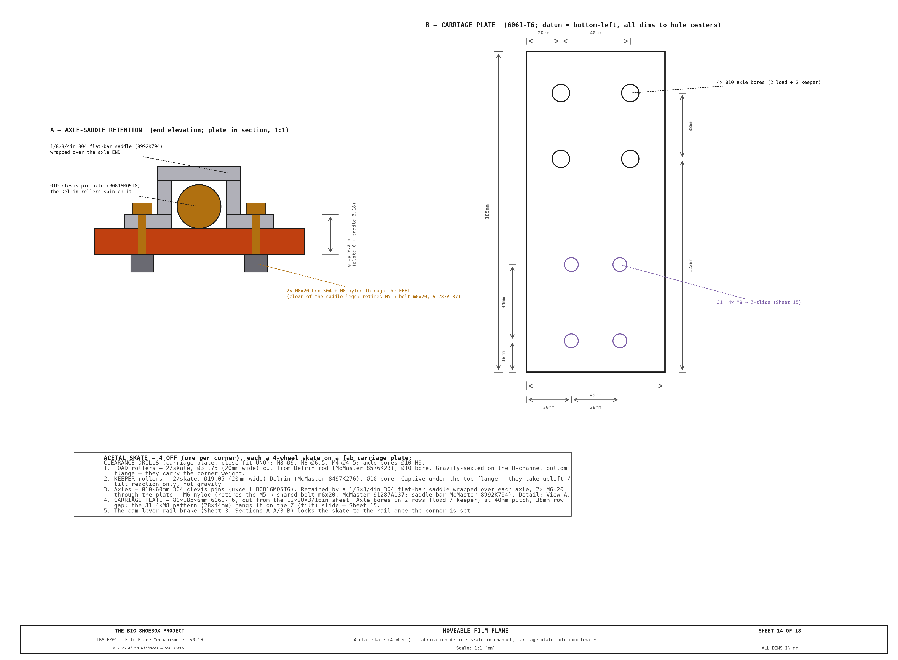

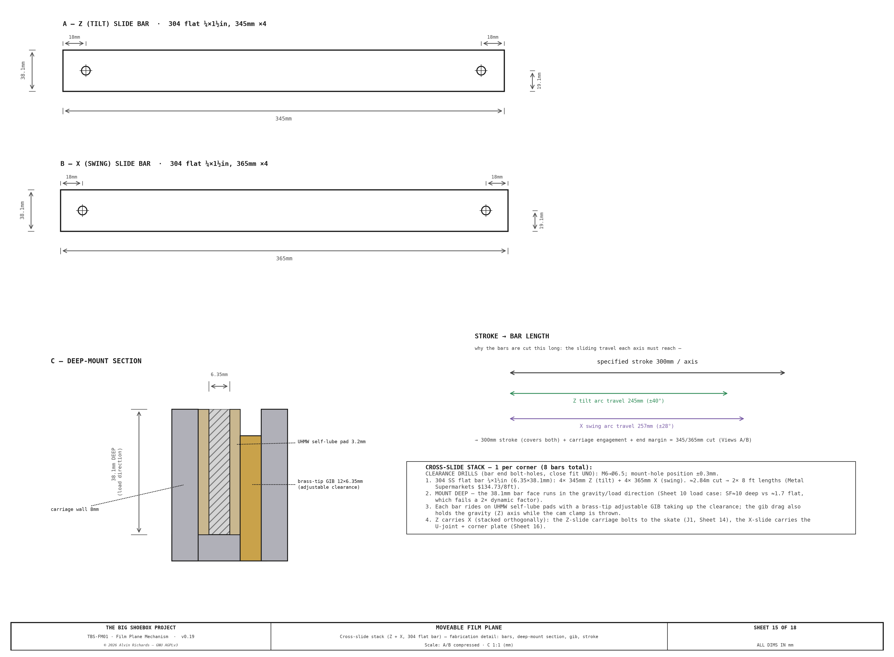

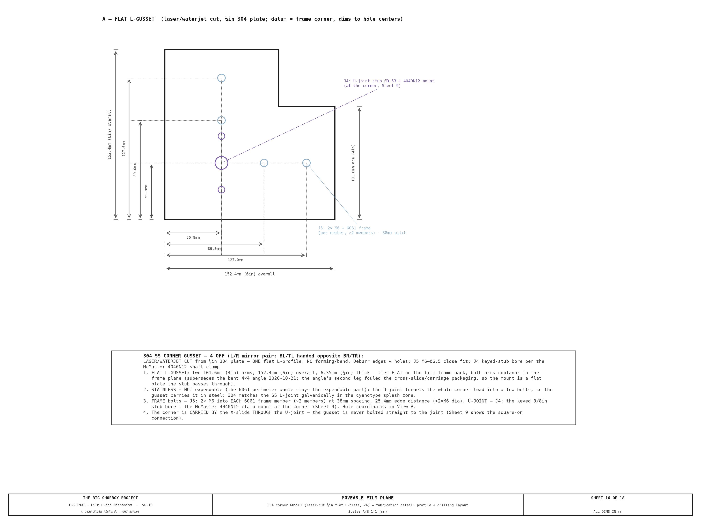

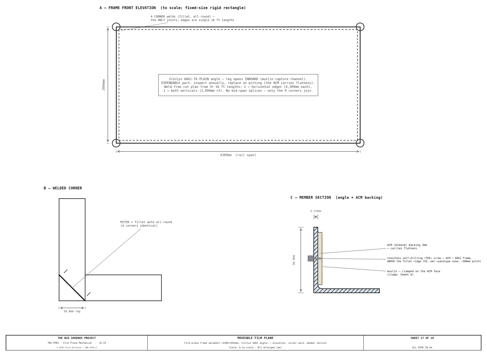

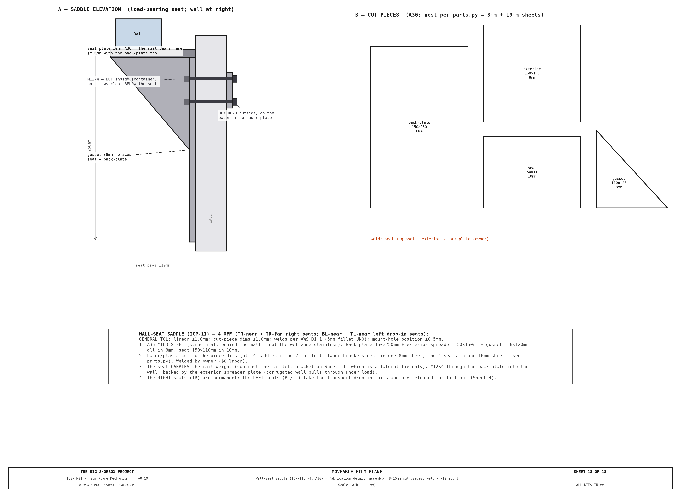

---

## 5. Tilt / Swing Configurations

The plane stays flat at all times, so it is always a single tilt **or** swing (or a limited combination). Corner depths below are about the **mid-rail center (1,181mm)** — add the focus offset to reposition the whole plane. Film height is **constant**.

| Config | Name | TL | TR | BL | BR | Tilt | Swing | Film Height |
|--------|------|----|----|----|----|------|-------|-------------|
| C0 | Flat | 1181 | 1181 | 1181 | 1181 | 0° | 0° | 2,094mm |
| C1 | Mild tilt | 981 | 981 | 1381 | 1381 | 11.0° | 0° | 2,094mm |
| C2 | Strong tilt | 634 | 634 | 1728 | 1728 | 31.5° | 0° | 2,094mm |
| C3 | Max tilt | 508 | 508 | 1854 | 1854 | 40.0° | 0° | 2,094mm |
| C4 | Mild swing | 929 | 1433 | 929 | 1433 | 0° | 6.6° | 2,094mm |
| C5 | Strong swing | 430 | 1932 | 430 | 1932 | 0° | 20.0° | 2,094mm |
| C6 | Max swing | 151 | 2211 | 151 | 2211 | 0° | 28.0° | 2,094mm |

*Depths measured from the pinhole wall about the mid-rail center. Each corner sits at 1,181 ∓ (FP_H/2)·sin(tilt) for tilt, or 1,181 ∓ (FP_W/2)·sin(swing) for swing (FP_H = 2,094, FP_W = 4,389) — a rigid rotation about the plane center. Rail positions: left X=260mm, right X=4,649mm.*

**Combined tilt+swing is limited** — the corners must all stay on the rails, so the full single-axis maxima cannot be used together.

---

## 6. Optical Distortion Summary

The six achievable flat configurations (C0–C5) on a checker grid (D = 8,000mm). Because Option A's plane is always flat, each render is a pure tilt or swing; the flat plane produces no compound *twist* (the C0–C5 labels here index the render set only — independent of the §5 mechanism configuration numbers):

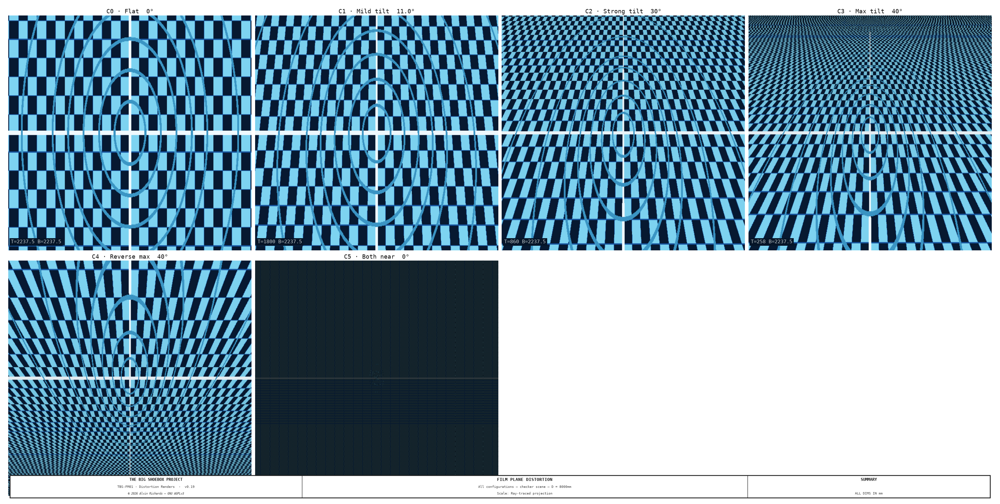

A detailed analysis of the optical distortions can be found [here](distortion-renders.md#1-film-plane-distortion-renders).

---

## 7. Parts List

See the **[Master Shopping List, filtered to the film-plane system](master-shopping-list.md?system=film)** for the same parts with suppliers, current prices, and click-to-sort/filter.

*The wall-seat saddle design (ICP-11–14) is described below; all film-plane hardware is in the Master Shopping List linked above.*

### 7.1 Wall-Seat Saddles

Each of the **8 rail ends** anchors to the container — **4 of them** with a standalone **IBC-style wall-seat saddle** (a back-plate + horizontal seat the rail end rests on + triangular gusset, dims reused from the IBC frame wall seats, **through-bolted with a 4-bolt pattern to an exterior wall plate**), and **the 2 bottom-right ends (BR, near + far)** with a **combined corner plate shared with the right walkway** (see below), and **the 2 far-left ends** on the pivot post (the rear-corner attachment, §4.4). The container shell carries the lateral rigidity, so no cross-cage is needed. The wall is one 1.6mm corrugated sheet, so every wall through-bolt (M12×70 on the saddles, M12×75 on the far-left flanges) carries a steel **crush sleeve** (1in OD × 0.188in wall) that fills the corrugation hollow behind the exterior plate; without it the bolt preload would collapse the corrugation. Each sleeve is cut to the hollow measured on the purchased container (the shared detail and check are in [Walkway §3.1](walkway-report.md#31-cantilever-bracket-design)). The saddles cost ~110mm of carriage travel at each end, which the design does not need. The rails run the full width **saddle-to-saddle** (Yd 0 → C_WID).

**Right vs left.** The **right** rails (TR + BR) are **permanently bolted** into place. Each **left** rail (TL + BL) is split near the pivot post: a fixed **stub** (about 272mm) stays anchored at the pivot post and far wall, and the **removable section** (about 2,090mm) drops into its near-wall saddle on **knurled thumb screws** and onto the stub through a welded bridge and locating pin (Sheet 4). The removal section is to allow the hinge panel to swing for transportation.

**Combined corner plate.** At each bottom-right corner (near and far) the film plane and the right walkway terminate at the same wall station, so a single **10mm combined corner plate** seats both — the **bottom film rail (BR) on a 150mm seat** and the **right walkway long beam on a 70mm seat** — bolted through the wall with a shared interior/exterior plate pair. The BR rail has **no separate wall-seat saddle** at these corners. The plate is single-sourced in the overview generator (`fp_combined_corner_plate`) and reused by both the film-plane and walkway 3D models; the film-plane model draws the combined plate at the BR corners. See [Walkway Report](walkway-report.md) §4.3.

**Transport mode.** The light lock is offset and exits through the hinge-panel punch-out bay rather than rotating within the rail span. For *transport*, the panel + drum **SWING ~56°** about the pivot and the drum cage sweeps through X = 260, so the **two left film rails (TL + BL) and the muslin screen are struck first** — the removable sections lift out of their thumb-screw saddles and off the stubs, and re-seat to the film datum on re-deployment — see [Hinged Panel Report](hinged-panel-report.md) §5.4 for the conversion sequence.

*Quantities: 8 rail ends = 4 standalone saddles (BL-near, TL-near, TR-near, TR-far) + 2 combined corner plates (BR, carried in the walkway BoM) + 2 far-left flange brackets on the pivot post. Each saddle: 1 back-plate + 1 exterior plate + 1 seat + 1 gusset (8mm plate) + 4× M12 through-bolts. Hold-downs: thumb screws on the 2 left saddles, hex fixing bolts on the 2 TR saddles.*

### 7.2 Muslin Clamp System

The muslin is cut to the **washable tray area** (<!-- BEGIN fact:muslin_cut_width_mm -->4,249<!-- END fact:muslin_cut_width_mm --> × <!-- BEGIN fact:muslin_cut_height_mm -->2,000<!-- END fact:muslin_cut_height_mm -->mm) — **smaller than this 4,389 × 2,094mm frame** — so its edge sits ~70mm inside the frame's L-channel and is clamped **inboard on the ACM face** rather than captured in the channel (a field detail). The tray, not the frame, sets the muslin size — see [Processing Tray report §2.8](processing-tray-and-spray-bar.md).

See [Muslin Clamp System — Mechanism Design](film-clamp-mechanism-report.md) for the full clamp specification, parts list, and engineering drawing.

**Estimated materials total (incl. wall-seat saddles): ~<!-- BEGIN costing:film-total -->$3,907<!-- END costing:film-total -->**
*Excludes fasteners and fabrication labor.*

### 7.3 Local SoCal Metal Sourcing

- **Metal Supermarkets** — Anaheim (714-630-8463), Van Nuys (818-988-1301), San Diego (619-280-7600). Cut-to-length 304 flat bar and aluminum angle on-site, no minimum order.
- **Grimco** — City of Industry, CA. Sign-industry ACM panel supplier, large sheet stock.
- **McMaster-Carr** — 304 shaft supports, acetal rollers, 304 axle rod and cam clamps; ships nationally.
- **Grainger** — the 3×1½" 6061-T6 U-channel depth rails (795M51, 8 ft sticks cut to the wall-to-wall length) and the Belden U-joints; branches throughout LA, Orange County and San Diego, same-day pickup.

---

## 8. Maintenance

The mechanism runs **dry**: the acetal skates and UHMW slide pads take no lubricant, so grit on the rails — not lubrication — is the wear driver. The wear and expendable parts are the acetal rollers, the UHMW pads, the U-joint boots and the plain-6061 frame angle (bare 6061 pits sooner than anodized); the cam clamps hold a set position through transport. The recurring inspection schedule is in the [Operating Manual — Maintenance](operating-manual.md#maintenance).

---

## 9. Source References

1. [Grainger 795M51 Aluminum U-Channel](https://www.grainger.com/product/795M51) — 3×1½" (76×38mm) 6061-T6 Al U-channel, the depth rail the acetal skate runs in.
2. [Belden SSNBUJ750x3/8KB Universal Joint](https://www.grainger.com/product/BELDEN-Universal-Joint-Stainless-41D816) — single universal joint, 3/8" bore, stainless needle-bearing, 45° per axis — the per-corner tilt+swing joint (factory-booted, integral bellows).
3. [Pinhole Disc Holder (Front Board) Report](pinhole-disc-holder-report.md) — Quick-change pinhole disc holder in the pinhole wall (fixed board; all movement is in the film plane).
4. [Equipment Layout Report](equipment-layout-report.md) — Rail positions and shadow-free zone verification.
