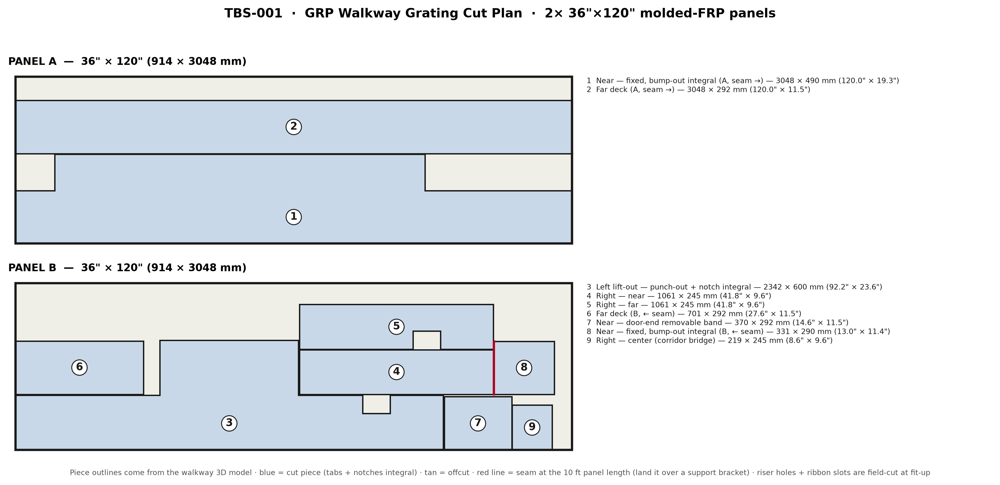

<!-- SPDX-License-Identifier: AGPL-3.0-only -->
<!-- © 2026 Alvin Richards -->
# GRP Walkway Grating — Quote Request

Working doc (unpublished) to send a vendor for a molded-FRP grating quote. Not a report.

## Product spec

| Attribute | Value |
|-----------|-------|
| Type | Molded fiberglass (FRP/GRP) grating |
| Grid height | **1″** |
| Mesh | **1½″ × 1½″ square** |
| Resin | **Vinyl-ester** (chemistry-zone corrosion) |
| Surface | **Grit top** (non-slip) |
| Weight | ~2.6 lb/ft² |
| Open area | ~70% |
| Reference SKU | McNichols **MS-S-100** (vinyl-ester = SVF/XVE) · American Grating equivalent |

## Pieces and panels — **2× 36″×120″** ($415 ea = **$830**)

Nine pieces. Each outline comes from the walkway 3D model, with the integral features kept in one piece (near-deck bump-out, left drum-exit punch-out, muslin notches). The near fixed deck and the far deck are longer than a 10 ft panel, so each has one seam at 120″, landed over a support bracket. The cut plan nests all nine on two panels; its key lists every piece size in mm and inches.

## Also
- Edge treatment: **Fibergrate Sealing & Bonding Kit** (~$50) — molded FRP cut edges are field-sealed with epoxy, not snap-trimmed.
- Hold-down: 30× SS grating clips (`walkway-holddown-clips`, separate).
- Drum-exit punch-out: integral to the left lift-out piece, nested on Panel B.
- **Pipe-clearance cutouts (field-cut + edge-sealed):** the right-walkway deck carries **3 ribbon slots** (~128 × 32 mm, across the 4 lanes, at the pinhole-end drop / loop-over rise / corridor drop); the near-walkway deck carries **3 round riser holes** (Ø32–Ø36 — tray-sump→P-04, TAP-01 fresh-water branch, BV-05 fresh-supply trunk) — see walkway Sheet 3 + Sheet 9 for locations. These are small clearance cuts within already-nested pieces (no effect on the sheet count); seal their cut edges with the same kit.

## Vendors
- **McNichols** — 877.891.7418 (quote-only, no public pricing)
- **American Grating** — public pricing, identical spec: https://www.americangrating.com/products/1-deep-x-1-12-square-mesh-molded-frp-grating__i-10.aspx
