<!-- SPDX-License-Identifier: AGPL-3.0-only -->
<!-- © 2026 Alvin Richards -->
# Hinged Light-Trap Panel

## 1. Purpose

TBS-001 requires a light-tight seal at the cargo door end of the container that
simultaneously allows personnel access during operation without admitting daylight.
The hinged light-trap panel fills both roles: it seals the full <!-- BEGIN fact:container_width_mm -->2,362<!-- END fact:container_width_mm --> × <!-- BEGIN fact:container_height_mm -->2,388<!-- END fact:container_height_mm -->mm
cargo door opening as a rigid structural panel, and incorporates a revolving drum
light trap that permits operators to enter and exit the darkened interior at any
time without opening the panel or breaking the light seal. In case of emergency, or to easy loading and unloading of materials, the whole hinged panel can open fully, being locked from the inside.

**Sheet 1 — Front Elevation (1:20): Panel Dimensions, Drum, Hinges, Latches (interior face)**
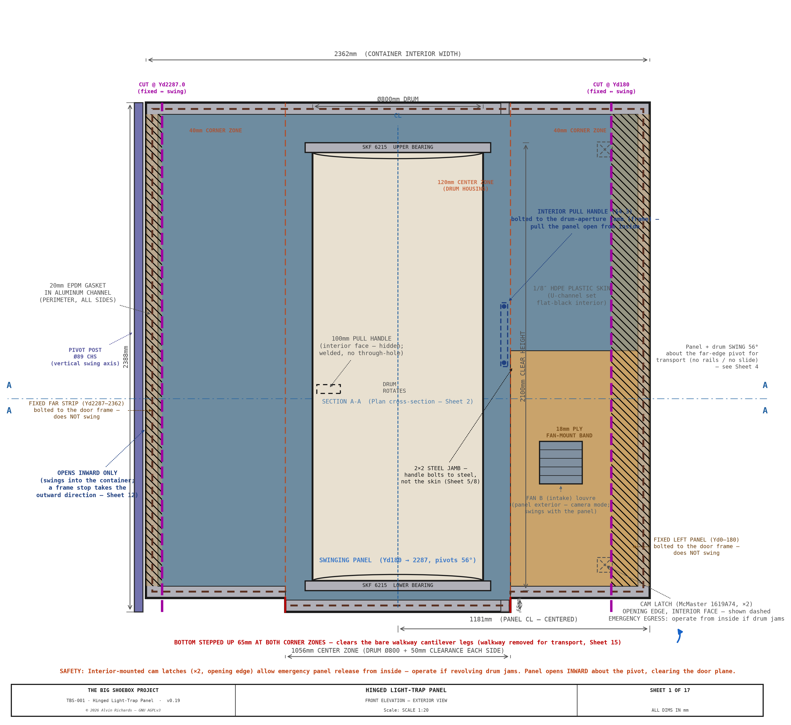

**Design goals:**

- 100% light exclusion — no straight-line optical path from exterior to interior
- Single-operator personnel access at any time during exposure
- Inward swing (into the container, about the Ø89 pivot) for full-width loading access (IBC totes, equipment) — the panel opens inward only; a frame stop takes the outward direction
- ~<!-- BEGIN fact:panel_swing_deg -->56<!-- END fact:panel_swing_deg -->° transport swing about the Ø89 pivot post — carries the B2 punch-out bay inboard of the ISO container doors (clears the closed-door inner face by +<!-- BEGIN fact:swung_door_clearance_mm -->29<!-- END fact:swung_door_clearance_mm -->mm) + hardware
- Emergency egress operable from inside without tools
- Weatherproof for outdoor field deployment (IP44 rated seals)
- Single-person mode conversion (~10 minutes)

<!-- brochure:skip -->
**Interactive 3D model** — the revolving light-trap drum, hinged stepped panel, Ø89 swing pivot, fixed door frame, and Fan B. Drag to orbit, scroll to zoom.

  

    <iframe title="TBS-001 Lighttrap Model" frameborder="0" allowfullscreen mozallowfullscreen="true" webkitallowfullscreen="true" allow="autoplay; fullscreen; xr-spatial-tracking" execution-while-out-of-viewport execution-while-not-rendered web-share src="https://sketchfab.com/models/a4f73191b8bb4d17a6e764585ca695be/embed" style="position:absolute;top:0;left:0;width:100%;height:100%;border:0;"></iframe>
  

  
<a href="https://sketchfab.com/3d-models/tbs-001-lighttrap-model-a4f73191b8bb4d17a6e764585ca695be?utm_medium=embed&utm_campaign=share-popup&utm_content=a4f73191b8bb4d17a6e764585ca695be" target="_blank" rel="nofollow" style="font-weight: bold; color: #1CAAD9;">TBS-001 Lighttrap Model</a> by <a href="https://sketchfab.com/alvin91403?utm_medium=embed&utm_campaign=share-popup&utm_content=a4f73191b8bb4d17a6e764585ca695be" target="_blank" rel="nofollow" style="font-weight: bold; color: #1CAAD9;">alvin91403</a> on <a href="https://sketchfab.com?utm_medium=embed&utm_campaign=share-popup&utm_content=a4f73191b8bb4d17a6e764585ca695be" target="_blank" rel="nofollow" style="font-weight: bold; color: #1CAAD9;">Sketchfab</a>

<!-- brochure:endskip -->

---

## 2. Panel Construction

### 2.1 Stepped Profile

The panel has three thickness zones to accommodate the revolving drum in the center
while keeping the corners flush with the container walls.

**Sheet 2 — Plan Cross-Section (1:10 horiz / 1:1 depth): Housed Revolving Door — Housing, Drum & Light-Tight Geometry**
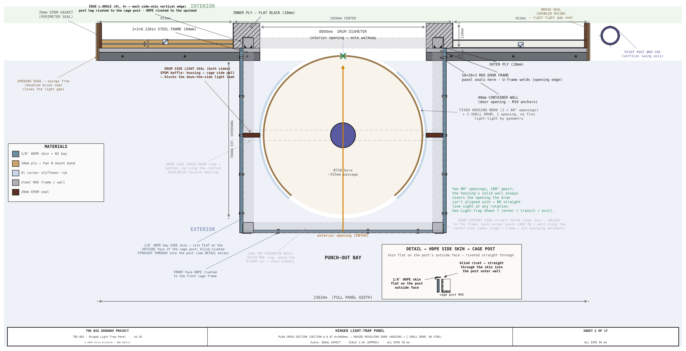

| Zone | Width (mm) | Thickness (mm) | Construction |
|------|--------------|-----------|---------------|-------------|
| Near corner | 653 | 40 | 1/8" HDPE skin + 1"×1"×⅛" 6061 Al stiffener grid + 1/8" HDPE skin (40mm framed); **18mm-ply Fan-B mount band** bottom→1,225mm |
| Center | 1,056 | 120 | 1/8" HDPE skin + 84mm RHS frame + 1/8" HDPE skin |
| Far corner | 653 | 40 | 1/8" HDPE skin + 1"×1"×⅛" 6061 Al stiffener grid + 1/8" HDPE skin (40mm framed) |

The 80mm step between corner and center zones to locate the
light-trap housing; the corner zones are
flush-faced panels that seal against the fixed door frame.

### 2.2 Frame

| Parameter | Value |
|-----------|-------|
| Frame material | 50 × 50 × 3mm RHS mild steel |
| Outer dimensions | <!-- BEGIN fact:container_width_mm -->2,362<!-- END fact:container_width_mm --> × <!-- BEGIN fact:container_height_mm -->2,388<!-- END fact:container_height_mm -->mm |
| Skin (each face) | **1/8" HDPE plastic sheet** (same material as the drum/housing), set in U-channels — black-pigmented, light-tight, moisture/chemical-proof. **Exception:** an 18mm exterior-grade plywood band on the Fan B corner (bottom up to 1,225mm) for rigid fan/duct mounting + screw retention |
| Interior finish | Black-pigmented sheet (HDPE) + flat-black touch-in — optically dead at visible wavelengths |
| Frame perimeter | Welded corners, mitered joints |
| Panel weight (full panel: skins + Ø800 housing + B2 bay, excl. drum) | ~139 kg (first-principles: 96 kg framed skins + 22 kg housing + 21 kg B2 bay). See §2.4–2.5 for the movable breakdown + trade study |

**Sheet 8 — Steel Frame General Arrangement (interior front elevation): member sizes, weld schedule, corner detail**
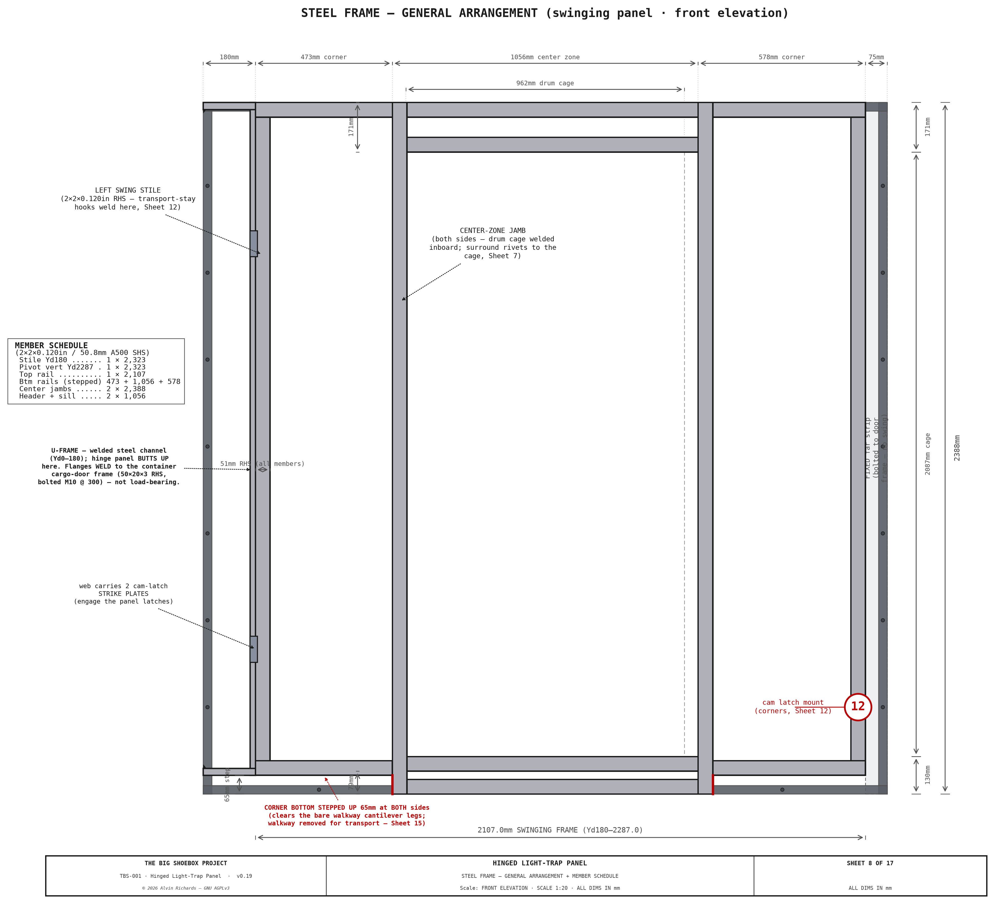

**Sheet 9 — Steel Frame General Arrangement (exterior mirror): fastener/hardware face**
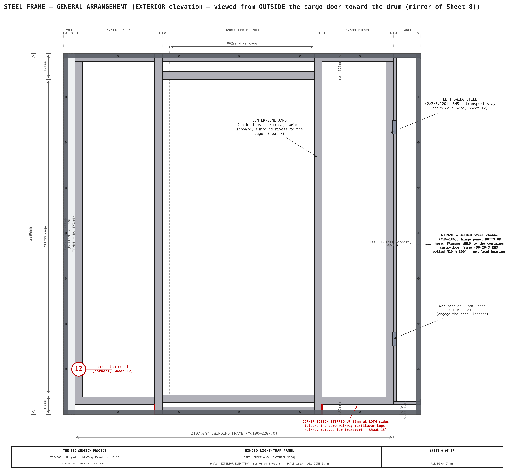

**Sheet 13 — Plywood → Frame Attachment (enlarged): welded tab + captive tee-nut**
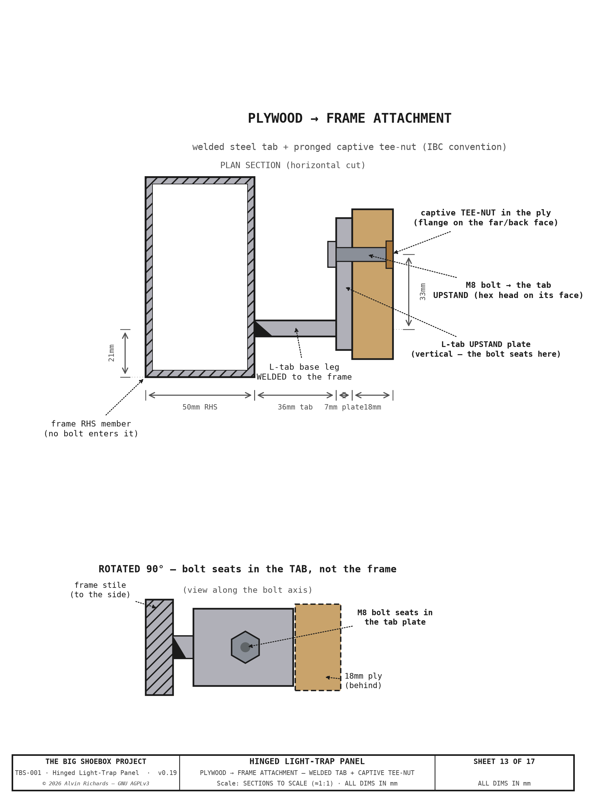

### 2.3 Perimeter Seals

A 20mm closed-cell EPDM compression gasket runs the two **vertical** edges of the panel,
seated in an extruded aluminum channel, and compresses against the fixed welded door
frame (50 × 50 × 3mm RHS) when the two opening-edge cam latches engage. The **top and bottom** edges
are **nylon strip-brush** light seals instead (§6, paths #3/#4): because the panel edge
**sweeps sideways** through the seal as it swings, a brush passes the edge through cleanly
where a compression EPDM would drag and deform. Together they give a light-tight seal on
all four sides.

A **second** 20mm EPDM gasket — the **housing-surround seal** — runs as a ring around
the Ø800 light-trap housing aperture. Because the housing is **fixed** (only the drum
rotates inside it), this gasket seals the fixed surround to the frame independently of
the moving panel, all the way around the opening the housing passes through. It sits in
the same exterior door plane, concentric inboard of the panel-perimeter seal (see
§6, light-path #8).

### 2.4 Movable-Panel Weight Breakdown

The transport scheme swings the panel + drum ~<!-- BEGIN fact:panel_swing_deg -->56<!-- END fact:panel_swing_deg -->° about the vertical Ø89 pivot, so
the **movable assembly** is everything that rotates about that pivot. The breakdown
below is first-principles from the geometry constants (reproducible via
`src/generators/generate_movable_panel_weight.py`); it isolates the swing zone
 and deducts the Ø800 housing aperture from the center skins, so it
is slightly lower than the whole-panel figure carried in the
[Weight Distribution Report §3.2](weight-distribution-report.md).

| Group | Component | Construction | kg |
|-------|-----------|-------------|---:|
| **A · Skins + frame** | Fan B mount band | 18mm ply, 0.47m × 0.99m, 2 faces | 10.2 |
| | HDPE corner skins | 1/8" HDPE (near above band + far) | 12.3 |
| | Corner Al stiffener grid | 1×1×1/8 6061 angle | 2.8 |
| | Center RHS frame | 2×2×0.120in steel SHS, 11.1m | 49.2 |
| | HDPE center skins | 1/8" HDPE, Ø800 aperture deducted | 11.4 |
| | **A subtotal** | | **85.9** |
| **B · Housing** | HDPE shell + steel flange/hub | Ø800×3/16", two 80° openings | 21.8 |
| **C · Drum** | HDPE C-shell (1/8") + 8mm Al caps + Ø75 shafts + 2× SKF 6215 + stiffeners + pull handle | Ø764 | 35.9 |
| **D · Bay** | B2 punch-out bay walls | 1/8" HDPE, 4-wall tube 0.89m deep | 20.8 |
| **E · Cage** | Drum support cage frame | ~25×25×3 angle, 16.1m box | 16.1 |
| **F · Seals** | Vertical perimeter + housing EPDM + top/bottom strip brush + drum wipers | 20mm foam + strip/felt brush | 2.7 |
| **G · Latches** | Cam latches (2) | ~0.5 kg each | 1.0 |
| **H · Pivot (rotating)** | Thrust/journal bearings + collar/hub | carries leaf at pivot | 13.0 |
| | **MOVABLE TOTAL (carried-rotating)** | | **≈197** |
| | *+ transport-only locks (stays + 4 saddles)* | engaged only when swung | +10 |

**By material:** steel 103 kg (52%), HDPE 79 kg (40%), aluminum 3 kg (1.4%),
plywood 10 kg (5%, Fan B band only), EPDM/other 3 kg. (All light-lock plastic —
skins, drum, bay, housing — is now one weld-compatible HDPE.)

**Findings.** The largest remaining single item is the **steel center
RHS frame (49 kg)** — the structural spine carrying the drum — which is the only
meaningful target left (§2.5). Because the swing axis is **vertical**, this mass
produces **no gravity overturning torque** at any swing angle; it matters for the
thrust-bearing/pivot-post sizing, for handling during assembly (still beyond a
two-person lift — an engine crane or gantry hoist is required), and for total
container payload.

### 2.5 Weight-Reduction

Black-pigmented HDPE
is light-tight (proven on the drum), moisture- and chemical-proof in the wet darkroom,
and floats in its channel to absorb its higher thermal expansion. A tighter stiffener-
channel grid (~400–450mm centers) keeps the floppier 1/8" sheet flat at the EPDM seal
line. **One exception:** the Fan B corner keeps an **18mm plywood band** (bottom up to
1,225mm) for rigid fan/duct mounting + screw retention. The panel sits at **~139 kg**. The HDPE
skin + 1"×1"×⅛" Al stiffener grid + U-channel envelope is moisture/chemical-proof,
light-tight, and weld-sealed (same material and weld process as the drum/housing); it
costs more than a plywood build (see the Cost Summary, §8).

**Sheet 11 — Fan-B Mount Band: Fabrication (fan cutout, fan/duct bolt pattern, frame-tab tee-nut holes)**
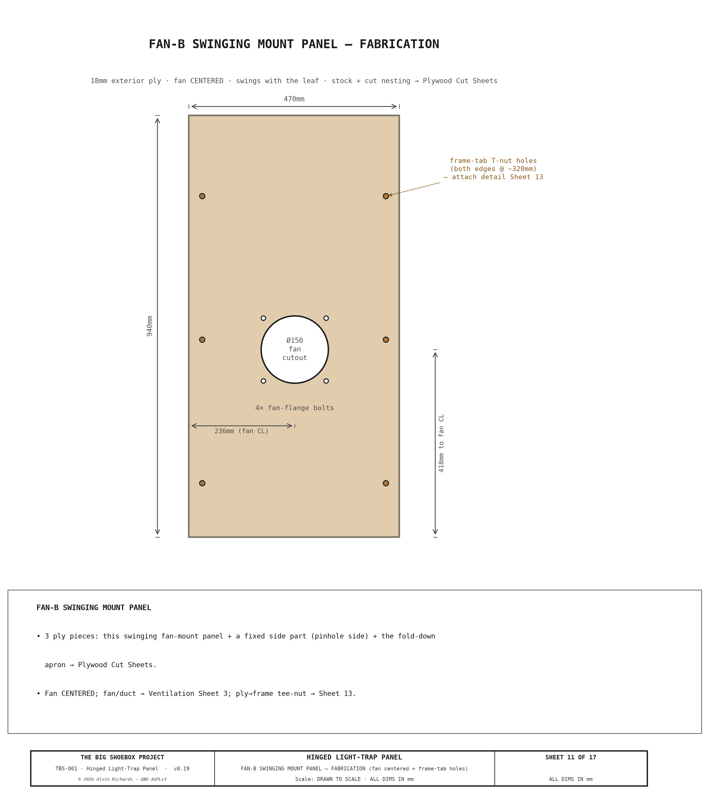

The band's plywood stock and cut nesting are single-sourced on the
[Plywood Cut Sheets](plywood-cut-sheets.md) — it is cut, with the corridor and pinhole-wall
panels, from the shared 18mm exterior sheets rather than a dedicated sheet.

### 2.6 HDPE Surround Fabrication

The center-zone HDPE surround — the skin that wraps the Ø800 light-trap housing and the
forward B2 punch-out bay — is a corner-welded 1/8" HDPE assembly of six pieces: the two
center-zone panel-face skins (carrying the personnel light-lock opening), the two bay
side walls, and the upper and lower floor/roof caps. The caps are **plain plates (no
cut-out)**: each sits on the **outside** of the top/bottom frame beams and **blind-rivets to
them**. The Ø800 housing **outer skin** extends to the beam outer faces (see the
[Light Trap Selection](light-trap-selection.md) Sheet 9), and its top/bottom edge **butts the
cap underside**, sealed by a **silicone caulk bead** (no weld, no neoprene). The
surround is fastened to the **drum cage** (50×50×3 RHS) by a **lapped, blind-riveted joint**
— the HDPE laps the cage posts/rails (front + side faces) and is set with 1/8" 18-8
stainless blind rivets on a regular pitch, with a DP8010 sealant bead along the lap for
light-tightness. Because the **cage is welded into the panel top/bottom rails** (one
weldment), riveting to the cage ties the surround to the panel structure — it is not a
floating skin. The same rivet family is used on the light-trap shell.

The flat-pattern cut sheets for all six pieces are **Sheet 6**; the housing-join and
frame-rivet lap sections are **Sheet 7**. The housing cut geometry is shared with the
[Light Trap Selection](light-trap-selection.md) housing sheet so the surround↔housing
interface stays single-sourced.

**Sheet 6 — HDPE Surround Flat-Pattern Cut Sheets (6 pieces)**
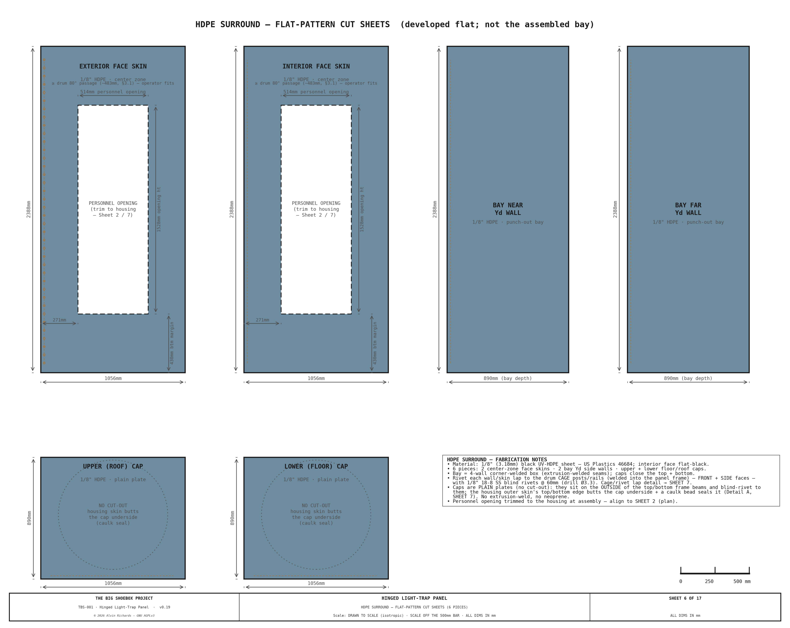

**Sheet 7 — HDPE Surround: Housing Join & Frame Rivet Details**
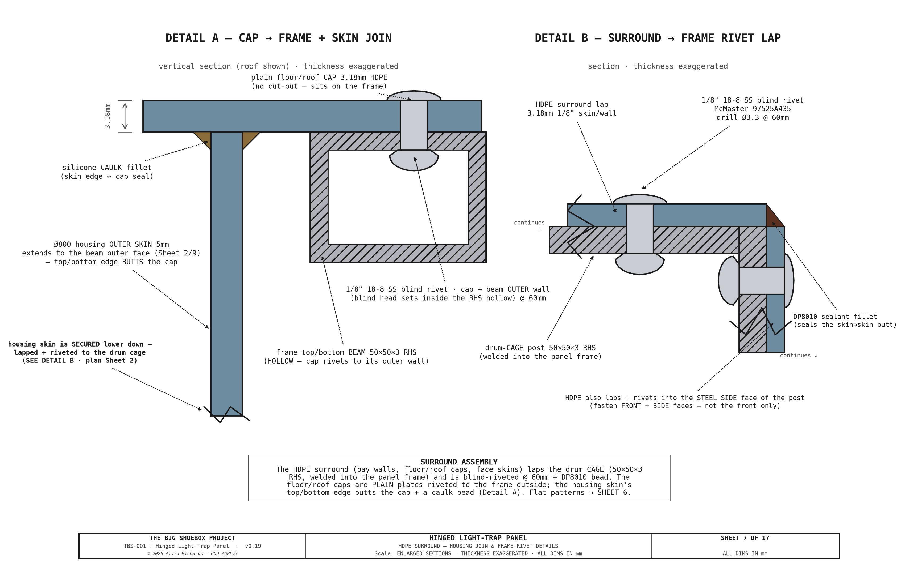

---

## 3. Housed Revolving-Door Light Lock

> The light lock is  a
> **fixed cylindrical housing + single-opening C-shell drum** — the standard
> commercial-darkroom-door arrangement — sized for a single operator.

**Sheet 3 — Drum Vertical Section Elevation (Section A-A): Walking-height orientation confirmation + Details B & C (panel bottom & top light seals)**
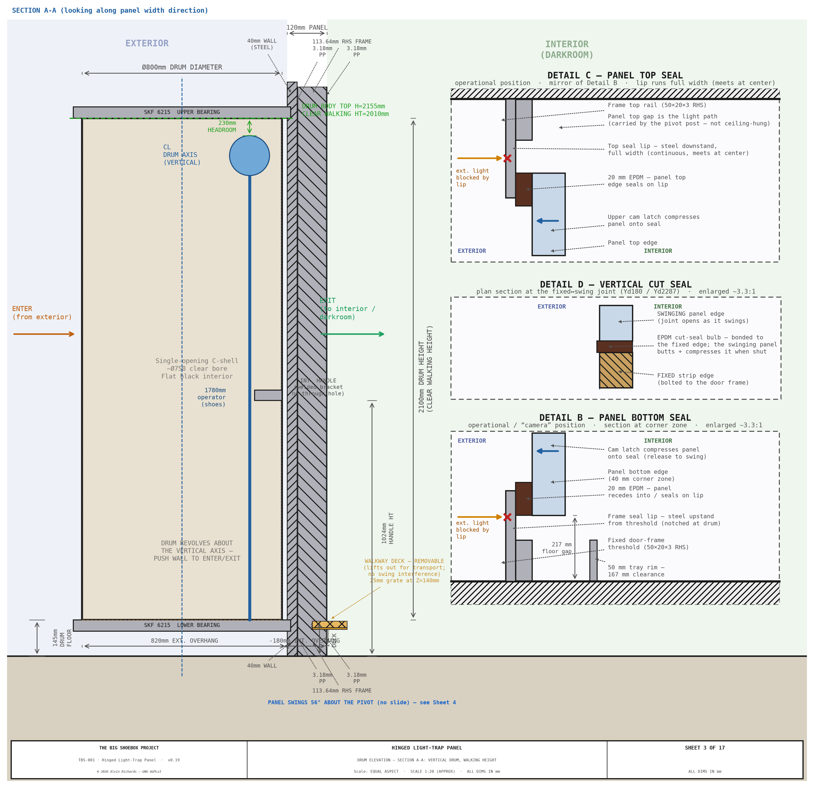

### 3.1 Specification

| Parameter | Value |
|-----------|-------|
| Type | Fixed cylindrical housing + single-opening C-shell revolving drum (no internal fins) |
| Housing outer diameter | Ø800mm (fixed, built into the panel center zone) |
| Housing openings | Two, **80° arc each, 180° apart** — one facing exterior, one facing the interior/walkway |
| Drum (rotating) | Ø764mm C-shell, single 80° opening, **~Ø758mm clear bore** |
| Passage width | **~487mm** (the 80° opening) — single operator, sideways entry |
| Height | Cap top at 2,100mm AFF (cage/beam top 2,217mm); see [Light Trap Selection](light-trap-selection.md) §3 |
| Mounting | **Carried with the panel** — panel bottom rides at the 217mm floor gap; the drum-cage underside hangs clear of the fixed floor-leg walkway posts + tray rim as it swings. Operator steps up from the walkway deck into the drum. |
| Wall thickness | 5mm (3/16in) UV-HDPE housing (LT_HOUSING_T) + 1/8" HDPE drum (LT_DRUM_T) — rolled and extrusion-welded plastic skin; opening edge-stiffened |
| Interior finish | Black-pigmented sheet + flat-black touch-in at welds (no etch-prime) |
| Exterior finish | UV-stabilized black/gray sheet — inherent, no primer |
| Clear walking height | 1,883mm clear interior |
| Internal baffles | **None** — light-tightness is by the fixed-housing geometry (§3.3) |
| Weight | housing ~22 kg + rotating drum ~36 kg = **~58 kg** (plastic skin, ≈59% of the 3mm-aluminum ~99 kg; the steel shaft/bearings set a floor the shell mass can't drop below) |

### 3.2 Bearings

| Item | Specification |
|------|--------------|
| Bearing model (×2) | SKF 6215-2RS1 sealed deep-groove ball bearing |
| Bore | 75mm ID, 130mm OD, 25mm wide |
| Clearance | C3 |
| Radial load rating | 52.7 kN (basic dynamic C) |
| Operating temperature | 0–120°C |
| Stub shafts | 75mm Ø × 150mm steel, bolted through an isolated steel hub to the aluminum drum caps (dissimilar-metal joint) |
| Axial retention | Circlip on stub shaft each side |
| Upper mount | Aluminum housing top ring bolted to panel top rail (6 × M10 SS, nylon-isolated) |
| Lower mount | Steel floor collar bolted to panel bottom rail (8 × M10 SS) — no weld |
| Bearing housing height | 45mm (each) |

### 3.3 Light Path Verification

The light lock is light-tight **by geometry**. The fixed housing has two openings
(one facing the exterior, one facing the interior/walkway), each **80° of arc and
180° apart**; the rotating drum is a C-shell with a **single 80° opening and no
internal fins**. Because each opening is narrower than 90° and the two housing
openings are 180° apart, the drum opening can never align with both at once — the
housing's solid wall always covers whichever opening the drum opening is *not*
facing. So at **no rotation angle** is there a straight-line path from exterior to
interior: daylight entering the bore through the exterior opening is stopped by the
drum's solid wall before it can reach the interior opening.

See [Light Trap Selection](light-trap-selection.md) §5 and **Light-Trap Sheet 7**
(enter / transit / exit verification).

### 3.4 Drum Seals

| Location | Seal method |
|----------|------------|
| Top | 12mm closed-cell neoprene wiper ring bonded to drum top cap + silicone bead against ceiling mount plate |
| Bottom | 12mm closed-cell neoprene wiper ring bonded to drum bottom cap + silicone bead against floor mount plate |
| **Drum↔housing rotating seal** | Felt/brush wiper strips on the two vertical edges of the drum opening sweep against the housing inner wall as the drum turns, blocking light leaking around the opening; top + bottom felt wiper rings close the ~15mm annular running gap |
| Housing-to-panel gap (top/bottom caps) | The floor/roof caps are **plain plates** riveted to the **outside** of the top/bottom frame beams; the housing **outer skin** extends to the beam outer faces and its top/bottom edge **butts the cap underside**, closed by a **silicone caulk bead** — no weld, no neoprene (Sheet 7 Detail A) |
| Weather rating | IP44 (splash and rain protection) |

### 3.5 Handle

An off-the-shelf 12″ (308mm) round pull handle ([McMaster 1871A65](https://www.mcmaster.com/1871A65/),
Ø0.5″ bar, 2.06″ standoff) is mounted on the interior face at 900mm height. It bolts (1/4″
screws) to a steel stile that spans and bolts to the two aluminum caps — no welds, and no
through-bolt penetration of the drum wall on the exterior face, so the pull load lands in the
structural caps and no light leak path is created. The operator enters by pushing the bare
exterior drum wall, then uses the interior pull handle to pull the drum closed and brace during exit.

### 3.6 Access & Light-Tightness Verification (both tests pass)

**Light-lock access & light-tightness verification** (see Light-Trap Sheet 7)
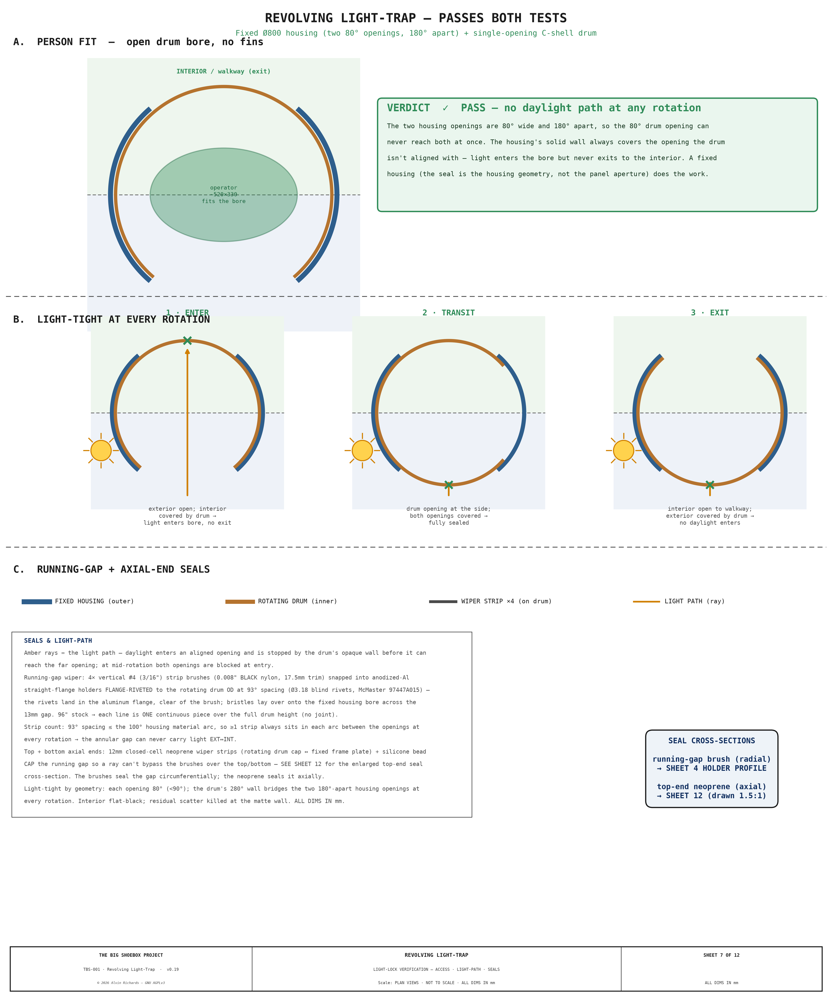

**1. Does a person fit? — Yes.** The drum is a
single-opening C-shell, so the whole **~Ø758mm bore** is clear standing space. The
80° opening gives a **~487mm passage** (sideways entry), enough for a single operator to enter and
turn inside. Emergency egress remains the whole panel swinging open.

**2. As the drum rotates, can daylight enter? — No.** The fixed housing's two 80°
openings are 180° apart, so the 80° drum opening can never reach both at once: at
**enter** the exterior opening feeds the bore but the interior opening is covered by
the drum's solid wall; at **transit** both housing openings are covered; at **exit**
the exterior opening is covered. There is no straight-line path at any angle.

---

## 4. Hinges and Latches

### 4.1 Hinges

| Parameter | Value |
|-----------|-------|
| Type | Vertical **Ø89×8 CHS pivot post** (the reused film-plane far-left upright) on a thrust collar + top/bottom hub bearings — **STRUCTURAL SIGN-OFF REQUIRED** |
| Quantity | 1 post (carries the full bay + housing + drum swing cantilever, ~3.6 kN·m, SF ~3.7 in S355) |
| Position | Far-left panel edge |
| Mounting | Post fixed top + bottom to the container end structure; the swinging frame rotates on the hub bearings (vertical axis ⇒ balanced at any angle, no gravity torque) |
| Swing | ~<!-- BEGIN fact:panel_swing_deg -->56<!-- END fact:panel_swing_deg -->° inboard to the transport position (locked by the top + bottom wall stays); swings clear of the door plane for personnel/equipment access |

The plastic-skinned drum/housing (LT_DRUM_T = 1/8" HDPE,
LT_HOUSING_T = 5mm (3/16in) UV-HDPE) keeps the added mass modest. Because the pivot axis is
**vertical**, the assembly is balanced at any swing angle — no gravity torque and no
free-edge sag, so no swing-support caster is needed. The **pivot post and its bearing + weld pattern require a structural
engineer's sign-off** before fabrication.

### 4.2 Cam Latches

| Parameter | Value |
|-----------|-------|
| Model | McMaster 1619A74 lift-and-turn cam latch |
| Quantity | 2 (both on the opening/free edge — top + bottom) |
| Positions | 210mm from the opening edge; 220mm and 2,168mm from floor (the pivot edge is hinged and needs no latch — a frame stop takes the outward direction) |
| Mounting face | **Interior** — deliberate safety design for emergency egress |
| Seal compression | Compresses EPDM perimeter gasket against fixed door frame |

**Emergency egress:** If the revolving drum jams and prevents normal egress, an
operator inside the container can release both interior-mounted cam latches
independently and push the panel open **inward** — it swings into the container about
the Ø89 pivot, clearing the door plane so the operator can step out. (The panel opens
**inward only**; a stop on the fixed frame takes the outward direction — §4.2 latches.)

### 4.3 Interior Pull Handle

A grab/pull handle is **through-bolted to the panel's structural frame on the interior
face** — the **left jamb of the drum aperture**, at waist height — so a single operator
can grip it and swing the heavy (~139 kg movable) panel open from **inside** the container,
both for the emergency-egress swing (§4.2) and to initiate the transport rotation (§5). It
bolts to the steel frame, not the HDPE skin. This is the **panel-swing** handle — distinct
from the drum-rotation pull handle inside the revolving light lock (owned by the
[Light Trap Selection](light-trap-selection.md) set); the two handles serve different
mechanisms and are drawn on their own blueprints.

| Parameter | Value |
|-----------|-------|
| Type | McMaster 1871A65 round pull handle (Ø12.7 bar, ~308mm grip, 52mm standoff) — the **same off-the-shelf part as the interior drum handle** |
| Mounting | Screwed into **1/4"-20 rivet-nuts** set in the near wall of the 50 × 50 × 3mm RHS frame jamb — the swing load reacts into the **steel** frame, not the HDPE skin (rivnuts because the 3mm tube wall can't be tapped and there is no back-access to a nut) |
| Position | Interior face of the **swinging** panel, on the **left drum-aperture jamb**. The transport swing pivots on the **far** edge (§5), so this near-of-center jamb keeps the operator's leverage while landing the load on frame steel right beside the drum (rather than the unbacked HDPE skin) |
| Finish | **Matte-black powder-coat** — the interior must stay optically dead (stray-light control for the pinhole), so the handle is not left bare/reflective |

See the [Master Shopping List](master-shopping-list.md?system=panel) for the part; the handle is also shown on the interior-face
**Sheet 1** front elevation.

**Sheet 5 — Interior Pull Handle: mounting detail (handle through-bolted to the RHS frame)**
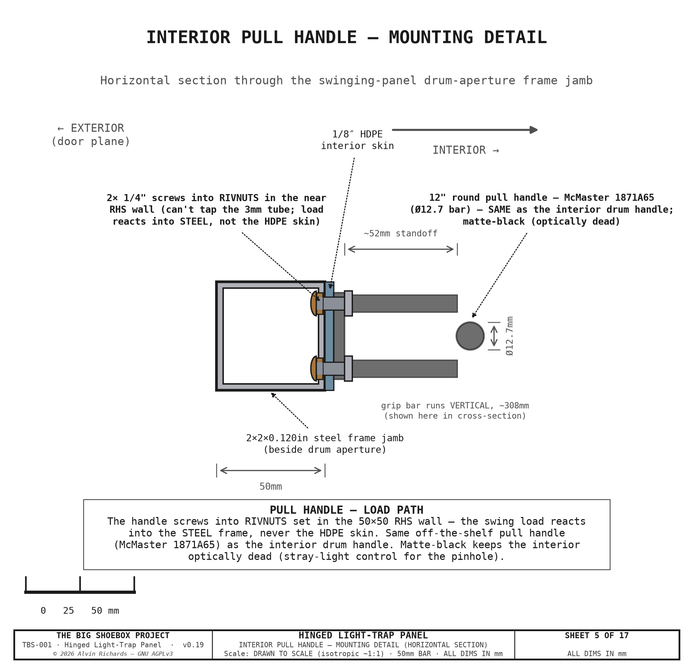

**Sheet 12 — Door-Frame Hardware: cam-latch keeper + brush-strip holder (two details)** — the transport lock formerly here is now on its own focused sheet (Sheet 17).
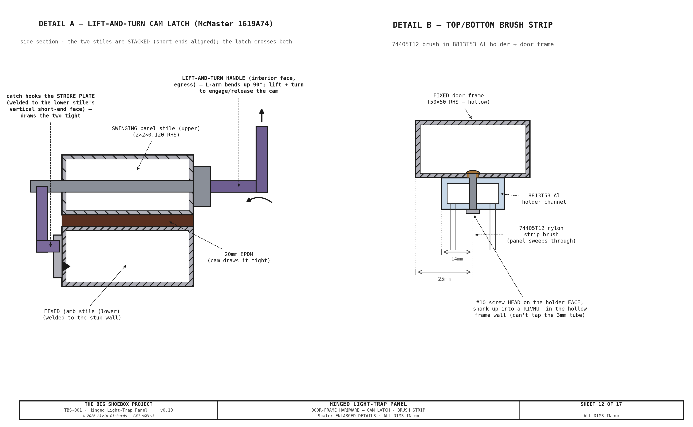

### 4.4 Emergency Egress — Path Clearance

The panel is the camera's egress route, and the left end zone it fronts is kept clear at
floor level. With the waste drums eliminated, no fixed equipment stands in the path, so the
open panel yields the **full container-width passage**
(<!-- BEGIN fact:container_width_mm -->2,362<!-- END fact:container_width_mm -->mm, 93") —
several times any walk-through or emergency-egress minimum. All fixed interior equipment —
the electrical panel, battery, pumps, and water lines — sits inboard of the door-end swing
sweep, so nothing fouls the panel's inward swing or narrows the clear floor (the
[container floor plan](equipment-layout-report.md) carries the positions). The revolving
drum is the normal light-tight entry and exit; if it jams, the whole panel swings inward as
the backup (§4.2).

---

## 5. Rotating Transport System

For transport the entire swinging assembly — the panel center section, the B2
punch-out bay, and the housing + revolving drum — **revolves ~<!-- BEGIN fact:panel_swing_deg -->56<!-- END fact:panel_swing_deg -->° about a vertical Ø89mm CHS
pivot post** (the reused film-plane far-left upright at the far panel edge). The swing carries
the bay's ~890mm exterior overhang from outside the cargo-door plane to inboard of it, so the ISO
doors close.

Two narrow strips stay fixed at the door plane and do **not** swing: the near strip
and the far strip. The cargo doors close outboard of the
fixed near strip.

To let the swinging cage cross the film-plane rail line, the **two left film rails
(top-left + bottom-left) lift out of their drop-in saddles** and the **left walkway + door-end
near-deck section lift out** before the swing; all are re-seated to datum afterward.

### 5.1 Panel Positions

**Sheet 4 — Rotating transport + swing clearance: panel swings <!-- BEGIN fact:panel_swing_deg -->56<!-- END fact:panel_swing_deg -->° about the pivot (camera vs swung), removable left rails**
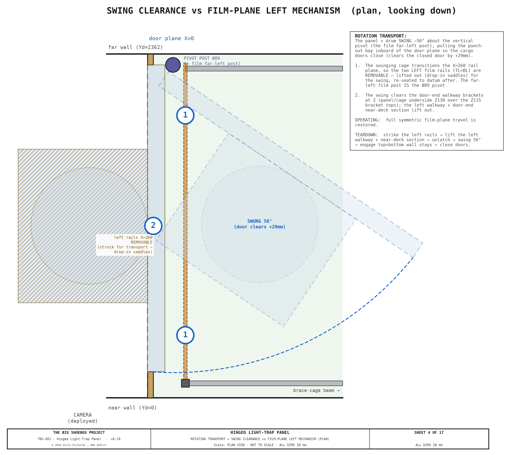

| Position | Bay front-right corner X | Container doors clear? |
|----------|-------------------------|----------------------|
| Operational (0°) | −890mm (bay protrudes ~890mm outside the door plane) | No — the cargo doors stay open during operation |
| Transport (swung <!-- BEGIN fact:panel_swing_deg -->56<!-- END fact:panel_swing_deg -->°) | +<!-- BEGIN fact:swung_door_clearance_mm -->29<!-- END fact:swung_door_clearance_mm -->mm clearance to the closed-door inner face (swept-frame min X 58.6mm − 30mm door-leaf inboard) | Yes — the swept frame is fully inboard of the closed door |

### 5.2 Locking

| State | Method |
|-------|--------|
| Operational (0°) | 2 × interior cam latches (§4, opening edge) compress the EPDM **vertical** perimeter + cut seals against the door frame; the top + bottom **strip-brush** seals are passive (always engaged, no compression) |
| Transport (swung <!-- BEGIN fact:panel_swing_deg -->56<!-- END fact:panel_swing_deg -->°) | Top + bottom **wall stays** — hook welded to the **swinging panel's left perimeter 2×2×0.120in steel SHS stile** (the steel frame member at the swing cut) ↔ eye on the near wall, tensioned by turnbuckle, forming a couple. Engaged after the swing, released before swing-back. |

> **Stay hooks land on steel, not the skin.** The transport-stay couple carries real tension, so both hooks weld to the **left perimeter RHS stile** of the swinging frame — *not* the 1/8" HDPE plastic skin. The perimeter stile is the farthest point from the pivot (best lever arm) and a continuous welded steel load path into the frame.

The complete transport lock is detailed on **Sheet 17** — the general arrangement, the **panel-side receiver lug** (a 12mm steel eye plate with a Ø17 clevis-pin hole, 6mm fillet-welded all round to the stile — the turnbuckle jaw clevis-pins here), and the **near-wall anchor** (a 150 × 150 × 12mm A36 plate pair bolted through the near wall with 4 × M16 on a 90mm square — the interior + exterior backing-plate pattern of the wall-hanger / cantilever joints, since the wall can't be welded to). The turnbuckle is a 5/8in jaw-eye galvanized unit (JETBGV58X6); lug/plate/bolt sizes single-source from `tbs_constants` (`LT_STAY_*`). Both ends are modeled in 3D — the panel receiver (`frame_hooks()`) and the wall anchor (`wall_anchors()`).

**Sheet 17 — Transport Lock: general arrangement + panel-side receiver lug + near-wall anchor**
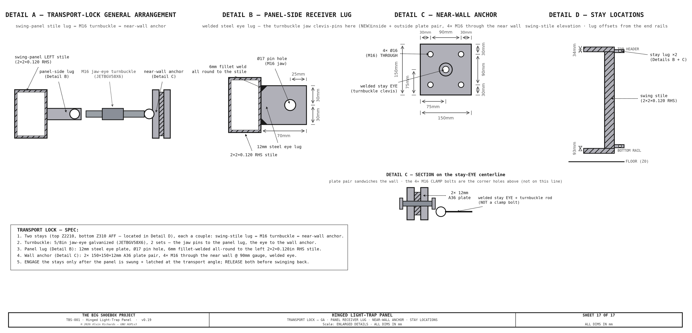

### 5.3 Floor Gap

The panel + drum cage ride at a **217mm floor gap**, carried by the pivot post on its
thrust collar + hub bearings. The gap is set by the **transport-swing clearance**: as the
panel + drum swing across the container, the drum-cage underside must clear the tallest fixed
obstacle in the swept path — the **LEFT walkway's floor-leg cantilever posts**, which stay bolted
during the swing and stand taller than the fixed processing-tray rim. The 217mm floor gap clears
the posts by **25mm** (and the tray rim by 70mm; the bottom axle beam uses a shallower section to
win 10mm of that from the lower hub without raising the drum), at a cost of 87mm of drum interior —
still clearing a 1,780mm operator by 103mm.

**Why the panel bottom is stepped (corner zones at 282mm).** The 217mm gap above is the *center*
zone, under the drum bay. The near/far **corner zones** of the panel bottom step **up** to **282mm**
(`PANEL_FLOOR_GAP_SIDE`) — a *separate* transport-swing clearance from the drum-cage gap. With the
walkway grate lifted out for transport, the panel corners swing over the **bare wall-cantilever
walkway-bracket legs**, which stand to ~200mm on the near/far side walls; the corner bottom is raised
to clear those legs with margin (≥50mm by design, 82mm as built — the swing is about the vertical
pivot, so any positive clearance over the leg top suffices). The center zone has **no** wall brackets
in its swept path, so it stays at the lower 217mm. The 65mm difference is `PANEL_BOTTOM_STEP`. (This
corner height sets the corner-zone apron height — it is the top of the removable pull-out strips
(Z282) — see §6.)

The swing is about a **vertical** pivot, so the cage underside stays at the same height throughout — this
is what makes the deep Ø800 housing transport-feasible without a slide; a floor-mounted housing
would have fouled the tray. The 217mm floor gap is closed in the operational position by the
**pull-out corner apron** (§6, **Sheet 16**). The clearance is drawn on **Sheet 15**
(transport-swing bottom-clearance section).

**Sheet 15 — Transport-Swing Bottom-Clearance Section (Yd–Z): drum-cage underside vs the fixed floor-leg posts + tray rim, walkway grate lifted out**
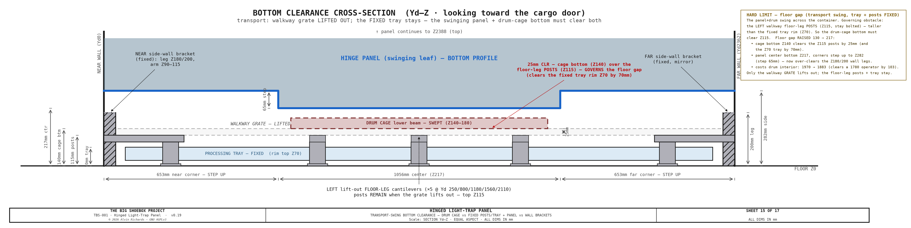

The gap would otherwise be a straight light path, so it is closed by the **pull-out corner apron**
(Sheet 16): a **fixed full-width base** (Z0–130, continuous across the door bottom, never moves) plus
two **removable pull-out strips** at the corner zones (near Yd0–653, far Yd1709–2162; Z130–282, 18mm
exterior ply). The drum-bay center (Yd653–1709) has no pull-out — the fixed base closes Z0–130 and the
drum's own vertical cage seals the center Z130→217. Each strip locates in a 45° chamfer in the base at
the bottom (ext-low → int-high, so it gravity-seats exterior-down) and butts a flat ply **lip cleat** lapped
on the leaf's exterior face at the top (this cleat is batten **B1**); **1590A13 draw latches** hold the strip —
four per strip: two **bottom** latches on the interior face (one at each strip end) clamp it down onto the chamfer seat, and two **exterior span** latches (one at each strip end) bridge B1 and a second coplanar ply batten **B2** (added to the strip's exterior face) to clamp the strip up to the leaf/lip — on the door side, so nothing projects into the darkroom and the film-plane beam (which an interior top latch fouled) stays clear (Sheet 16 Details D–F). The apron ply cuts from
the SYP sheets A–C ([Plywood Cut Sheets](plywood-cut-sheets.md)), so it buys no sheet of its own. In
operation the strips are latched in and seal; for the transport swing the draw latches are released and the strips lifted out —
they are simply **absent** while the leaf sweeps (no fold arc), and stow strapped flat inside the container.
This sidesteps the clearance conflict a fixed apron hits: a fixed apron reaching the seal plane would sit
in the leaf's horizontal sweep and block it, whereas the removable strip is gone during the swing.

### 5.4 Transport Conversion Sequence

The rotation transport + swing clearance vs the film-plane left mechanism is shown in
**Sheet 4** (above): the panel + drum swing ~<!-- BEGIN fact:panel_swing_deg -->56<!-- END fact:panel_swing_deg -->° about the pivot, pulling the bay inboard of
the door plane (clears the closed-door inner face by +<!-- BEGIN fact:swung_door_clearance_mm -->29<!-- END fact:swung_door_clearance_mm --> mm); the two left film rails are struck (removable) so the
swinging cage transitions the film-plane rail plane, then re-seat to the film datum.

The swing carries the drum cage through the **film-plane rail line**, where the film-plane mechanism's
left edge sits, so the **two left film rails (TL + BL) must be struck before the swing**
and re-seated after (the tapered dowels return the film datum). The muslin screen must
be struck regardless — the fragile screen cannot travel mounted. The swing **clears the
door-end floor-leg posts**: the cage underside passes over the post tops (they stay bolted),
so **no floor-leg post is demounted**.

The conversion is a single-person operation. Every part that sits in the swing path is
designed to be removed by hand without tools: the left walkway + door-end near-deck lift out,
the left film rails release from their clamp bars and saddles, and the two pull-out apron
strips release from their draw latches and chamfer seats. The drum is pinned against rotation
for the move, and the muslin screen and its demountable brace cage (saddle/thumbscrew portals)
come down because the screen cannot travel mounted. The swing itself is assisted and balanced
about the vertical axis (no gravity torque), and the swung frame clears the closed ISO cargo
doors by +<!-- BEGIN fact:swung_door_clearance_mm -->29<!-- END fact:swung_door_clearance_mm --> mm. The step sequence is in the
[Operating Manual §5.5](operating-manual.md) (to transport) and §1.3 (to operational).

### 5.5 Pivot-Post Assembly

The whole movable assembly swings on a **fixed Ø89×8 CHS post** (3" NPS Sch-80, S355 —
the reused film far-left upright, upgraded), running floor→roof and **bolted at both ends**
to Ø220×20 mount plates: the floor plate takes the vertical + moment on a 6× M12 anchor-bolt
circle into the container floor cross-member, the roof plate is bolted to the roof rail. The
post is a **structural positioning member** carrying the ~3.6 kN·m swing cantilever (SF 3.7).

The **moving hub** rides the post and swings with the frame: a **51118 single-direction
thrust bearing** at the base carries the ~330 kg vertical load, and **two iglide J journal
bushings** (JFM-9095-100, top + bottom) take the radial load and the overturning couple. The
hub ties to the panel through **three welded hinge brackets** bolting to the steel center-zone
jamb (2× M12 each, through the RHS into a backing plate — not the HDPE skin). The pivot post,
its bearings, and the frame→hub bracket still require a **structural sign-off** before fab.

**Sheet 10 — Pivot-Post Assembly (section + frame→hub bracket + floor anchor plate)**
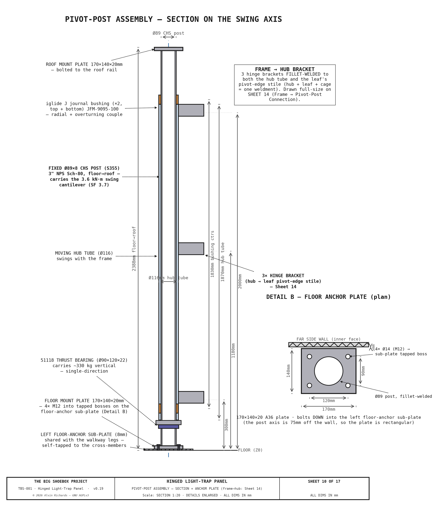

**Sheet 14 — Frame → Pivot-Post Connection: the 3 welded hinge brackets tying the moving hub to the center-zone jamb**
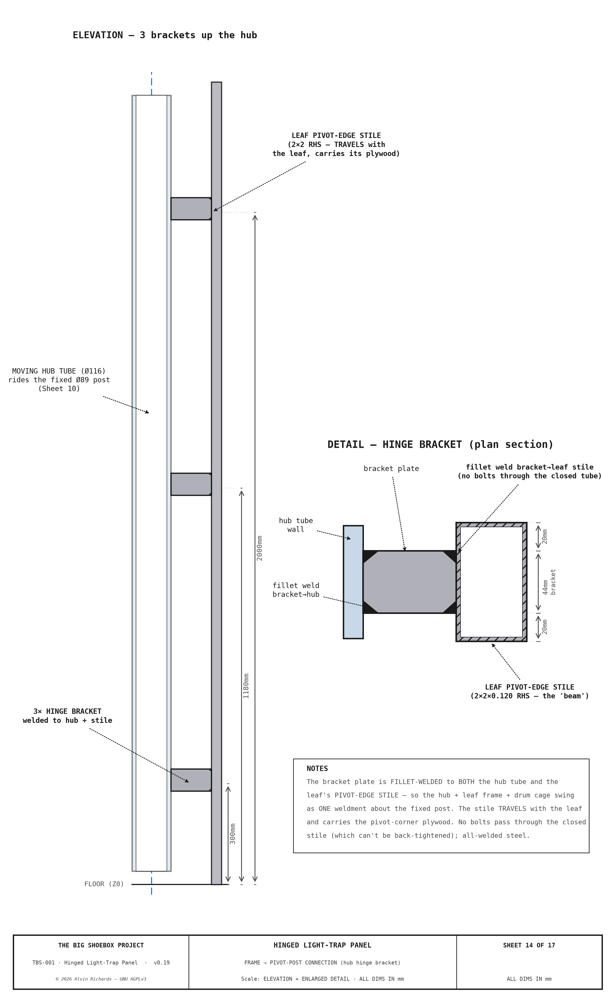

---

## 6. Light Seal Design

The swinging panel seals against the fixed door frame in its operational (closed)
position. Five light ingress paths are sealed:

| # | Light path | Seal method |
|---|-----------|-------------|
| 1 | Panel perimeter (left/right) → door frame | 20mm EPDM gasket in an aluminum channel down each **vertical** edge, compressed by the 2 × McMaster 1619A74 lift-and-turn cam latches (opening edge, top + bottom) against the fixed door frame. (The **top + bottom** edges are strip-brush seals — paths #3/#4 — not compression EPDM.) |
| 2 | Swing cuts → fixed strips | The swinging center+corners separate from the two FIXED strips (near Yd0–180, far Yd2287–2362, which carries the pivot) along vertical cuts. A 20mm EPDM **cut seal** runs the full panel height down each cut, compressed by the cam latches when the panel is latched at the door plane. Replaces the old sliding-carriage beam/guide-slot brush seals. (Sheet 3, Detail D.) |
| 3 | Panel bottom → 217mm floor gap | **Pull-out corner apron** (Sheet 16) — a **fixed full-width base** (Z0–130, continuous, never moves) + two **removable pull-out strips** at the corner zones (Z130–282, 18mm ext ply); the drum-bay center has no pull-out (the fixed base + the drum's own vertical cage seal it). Each strip locates in a 45° chamfer in the base and butts a flat ply **lip batten B1** on the leaf's exterior face; **1590A13 draw latches** hold it — four per strip: two bottom latches (interior, one at each strip end) span the strip↔base joint (keeper on the fixed base) and draw the strip DOWN onto its chamfer seat, and two exterior **span latches** (one at each strip end) bridge B1 and a second coplanar batten **B2** on the strip's exterior face, drawing it UP to the leaf/lip on the door side (so nothing projects into the darkroom — this clears the film-plane beam that an interior top latch fouled); the chamfer also gravity-seats the strip; released, nothing passes through the strip or lip, so the strip slips out of the chamfer. EPDM at every joint, flat-black interior. **The strips are removable, not fixed** — the panel swings as a pure horizontal rotation about the vertical pivot (the leaf bottom sweeps sideways at the seal plane, it never lifts), so a fixed apron reaching that plane would block the swing; the pull-out strip is simply absent during the swing (no fold arc) and stows strapped inside. Sheet 16 Details A–F. |
| 4 | Panel top → frame gap | Fixed-frame **top brush seal** — the mirror of #3: a nylon-filament strip brush in a holder on the frame top rail, its bristles reaching ~30mm below the panel top edge. The drum stub shaft stops below it, so the brush runs as **one continuous member across the full panel-top width — no notch — meeting across the center**. The panel + drum-box top edge **sweeps through the bristles** as the panel swings — a deliberate ~30mm bristle overlap in the closed position, **not a clash**. No cam-latch compression on this edge; the bristles are the seal. (Sheet 3, Detail C.) |
| 5 | Housing surround → door frame | The Ø800 light-trap housing carries the revolving drum and swings with the panel. A **second 20mm EPDM gasket** rings the housing aperture (floor gap up to the housing top), concentric **inboard** of the panel-perimeter seal (#1), seated in the door plane. In the closed position it seals the housing surround to the frame all the way around the opening — light-tight. (3D: the `door_frame()` "Housing surround seal", in both the light-trap and overview models.) |

**Seal verification:** The five seals are verified light-tight by a dark-adaptation check
inside the container with all seals engaged, after every mode conversion
([Operating Manual §1.4 and §1.8](operating-manual.md)).

**Sheet 16 — Pull-Out Corner Apron: fixed full-width base + removable corner strips closing the floor gap (Section A + Details D–F: chamfer, leaf lip register, 1590A13 draw latch)**
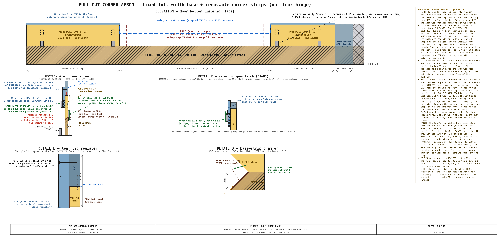

---

## 7. Fixed Door Frame

A fixed welded door frame provides the seal landing surface (perimeter, cut, and lip
seals) for the swinging panel, and the structural anchor for the wall-stay eyes.

| Parameter | Value |
|-----------|-------|
| Material | 50 × 50 × 3mm RHS mild steel |
| Position | X=0 (container end wall inner face) |
| Function | Seal landing for the swinging-panel **vertical** perimeter + cut seals + housing-surround EPDM, plus the **top + bottom strip-brush** light seals |
| Attachment | Welded to container end wall structural members |
| Cut-seal landings | 2 × vertical EPDM landings (the swing cuts between the swinging panel and the fixed strips) |
| Bottom light seal | **Pull-out corner apron** — fixed full-width base (Z0–130) + 2 removable pull-out strips (corner zones, Z130–282) held by 1590A13 draw latches (4 per strip: 2 bottom interior clamping to the chamfer seat + 2 exterior span latches bridging battens B1↔B2, door-side, clamping up to the leaf/lip); removed + stowed inside for transport (see §6 path #3, Sheet 16) |
| Top brush seal | Mirror of the bottom: continuous nylon-filament **strip brush** in a holder on the frame top rail, bristles reaching ~30mm below the panel top edge, full panel-top width and **continuous across the center** (the drum does not reach the top, so no notch) — the panel + drum-box top edge sweeps through the bristles (see §6 path #4) |

---

## 8. Parts List

See the **[Master Shopping List, filtered to this report's systems](master-shopping-list.md?system=panel,lightlock,swing,door)** for the same parts with suppliers, current prices, and click-to-sort/filter.

### Cost Summary

| Assembly | Low estimate | High estimate |
|----------|------------|--------------|
| Panel structure (incl. B2 bay + pull handle) | <!-- BEGIN costing:hp-panel-low -->$1,195<!-- END costing:hp-panel-low --> | <!-- BEGIN costing:hp-panel-high -->$1,368<!-- END costing:hp-panel-high --> |
| Housing + drum (plastic skin) | <!-- BEGIN costing:hp-housing-low -->$3,156<!-- END costing:hp-housing-low --> | <!-- BEGIN costing:hp-housing-high -->$4,175<!-- END costing:hp-housing-high --> |
| Swing pivot hardware | <!-- BEGIN costing:hp-swing-low -->$831<!-- END costing:hp-swing-low --> | <!-- BEGIN costing:hp-swing-high -->$1,131<!-- END costing:hp-swing-high --> |
| Fixed door frame | <!-- BEGIN costing:hp-doorframe-low -->$419<!-- END costing:hp-doorframe-low --> | <!-- BEGIN costing:hp-doorframe-high -->$599<!-- END costing:hp-doorframe-high --> |
| **Total** | **<!-- BEGIN costing:hp-total-low -->$5,601<!-- END costing:hp-total-low -->** | **<!-- BEGIN costing:hp-total-high -->$7,273<!-- END costing:hp-total-high -->** |

---

## 9. Maintenance

The panel's wear items are its elastomer seals (the EPDM perimeter gasket and the cut seals at
the swing boundaries, which flex on every mode conversion; the neoprene drum wipers and their
silicone bead), the wall-stay turnbuckles and anchors, the cam-latch keepers (adjustable for
clamp force), and the flat-black interior paint. The 51118 pivot thrust bearing is a greased
bearing; the iglide J journal bushings are self-lubricating and run dry (no oil or grease on
the post journal bands); the SKF 6215 drum bearings are sealed for life.
The inspection and service schedule is in the [Operating Manual — Maintenance](operating-manual.md).

---

## 10. Source References

| Item | Source |
|------|--------|
| SKF 6215-2RS1 bearing specification | [SKF Product Catalog](https://www.skf.com/group/products/rolling-bearings/ball-bearings/deep-groove-ball-bearings/productid-6215-2RS1) — radial load 52.7 kN basic dynamic (C), sealed, C3 clearance |
| Lift-and-turn cam latch | [McMaster 1619A74](https://www.mcmaster.com/1619A74/) — adjustable lift-and-turn tight-hold cam latch, 150 lbf |
| Turnbuckle + eye/hook (wall stays) | [McMaster-Carr turnbuckles](https://www.mcmaster.com/turnbuckles/) — drop-forged jaw/eye turnbuckles for the transport lock |
| Pivot thrust bearing (51118) | [Motion — SKF 51118](https://www.motion.com/products/sku/00132858) — single-direction thrust ball bearing, Ø90 × 120 × 22mm, static Cₒ ≈190 kN, for the pivot base |
| Pivot journal bushings (JFM-9095-100) | [igus — iglide J JFM-9095-100](https://www.igus.com/iglide-ibh/flange-bearings/product-details/iglide-j-m?artnr=JFM-9095-100) — iglide J self-lubricating flange bushing, Ø90 ID × 95 OD × Ø103 flange × 100L, top + bottom post radial location |
| EPDM gasket material | [McMaster-Carr](https://www.mcmaster.com/epdm-rubber-sheets) — closed-cell EPDM, UV-stable |
| Neoprene wiper strip | [McMaster-Carr #93855K6](https://www.mcmaster.com/93855K6) — closed-cell, pressure-sensitive adhesive |
| Revolving drum light trap design | See [Light Trap Selection](light-trap-selection.md) for full commercial comparison and custom specification |
| Swing mechanism & light seal | §4–6 (this report) — hinges/latches, rotating transport, light-seal design |
| Panel construction drawings | See [Engineering Diagrams](engineering-diagrams.md) §12 — Sheets 1–5 |
