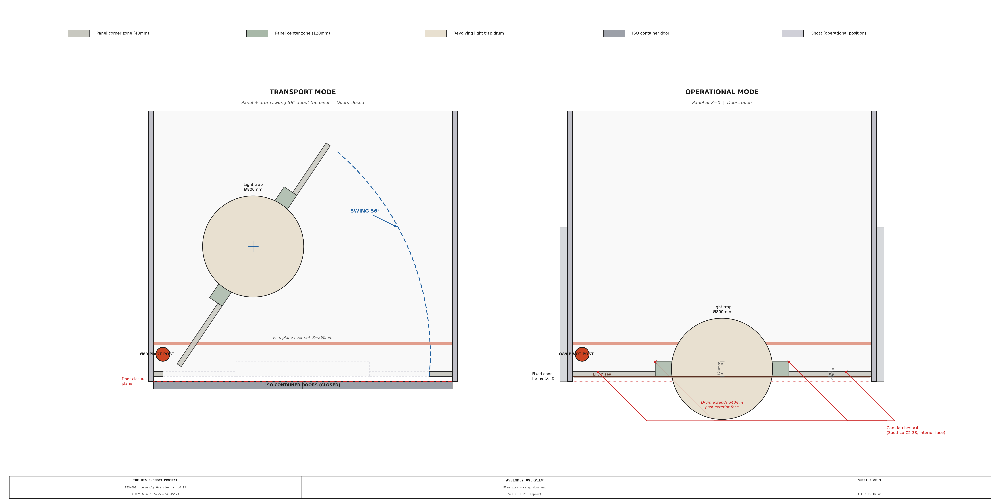
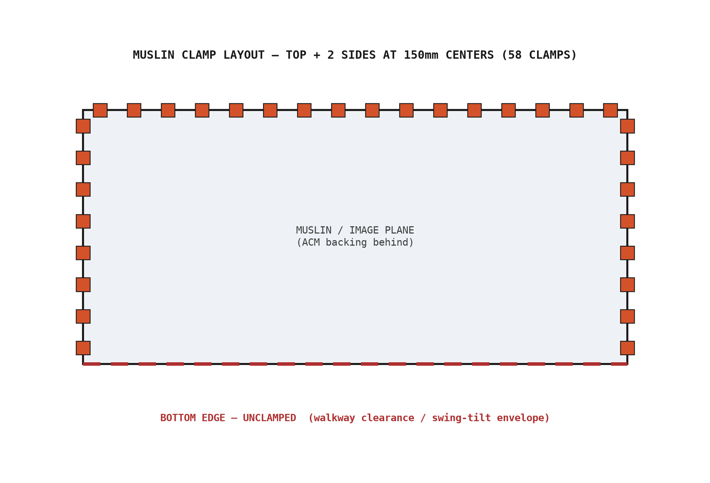

<!-- SPDX-License-Identifier: AGPL-3.0-only -->
<!-- © 2026 Alvin Richards -->
# Operating Manual — TBS-001

**The Big Shoebox Project — Camera No. 1**
Single-operator workflow for cyanotype on cotton muslin.

> **Before you begin:** Read this manual end-to-end once before your first deployment. Each phase has a time estimate and a GO/NO-GO checkpoint. Do not proceed past a checkpoint unless all conditions are met.

## Quick Reference
| Phase | What | Time |
|-------|------|------|
| 0 | Pre-departure (home/workshop) | ~2 hours |
| 1 | Site setup | ~1.5 hours |
| 2 | Load image plane (red light) | ~45 min |
| 3 | Exposure | ~30–45 min (baseline) |
| 4 | Development | ~20 min |
| 5 | Cleanup and close-down | ~30 min |
| **Total** | **First print, ideal conditions** | **~5–5.5 hours** |

Baseline exposure is **30–45 minutes** under direct full sun, ISO equivalent ~2–4. See the [Exposure Adjustment Table](#exposure-adjustment-table) for cloud cover and time-of-day corrections.

## Chemistry Choice — With or Without Ammonium Dichromate

Decide this **before mixing Part B**. The baseline sensitizer is iron-only. Adding ammonium dichromate
steepens the print's contrast. It is a creative choice, but it changes three procedures and the
disposal of the wash water ([Water System Report §2](water-system-report.md); the basis is in [Wash-Water Classification](wash-water-classification.md)):

| | Baseline (no dichromate) | Dichromate option |
|---|---|---|
| Part B (§0.3) | Potassium ferricyanide only | Ferricyanide + ammonium dichromate (§0.3.4–0.3.6) |
| First wash drain, 3W-DV-02 (§4.2) | Brown (IBC-3), like every pass | **Waste (IBC-4)** for pass 1; Brown for passes 2–3 |
| Leftover sensitizer and roller rinse (§5.1) | Into the tray, drained to Waste | Same, and always to Waste |
| Disposal of IBC-3/IBC-4 (§5.1.1, TU.3) | Liquid-waste hauler or wastewater plant | IBC-4: licensed hazardous-waste hauler, manifested. IBC-3: the same until Brown is measured below 5 mg/L chromium |

Once a tote has received dichromate wash water, it stays on the dichromate disposal route until it is
pumped out. Switching back to the baseline does not clean it.

## Phase 0 — Pre-Departure
**Time: ~2 hours. Complete the day before or morning of shoot day at your workshop/home.**
**Lighting: normal white light throughout this phase.**

### 0.1 Water System
The water system has three circuits (Blue/Brown/Black), pumps on the plumbing panel in the IBC plumbing corridor (P-01 Blue supply, P-02 Brown recycle spray, P-05/P-03 Brown/Waste drain), plus P-04 on the pinhole-wall filter skid (tray drain, feeds the filter train), and four 275-gal IBC totes in a 2×2 stack. All IBCs use DN50 butterfly valves facing the plumbing corridor; all tote-top connections are **side-entry near the top** (no top-cap access — only <!-- BEGIN fact:ibc_ceiling_clearance_mm -->52<!-- END fact:ibc_ceiling_clearance_mm -->mm of headroom). The X1 fill line tees inside the corridor to fill both Blue totes (IBC-1 and IBC-2) in parallel via side-entry near the top. A check valve (CV-1) on the X1 fill line prevents backflow on the gravity fresh-fill; the pump-driven X3/X4 drains sit above the bottom-tier totes and are isolated by the drain-pump suction valves BV-02/BV-07, and CV-2/CV-3 stop the two diverter waste legs back-feeding each other at the IBC-4 tee. External fill (X1) and drain (X3/X4) ports on the sealed end wall allow resupply and disposal without opening the cargo doors.

- [ ] 0.1.1 — **Fill the Blue totes before departure.** The camera deploys with Blue full: <!-- BEGIN fact:blue_fill_per_tote_l -->900<!-- END fact:blue_fill_per_tote_l --> L in each of IBC-1 and IBC-2 (<!-- BEGIN fact:blue_supply_l -->1,800<!-- END fact:blue_supply_l --> L, <!-- BEGIN fact:blue_supply_gal -->476<!-- END fact:blue_supply_gal --> gal in all). Remove the X1 dust cap, connect the supply hose, fill, disconnect and re-cap. X1 tees internally to fill both totes in parallel through check valve CV-1. Fill before the container is lifted: the transport restraint is designed for this load ([IBC Stacking §3.4](ibc-stacking-report.md)). Confirm Brown IBC-3 and Waste IBC-4 are empty.
- [ ] 0.1.2 — Check the drain-pump switches **S-05** and **S-03** (near-upper side board, beside BV-02 / BV-07) are OFF. Set the valves for operation: open the DN50 butterfly valves on IBC-1, IBC-2 (Blue) and IBC-3 (Brown); open **BV-01** (P-01 suction) and **BV-03** (P-02 suction). Keep closed: the IBC-4 butterfly valve, **BV-02** and **BV-07** (the P-05 / P-03 drain suctions), **BV-04** (TAP-01, opened only when drawing water), and **BV-06** (spray on/off). P-01 is self-priming.
- [ ] 0.1.3 — Set BV-05 to Blue and open BV-06. Switch on P-01 (Blue supply, circuit C1).
- [ ] 0.1.4 — Check all pipe joints for drips. Tighten any fittings that are weeping.
- [ ] 0.1.5 — Run water through the spray bar for 60 seconds. Check spray pattern is even across the full image plane width.
- [ ] 0.1.6 — Switch P-01 OFF.
- [ ] 0.1.7 — Confirm P-04 suction pickup tube is seated in the sump well and the suction hose is connected over the tray rim to the pump manifold. Set 3W-DV-02 (on P-04 discharge) to route toward IBC-3 (Brown). P-04 draws used wash water from the sump and lifts it to IBC-3 via a side-entry near the top. Switch on manually after each wash cycle. (The tray and pickup tube are permanently installed between the film plane rails.)

### 0.2 Chemistry — Part A (Ammonium Iron(III) Oxalate)
**Lighting: WHITE LIGHT — Part A is not light-sensitive in dry or dissolved form.**

> **⚠ RECIPE NOT YET LOCKED — see [Sensitizer Trials](sensitizer-trials.md).** Quantities use the
> **Mike Ware New Cyanotype** ratio (AmFe : ferricyanide = **3 : 1**) over the **<!-- BEGIN fact:image_area_m2 -->9.19<!-- END fact:image_area_m2 --> m² active
> plane, TWO wet-on-wet coats** (§2.5), at the sourced muslin coverage **~120 ml/m²/coat →
> ~<!-- BEGIN fact:sensitizer_l_per_print -->2.2<!-- END fact:sensitizer_l_per_print --> L working sensitizer per print**. The **concentration tier is the open variable** — it
> swings chemistry cost and print count by **~3×** across the three tiers. Three alternatives are given for costing/trialling.
> **Default: Standard (½-Ware)** until the trial decides.

Prepare Part A in **warm water (50–60°C)** — AmFe does not dissolve cold. Part A holds all the
iron and is ~half the working volume (mixed 1:1 with Part B, §2.1).

| Tier (per print) | AmFe (dry) | Part A water (warm) | mixed strength | AmFe for 50 prints |
|---|---|---|---|---|
| Lean (⅓-Ware) | <!-- BEGIN costing:om-amfe-g-lean -->222<!-- END costing:om-amfe-g-lean --> g | ~<!-- BEGIN fact:sensitizer_part_l -->1.1<!-- END fact:sensitizer_part_l --> L | 10 g/100 ml | <!-- BEGIN costing:om-amfe-kg-lean -->11.1<!-- END costing:om-amfe-kg-lean --> kg |
| **Standard (½-Ware) — default** | **<!-- BEGIN costing:om-amfe-g-standard -->334<!-- END costing:om-amfe-g-standard --> g** | **~<!-- BEGIN fact:sensitizer_part_l -->1.1<!-- END fact:sensitizer_part_l --> L** | **15 g/100 ml** | **<!-- BEGIN costing:om-amfe-kg-standard -->16.7<!-- END costing:om-amfe-kg-standard --> kg** |
| Rich (full-Ware) | <!-- BEGIN costing:om-amfe-g-rich -->668<!-- END costing:om-amfe-g-rich --> g | ~<!-- BEGIN fact:sensitizer_part_l -->1.1<!-- END fact:sensitizer_part_l --> L | 30 g/100 ml | <!-- BEGIN costing:om-amfe-kg-rich -->33.4<!-- END costing:om-amfe-kg-rich --> kg |

- [ ] 0.2.1 — Heat water to 50–60°C (a kettle left to stand for 2 minutes after boiling is ideal).
- [ ] 0.2.2 — Weigh AmFe into a mixing jug.
- [ ] 0.2.3 — Pour warm water over the AmFe. Stir continuously until fully dissolved — the solution turns pale yellow-green and is clear, not cloudy. This may take 3–5 minutes.
- [ ] 0.2.4 — Allow to cool to room temperature.
- [ ] 0.2.5 — Label the jug **PART A — AmFe (WARE)**. Store in a sealed dark bottle.

### 0.3 Chemistry — Part B (Potassium Ferricyanide, + Ammonium Dichromate if chosen)
**Lighting: WHITE LIGHT — Part B is not light-sensitive on its own.**

Part B holds the ferricyanide, at ⅓ of the AmFe mass (Ware's 3:1 ratio), in ~half the working
volume. For the dichromate option it also carries the dichromate (see
[Chemistry Choice](#chemistry-choice-with-or-without-ammonium-dichromate)).

| Tier (per print) | Potassium ferricyanide | Part B water |
|---|---|---|
| Lean (⅓-Ware) | <!-- BEGIN costing:om-ferri-g-lean -->74<!-- END costing:om-ferri-g-lean --> g | ~<!-- BEGIN fact:sensitizer_part_l -->1.1<!-- END fact:sensitizer_part_l --> L |
| **Standard (½-Ware) — default** | **<!-- BEGIN costing:om-ferri-g-standard -->112<!-- END costing:om-ferri-g-standard --> g** | **~<!-- BEGIN fact:sensitizer_part_l -->1.1<!-- END fact:sensitizer_part_l --> L** |
| Rich (full-Ware) | <!-- BEGIN costing:om-ferri-g-rich -->222<!-- END costing:om-ferri-g-rich --> g | ~<!-- BEGIN fact:sensitizer_part_l -->1.1<!-- END fact:sensitizer_part_l --> L |

**All prints:**

- [ ] 0.3.1 — Weigh the potassium ferricyanide into a second jug.
- [ ] 0.3.2 — Add water (room temperature). Stir until fully dissolved — the solution turns yellow-orange.
- [ ] 0.3.3 — Label the jug **PART B — KFe**.

**Dichromate option only.** Dichromate is dosed as a **% of the total working volume**, so it is the
same across strength tiers: Ware's baseline is **0.1%**, raised for more contrast (trial **T3**: 0.1% /
0.2% / 0.4%). That is <!-- BEGIN fact:dichromate_g_lo -->2.2<!-- END fact:dichromate_g_lo -->–<!-- BEGIN fact:dichromate_g_hi -->8.8<!-- END fact:dichromate_g_hi --> g per print.

> **⚠ Ammonium dichromate** is a Category 1A carcinogen and an oxidizer. Wear nitrile gloves and weigh
> it in a ventilated space. Do not inhale the dust. Once it is in the sensitizer, the wash water from
> every print carries chromium (§4.2, §5.1).

- [ ] 0.3.4 — Wearing nitrile gloves, weigh the ammonium dichromate.
- [ ] 0.3.5 — Add it to the Part B jug and stir until dissolved — the solution turns bright orange-red.
- [ ] 0.3.6 — Relabel the jug **PART B — KFe + AmDichr** so it is never mistaken for baseline Part B.

> **Storage:** Part A and Part B stock solutions keep for 6–8 weeks in sealed dark bottles. Mixed together (the working sensitizer), shelf life is 4–6 hours. Mix only what you need per session.

### 0.4 Equipment Checklist
- [ ] 0.4.1 — Nitrile gloves (minimum 4 pairs)
- [ ] 0.4.2 — 18" foam roller + roller tray (two sets — one per coat pass)
- [ ] 0.4.3 — 2 × 2-liter mixing jugs (graduated)
- [ ] 0.4.4 — Funnel and stirring rod
- [ ] 0.4.5 — Digital scale (1g resolution)
- [ ] 0.4.6 — Digital hygrometer
- [ ] 0.4.7 — Pre-cut muslin in light-safe bag (unbleached cotton, <!-- BEGIN fact:muslin_cut_width_mm -->4,249<!-- END fact:muslin_cut_width_mm --> × <!-- BEGIN fact:muslin_cut_height_mm -->2,000<!-- END fact:muslin_cut_height_mm -->mm — cut to fit the washable tray area, clear of the rims + near-rim sump; clamped inboard on the ACM, no hem). Pre-wash it twice in hot water with no detergent to remove the sizing (starch filler), which repels the sensitizer, and dry it fully before coating.
- [ ] 0.4.8 — Part A bottle (sealed, labeled)
- [ ] 0.4.9 — Part B bottle (sealed, labeled)
- [ ] 0.4.10 — Timer (phone or dedicated)
- [ ] 0.4.11 — Spirit level
- [ ] 0.4.12 — Black silicone sealant + gaffer tape (light-leak repair)

### 0.5 Container Pre-Check (if accessible)
- [ ] 0.5.1 — Inspect interior: no water ingress or condensation on image plane.
- [ ] 0.5.2 — All seals (door perimeter, neoprene cord) are intact.
- [ ] 0.5.3 — Film plane mechanism moves freely on all four corners.
- [ ] 0.5.4 — Install perimeter walkway grating sections onto wall-cantilevered brackets around all 4 sides of the processing tray. Near, far, and right grating panels lift onto bracket arms and are secured with grating clips. The left walkway (cargo door end) is a removable lift-out section — it rests on 5 floor-leg cantilever brackets bolted to the bare floor outside the tray (the three brackets at the drum-exit punch-out reach further inboard than the rest; the hinged panel occupies this end wall). Left corners use butt joints (no miter) so near/far walkways start clear of the door-end panel swing sweep. The left walkway grate must be removed before the panel swings to its transport position; the floor brackets stay bolted. No contact with the tray (brackets sit on bare floor outside it).
- [ ] 0.5.5 — Lay fresh 6-mil black LDPE containment liner over the tray surface, overlapping 50mm over the rims.

### 0.6 Transport Booking (when the container moves)
- [ ] 0.6.1 — Confirm the route against the state DOT databases for size and weight limits ([Container Report Part 2](container-report.md)).
- [ ] 0.6.2 — Ask the hauler to place the container with the rear (sealed) end over or near the trailer axle(s), which balances the load ([Weight Distribution Report §6.3](weight-distribution-report.md)).
- [ ] 0.6.3 — Give the hauler the loaded haul weight (Blue full outbound, [Transportation Options §1](container-transport-options.md)) and confirm the truck is rated for it. For a tilt-bed, confirm the bed tilt stays under ~25° while loading and unloading, the limit of the IBC restraint frame ([Transportation Options §3](container-transport-options.md)).

**GO/NO-GO checkpoint:** Water system tested and IBCs filled. Part A and Part B prepared and sealed. All equipment packed. Container interior inspected (if accessible).

## Phase 1 — Site Setup
**Time: ~1.5 hours. Complete on arrival at site.**
**Lighting: normal white light / daylight.**

### 1.1 Site Selection
- [ ] 1.1.1 — Ground is level to within 5° (use a spirit level on the container floor after delivery).
- [ ] 1.1.2 — Subject is visible from the pinhole wall — nothing blocking the view within 5m.
- [ ] 1.1.3 — Shade structure can be erected over the container (trees, canopy, building shadow).
- [ ] 1.1.4 — Solar panel deployment area: clear southern exposure, ~4m × 3m.
- [ ] 1.1.5 — Water source within 20m, or tanker access for IBC tote fill (if not pre-filled).
- [ ] 1.1.6 — Emergency vehicle access not blocked by container placement.
- [ ] 1.1.7 — **Weather — check for lightning.** Review the forecast before departure and again on site. The container is an exposed, unprotected metal box — **do not occupy it during a thunderstorm**; step out and well away until the storm has passed, and plan sessions around clear-weather windows.

### 1.2 Container Positioning
- [ ] 1.2.1 — Direct the delivery driver to position the container with the **cargo doors at 90 degrees from the subject**. The pinhole wall faces the subject.
- [ ] 1.2.2 — Once set down, check level. Use 50mm timber sleepers under corner castings to correct — up to 50mm height difference is manageable without shimming the mechanism.
- [ ] 1.2.3 — Open cargo doors and inspect interior (if not done in Phase 0.5).

### 1.3 Mode Conversion — Transport to Operational
**Time: ~10 minutes. Single-person operation.**

The container arrives in transport mode: the stepped hinged panel is swung ~56° inboard about the vertical pivot post and held by the top + bottom wall stays; the two left film rails (TL + BL), the left walkway, and the two pull-out apron strips have been struck/removed (the strips stow strapped inside). Convert to operational mode before proceeding.

The two end states — transport (panel + drum swung 56°, doors closed) and operational (panel latched at the door plane, X=0) — are shown in plan at the cargo-door end:

- [ ] 1.3.1 — Open and secure the cargo doors.
- [ ] 1.3.2 — Release the top + bottom wall stays: slack the turnbuckles and unhook the rods from the near-wall eyes.
- [ ] 1.3.3 — With the panel still swung clear of the door plane, retrieve the evaporative cooler from near-walkway stowage (release 2 ratchet straps) and carry it out through the door opening (~<!-- BEGIN fact:cooler_weight_kg -->7<!-- END fact:cooler_weight_kg --> kg / <!-- BEGIN fact:cooler_weight_lb -->16<!-- END fact:cooler_weight_lb --> lb dry, one person).
- [ ] 1.3.4 — Place the cooler on the ground outside the container, adjacent to the pinhole wall near the Ø200mm duct penetration. Remove the weatherproof cap from the wall stub. Connect the Ø200mm flex duct from the cooler outlet to the wall stub collar and secure with a hose clamp. Fill the reservoir (~18 L, one tankful) from the Blue circuit at TAP-01 on the pinhole wall — doors are open at this stage, so draw at TAP-01 and carry/hose the water out to the cooler.
- [ ] 1.3.5 — Swing the frame back ~56° to the door plane (camera position), assisted. The vertical pivot is balanced at any angle (no gravity torque) — effort is only inertia + bearing friction; control momentum at the stop.
- [ ] 1.3.6 — Latch the panel to the door frame with both 1619A74 lift-and-turn cam latches (interior-face lever — lift and turn) — compresses the EPDM perimeter + cut seals.
- [ ] 1.3.7 — Re-fit the two pull-out apron strips (near + far corner zones) that close the under-leaf floor gap: set each onto its 45° base chamfer seat (exterior-low → interior-high, so it gravity-seats exterior-down) and butt it up to the leaf lip at the top, then throw its four draw latches (1590A13): the two bottom latches from inside (one at each strip end, clamping the strip down onto the chamfer) and the two exterior span latches from the door side (one at each strip end, bridging the leaf lip batten B1 + the strip batten B2 to clamp the strip up to the leaf/lip). Confirm the EPDM joints (chamfer, strip↔lip butt, strip ends) are seated.
- [ ] 1.3.8 — Re-fit the two left film rails (TL + BL): drop each into its saddles; the tapered dowels set the film datum; clamp down. Confirm the re-seated rails return the film plane square and planar to datum.
- [ ] 1.3.9 — Re-fit the left walkway + door-end near-deck lift-out section onto their butt-joint ends / floor-leg cantilever brackets.
- [ ] 1.3.10 — Un-pin the revolving drum (ready for personnel light-lock use).
- [ ] 1.3.11 — Perform dark-adaptation check (see step 1.4.4 below).

### 1.4 Light Trap — Revolving Drum Panel
- [ ] 1.4.1 — Confirm the hinged drum panel is closed and both 1619A74 lift-and-turn cam latches are engaged (interior-face lever).
- [ ] 1.4.2 — Check the EPDM perimeter gasket is seated with no gaps or folded sections.
- [ ] 1.4.3 — Rotate the drum one full revolution by hand — it should turn freely with no binding or scraping.
- [ ] 1.4.4 — Verify: step into the drum entry side and rotate through to the interior. Wait 5 minutes for dark adaptation. **No light should be visible at any baffle position.** Mark any leaks with chalk and seal with black silicone before proceeding.

> **Safety:** Do not attempt to reverse direction inside the drum — the baffles only clear forward rotation. If unsure of orientation, continue rotating forward until you exit on the intended side.

### 1.5 Solar Power System
- [ ] 1.5.1 — Deploy solar panels on south-facing ground or roof rack, angled at 30° from horizontal (optimal for Palm Springs latitude).
- [ ] 1.5.2 — Connect panels in parallel to the Victron SmartSolar MPPT 100/50 controller.
- [ ] 1.5.3 — Connect controller to battery bank (1 × 100Ah LiFePO4 standard; optional 2nd pack in parallel). **Observe polarity.**
- [ ] 1.5.4 — Connect Blue Sea fuse block to battery positive busbar.
- [ ] 1.5.5 — Check controller display: battery voltage should read 12.6–13.2V (full charge). If below 12.0V, charge before proceeding — a depleted battery bank cannot power the cooler and water system simultaneously.
- [ ] 1.5.6 — Verify each circuit fuse is seated: A (exhaust fan), B (intake fan), C1 (corridor pumps P-01/02/03/05, one at a time), C2 (tray-drain pump P-04), D (red safelight), E (evap cooler inverter), F (white LED lighting). Both pump fuses are gated by the single 2-pole master pump switch; the drain pumps P-05 / P-03 also have local switches S-05 / S-03, kept OFF except for a pump-out.
- [ ] 1.5.7 — **Grounding.** The protective bond (container shell + inverter/cooler/equipment → battery-negative, 4 AWG) is **permanent** — just confirm the main-panel bond lug is tight. It protects on any surface; **no site earth needs to be driven.** The 8-ft copper earth stake is **optional supplementary earthing**: **on soil**, drive it beside the power panel and clamp it to the main-panel earth terminal (it dissipates static — good in a dry darkroom); **on concrete, asphalt, or any hard surface, skip it** — the bonding provides full fault protection regardless ([Electrical Report §7.3](electrical-report.md)). If a convenient earth is at hand (building ground, grounded metal water pipe), bond to that instead of driving the stake. (Set **directly on bare soil**, the container's steel corner castings already earth it enough to bleed static — so the stake only matters if it is leveled up on **timber sleepers**, §1.2.2, which insulate the castings.)

> **Shore power backup:** First confirm the site's AC supply is on an RCD/GFCI-protected circuit. Never run an AC extension cord or generator output into the wet interior. If grid power is available at the site, connect the Victron IP65 charger to the NEMA 5-15 inlet on the container exterior. The charger maintains the battery bank automatically — leave it connected whenever shore power is available.

### 1.6 Ventilation and Cooling
- [ ] 1.6.1 — Switch ON exhaust fan (circuit A) and intake fan (circuit B). Confirm airflow — hold a piece of tissue at each duct stub; it should deflect visibly.
- [ ] 1.6.2 — **Cooling (hot climate):** Switch ON evaporative cooler (circuit E). Fill the cooler reservoir from TAP-01 (open BV-04, then close it). Run cooler for a minimum of **30 minutes before any operator entry** when ambient temperature exceeds 30°C. Interior should reach below 35°C before loading.
- [ ] 1.6.3 — If using shade canopy: erect before solar noon. A 70% shade cloth over the container reduces interior temperature by 15–20°C.

> **Heat safety:** Do not enter the container if the interior temperature exceeds 40°C. A digital thermometer hung inside is standard practice. In Palm Springs summer without shade, the steel container body can reach 75°C — **shade and pre-cooling are not optional in these conditions.**

### 1.7 Walkway and Tray (if not done in Phase 0.5)
- [ ] 1.7.1 — Install perimeter walkway grating sections (see 0.5.4 for full procedure).
- [ ] 1.7.2 — Lay fresh LDPE containment liner (see 0.5.5).
- [ ] 1.7.3 — Deploy the chemistry prep shelf: release the cam latch, lower the board onto its two chain stays (both taut, quick-links closed), confirm the hinge swings freely and the board is level, wipe the surface and clear any residue from the spill lip ([Chemistry Prep Shelves](chemistry-prep-shelves.md)).

### 1.8 Light-Leak Inspection
- [ ] 1.8.1 — Latch the drum panel (both 1619A74 lift-and-turn cam latches engaged).
- [ ] 1.8.2 — Switch ON interior safelight (circuit D, **red LED only**). Enter through the revolving drum.
- [ ] 1.8.3 — Switch OFF safelight. Stand still for **5 minutes** minimum for dark adaptation.
- [ ] 1.8.4 — Inspect all seams, door perimeters, and duct penetrations. Even a pinprick leak will be visible.
- [ ] 1.8.5 — Exit. Seal any leaks found with black silicone sealant or gaffer tape. Repeat inspection.

**GO/NO-GO checkpoint:** All leaks sealed. Interior temperature below 35°C. Battery bank above 12.4V. Blue supply flows evenly at the spray bar (0.1.5).

### 1.9 Film Plane — Tilt, Swing and Focus
Set the plane for the shot before loading. The corner-depth table is in the
[Film Plane Mechanism Report §5](film-plane-mechanism-report.md).

- [ ] 1.9.1 — At each corner, roll the acetal skate along its U-channel to the target depth, slide the Z and X cross-slides to take up the rotation arc, then throw the **cam clamp** to lock the skate to the rail.
  - **Pure tilt:** slide the two top corners (TL + TR) together to one depth and the two bottom corners (BL + BR) together to another.
  - **Pure swing:** slide TL and BL together, and TR and BR together.
  - **Back focus:** slide all four corners by the same amount.
  - **Compound (limited):** set all four to a coordinated set of depths.
- [ ] 1.9.2 — Confirm all four cam clamps are locked.

## Phase 2 — Loading the Image Plane
**Time: ~45 minutes. Entire phase performed under RED LIGHT only (circuit D).**
**Lighting: RED LED safelight. No white light, no daylight.**

### 2.1 Prepare Working Sensitizer
**Do this step just before entering — the combined sensitizer is UV-sensitive.**

| For 1 print (<!-- BEGIN fact:image_area_m2 -->9.19<!-- END fact:image_area_m2 --> m² active plane, **2 wet-on-wet coats**) | Volume |
|------------------------|--------|
| Part A | ~<!-- BEGIN fact:sensitizer_part_l -->1.1<!-- END fact:sensitizer_part_l --> L |
| Part B | ~<!-- BEGIN fact:sensitizer_part_l -->1.1<!-- END fact:sensitizer_part_l --> L |
| **Working sensitizer** | **~<!-- BEGIN fact:sensitizer_l_per_print -->2.2<!-- END fact:sensitizer_l_per_print --> L** |

> **Volume basis:** ~120 ml/m²/coat (muslin, sourced — [AlternativePhotography](https://www.alternativephotography.com/cyanotypes-on-fabric-preparing-the-fabric/) / [Jacquard](https://www.dickblick.com/products/jacquard-cyanotype-sensitizer-set/)) × **2 coats** (§2.5 is two wet-on-wet passes, not one) × <!-- BEGIN fact:image_area_m2 -->9.19<!-- END fact:image_area_m2 --> m². **Confirm by trial T1** — [Sensitizer Trials](sensitizer-trials.md). Mix 1:1 by volume.

- [ ] 2.1.1 — Pour equal volumes of Part A and Part B into a third jug. Stir gently. The mix turns yellow-green.
- [ ] 2.1.2 — Pour into the roller tray immediately.

> **The mixed sensitizer is UV-sensitive.** It is safe under red LED safelight but must not be exposed to daylight, blue sky light, or white LED light once mixed. Work quickly once inside.

### 2.2 Humidity Check
Cyanotype coating is sensitive to humidity. Check with a digital hygrometer:

| Humidity | Action |
|----------|--------|
| Below 30% (typical Palm Springs) | Mist the muslin lightly with plain water 5 min before coating |
| 30–65% | Coat normally |
| Above 70% | Delay — coating may not dry under safelight, increasing fogging risk |

- [ ] 2.2.1 — Check humidity and take appropriate action per table above.

### 2.3 Entering via the Light Trap
**Revolving drum entry procedure (memorize this — you will do it in dim conditions):**

- [ ] 2.3.1 — Confirm drum panel is latched (both 1619A74 lift-and-turn cam latches engaged).
- [ ] 2.3.2 — Carry all equipment to the drum entry side. Set it down at your feet.
- [ ] 2.3.3 — Push the drum wall forward until the first baffle clears. Step in.
- [ ] 2.3.4 — Continue rotating forward until you exit into the container interior.
- [ ] 2.3.5 — Pass equipment through the drum in the same direction — one item at a time.
- [ ] 2.3.6 — Switch ON the safelight (circuit D switch, located on the electrical panel). **RED light only.**

> **Rule:** The drum seals automatically as it rotates — no doors to leave open. However, do not wedge equipment in the drum aperture. If a load is too large for the drum, it must be loaded during a full dark period (after sunset) with the panel unlatched and swung open.

### 2.4 Mounting the Muslin

- [ ] 2.4.1 — Retrieve the pre-cut muslin. Confirm the HDPE filler strip is seated in the frame's L channel along the three clamped edges (it stays installed).
- [ ] 2.4.2 — Start at the **top edge**. Open each nylon spring clamp by hand and hook it over the frame edge so its swivel pads bite the muslin against the filled sandwich; the spring holds it closed with tactile feedback. Work along the top at <!-- BEGIN fact:clamp_spacing_mm -->150<!-- END fact:clamp_spacing_mm -->mm centers (30 clamps) — hanging from the top lets the fabric fall straight.
- [ ] 2.4.3 — Work down the **left and right edges** (14 clamps each), pulling the fabric taut outward from center. Total: **58 clamps** on the top + two sides.
- [ ] 2.4.4 — The **bottom edge is left unclamped** (no clamp clearance to the raised walkway; keeps the swing/tilt envelope clear). Tension the fabric downward and secure the bottom flat against the plane by the trained method, so it cannot flap when the plane tilts or swings.
- [ ] 2.4.5 — Final check: no wrinkles or sags when viewed with the safelight from 2 meters. Any slack will print as a soft zone.

### 2.5 Applying the Sensitizer
**Lighting: RED LED safelight only. Work efficiently — aim to complete coating within 20 minutes.**

- [ ] 2.5.1 — Load the foam roller with sensitizer. Roll out any excess onto scrap card — the roller should be evenly loaded, not dripping.
- [ ] 2.5.2 — **First coat:** roll horizontally from left to right across the full width of the muslin. Even strokes, 50% overlap. Work top to bottom.
- [ ] 2.5.3 — **Second coat — wet-on-wet (apply while the first is still wet):** roll vertically, top to bottom. The cross-direction second coat lays down the remaining sensitizer and evens the coverage. *Two coats is why the working volume is ~<!-- BEGIN fact:sensitizer_l_per_print -->2.2<!-- END fact:sensitizer_l_per_print --> L (§2.1), not ~<!-- BEGIN fact:sensitizer_part_l -->1.1<!-- END fact:sensitizer_part_l --> L — budget for both.*
- [ ] 2.5.4 — Check edges — roller tends to undercoat at the far edges. Finish with a hand-held foam brush on the last 50mm of each edge.
- [ ] 2.5.5 — Set the empty tray and roller aside. **Do not leave the roller sitting in residual sensitizer — it will skin over.**

### 2.6 Tack-Drying
**Lighting: RED LED safelight only.**

- [ ] 2.6.1 — Run the ventilation fans (circuits A and B) on **low speed** — just enough airflow to assist drying. Avoid directed airflow directly at the coated surface.
- [ ] 2.6.2 — Wait **15–20 minutes** under safelight. The sensitizer changes from wet-glossy to a matte tack-dry state.
- [ ] 2.6.3 — Confirm by lightly touching the corner of the coated area with a gloved fingertip. It should not transfer to the glove.

> **Do not proceed with a wet coat.** A wet coat will run during exposure and will not produce a sharp image.

### 2.7 Exiting via the Light Trap
- [ ] 2.7.1 — Switch OFF safelight.
- [ ] 2.7.2 — Step into the drum from the interior side. Rotate forward (same direction as entry) until you exit to the exterior.
- [ ] 2.7.3 — The drum seals behind you as it rotates.

**GO/NO-GO checkpoint:** Muslin fully clipped and taut. Sensitizer dry to touch. Drum panel latched.

## Phase 3 — Exposure
**Time: ~30–45 minutes baseline + adjustment (Ware formula). Shutter operated entirely from outside.**
**Lighting: N/A — operator is outside the container.**

### 3.1 Exposure Calculation
Baseline exposure: **30–45 minutes** in direct unobstructed sun, mid-morning to mid-afternoon, summer (Mike Ware New Cyanotype formula on cotton muslin). This is 4–8× faster than the traditional Herschel formula (~2–3 hours baseline) due to the higher UV sensitivity of ammonium iron(III) oxalate.

**Exposure Adjustment Table**

| Condition | Multiply baseline by |
|-----------|---------------------|
| Full direct sun | × 1.0 |
| Thin haze / milky sky | × 1.5 |
| Broken cloud (50% coverage) | × 2.0 |
| Heavy overcast | × 4.0 |
| Early morning / late afternoon (2h before/after sunset) | × 2.0 |
| Winter sun at mid-latitude | × 1.5 |

*For compound conditions (e.g. thin haze + early morning), multiply the factors: 1.5 × 2.0 = × 3.0.*

These factors are EV-based estimates for light level changes. Cyanotype is an iron-based process and does not exhibit Schwarzschild reciprocity failure — no additional reciprocity correction is required beyond the factors above. For critical work, run a test strip first: cut a 200mm × full-height strip of coated muslin, expose in **5-minute intervals** using a card mask, develop immediately, and compare zones.

### 3.2 Opening the Shutter
- [ ] 3.2.1 — Confirm the vestibule outer door is closed and latched.
- [ ] 3.2.2 — Set a timer for your calculated exposure time.
- [ ] 3.2.3 — Open the pinhole shutter from the exterior operating handle.
- [ ] 3.2.4 — **Do not open any doors, stand in front of the pinhole wall, or allow shadows to cross the pinhole during exposure.**

### 3.3 Monitoring During Exposure
- [ ] 3.3.1 — Check the battery bank voltage on the MPPT controller display every 15 minutes. If voltage drops below 11.8V, switch off the evaporative cooler (non-essential during exposure).
- [ ] 3.3.2 — Note any significant cloud cover changes. If conditions change substantially mid-exposure (e.g. sky goes from clear to heavy overcast), close the shutter, note elapsed time, wait for conditions to return, then re-open for the remaining time.

### 3.4 Closing the Shutter
- [ ] 3.4.1 — At the calculated time, close the pinhole shutter using the exterior operating handle.
- [ ] 3.4.2 — Confirm the shutter plate is fully closed — slide driven to its closed stop, plate fully covering the aperture — before entering.

**GO/NO-GO checkpoint:** Shutter confirmed closed. Elapsed time within ± 2 min of target.

## Phase 4 — Development
**Time: ~20 minutes.**
**Lighting: RED LED safelight (Circuit D) on entry, then switch to WHITE LIGHT (Circuit F) after first wash begins.**

### 4.1 Entering and Removing the Muslin
- [ ] 4.1.1 — Enter via light trap (same procedure as Phase 2.3). Switch safelight ON (**red light**).
- [ ] 4.1.2 — Squeeze each spring clip open to release the muslin — work top-down, supporting the fabric weight as the upper clamps release. The image is latent at this point and may be barely visible as a pale yellow ghost.
- [ ] 4.1.3 — Roll the spray-bar gantry to the **near (pinhole-wall) end** of its travel and park it there.
- [ ] 4.1.4 — Feed the exposed muslin face-up down through the **far muslin-drop slot** (image-plane side) and draw it across the tray toward the parked beam until it lies flat on the LDPE liner over the washable area. The beam then rolls back over the laid muslin to wash ([Processing Tray & Spray Bar §4.2](processing-tray-and-spray-bar.md)).

### 4.2 Development in Water
**Lighting: switch to WHITE LIGHT (Circuit F — white LED, a SEPARATE circuit from the Circuit D red safelight) once the first wash begins — the image is no longer UV-sensitive after initial water contact. The two lighting circuits are independently switched (pull-cords labeled RED / WHITE), not interlocked.**

Cyanotype develops by oxidation — the iron salts convert to Prussian blue on contact with water and air. The full blue color deepens over the first few minutes of drying.

**Spray bar setup:**

- [ ] 4.2.1 — With the spray bar parked at the pinhole-wall end (§4.1.3), attach the telescoping pole to the arm tube.

**Continuous flow-through wash (supply + drain run together):**

Circuit C is dual-fused (**C1** corridor supply pumps, **C2** tray-drain P-04) so a supply pump and the drain run **at the same time**, both gated by the one 2-pole master pump switch. Both Shurflo 2088s move ~3.5 GPM, so the drain keeps pace with the spray and the tray holds a shallow, constantly-refreshed film — fresh water in at the bar, used water out at the sump — instead of the old fill-dwell-drain cycle (water consumed per print is the same; see [Water System Report §6](water-system-report.md)).

- [ ] 4.2.2 — Switch ON the master pump switch — **P-02 (Brown recycle supply) and P-04 (tray drain) both run.** P-02 feeds the spray bar from the IBC-3 buffer; P-04 continuously lifts the sump water through 3W-DV-02 and the filter train back toward IBC-3. Confirm BV-01 and BV-03 are open (0.1.2). *(First print after a resupply: IBC-3 is empty — run this pass on Blue: BV-05 to Blue, P-01 instead of P-02.)*
- [ ] 4.2.3 — **Recycled first wash:** set BV-05 to Brown (recycled) and open BV-06. Set 3W-DV-02 by the [chemistry choice](#chemistry-choice-with-or-without-ammonium-dichromate): **Brown** for the baseline, **Waste (IBC-4)** for the dichromate option. Using the pole, slowly traverse the spray bar across the full surface (~50mm/second, ~44s/pass) and keep traversing for **5 minutes** — water flows continuously over the print and drains as fast as it arrives, so the tray never fills. This is the leaching wash: it runs yellow-green as unreacted sensitizer clears (orange-tinged with the dichromate option). **Switch to WHITE LIGHT now (Circuit F)** — the print is safe once washing begins. *(Baseline: if the drain water is heavily contaminated, set 3W-DV-02 to Waste instead — see the diverter decisions below.)*
- [ ] 4.2.4 — **Clean wash:** set BV-05 to Blue (fresh) and bring up **P-01**; P-02 idles. Dichromate option: return 3W-DV-02 to **Brown** now. P-04 keeps draining throughout. Continue the traverse for ~5 minutes.
- [ ] 4.2.5 — **Final rinse:** keep BV-05 on Blue (P-01) for a final ~5-minute clean-Blue flush, P-04 still draining.
- [ ] 4.2.6 — **Stop:** close BV-06 (spray off), let P-04 run ~30 seconds to clear the sump, then switch OFF the master pump switch. Total wash ~15 minutes (**3 passes**).

> **Visual check after the second wash:** The image should be clearly visible — Prussian blue shadows against a white or off-white highlight. If the image appears flat or very faint, the print was underexposed. Allow it to complete washing and dry — images that appear pale when wet frequently darken significantly on drying. If still flat after drying, re-expose for 1.5× the original time.

#### Valve matrix

Flow-through, so there are no separate drain phases — **P-04 drains throughout** all three passes:

| Valve / pump | Default | Pass 1 (Brown recycle) | Pass 2 (Blue) | Pass 3 (Blue final) | Stop |
|---|---|---|---|---|---|
| BV-01 (P-01 suction) | Open | Open | Open | Open | Open |
| BV-03 (P-02 suction) | Open | Open | Open | Open | Open |
| BV-05 (spray selector) | Blue | **Brown** | Blue | Blue | — |
| BV-06 (spray on/off) | Closed | **Open** | **Open** | **Open** | **Closed** |
| BV-04 (TAP-01 chemistry tap) | Closed | Closed | Closed | Closed | Closed |
| BV-02 / BV-07 (P-05 / P-03 drain suctions) | Closed | Closed | Closed | Closed | Closed |
| S-05 / S-03 (drain-pump switches) | Off | Off | Off | Off | Off |
| 3W-DV-02 (tray drain) | Brown | **Brown** (baseline) / **Waste** (dichromate) | Brown | Brown | Brown |
| P-01 (Blue supply) | Off | Off | **On** | **On** | Off |
| P-02 (Brown pump) | Off | **On** | Off | Off | Off |
| P-04 (tray drain, C2) | Off | **On** | **On** | **On** | Off (after sump clear) |
| 3W-DV-01 (filter out) | Brown buffer | Brown | Brown | Brown | Brown |

*First print after a resupply: IBC-3 is empty, so Pass 1 runs on Blue (BV-05 Blue, P-01 On, P-02 Off).*

#### Diverter valve operator decisions

The two 3-way diverter valves serve different roles in the water triage chain. Understanding when and why to switch each valve is critical to avoiding cross-contamination of the Blue clean supply.

**3W-DV-02 — Tray drain diverter (operator judgment call)**

DV-02 sits on the P-04 pump discharge and controls whether drain water from the processing tray goes to Brown (IBC-3, for filtering and potential recycling) or Black (IBC-4, waste for external disposal). There is no automated test at this valve — the operator decides based on what happened during the session:

- **Dichromate option — pass 1 to Waste:** the first wash carries most of the chromium. Send it straight to IBC-4 so it never reaches the filters or the Brown buffer. Return DV-02 to Brown for passes 2 and 3.
- **Set to Brown (default):** Normal processing rinse water: baseline washes, and passes 2–3 under the dichromate option. This water is filtered and reused as the next print's first wash.
- **Switch to Waste:** Heavy contamination events — concentrated chemistry spills, a failed coat that washes off in bulk, or drain water visibly discolored beyond a pale yellow tint. This water goes directly to IBC-4 and never enters the filter/recycle path.

**Rule of thumb (baseline):** If the drain water looks like rinse water (clear to pale yellow), send it to Brown. If it looks like chemistry (deep yellow, orange, or green), send it to Waste.

**3W-DV-01 — Filter output diverter (pH meter reading)**

DV-01 sits after the filter skid (F1→F2→F3) and the SV-01 sample tap. After brown water has been filtered, the operator draws a ~50 ml sample at SV-01 and checks the pH reading:

- **Set to Brown buffer (default):** pH is <!-- BEGIN fact:brown_ph_lo -->6<!-- END fact:brown_ph_lo -->–<!-- BEGIN fact:brown_ph_hi -->7.5<!-- END fact:brown_ph_hi --> and the water looks clean, so it returns to IBC-3 (Brown buffer) for reuse as a first wash. The Blue supply only ever holds fresh water.
- **Switch to Waste:** pH is above <!-- BEGIN fact:brown_ph_hi -->7.5<!-- END fact:brown_ph_hi -->, or the water is visibly discolored after filtering. This water goes to IBC-4 (waste) rather than contaminating the recycle buffer.

**Correcting the Brown buffer pH:** if SV-01 reads above pH <!-- BEGIN fact:brown_ph_hi -->7.5<!-- END fact:brown_ph_hi --> with DV-01 still on Brown:

- [ ] 4.2.7 — Dissolve citric acid in a separate container (10 g per liter of water). Never add dry acid to the tote — in iron-rich water it can react exothermically and bubble.
- [ ] 4.2.8 — Add the solution at the IBC-3 outlet dosing port, stir, and retest at SV-01.
- [ ] 4.2.9 — Never return water above pH <!-- BEGIN fact:brown_ph_hi -->7.5<!-- END fact:brown_ph_hi --> to IBC-3; send it to Waste through DV-01.

| Valve | Decision | Basis | Who decides |
|-------|----------|-------|-------------|
| 3W-DV-02 (tray drain) | Brown vs Waste | Chemistry choice (pass 1), then contamination at drain time | Operator — chemistry choice + visual judgment |
| 3W-DV-01 (filter output) | Brown buffer vs Black | Water quality after filtering | Operator — pH meter reading |

### 4.3 Drying
**Lighting: WHITE LIGHT or daylight — cyanotype is no longer light-sensitive after washing.**

- [ ] 4.3.1 — After the final wash, carry the muslin outside through the light trap. Daylight exposure is safe and accelerates oxidation.
- [ ] 4.3.2 — Hang the developed muslin to dry — horizontal is ideal (prevents drip marks). Wooden poles or a rope line between two vehicles work well.
- [ ] 4.3.3 — Drying time: 20–60 minutes depending on temperature and airflow. The blue intensifies as the image oxidizes in air.
- [ ] 4.3.4 — Final color appears approximately 30 minutes after the print appears dry to the touch.

## Extended Deployment — On-Site Water Top-Up (optional)
**Lighting: normal — all top-up is external; the container stays sealed and dark.**

A single hauled Blue fill supports ~<!-- BEGIN fact:prints_per_resupply -->15<!-- END fact:prints_per_resupply --> prints (up to ~<!-- BEGIN fact:prints_max_fill -->17<!-- END fact:prints_max_fill --> if the Blue totes are topped toward
their 1,000L limit before departure — see [Water System Report §3](water-system-report.md)). For
a longer stay, resupply Blue and discharge waste through the **external end-wall bulkhead ports** —
**without opening the cargo doors**, so the dark, camera-ready state is preserved and the print cycle
(Phases 2–4) simply repeats. This is a distinct mode from the single-fill deployment; it is **not**
required for a normal 1–2 print outing.

- [ ] TU.1 — Check the **Blue level (IBC-1/IBC-2)** before each print. Plan a top-up *before* it runs dry mid-wash, not after.
- [ ] TU.2 — **Resupply Blue:** remove the X1 dust cap and connect the water bowser/tanker hose to the **X1** camlock inlet on the sealed end wall. X1 gravity-feeds through check valve CV-1 and tees to both Blue totes in parallel (side-entry near the top); the fill is controlled at the bowser. Confirm the level, then shut off at the bowser, disconnect, and re-cap X1.
- [ ] TU.3 — **Discharge Brown/Waste** when they near their working levels. Book the hauler for the chemistry in use first (§5.1.1): a liquid-waste hauler for the baseline, a **licensed hazardous-waste hauler** for IBC-4 under the dichromate option (and IBC-3 until it is measured). Wearing nitrile gloves, remove the dust cap and connect the hauler's tanker hose to the **X3** (Brown) and/or **X4** (Waste) camlock port. Open the drain suction — **BV-02** for P-05 (X3), or the IBC-4 butterfly valve and **BV-07** for P-03 (X4) — and switch on that pump's local switch (**S-05** or **S-03**; one tote at a time) to empty the tote. Then switch it OFF, close BV-02 / BV-07 (and the IBC-4 butterfly valve), disconnect and re-cap, and file the hauler's paperwork (the manifest, for hazardous loads).
- [ ] TU.4 — With supply restored and collection capacity freed, resume the print cycle from [Phase 2](#phase-2-loading-the-image-plane). Print count per deployment is now set by water logistics (bowser visits, disposal access), not tote volume.

> **Before transport:** return the totes to their validated fill states — Blue drained, Waste within
> its return-haul limit — per [§5.5](#55-transport-mode-conversion-packing-up). On-site top-up does
> **not** change the transport fill limits.

## Phase 5 — Cleanup and Close-Down
**Time: ~30 minutes.**
**Lighting: WHITE LIGHT.**

### 5.1 Chemistry Disposal
- [ ] 5.1.1 — **Spent wash water** is collected in IBC-3 (Brown) and IBC-4 (Waste) and leaves only through the X3/X4 end-wall ports (TU.3). Never discharge either tote to a storm drain, soil or waterway. Keep the caps and valves closed between pump-outs. Book disposal by chemistry ([Water System Report §2.3](water-system-report.md)):
  - **Baseline:** a liquid-waste hauler or a wastewater plant that accepts it. Before the first disposal, the collected water needs its one-time check ([Sensitizer Trials T6](sensitizer-trials.md)).
  - **Dichromate option:** IBC-4 always goes to a **licensed hazardous-waste hauler**, on a hazardous-waste manifest. IBC-3 goes the same way until Brown has been measured below 5 mg/L chromium ([Sensitizer Trials T7](sensitizer-trials.md)). Keep each manifest with the disposal record, and count the hazardous kilograms each month — they set the generator category.
- [ ] 5.1.2 — **Unused stock solutions:** seal and store Part A and Part B in dark bottles (6–8 week shelf life). **Mixed working sensitizer** (4–6 hour life): pour what is left into the tray and drain it to **Waste** (3W-DV-02 to Waste, run P-04). Never pour it down a sink or onto the ground.
- [ ] 5.1.3 — **Rinse the roller trays, rollers and brushes** in the processing tray right away (dried sensitizer is harder to remove), with 3W-DV-02 on **Waste**. Wear nitrile gloves; with the dichromate option this rinse carries chromium.
- [ ] 5.1.4 — Stow the spray bar at either end of its travel. Detach the telescoping pole and store alongside the bar or clip to the container wall. The flexible hose coils naturally at the pinhole wall.

### 5.2 Container Ventilation
- [ ] 5.2.1 — Open both ventilation fans to full speed (circuits A and B).
- [ ] 5.2.2 — Leave ventilating for **30 minutes minimum** after development is complete, especially if working in hot conditions — the container interior will have accumulated heat and humidity from the wash operation.

### 5.3 Power-Down Sequence
Power down in this order to avoid voltage spikes on sensitive electronics:

- [ ] 5.3.1 — Evaporative cooler (circuit E)
- [ ] 5.3.2 — Water pumps P-01 through P-05 (circuit C)
- [ ] 5.3.3 — Ventilation fans (circuits A, B)
- [ ] 5.3.4 — Lighting — safelight (circuit D) and white light (circuit F)
- [ ] 5.3.5 — Disconnect solar panel inputs at the MPPT controller

If shore charger is connected, leave it running overnight to top up the battery bank.

### 5.4 Securing the Container (Operational Mode)
- [ ] 5.4.1 — Engage both 1619A74 lift-and-turn cam latches on the drum panel.
- [ ] 5.4.2 — Apply secondary locking bar across the drum panel face if the container will be unattended overnight.
- [ ] 5.4.3 — Cap all ventilation duct stubs on the exterior.
- [ ] 5.4.4 — Secure solar panels — if conditions allow, lay flat or fold to minimize wind load.

### 5.5 Transport Mode Conversion (Packing Up)
**Time: ~10 minutes. Single-person operation.**

The stepped hinged panel + drum SWING ~56° inboard about the vertical pivot post for transport, riding the floor gap (clearing the processing tray rim). The two left film rails (TL + BL), the left walkway, and the two pull-out apron strips must be removed before the swing — the rails so the drum cage can transition the left film-plane rail plane, and the apron strips because they sit in the leaf's horizontal sweep at the floor-gap seal plane (they lift straight out — no floor hinge, nothing folds onto the tray). The processing tray and the near/far/right walkway sections remain in place during mode conversion.

- [ ] 5.5.1 — End camera use: power off Fan B, finish any darkroom access. Stow all interior items; return the film-plane cross-slides to their datum, lock all four corners at matching depth and set all four cam clamps. Remove the muslin screen from its frame and stow it rolled; knock down the demountable brace cage (saddle/thumbscrew portals). Fold up and latch the chemistry prep shelf, clear of the cooler stow and the walkway.
- [ ] 5.5.2 — Park the revolving drum in its closed/aligned position and pin its rotation (detent) so it cannot flop during the move.
- [ ] 5.5.3 — Disconnect the flex duct from the wall stub collar (release hose clamp). Replace the weatherproof cap on the wall stub. Drain the cooler reservoir completely. Unplug and stow the cooler's SJOOW cord and open the inverter DC disconnect.
- [ ] 5.5.4 — Carry the cooler in through the door opening (~<!-- BEGIN fact:cooler_weight_kg -->7<!-- END fact:cooler_weight_kg --> kg / <!-- BEGIN fact:cooler_weight_lb -->16<!-- END fact:cooler_weight_lb --> lb drained, one person). Place on a ply base plate on the near-walkway wide section, clear of the panel swing sweep. Secure with 2× ratchet straps to the wall brackets and check the anti-slide cleats. Stow the flex duct alongside.
- [ ] 5.5.5 — Lift out the removable left walkway + door-end near-deck section — both sit inside the swing arc.
- [ ] 5.5.6 — Strike the two left film rails (TL + BL): release each clamp bar, lift the rail straight up out of its saddles, and stow (clipped to the near wall). *Required before the swing — otherwise the drum cage fouls the left rail plane.*
- [ ] 5.5.7 — Remove the two pull-out apron strips (near + far corner zones): at each strip, release its four draw latches (1590A13 — two bottom from inside + two span from the door side), then lift the strip up off its 45° chamfer seat and out; stow both strips strapped inside. *Required before the swing — the strips sit in the leaf's horizontal sweep; the empty corner lets the leaf sweep through (no floor hinge — nothing folds onto the tray).*
- [ ] 5.5.8 — Release both 1619A74 lift-and-turn cam latches (panel perimeter, interior-face lever) — releases the perimeter + cut seals.
- [ ] 5.5.9 — Swing the frame ~56° inboard (toward the far wall), assisted. Balanced about the vertical pivot (no gravity torque); control momentum at the stop.
- [ ] 5.5.10 — Engage the transport lock: connect the top + bottom wall stays — hook the rods from the frame hooks to the near-wall eyes and tension the turnbuckles.
- [ ] 5.5.11 — Close and latch the standard ISO container cargo doors. They close outboard of the fixed left panel (Yd0–180); the swung frame clears the door plane by +<!-- BEGIN fact:swung_door_clearance_mm -->29<!-- END fact:swung_door_clearance_mm --> mm.
- [ ] 5.5.12 — Set all circuit fuses/breakers off except safelight standby.
- [ ] 5.5.13 — Tighten all IBC tote ratchet straps ([IBC Stacking Report §4.2](ibc-stacking-report.md)). Re-check their tension after the first 50 km.
- [ ] 5.5.14 — Check the dust caps are on all three end-wall ports (X1, X3, X4), that BV-02 and BV-07 (the P-05 / P-03 suctions) are closed, and that S-05 / S-03 are OFF.

### 5.6 Operational Mode Conversion (Setting Up)
**Time: ~10 minutes. Single-person operation. Reverse of 5.5.**

Follow the procedure in [Phase 1.3 — Mode Conversion](#13-mode-conversion-transport-to-operational). Steps are the reverse of §5.5: open cargo doors → release wall stays → swing the panel back ~56° to the door plane → latch panel → re-fit the two pull-out apron strips (seat in the chamfer, butt the lip, throw the draw latches to lock) → re-fit the left film rails + left walkway → place cooler on ground and connect flex duct → un-pin drum → re-deploy the chemistry prep shelf and re-check its level → check the walkway sections sit level → dark-adaptation check.

## Maintenance

Recurring upkeep between deployments. The design reason for each item is in the subsystem report cited.

### Water storage ([Water System Report §9](water-system-report.md))

| Task | Frequency | Procedure |
|------|-----------|-----------|
| Flush Brown IBC-3 | Every 5 prints | Rinse with clean water and inspect for sediment. The rinse goes out with the Brown pump-out (X3), on the route for the chemistry in use. |
| Drain and rinse the Blue IBCs | Annually, or before long storage | Prevents biofilm. |
| Inspect the IBC-4 valve and cap | Before every transport | Check for leaks. |

Wear nitrile gloves and eye protection when handling the wash tray, liner or filter cartridges: the
fine Prussian blue particles irritate skin and eyes.

### Plumbing and filter skid ([Plumbing Report §9](plumbing-report.md))

| Interval | Task |
|----------|------|
| Before each session | Verify all valve positions per §4.2 |
| Before each session | Run P-04 for 2 minutes to verify filter flow; draw a sample at SV-01 and check pH of filtered output |
| After each session | Run P-04 to evacuate residual tray water, with 3W-DV-02 set for the chemistry in use |
| Monthly | Inspect all pipe joints for leaks; tighten compression fittings if needed |
| Monthly | Check pump mounting bracket bolts for tightness |
| Monthly | Inspect filter housing clamp bands and mounting machine screws (tee-nut joints) |
| Every ~40 prints | Replace F-03 (CTO carbon block) cartridge |
| Every ~50 prints | Replace F-01 (5μm sediment) cartridge |
| Every ~60 prints | Replace F-02 (KDF-55) cartridge |
| Quarterly | Check accumulator pre-charge pressure (should hold 30 PSI) |
| Quarterly | Inspect check valves CV-1 (X1 fill line) and CV-2 / CV-3 (IBC-4 merge risers) for proper seating |
| Annually | Inspect plywood panel for delamination or moisture damage; reseal if needed |

**Filter replacement:** with the master pump switch off (P-04 stopped), set 3W-DV-02 to Waste so nothing flows to the filters. Place a bucket under the housing. Turn the sump
bowl counter-clockwise with the Big Blue wrench (included with the housing). Remove the spent
cartridge, inspect the housing interior, insert the new cartridge, re-seat the sump bowl and
hand-tighten plus ¼ turn. Return 3W-DV-02 to Brown; at the next wash, check the housing for leaks while P-04 runs. Bag spent cartridges
with the disposal for the chemistry in use.

### Processing tray and spray bar ([Processing Tray & Spray Bar §7](processing-tray-and-spray-bar.md))

| Task | Frequency | Procedure |
|------|-----------|-----------|
| Tray wipe-down | After each session | Remove LDPE liner, wipe tray with damp cloth, inspect sump for debris |
| Sump pickup clean | Monthly | Lift pickup tube, rinse strainer screen, check foot valve seal |
| Spray nozzles | Monthly | Flush beam bore with clean water; remove and soak nozzles in vinegar to clear mineral deposits |
| Wheel inspection | Quarterly | Check for flat spots, debris in tread, axle pin retention |
| Hose inspection | Quarterly | Check for kinks, abrasion, fitting tightness |
| Tray panel flange | Annually | Inspect silicone gasket, retighten flange bolts if needed |

For deep cleaning or nozzle service, lift out the right walkway grate and extract the beam through that opening.

### IBC frame and totes ([IBC Stacking Report §10](ibc-stacking-report.md))

| Interval | Task |
|----------|------|
| Every use | Visually inspect ratchet strap tension before transport |
| Every 10 prints | Inspect IBC valve seals (DN50 butterfly) for drips; tighten or replace O-ring |
| Every 10 prints | Check external camlock fittings for cross-threading; clean dust caps |
| Every 6 months | Inspect lashing-ring welds for cracking; load-test straps |
| Every 6 months | Inspect lashing rings + ratchet straps for wear; re-tension straps |
| Annually | Inspect frame welds (all joints) for fatigue cracking |
| Annually | Touch up paint on frame where chipped or rusted |
| Annually | Inspect front-bar/wall-hanger bolts and upright floor-anchor bolts for loosening; re-torque to spec |
| Annually | Flush all internal pipes with clean water; inspect for biofilm |
| As needed | Replace camlock gaskets if leaking |
| As needed | Clean IBC interiors between circuit changes: flush with clean water first, then bleach rinse + water flush. Never put bleach into a tote that still holds wash-water residue — alkali breaks down ferricyanide ([Water System Report §10](water-system-report.md)) |

### Chemistry prep shelf ([Chemistry Prep Shelves §8](chemistry-prep-shelves.md))

| Interval | Task |
|----------|------|
| Monthly | Inspect the hinge, chain stays and quick-links, and the wall-plate bolts for corrosion and tightness |

Deployment and stowing are in §1.7.3 and §5.5.1.

### Hinged panel and light trap ([Hinged Panel Report §9](hinged-panel-report.md))

| Interval | Task |
|----------|------|
| Every use | Dark-adaptation light seal check (5 min) — mark any light points with gaffer tape (§1.8) |
| Every 20 mode conversions | Inspect the EPDM cut seals at the swing boundaries (Yd180/2287) for wear |
| Every 6 months | Inspect EPDM perimeter gasket compression; replace if permanently deformed |
| Every 6 months | Inspect neoprene drum seals (top/bottom) for wear and adhesion |
| Annually | Inspect the wall-stay turnbuckles, hooks, and eye anchors; verify tension at the locked angle |
| Annually | Grease the 51118 pivot thrust bearing; the iglide journal bushings run dry — do **not** oil/grease them — wipe the post journal bands clean and check for free, smooth rotation |
| Annually | Check SKF 6215 bearings for roughness — sealed for life, replace only if failed |
| Annually | Check the drop-in rail saddles + tapered dowels seat the left film rails square to datum |
| Annually | Inspect the cam latches for clamp force; adjust the latching distance or replace the keeper |
| Every 2 years | Re-seal drum top/bottom neoprene wiper strips and silicone bead |
| As needed | Re-apply flat black interior paint where scuffed or worn |

### Ventilation and cooling ([Ventilation Report §10](ventilation-report.md))

| Interval | Task |
|----------|------|
| Before each session | Inspect shade canopy for tears or collapsed frame sections |
| Monthly | Clean fan blades and baffle duct interiors (dust accumulation reduces airflow) |
| Monthly | Inspect Deutsch DT connectors at Fan B flex cable for corrosion |
| Every 6 months | Check cooler pad condition — replace if mineral buildup reduces airflow |
| Every 6 months | Inspect baffle duct welds for cracking or corrosion |
| Annually | Replace evaporative cooler pads regardless of condition |
| Annually | Inspect shade cloth for UV degradation; replace if shade factor drops below 70% |

### Film plane mechanism ([Film Plane Mechanism Report §8](film-plane-mechanism-report.md))

| Interval | Task |
|----------|------|
| Before each session | Verify all four cam clamps are locked after repositioning |
| Monthly | Wipe the U-channel rails clean of grit — the acetal skate and UHMW pads run **dry** (no lubricant) |
| Monthly | Inspect the acetal rollers and UHMW slide pads for wear or embedded grit |
| Every 6 months | Check each U-joint for play and its nitrile boot for tears — replace the boot if split |
| Annually | Inspect the plain-6061 frame angle and corner L-brackets for pitting; replace on pitting |
| Annually | Verify rail mounting bolts for torque at all four rail positions |

### Muslin clamps ([Film Clamp Mechanism Report §5](film-clamp-mechanism-report.md))

| Interval | Task |
|----------|------|
| Before each session | Inspect muslin clamp engagement — all 58 clamps clipped on the three edges |
| Monthly | Check each nylon clamp still springs firmly closed; swap out any weak or cracked clamp (inexpensive, off-the-shelf) |
| Every 6 months | Verify the clamps hold the muslin taut under gravity at <!-- BEGIN fact:film_plane_max_tilt -->40<!-- END fact:film_plane_max_tilt -->° tilt; re-seat any that have crept |
| Annually | Inspect the HDPE filler strip for damage; wipe the clamps + filler clean of chemistry residue |

### Electrical ([Electrical Report §9](electrical-report.md), [Electrical Safety Report §7](electrical-safety-report.md))

| Interval | Task |
|----------|------|
| Before each session | Check battery state of charge via Victron Connect app |
| Before each session | Verify all circuit fuses are intact on Blue Sea 5026 fuse block |
| Before each session | Test safelight (Circuit D) and white light (Circuit F) switches |
| Before each session | Wet-zone connectors seated and dry; no liquid pooling at any connection |
| Before each cooling session | Trip-test the Circuit-E cooler-outlet GFCI; cord and outlet undamaged |
| Monthly | Inspect Anderson Powerpole connections for corrosion or looseness |
| Monthly | Check cable trunking clips and conduit routing for chafe |
| Monthly | Inspect Deutsch DT weatherproof connectors at fan penetrations |
| Monthly | Terminals for corrosion/discoloration (heat); re-grease as needed; fuse and disconnect tight |
| Every 6 months | Clean solar panel surfaces; check MC4 connector seals |
| Every 6 months | Inspect EPDM gasket on external power panel for compression set |
| Annually | Test battery BMS function (charge/discharge cycle under monitoring) |
| Annually | Inspect the ground-stake connection and measure earth resistance *(only if the optional earth stake is deployed — §1.5.7)* |
| Annually | Check pull-cord switch mechanisms for wear |

Use insulated tools at the busbar.

### Walkway ([Walkway Report §12](walkway-report.md))

| Interval | Task |
|----------|------|
| Before each session | Inspect all grating clips are seated; test left walkway lift-out for freedom of movement |
| Before each session | Check the 5 floor-leg foot-plate anchors are tight; posts standing square |
| Monthly | Inspect cantilever bracket bolts for tightness (3× M12 std, 4× M12 widened) |
| Monthly | Check the right-walkway cantilever-arm CJ end-plate bolts (M12×100) to the IBC uprights and the combined-plate bolts for tightness |
| Monthly | Inspect GRP grating panels for cracks, delamination, or a worn grit top |
| Quarterly | Inspect reinforcing plates (exterior) for corrosion — touch up paint if needed |
| Quarterly | Inspect the right walkway cantilever-rectangle welds + wall cleats for corrosion and bolt tightness |

### Pinhole disc holder ([Pinhole Disc Holder Report §10](pinhole-disc-holder-report.md))

| Interval | Task |
|----------|------|
| Each disc change | Inspect the neoprene washer for a clean, unbroken seat; replace if nicked or set |
| Every 6 months | Check the thumb screws are finger-tight and the retaining ring seats flat |
| As needed | Store spare pinhole boards flat in a protective sleeve — the SS-302 shim is easily creased |

## Changing the Front-Board Carrier (Pinhole ↔ Lens)
No tools — finger-operated thumb screws ([Pinhole Disc Holder Report §7](pinhole-disc-holder-report.md)).

- [ ] FB.1 — Loosen the four M6 knurled thumb screws.
- [ ] FB.2 — Lift the circular retaining ring off.
- [ ] FB.3 — Remove the carrier from the Ø82 counterbore seat.
- [ ] FB.4 — Fit the new carrier (a pinhole board, or a lens board) into the seat, against the washer.
- [ ] FB.5 — Replace the retaining ring and finger-tighten the four thumb screws evenly. Swap time: about 30 seconds.

## Exposure Adjustment Table
*Full reference table for use in Phase 3.*

| Baseline | 35 min | Direct full sun, summer, 10:00–14:00 (Ware formula) |
|----------|--------|-----------------------------------------------------|
| Thin haze | 55 min | |
| Broken cloud | 70 min | |
| Heavy overcast | 140 min | |
| Early/late sun | 70 min | |
| Winter mid-latitude | 55 min | |
| Thin haze + early sun | 105 min | Multiply factors: 1.5 × 2.0 |

## Troubleshooting

| Symptom | Likely cause | Action |
|---------|-------------|--------|
| Image very faint after full drying | Underexposure | Increase time by 50% |
| Image too dark / no highlight detail | Overexposure | Reduce time by 30% on next print |
| Streaks or tide-marks | Uneven coating or drips during development | Improve roller technique; ensure even wash flow |
| Soft or blurred image | Muslin slack at coating or during exposure | Re-tension: re-seat the nylon clamps and check the bottom-edge securing; check frame is not vibrating in wind |
| Blue haze (fogging) in shadows | Light leak or sensitizer exposed to UV before loading | Re-inspect light trap; check sensitizer storage |
| Uneven color — cool/warm zones | Humidity variation across coating | Ensure even pre-misting if in dry climate |
| Correct exposure but contrast too low | Iron-only sensitizer on a flat scene | Consider the [dichromate option](#chemistry-choice-with-or-without-ammonium-dichromate); it changes the wash and disposal steps |

## See Also
- [Electrical & Systems Report](electrical-report.md) — power system, light trap construction, cooling specification
- [Film Plane Mechanism](film-plane-mechanism-report.md) — image plane adjustment and setup
- [Pinhole Disc Holder (Front Board)](pinhole-disc-holder-report.md) — quick-change pinhole disc / lens swap procedure
- [Chem Shopping List](chemistry-shopping-list.md) — chemistry suppliers and quantities
- [Processing System](water-system-report.md) — water system circuit operation