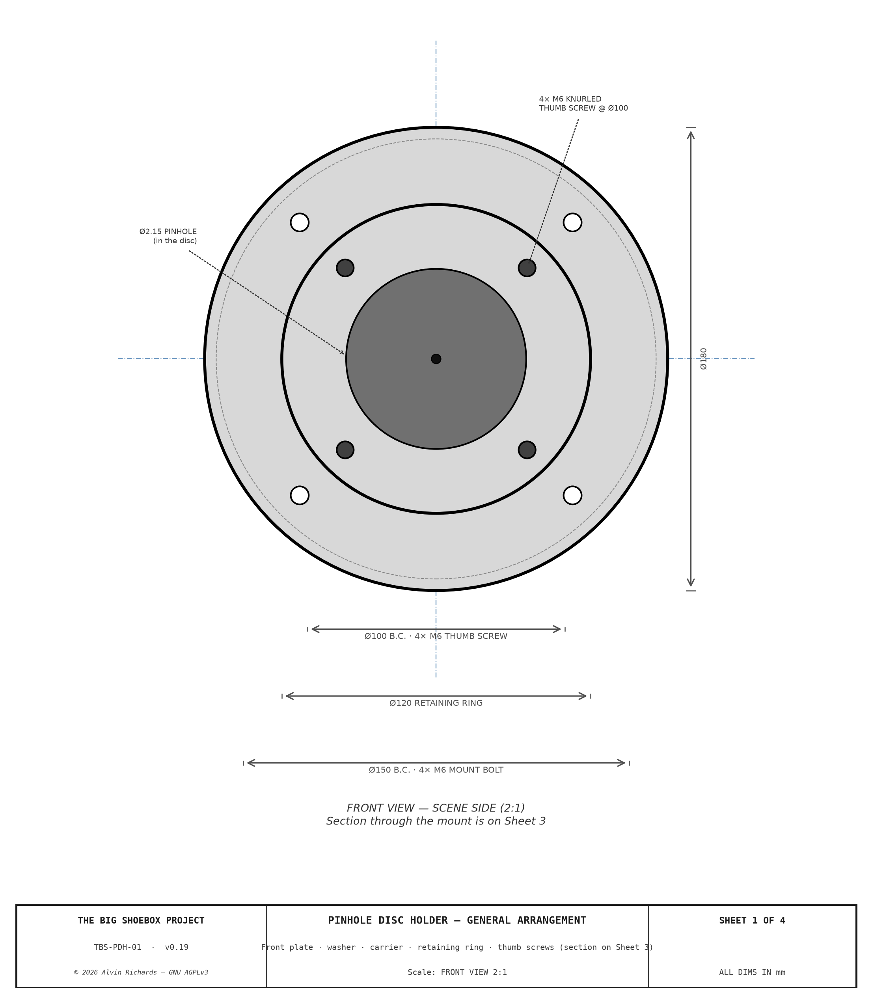
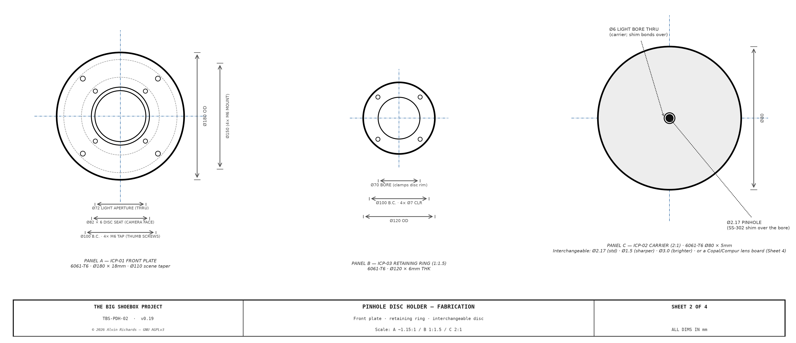
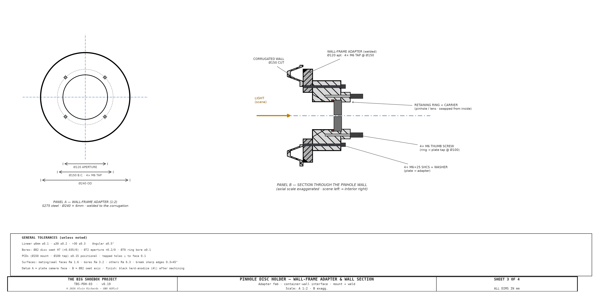
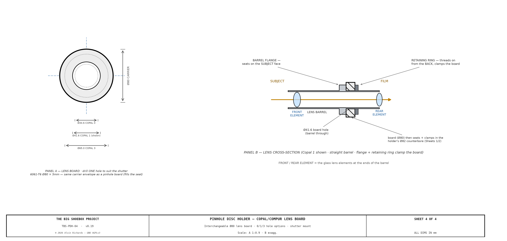

<!-- SPDX-License-Identifier: AGPL-3.0-only -->
<!-- © 2026 Alvin Richards -->
# Pinhole Disc Holder (Front Board)

## 1. Purpose

The front board carries the pinhole in the scene-facing long side wall of the container. This report specifies a simple **quick-change disc/lens-board holder**: an interchangeable **Ø80 carrier** is clamped against a neoprene light-seal washer by a circular retaining ring held with four thumb screws. Carriers swap in seconds — a pinhole board (any diameter), or a **large-format lens board** taking a Copal/Compur 0, 1 or 3 shutter — with no tools beyond fingers, so one compact holder serves as both the pinhole and the lens mount.

There is **no tilt or swing**. A pinhole is a point aperture: the image is a central projection *through the pinhole point*, determined only by the pinhole's position and the film plane, and is completely independent of the orientation of the plate that holds it. Tilting a pinhole board therefore does nothing to the image (it only moves the pinhole point by the small pivot offset). All perspective and keystone control lives in the **film-plane mechanism** (the rear standard), where tilting the *film* plane genuinely changes the projection.

---

## 2. Mechanism Overview

The holder is a compact front board mounted to the wall-frame adapter with a small bolt pattern (the adapter is part of this design, so it carries the matching pattern). Five elements:

- **ICP-01 Front plate** — **Ø180 round × 18mm** 6061-T6. Mounts to the wall-frame adapter (**4× M6 @ Ø150**); a Ø110 scene-side taper bore converging to a Ø72 light-aperture clearance bore; a Ø82 × 6mm counterbore that seats the carrier and reacts the weight of a lens; four M6 taps on a Ø100 circle (9mm clear of the counterbore wall) for the thumb screws.
- **Light-seal washer** — Ø82 OD × Ø72 ID × 1.5mm neoprene. The carrier presses against it, sealing the aperture under the clamp.
- **Interchangeable carrier (ICP-02)** — **Ø80 × 5mm** 6061 disc: either a pinhole carrier or a **large-format lens board** drilled for a Copal/Compur 0, 1 or 3 shutter (see §3). Every carrier shares this one envelope, so the retaining ring seats them all identically.
- **Circular retaining ring (ICP-03)** — Ø120 OD × Ø70 bore × 6mm 6061-T6. The Ø70 bore is smaller than the carrier so the ring clamps its rim; it clears the light path.
- **Four thumb screws** — M6 knurled, on the Ø100 circle, into the plate.

**Quick-change:** the carrier is retained only by the ring and four finger-operated thumb screws, so a carrier swap takes about 30 seconds with no tools (§7).

**Interactive 3D model** — the Ø180 front plate, neoprene washer, interchangeable carrier, retaining ring and thumb screws. Drag to orbit, scroll to zoom; **click the ring** to pull the retaining ring + thumb screws out along the optical axis and reveal the interchangeable carrier and the plate's four tapped holes (click again to re-seat).

<!-- brochure:skip -->

  

    <iframe title="TBS-001 Pinhole Disc Holder" frameborder="0" allowfullscreen mozallowfullscreen="true" webkitallowfullscreen="true" allow="autoplay; fullscreen; xr-spatial-tracking" execution-while-out-of-viewport execution-while-not-rendered web-share src="https://sketchfab.com/models/4ce663d3fe3e4a2e99c0643dad5bfffe/embed" style="position:absolute;top:0;left:0;width:100%;height:100%;border:0;"></iframe>
  

  
<a href="https://sketchfab.com/3d-models/tbs-001-pinhole-disc-holder-4ce663d3fe3e4a2e99c0643dad5bfffe?utm_medium=embed&utm_campaign=share-popup&utm_content=4ce663d3fe3e4a2e99c0643dad5bfffe" target="_blank" rel="nofollow" style="font-weight: bold; color: #1CAAD9;">TBS-001 Pinhole Disc Holder</a> by <a href="https://sketchfab.com/alvin91403?utm_medium=embed&utm_campaign=share-popup&utm_content=4ce663d3fe3e4a2e99c0643dad5bfffe" target="_blank" rel="nofollow" style="font-weight: bold; color: #1CAAD9;">alvin91403</a> on <a href="https://sketchfab.com?utm_medium=embed&utm_campaign=share-popup&utm_content=4ce663d3fe3e4a2e99c0643dad5bfffe" target="_blank" rel="nofollow" style="font-weight: bold; color: #1CAAD9;">Sketchfab</a>

<!-- brochure:endskip -->

The drawing set (TBS-PDH, 4 sheets): **Sheet 1** — general arrangement; **Sheet 2** — fabrication blueprints; **Sheet 3** — wall-frame adapter + a section through the container wall; **Sheet 4** — the Copal/Compur lens board. Sheets 2–4 carry the CNC‑shop tolerance block (§8).

---

## 3. Interchangeable Carriers — Pinhole & Large-Format Lens

Every carrier is a **Ø80 × 5mm** disc, clamped by the retaining ring, so the camera's front optic changes in seconds.

### Pinhole boards

| Board | Aperture | Effect |
|-------|----------|--------|
| **Standard pinhole** | Ø<!-- BEGIN fact:pinhole_diameter_mm -->2.15<!-- END fact:pinhole_diameter_mm -->mm | Rayleigh optimum for the <!-- BEGIN fact:focal_length_mm -->2,338<!-- END fact:focal_length_mm -->mm focal length — sharpest pinhole image (f/<!-- BEGIN fact:f_number -->1087<!-- END fact:f_number -->) |
| **Sharper pinhole** | Ø1.5mm | Finer detail, ~2× dimmer (longer exposure) |
| **Brighter pinhole** | Ø3.0mm | ~2× brighter (shorter exposure), softer image |

The Rayleigh-optimum pinhole diameter is d = 1.9·√(f·λ) = **Ø<!-- BEGIN fact:pinhole_diameter_mm -->2.15<!-- END fact:pinhole_diameter_mm -->mm** at λ = 550nm, giving f/<!-- BEGIN fact:f_number -->1087<!-- END fact:f_number -->. The focal length runs from the pinhole, in the shim on the carrier's camera face 24.5mm inboard of the wall, to the far wall. The carrier bore behind the shim is a 100° countersink opening to Ø14.9 on the scene face, so it does not clip the light reaching the film-plane corners (about 47° off-axis).

### Large-format lens boards

The same Ø80 carrier accepts a lens board drilled for a standard large-format shutter, converting the camera to a lens optic (sharp, fast, controllable aperture). The Ø72 light aperture clears the shutter barrel of the whole Copal/Compur range:

| Shutter | Lens-board hole | Fits (Ø80 carrier / Ø72 aperture)? |
|---------|-----------------|-------------------------------------|
| Copal / Compur **0** | 34.6mm | ✅ |
| Copal / Compur **1** | 41.6mm | ✅ |
| Copal / Compur **3** | 65.0mm | ✅ (Ø65 barrel < Ø72 aperture; ~7.5mm rim on the Ø80 board) |

Board-hole diameters per [lensnotes.com](https://lensnotes.com/photography/lens-board/) (Copal 3 = 65.0mm, matching Compur 3) and the [Intrepid Camera Large-Format Lens Explorer](https://intrepidcamera.co.uk/blogs/guides/the-large-format-lens-explorer) for 0/1 (§11). The lens board (drill one hole to suit) and how a Copal/Compur shutter mounts in it are drawn on **Sheet 4**.

**Carrying a lens's weight.** A large-format lens is cantilevered forward of the board, so the retention is designed to react its weight and tipping moment: the board seats **6mm deep** in the Ø82 counterbore (which takes the shear and the moment against its wall — not the clamp), and the Ø120 × 6mm ring is drawn down by **four M6 knurled thumb screws** for axial clamp force. For a heavy, permanently-mounted Copal 3 lens the thumb screws are simply run down firm; the seat, not the screws, carries the load.

---

## 4. Optical Specification

| Parameter | Value | Note |
|-----------|-------|------|
| Focal length | <!-- BEGIN fact:focal_length_mm -->2,338<!-- END fact:focal_length_mm -->mm | Pinhole (24.5mm inboard of the wall) to the far wall |
| Standard pinhole Ø | <!-- BEGIN fact:pinhole_diameter_mm -->2.15<!-- END fact:pinhole_diameter_mm -->mm | Rayleigh optimum, λ=550nm |
| f-number | f/<!-- BEGIN fact:f_number -->1087<!-- END fact:f_number --> | f / d |

The image is a central projection through the pinhole point. Tilt and swing are provided by the **film-plane (rear standard) mechanism** — see the [Film Plane Mechanism Report](film-plane-mechanism-report.md); the resulting distortions are rendered in [Distortion Renders](distortion-renders.md).

---

## 5. Light Sealing

The neoprene washer, seated on the floor of the Ø82 counterbore, seals the carrier-to-plate joint. Without it, light through the aperture could leak around the carrier's perimeter — the Ø80 carrier sits in the Ø82 seat with a ~1mm radial gap all round — into the camera. Every carrier is a **Ø80 × 5mm** disc (§3), so it fills the 6mm seat and stands ~0.5mm proud on the 1.5mm washer; tightening the thumb screws draws the retaining ring flat, pressing the carrier rim and compressing the washer against the seat floor to block the perimeter path. It is a single static compression seal. The Ø110 taper bore on the scene side and the Ø72 clearance bore behind the carrier form the light path; the carrier is the only opening. The plate-to-adapter joint is light-sealed by a 2.5mm black nitrile O-ring in a Ø171 face groove on the plate's adapter face, outside the Ø150 bolt circle (Sheet 2).

---

## 6. Wall Mounting

The pinhole wall (the scene-facing long side wall) is corrugated steel, so the front plate cannot seat on it directly. A flat steel **wall-frame adapter** — **Ø240 × 6mm S275**, welded to the interior crests of the corrugation — presents the machined flat datum; every alignment reference starts from its face. It carries **4× M6 tapped holes on the Ø150 circle** (matching the plate), a **Ø120 aperture** (clearing the Ø110 taper bore), and sits over a **Ø150 aperture** cut through the corrugation. The Ø180 front plate bolts to it with **4× M6×25 SHCS** at Ø150, each with a flat washer under the head. Fabrication and the full through-wall stack (weld, bolts, apertures, light path) are on **Sheet 3**.

---

## 7. Quick-Change

The holder is designed for a tool-free carrier swap. The four M6 knurled thumb screws are the only fasteners between the carrier and the outside world: releasing them frees the retaining ring, and the carrier (pinhole board or lens board) lifts straight out of the Ø82 counterbore seat. The new carrier drops onto the washer in the same seat, and the ring, drawn down evenly by the thumb screws, re-clamps it. A swap takes about 30 seconds; the carrier-swap steps are an operating task ([Operating Manual — Changing the Front-Board Carrier](operating-manual.md#11-changing-the-front-board-carrier-pinhole-lens)). The whole front board can also be unbolted from the wall-frame adapter (4× M6) if the plate itself needs service.

---

## 8. Machining Tolerances

| Feature | Nominal | Tolerance | Importance |
|---------|---------|-----------|------------|
| Front-plate carrier counterbore Ø82 | Ø82.000 | H7: +0.035/0.000 | Carrier seats concentric with the optical axis; reacts a lens's weight/moment |
| Carrier seat depth | 6.000mm | +0.1/0.0 | Positive location + moment reaction for a lens board |
| Light-aperture bore Ø72 | Ø72.000 | +0.2/0.0 | Clearance only — clears a Copal 3 shutter barrel (Ø65), must not vignette |
| Thumb-screw PCD Ø100 | Ø100.000 | ±0.2mm positional | Even clamp of the retaining ring; taps 9mm clear of the Ø82 counterbore wall |
| Retaining-ring bore Ø70 | Ø70.000 | ±0.1mm | Clamps the carrier rim without fouling the light path |
| Mount bolts M6 PCD | Ø150.000 | ±0.15mm positional | Must match the wall-frame adapter |

These are carried as a **CNC-shop tolerance block on Sheets 2–4**: general linear (±0.1 to ±0.3 by size) and angular (±0.5°) tolerances, the bore fits above, PCD positional tolerances (mount + tap), surface finish (mating/seal Ra 1.6, bores Ra 3.2), datum scheme (A = plate camera face, B = Ø82 seat axis), and black hard-anodize after machining.

---

## 9. Parts List

See the **[Master Shopping List, filtered to the front-board system](master-shopping-list.md?system=front-board)** for the same parts with suppliers, current prices, and click-to-sort/filter.

---

## 10. Service Items

The neoprene washer is the holder's main wearing part: it seals only while its seat is clean and unbroken, and it is a replaceable consumable once nicked or compression-set. The plate-to-adapter O-ring is static and long-lived; replace it whenever the plate is unbolted and the ring is nicked or flattened. The light seal also depends on the thumb screws holding the retaining ring flat. The SS-302 shim on a pinhole board is easily creased, so spare boards need flat, sleeved storage. The inspection schedule is an operating task ([Operating Manual — Maintenance](operating-manual.md)).

---

## 11. Source References

1. [Lenox Laser Precision Pinholes](https://lenoxlaser.com/blog/pinholes-and-apertures/) — Pinhole board fabrication (the standard Rayleigh pinhole and alternates, SS-302 shim).
2. [Intrepid Camera — Large-Format Lens Explorer](https://intrepidcamera.co.uk/blogs/guides/the-large-format-lens-explorer) — Large-format lens data and the Copal/Compur 0/1 lens-board hole diameters (34.6 / 41.6mm).
3. [lensnotes.com — Lens Boards](https://lensnotes.com/photography/lens-board/) — Standard board sizes + the full Copal/Compur shutter-hole set; Copal 3 = 65.0mm (matching Compur 3), the value adopted here over Intrepid's 61.5.
4. [S.K. Grimes — Lens Board Mountings](https://skgrimes.com/lens-board-mountings/) — how a Copal/Compur shutter mounts to a lens board (front flange + rear retaining ring); the Sheet 4 mount.
5. [Film Plane Mechanism Report](film-plane-mechanism-report.md) — Rear standard (film-plane) tilt and swing.
6. [Pinhole Wall & Front-Board Mount](pinhole-report.md) — the wall aperture and wall-frame adapter interface; pinhole optics are in the [Pinhole Optics Report](pinhole-optics-report.md).
7. [McMaster-Carr — Knurled Thumb Screws](https://www.mcmaster.com/products/thumb-screws/) — M6 knurled thumb screws for the retaining ring.
8. [McMaster-Carr — Neoprene Washers / Rubber Sheet](https://www.mcmaster.com/products/rubber/) — Light-seal washer stock.
