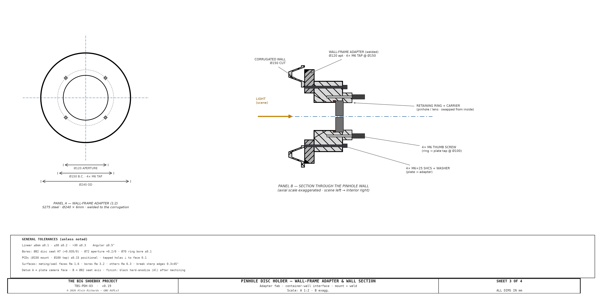

<!-- SPDX-License-Identifier: AGPL-3.0-only -->
<!-- © 2026 Alvin Richards -->
# Pinhole Wall & Front-Board Mount

## 1. Purpose

The pinhole wall is the far (scene-facing) end wall of the container — the plane that carries the camera's aperture. This report covers the **wall interface**: the aperture cut through the container wall and the flat **wall-frame adapter** that the front board bolts to. The front board itself — the interchangeable pinhole/lens mount — is the [Pinhole Disc Holder](pinhole-disc-holder-report.md); the pinhole optics are in the [Pinhole Optics Report](pinhole-optics-report.md).

> The disc holder takes either a pinhole board or a large-format lens board (Copal/Compur 0/1/3). Focus for a lens is set at the **film plane** (the rear standard's depth rail), so the front board needs no focus tube.

---

## 2. Wall Aperture

The far end wall is corrugated ISO container steel. A **Ø150 aperture** is cut through the corrugation on the optical axis (pinhole center: X = <!-- BEGIN fact:pinhole_x_mm -->2,454<!-- END fact:pinhole_x_mm -->mm on the long axis). It clears the front board's Ø110 scene-side taper bore with margin. The cut is not a precision feature: the adapter over it sets every alignment datum.

---

## 3. Wall-Frame Adapter

Corrugated steel cannot seat a machined plate, so a flat **Ø240 × 6mm S275 steel adapter** is welded to the interior crests of the corrugation, concentric with the aperture. Its machined face is the optical datum. It carries:

- **4× M6 tapped holes on a Ø150 circle** for the Ø180 front plate (the disc holder's mount pattern),
- a **Ø120 aperture**, clearing the Ø110 taper bore, and
- the flat face the front plate seals against.

The adapter is drawn with the through-wall section on Disc Holder Sheet 3:

---

## 4. Front Board (the mount)

The interchangeable pinhole/lens mount is the **[Pinhole Disc Holder](pinhole-disc-holder-report.md)**: a Ø180 front plate that bolts to the adapter and clamps an interchangeable **Ø80 carrier** (a pinhole board, or a Copal/Compur lens board) with a retaining ring and four thumb screws. A carrier swap takes about 30 seconds without tools. The mechanism, drawings, tolerances and parts are in that report.

---

## 5. Sealing & Light Integrity

Three joints keep light out:

- **Adapter → container wall:** a continuous weld around the adapter, so there is no light path past it.
- **Front plate → adapter:** a 2.5mm black nitrile **O-ring** in the **Ø166 face groove** on the plate's adapter face, outside the bolt circle so it also blocks light along the tapped holes, compressed by the 4× M6 mount bolts.
- **Carrier → front plate:** the neoprene washer under the carrier ([Disc Holder §5](pinhole-disc-holder-report.md)).

The carrier (pinhole or lens) is the only intended opening. Between exposures and during loading, a light-tight **dark slide** covers the aperture.

---

## 6. Parts

The adapter plate and the aperture dark slide are in the **[Master Shopping List, filtered to the optics system](master-shopping-list.md?system=optics)**; the front board's parts are under the [front-board system](master-shopping-list.md?system=front-board).

---

## 7. See Also

- [Pinhole Disc Holder (Front Board)](pinhole-disc-holder-report.md) — the interchangeable pinhole/lens mount (Ø80 carrier, retaining ring, thumb screws) that bolts to the adapter.
- [Pinhole Optics Report](pinhole-optics-report.md) — pinhole diameter, f-number, exposure.
- [Lens Options](lens-options.md) — large-format lens choices and coverage.
- [Film Plane Mechanism](film-plane-mechanism-report.md) — the rear standard, where focus (for a lens) and all perspective movements live.

---

## 8. Source References

1. [Intrepid Camera — Large-Format Lens Explorer](https://intrepidcamera.co.uk/blogs/guides/the-large-format-lens-explorer) — Copal/Compur lens-board hole sizes for the carrier.
