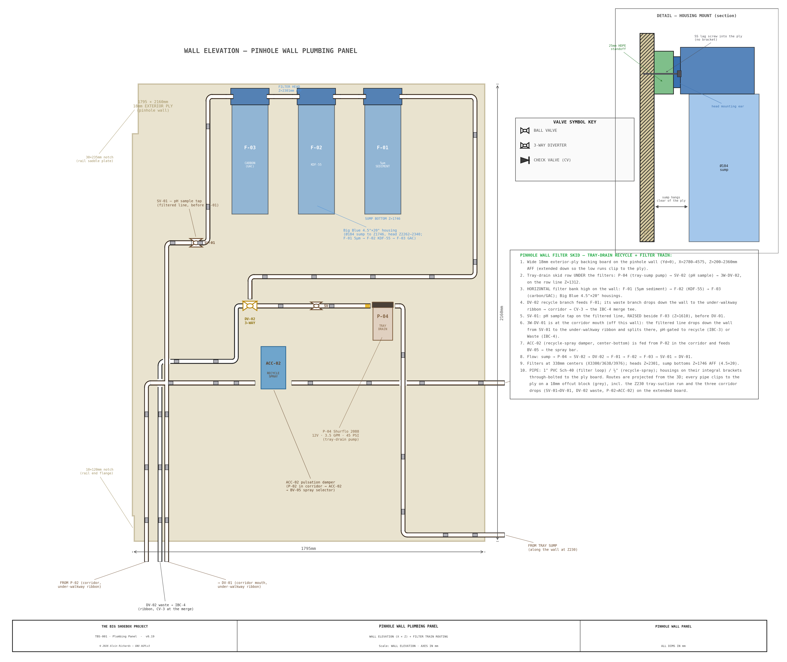
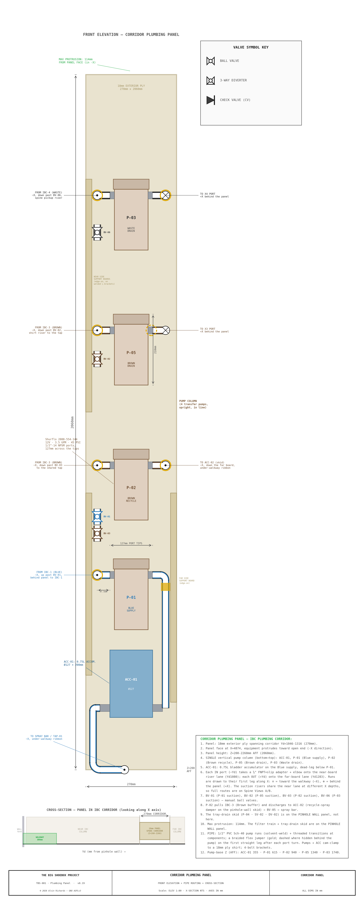
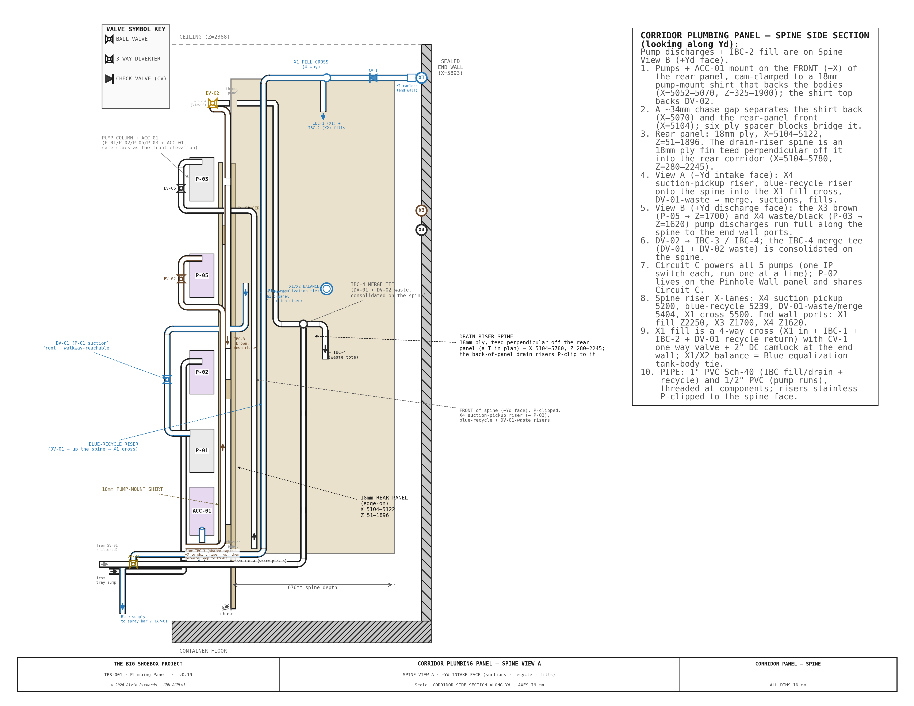
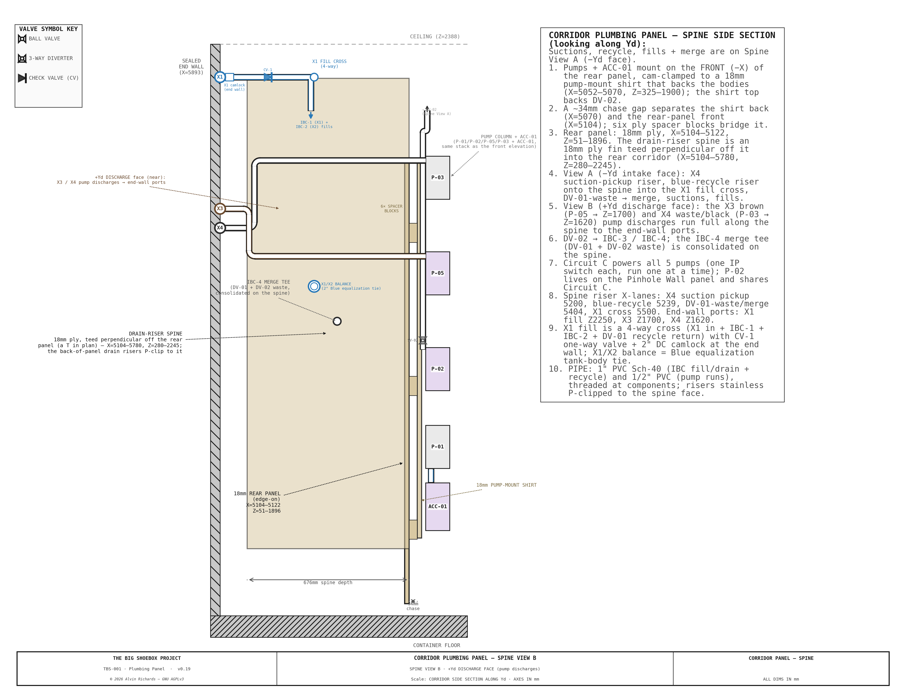
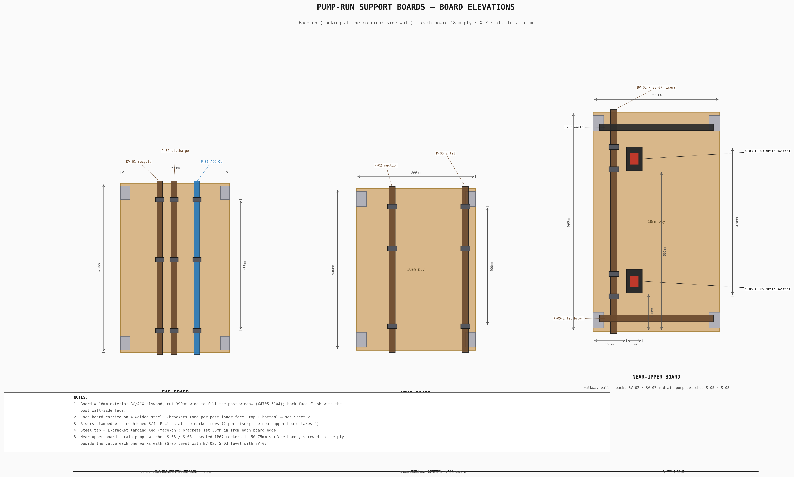
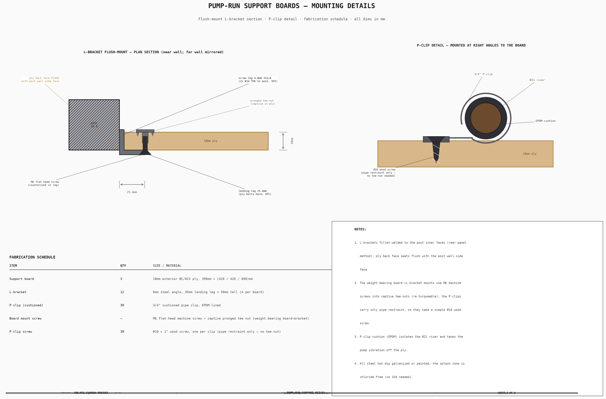

<!-- SPDX-License-Identifier: AGPL-3.0-only -->
<!-- © 2026 Alvin Richards -->
# Plumbing Report

<!-- brochure:skip -->
## Interactive 3D model

<div class="sketchfab-embed-wrapper" style="position:relative;width:100%;padding-bottom:56.25%;height:0;overflow:hidden;margin-bottom:1em;">
    <iframe title="TBS-001 Water System Model" frameborder="0" allowfullscreen mozallowfullscreen="true" webkitallowfullscreen="true" allow="autoplay; fullscreen; xr-spatial-tracking" execution-while-out-of-viewport execution-while-not-rendered web-share src="https://sketchfab.com/models/1dae932430924e9b993e153a16f485fc/embed" style="position:absolute;top:0;left:0;width:100%;height:100%;border:0;"></iframe>
</div>
<p style="font-size: 13px; font-weight: normal; margin: 5px; color: #4A4A4A;"><a href="https://sketchfab.com/3d-models/1dae932430924e9b993e153a16f485fc" target="_blank" rel="nofollow" style="font-weight: bold; color: #1CAAD9;">TBS-001 Water System Model</a> by <a href="https://sketchfab.com/alvin91403" target="_blank" rel="nofollow" style="font-weight: bold; color: #1CAAD9;">alvin91403</a> on <a href="https://sketchfab.com" target="_blank" rel="nofollow" style="font-weight: bold; color: #1CAAD9;">Sketchfab</a></p>
<!-- brochure:endskip -->

## 1. Purpose

The water-handling equipment mounts on **two plumbing panels**:

- The **Corridor Plumbing Panel** — an 18mm exterior-grade plywood board (white face for visibility) mounted vertically at the
  front (cargo-door-facing) mouth of the IBC plumbing corridor on the front-portal frame
  (<!-- BEGIN fact:corridor_width_mm -->270<!-- END fact:corridor_width_mm -->mm corridor width × 2,060mm tall). It carries the transfer pumps
  (P-01 Blue supply, P-02 Brown recycle, P-03 waste, P-05 Brown drain), the pressure
  accumulator (ACC-01), and the pump-suction isolation valves.
- The **Pinhole Wall Filter Skid** — the filter train + the tray-drain skid mounted on the
  pinhole wall: the tray-drain pump P-04, the skid-row sample tap (SV-02) and diverter (DV-02),
  the 3-stage Big Blue filter (F1/F2/F3), the filter-output sample tap (SV-01) and diverter (DV-01),
  and the recycle-spray damper (ACC-02).

Each panel concentrates its part of the system in one accessible location. The panels serve
three functions:

1. **Structural mounting surface** — provides a rigid, flat substrate for
   equipment that would otherwise require individual mounting brackets on the
   corrugated container walls.
2. **Plumbing coordination** — all pump suction and discharge lines, filter
   connections, and valve positions are organized on one face, minimizing pipe
   runs and simplifying maintenance.
3. **Accessibility** — the panel faces the open end of the container. The operator approaches from the right walkway
   and reaches into the <!-- BEGIN fact:corridor_width_mm -->270<!-- END fact:corridor_width_mm -->mm corridor to access the valves (the pumps are switched at the EP — §2.2).

---

## 2. Equipment Layout

The **Pinhole Wall Filter Skid** carries the
3-stage filter train + the tray-drain skid row P-04·SV-02·DV-02 (§2.1); the **Corridor Plumbing
Panel** carries the four corridor pumps (P-01/P-02/P-03/P-05) and the accumulator (§2.2–§2.3). Each panel has its
own front-elevation drawing; the corridor backside (drain-riser spine + Circuit-C power) is a
third sheet.

### 2.1 Pinhole Wall Filter Skid — Filter Train + Tray-Drain Row

Three 4.5"×20" Big Blue filter housings in a horizontal bank mounted on
the pinhole wall — the heads pinned just below the
ceiling, the sump bowls hanging below — so the walkway stays clear and the
operator reaches up to service them. The **tray drain** feeds the filters: tray sump
→ P-04 → SV-02 sample tap → 3W-DV-02 → F-01 (5μm sediment) → F-02 (KDF-55) →
F-03 (carbon) → SV-01 sample tap → 3W-DV-01. The tray-drain skid row (P-04·SV-02·DV-02)
sits directly under the filters; ACC-02 (the recycle-spray damper for P-02) is at the
panel's center-bottom.

**Pinhole Wall Filter Skid — Front elevation: **


| Stage | Media | Housing |
|-------|-------|---------|
| F-01 (sediment) | 5μm MPP melt-blown polypropylene | 4.5"×20" Big Blue |
| F-02 (heavy metal) | KDF-55 heavy-metal removal | 4.5"×20" Big Blue |
| F-03 (carbon) | CTO coconut-shell activated carbon | 4.5"×20" Big Blue |

Each housing has 1" NPT inlet and outlet on the head; the heads sit on a common
line and the sumps hang below, each housing carried on its own Pentair 244718 single-housing bracket.
Inter-housing piping connects F-01 OUT → F-02 IN and F-02 OUT → F-03 IN using
1" PVC pipe (threaded at the filter ports) with 90° elbows routed outside the housing
bodies. Each bracket machine-screws through 25mm plywood-offcut standoff blocks into back-face pronged
tee-nuts in the 18mm ply backing, giving sump-bowl clearance — no fabricated bracket (see the
**DETAIL — HOUSING MOUNT (section)** inset on the panel elevation above).

**Head clearance:** the 20" sumps hang at roughly shoulder height for the 1.75m scale operator. 10" cartiridges would proved head clearance, but a 50% of the change interval.

| Stage | Cartridge | Removes | Replace every |
|-------|-----------|---------|--------------|
| F-01 | 5μm MPP sediment | Gross sediment, fiber lint, Prussian blue particles | ~50 prints |
| F-02 | KDF-55 | Dissolved iron from ferricyanide wash water | ~60 prints |
| F-03 | CTO carbon block | Residual organics, color | ~40 prints |

### 2.2 Corridor Plumbing Panel — Pump Zone

**Four** Shurflo 2088 pumps mount on the Corridor panel (P-04, the tray-drain pump, lives on
the Pinhole Wall filter skid, §2.1). The accumulator ACC-01 sits at the column foot (§2.3).

| Pump | Circuit | Function |
|------|---------|----------|
| P-01 | Blue | Clean water supply to spray bar (via ACC-01) |
| P-02 | Brown | Recycle spray — pulls the clean IBC-3 buffer → ACC-02 → BV-05 → spray bar |
| P-03 | Black | Waste evacuation (IBC-4 → external drain X4) |
| P-05 | Brown | Brown drain-out (IBC-3 → external drain X3) |

All pumps are identical Shurflo 2088-554-144 units: 12VDC, 3.5 GPM, 45 PSI,
self-priming diaphragm. Vertical mount, ports at the head, 127mm body width ×
216mm body height × ~114mm protrusion. Each mounts on a stainless 4-bolt bracket
through the plywood. They sit in a single vertical column in the <!-- BEGIN fact:corridor_width_mm -->270<!-- END fact:corridor_width_mm -->mm corridor;
P-01 draws the Blue manifold (both top-tier totes), P-02 and P-05 share the IBC-3 bottom tap (near
column), and P-03 draws IBC-4 (far column).

#### Pump electrical — Circuit C1 (corridor) / C2 (tray drain)

The pump circuit is **dual-fused** off the Blue Sea fuse block, both legs under one **2-pole
master pump switch on the Electrical Panel (EP)** ([Electrical Report §7.2–7.3](electrical-report.md)):

- **C1** (15A fuse, 12 AWG dry feed) runs the ceiling trunk to a **12V DC distribution block**
  (positive + shared negative bus) on the rear of the corridor panel; from it a short 14 AWG
  marine-duplex branch feeds each of the four corridor pumps.
- **C2** (10A fuse, 12 AWG) is P-04's own run to the Pinhole Wall filter skid (§2.1).

| Item | Spec |
|------|------|
| Feed | C1: 12 AWG, 15A fuse (four corridor pumps) · C2: 12 AWG, 10A fuse (P-04) |
| Master switch | 1 × IP-rated 2-pole sealed switch, **mounted on the EP** — one cutoff for both legs; no per-pump switches (each Shurflo runs on its internal pressure switch) |
| Distribution | 12V DC + / − bus block on the rear of the plumbing panel, fed from C1 |
| Branches | 14 AWG marine duplex, ~0.5–1m, block → pump, curved-elbow conduit (<!-- BEGIN fact:pump_current_a -->5.2<!-- END fact:pump_current_a -->A / <!-- BEGIN fact:pump_draw_w -->62<!-- END fact:pump_draw_w -->W per pump) |

The four corridor pumps on C1 run **one at a time**: the open ball valves select the pump for
the current task, and that pump's Shurflo **internal demand/pressure switch** runs it on demand.
P-04 on C2 runs **concurrently** with the C1 supply pump, so the tray drains as fast as the spray
bar fills it (the continuous flow-through wash, [Water System Report §6](water-system-report.md)).
Each fuse carries a single pump with margin.
The distribution block sits **above the spill line**, IP-rated and sealed, with drip
loops, per the wet-zone rules in [Electrical Report §7.5](electrical-report.md); the
master switch is on the EP, clear of the wet zone.

**Corridor Plumbing Panel — Front elevation: the four transfer pumps (P-01/P-02/P-03/P-05), ACC-01, and full pipe routing**


**Spine side-sections (corridor side section) — two sheets, opposite
faces of the drain-riser spine** (18mm ply teed off the panel). Pumps mount on
the front face; the drain runs hang on the spine in the corridor gap clear of
both tote columns, each P-clipped on an 18mm ply-offcut block. Circuit C1 feeds
the four corridor pumps; P-04 lives on the Pinhole Wall filter skid on its own
fuse, C2. The two views share all structure + fittings as landmarks; each face's
own pipe runs appear on its own sheet, projected from the 3D model.

**Spine View A — intake face:** the four pump suctions through BV-01/03/02/06
(IBC-1 Blue, the shared IBC-3 bottom tap, the X4 waste pickup up the spine), the
DV-01 and DV-02 waste legs into the IBC-4 merge tee through CV-2 / CV-3, the IBC-1
fill off the X1 fill tee, and the Blue supply trunk.


**Spine View B — discharge face (a mirror of A):** the X3 brown (P-05) and X4
black (P-03) pump discharges running along the spine to the sealed end-wall
ports, P-01 → ACC-01, P-02 → ACC-02 (down the far board to the under-walkway
ribbon), the DV-01 recycle → IBC-3, and the IBC-2 fill.


### 2.3 Accumulator

| Parameter | Value |
|-----------|-------|
| Model | SeaFlo SFAT-075-125-01, 0.75L (23.5 oz) |
| Dimensions | 127mm OD × 200mm length |
| Position | Corridor panel, at the column **foot** (below P-01, so the accumulator sits at the base) |
| Port | 1/2" NPT, bottom |
| Function | Smooths P-01 pump cycling, maintains pressure when the pump is off |

ACC-01 sits inline on the Blue discharge path between the P-01 outlet and the spray-bar supply trunk (BV-05).
The accumulator's air bladder absorbs pressure pulsations from the diaphragm
pump, providing steady flow to the spray bar.

---

## 3. Valves

### 3.1 Ball Valves (Isolation)

| Valve | Size | Panel | Function |
|-------|------|-------|----------|
| BV-01 | 1/2" | Corridor | P-01 (Blue supply) suction isolation |
| BV-02 | 1/2" | Corridor | P-05 (Brown drain) suction isolation |
| BV-03 | 1/2" | Corridor | P-02 (Brown recycle) suction isolation |
| BV-04 | 1/2" | supply | TAP-01 chemistry-tap isolation |
| BV-05a | 1/2" | supply | Spray Blue/Brown **SELECTOR** — 1/2″ 3-way divert (same valve as DV-01/02) |
| BV-05b | 1/2" | spray bar | Spray-bar **ON/OFF** — 1/2″ 2-way ball valve |
| BV-06 | 1/2" | Corridor | P-03 (waste evacuation) suction isolation |

BV-01/BV-02/BV-03/BV-06 are the Corridor panel pump-suction isolation valves; **BV-04**
isolates the TAP-01 chemistry tap. These five, and BV-05b, are 1/2" Banjo V050FP quarter-turn
**2-way** ball valves (Grainger 803HZ1).

**BV-05 is the spray SELECTOR — split into two 1/2″ valves** rather than one 3-way L-port. Both the
Blue (fresh) and Brown (recycle) lines converge here, and the operator needs three states: Blue →
spray, Brown → spray, and off. A single 3-way that both selects *and* shuts off is only available
as an **L-port in 3/4″** (Banjo V075BL), which needs reducers to the 1/2″ lines and a verified OFF
detent, since some L-ports cross-connect the two inlets at the 4th quarter-turn. The design uses
**two plain 1/2″ valves** instead:

- **BV-05a — Blue/Brown selector:** a 1/2″ 3-way divert valve (the same US Plastic #22365 used for
  the diverters), plumbed **2 inlets → 1 outlet**, set at the panel to pick Blue or Brown.
- **BV-05b — spray on/off:** a 1/2″ 2-way ball valve at the **spray-bar feed**, where the operator
  controls flow during the wash pass.

This keeps everything **1/2″ (no reducers)**, avoids the L-port OFF-detent risk, costs less than the
3/4″ L-port, and puts the on/off where the operator's hand is.

### 3.2 Diverter Valves (3-Way)

| Valve | Size | Position | Function |
|-------|------|----------|----------|
| 3W-DV-01 | 1" FNPT | After the filter train + SV-01 sample tap | Routes filtered water to recycle (IBC-3 Brown buffer) or Black (IBC-4 waste) based on the SV-01 pH reading |
| 3W-DV-02 | 1/2" FNPT | Skid row, after SV-02 | Routes the tray-drain water into the filters (F-01, recycle) or straight to Black (IBC-4 waste), ahead of the filter train |

**3W-DV-02** sits ahead of the filters so any wash can bypass them and the recycle loop
entirely: wash 1 under the dichromate option, which carries most of the chromium, and
heavily contaminated drain water ([Water System Report §2.3, §4.2](water-system-report.md)).
Its settings are in the [Operating Manual §4.2](operating-manual.md).

**3W-DV-01** is the pH-gated valve, set from the **SV-01** sample (below): filtered water at pH <!-- BEGIN fact:brown_ph_lo -->6<!-- END fact:brown_ph_lo -->–<!-- BEGIN fact:brown_ph_hi -->7.5<!-- END fact:brown_ph_hi --> routes to
recycle (IBC-3 Brown buffer, which P-02 later sprays back); pH ><!-- BEGIN fact:brown_ph_hi -->7.5<!-- END fact:brown_ph_hi --> or discolored routes to Black (IBC-4).
Its settings are in the [Operating Manual §4.2](operating-manual.md).

### 3.3 Check Valves

| Valve | Size | Position | Function |
|-------|------|----------|----------|
| CV-1 | 1" NPT | X1 bulkhead fill line | Prevents backflow from the Blue totes to the external fill port |
| CV-2 | 1/2" | DV-01 reject riser, just below the IBC-4 merge tee | One-way into the merge — stops the IBC-4 riser draining back through DV-01 into the filter train |
| CV-3 | 1/2" | DV-02 waste riser, just below the IBC-4 merge tee | One-way into the merge — stops the DV-01 reject leg back-feeding the DV-02 leg |

The Shurflo 2088 pumps carry integral check valves, but those sit upstream of the diverters. CV-1
guards the one gravity (non-pumped) path, the X1 fresh fill. CV-2 and CV-3 make the two waste legs
one-way where they share the IBC-4 merge tee. All three are in the IBC zone, not on a panel.

### 3.4 Sample Taps (SV-01, SV-02)

| Valve | Size | Panel | Function |
|-------|------|-------|----------|
| SV-01 | 1/2" | Pinhole Wall | Filtered-Brown line (F-03 outlet → 3W-DV-01) — pH sample before the Blue/Black diversion |
| SV-02 | 1/2" | Pinhole Wall (skid row) | P-04 tray-drain discharge (→ 3W-DV-02) — pH sample before the recycle/waste diversion |

**SV-01** gives the filter output a sampling point. It is a 1/2" PP quarter-turn ball valve (same Banjo
family as the BV isolation valves) on a 1"×1/2" reducing branch tee, with a short
downturned hose-barb spout. It sits on the panel face **above the spill line**,
spout pointing toward the operator so a cup fits beneath it from the right
walkway. SV-02 is the same build on the P-04 discharge, ahead of 3W-DV-02.

SV-01 draws while P-04 pressurizes the filtered line; a ~50 ml sample sets 3W-DV-01
(recycle-return at pH <!-- BEGIN fact:brown_ph_lo -->6<!-- END fact:brown_ph_lo -->–<!-- BEGIN fact:brown_ph_hi -->7.5<!-- END fact:brown_ph_hi -->, Black-waste above pH <!-- BEGIN fact:brown_ph_hi -->7.5<!-- END fact:brown_ph_hi --> or on discoloration). The sampling
procedure is in the [Operating Manual §4.2](operating-manual.md).

---

## 4. Pipe Specifications

| Run | Schedule | Nominal Size | OD (mm) | Material | Notes |
|-----|----------|-------------|---------|----------|-------|
| Pump suction/discharge | Sch 40 | 1/2" | 21 | PVC Sch 40 | Matches Shurflo 2088 port thread |
| DV-02 outputs | Sch 40 | 1/2" | 21 | PVC Sch 40 | To F-01 (recycle) or IBC-4 (waste) |
| DV-01 outputs | Sch 40 | 1/2" | 21 | PVC Sch 40 | To Brown IBC-3 (recycle) or Black IBC-4 |
| Filter inter-stage | Sch 40 | 1" | 33 | PVC Sch 40 | Matches Big Blue 1" NPT ports |
| Filter outlet → DV-01 | Sch 40 | 1" | 33 | PVC Sch 40 | Gravity flow, lower restriction |
| IBC fill/drain (internal) | Sch 40 | 1" | 33 | PVC Sch 40 | IBC valve to corridor |
| IBC fill/drain (external bulkhead) | Sch 40 | 2" | — | PP (EPDM gaskets) | Bulkhead unions with camlock |
| Spray bar flex hose | — | 1/2" | — | Reinforced braided PVC | ~4m coiled, BV-05 to beam center feed |

All pump-driven internal runs use 1/2" pipe, matching the Shurflo 2088 pump
ports (1/2"-14 male parallel thread). This eliminates reducer fittings at pump
connections. The only reducer is a single 1/2"→1" bushing at the filter skid
inlet (DV-02 output to F-01 input).

### 4.1 Joint Convention

**Pipe joints are solvent-weld (slip socket) by default — the run is glued PVC.**
**Threaded (NPT) is used *only* where a run lands on a hard component that must be
removable for service:** pumps, filter housings, valves, check valves, tank
bulkheads, sample taps, and the accumulator. Each such interface uses a **slip×NPT
transition adapter** (a male adapter glued into the run, threaded into the
component's port). This keeps the run cheap and leak-free while every component
can be unscrewed for maintenance.

Classifying the BOM by this rule:

| Category | Connection | Parts |
|---|---|---|
| **Run joints — SLIP** | glued PVC socket | tees, elbows, cross, couplings, pipe |
| **Component interfaces — THREADED** | NPT (via slip×NPT adapter) | ball/diverter/check valves, camlocks, tank bulkheads, pump & filter ports, sample taps, accumulator |

### 4.2 Material: PVC Schedule 40 (justification)

The run pipe is **PVC Sch-40, solvent-welded**. PVC is chosen over HDPE because for this
service the deciding factors are **buildability and cost**, not the toughness where HDPE leads:

- **Joining — decisive for a hand-built system.** PVC solvent-welds with primer + cement and
  hand tools; HDPE *cannot be glued* — it needs heat-fusion equipment or bulkier, costlier
  mechanical/barbed fittings. Solvent-weld is what makes the §4.1 slip convention practical.
- **Pressure.** At the 45 PSI Shurflo 2088 service, Sch-40 (½" ≈ 600 PSI @ 73 °F) carries a
  ~13× margin — a non-issue for either material.
- **Chemistry.** Both are fully compatible with the dilute cyanotype wash (potassium
  ferricyanide, ferric ammonium oxalate, citric acid) — no advantage either way.
- **Cost & availability.** PVC pipe, fittings, and valves are the cheapest option and stocked
  everywhere (Home Depot); HDPE fittings are scarcer and pricier.

**The trade accepted:** HDPE's edge is toughness — impact, vibration, and freeze resistance
for a transported system. Both risks are mitigated operationally: the system is **drained for
transport** (no freeze-crack, less vibration mass) and every pump is de-coupled from the rigid
run on **both ports** — a **braided ½" flex jumper on the suction *and* discharge of all five
pumps** (P-04's suction is the 1" tray-drain hose), barb-coupled and SS-clamped, so pump vibration
can't fatigue-crack a solvent-weld joint; rigid runs are clipped at
close intervals. Runs stay off the sunniest wall face — PVC softens near 60 °C, though it
retains > 200 PSI hot, far above service. (If a future deployment must travel wet or in freezing
conditions, PEX is the tougher DIY alternative.)

### 4.3 Pump-run supports

The corridor pump risers and the back-of-panel drain runs cantilever off the pump ports and
tote taps, so each is backed and clamped rather than left hanging on its solvent-weld joints.
The method mirrors the rear panel: **18mm exterior-ply boards recessed flush** into the window
between the IBC-frame front and rear side-posts, carried on **welded steel L-brackets** (one leg
welded to each post inner face, the ply bolted to the landing leg), with the runs held to the
board face by **cushioned P-clips**.





- **Corridor side walls** — one board per wall, each tall enough to carry a **third clamp row**
  on its risers. The far (film-plane) side backs the DV-01
  recycle, P-02 discharge, and P-01→ACC-01 risers (3 clamp rows); the near-lower board carries the
  P-02 suction riser (BV-03) **and the P-01 suction riser (BV-01)** — the latter pushed onto the
  board face with two clamps straddling the valve; the near-upper board carries BV-02 / BV-06
  (P-05 / P-03 suction). Each riser is pulled flush onto its board plane, and the DV-01 recycle
  line runs down the far board between DV-01 and IBC-3.
- **Drain-riser spine** — the three gray/brown waste risers clamp to the spine's near face; the
  P-05→X3 and P-03→X4 lines running along the spine's far face toward the end wall clamp to it too.
  The far-face clips sit on 6.5mm shims rather than 18mm blocks: that lane is fixed by the
  pump-port turn, and a clip every ~200mm holds the line firmly at that standoff.
- **Filter skid** — the vertical skid runs (DV-02→F1, tray-sump→P-04, F3→SV-01) are pulled onto
  the backing panel and clamped, with the ACC-02 / SV-01 / DV-02-row horizontals held to the panel.

The corridor ball valves (BV-01 / BV-03 on the lower boards, BV-02 / BV-06 on the upper board) sit
below the clamp row above them, rotated 45° so their handles swing into the open corridor on the
diagonal — reachable while clear of the boards. Hardware: 3 side boards
(cut from the corridor ply sheet — no added ply), 12 welded L-brackets, and 46 cushioned 3/4"
P-clips (§8).

---

## 5. Flow Paths

### 5.1 Blue System — Clean Water Supply

```
IBC-1/IBC-2 → BV-01 → P-01 → ACC-01 → BV-05 → spray bar
```

P-01 draws from the Blue IBC manifold (the two Blue totes in parallel on the 1"
PVC manifold, through their DN50 tote valves), pressurizes through ACC-01 (0.75L accumulator),
and delivers to BV-05 on the spray-bar feed. A 4m flexible hose connects BV-05
to the spray bar center feed bulkhead.

### 5.2 Brown System — Used Water Recycling

```
Tray sump → P-04 → SV-02 sample → 3W-DV-02 → 1/2"→1" reducer → F-01 → F-02 → F-03
  → SV-01 sample tap → 3W-DV-01 → IBC-3 recycle (if pH 6–7.5) or IBC-4 waste (if above pH 7.5)
IBC-3 → P-02 → ACC-02 → BV-05 → spray bar   (recycle spray)
```

P-04 lifts drain water from the processing tray sump up to the filter bank and, via 3W-DV-02,
sends it into the 3-stage filter train. The SV-01 sample tap after the filters feeds the
pH check that sets 3W-DV-01: recycle (IBC-3 Brown buffer) or Waste (IBC-4). **P-02** then recirculates the clean IBC-3 buffer to the spray bar (via
ACC-02 and BV-05) — the recycle-spray loop.

### 5.3 Black System — Waste Containment

```
3W-DV-01 reject → IBC-4
3W-DV-02 wash 1 (dichromate option) / contaminated → IBC-4
IBC-4 → BV-06 → P-03 → external drain port X4
```

P-03 is dedicated to waste evacuation. X4 sits above the top of IBC-4, so the tote cannot drain
through it by gravity: P-03 pumps the waste up and out to the hauler's tanker
([Water System Report §4.3](water-system-report.md)). The same holds for X3 and P-05 on IBC-3. Each
port carries a tethered camlock dust cap whenever no hose is connected.

---

## 6. Mounting and Structure

### 6.1 Panel Mounting

The **Corridor Plumbing Panel** is secured to the IBC restraint front-portal frame uprights
(at the corridor mouth) at four points using L-brackets with M10 bolts.
The frame provides rigid lateral restraint — the panel does not contact the
container walls directly.

The **Pinhole Wall Filter Skid** uses no separate frame: each housing is carried on its own **Pentair 244718
zinc single-housing bracket** carrying the ~5kg filled housing. Each bracket fixes with **two 1/4"-20 zinc machine screws** (+ a washer spanning the 5/16-sized ear
bore) through its ears into **back-face pronged tee-nuts in the 18mm plywood backing** — a
re-torqueable joint, not wood or lag screws. 25mm plywood-offcut standoff blocks behind each ear
space the housing off the ply so the sump bowl hangs free and clears for cartridge changes.

### 6.2 Pump Mounting

Each Shurflo 2088 mounts on a stainless steel 4-bolt bracket (Shurflo OEM
accessory). The bracket screws through the plywood panel. Pump body orientation
is vertical with ports at the head (top), facing left and
right. This orientation minimizes the footprint on the 270mm-wide
panel and allows gravity to assist with priming.

### 6.3 Corridor Panel Protrusion Envelope

| Component | Protrusion from panel face (-X) |
|-----------|-------------------------------|
| Pump body (Shurflo 2088) | 114mm |
| Accumulator (ACC-01) | 127mm |
| Pipe fittings + valves | ~50mm |

The deepest item stands ~130mm proud of the panel face (tip ≈ X4744), clear of the film-plane
right rail at X<!-- BEGIN fact:film_plane_right_x_mm -->4,649<!-- END fact:film_plane_right_x_mm -->.

---

## 7. Pipe Routing Conventions

All piping on the plumbing panel follows the parallel-wall drawing convention
used throughout TBS-001 engineering diagrams:

- **Blue pipes** — front layer (closest to viewer/operator)
- **Brown pipes** — middle layer
- **Black/waste pipes** — rear layer (closest to panel)

Pipe crossings use the gap-break method (rear pipe broken at crossing) for pipes
of different system colors, and the bridge-arc method for same-color crossings.

Pipes enter and exit the panel zone at the left and right panel edges:
- **Left edge** (near wall side) — Blue IBC suction, Blue discharge
  riser to pinhole wall
- **Right edge** (far wall side) — Brown/Waste IBC connections,
  external drain routing

### 7.1 Corridor ↔ pinhole-wall ribbon (under the right walkway)

The four lines that connect the corridor equipment to the pinhole-wall skid —
P-02 → ACC-02 (recycle spray), the DV-02 waste → IBC-4, the filtered return
(SV-01 → DV-01), and the Blue supply trunk → TAP-01/spray bar — run together as a flat
**ribbon** in the otherwise-dead space **under the right-walkway grate**, in the
clear channel between the two walkway long beams (hugged to the outer/IBC edge,
clear of the print zone). The lanes ride **flush against the grate underside** so
the whole over-tray run clears the spray-bar carriage beneath it, and the two
middle lanes alternate (Blue trunk / Brown sump) so the blue and brown lines never
cross, and the ribbon stays out of the congested tray↔IBC gap.

At the first cantilever (nearest the pinhole wall) each line **loops up over the
cantilever** — then returns to the flush ribbon
height. Rather than dipping under the walkway support beam (which would foul the
spray carriage), each line crosses the **open corridor bay** — the outer long beam is
run in two simply-supported segments and omitted over the ~170 mm bay between the two
cantilever arms, so there is no beam to cross — and drops the **tray-edge slot** — clear
of the carriage travel — into the corridor, where it rises to its equipment connection. The pump-suction lines carry their own
service turns (P-04's sump pickup rises straight out of the widened sump well and
elbows flat into the ribbon lane at flush height — no over-deck loop; DV-01's filtered
return makes a square 90° turn into the diverter's IN port). The ribbon is carried by four welded steel cross-braces between the walkway
bearers, with the lines clipped to them. The full set of cross-sections — routing
envelope, clearances, and the open-bay corridor entry — is in
[Walkway Pipe Routing](walkway-routing-sections.md); routing is verified
collision-free by `src/models/check_interference.py` (the ribbon is a sanctioned
exception to the processing-tray exclusion zone — it runs above the tray rim, under
the grate).

---

## 8. Parts List

See the **[Master Shopping List, filtered to the water system](master-shopping-list.md?system=water)** for the full water BOM with suppliers, current prices, and click-to-sort/filter.

The panel-mounted equipment for both plumbing panels is part of the water system — see the filtered master BOM above (and the [Water System Report](water-system-report.md) §8). The panel ply/backing and mounting hardware are sourced there and in the IBC stacking frame line.

---

## 9. Maintenance

The serviceable parts are designed to be reached and replaced in place. The filter cartridges are
the consumable: F-03 (carbon) lasts ~40 prints, F-01 (sediment) ~50 and F-02 (KDF-55) ~60 (§2.1).
Every component that needs service lands on a threaded interface (§4.1), the Big Blue sumps hang
clear of the backing ply for cartridge changes (§6.1), and ACC-01 holds a 30 PSI pre-charge. The
inspection schedule and service procedures are in the
[Operating Manual — Maintenance](operating-manual.md#maintenance).

---

## 10. Source References

1. [Shurflo 2088-554-144 datasheet](https://www.shurflo.com/products/2088-series) — 12VDC diaphragm pump, 3.5 GPM, 45 PSI,
   self-priming. 127mm × 216mm × 114mm body dimensions, 1/2"-14 NPSM ports.
2. [Pentek Big Blue 4.5"×20" housing specifications](https://www.pentair.com/en-us/water-treatment-components/filter-housings/big_blue_heavy_duty_series.html) — 1" NPT inlet/outlet,
   184mm OD, ~594mm total height, polypropylene head.
3. [SeaFlo accumulator specifications](https://www.seaflo.com/products/accumulator-tank) — 0.75L capacity, 125 PSI max, 1/2" NPT
   port, 127mm OD × 200mm length.
4. [Purcooflow WHF2045B302](https://www.purcooflow.com/products/whf2045b302-3-stage-kdf-heavy-metal-water-filter) — 3-stage whole-house filter, 4.5"×20" Big Blue
   cartridges, 1" NPT inlet/outlet, integrated mounting bracket.
5. [Water System Report](water-system-report.md) — Flow circuits, chemistry, and waste
   handling.
6. [Equipment Layout Report](equipment-layout-report.md) — Component positions,
   IBC corridor dimensions, line-of-sight clearance.
7. [IBC Stacking Report](ibc-stacking-report.md) — IBC arrangement, stacking
   frame, external bulkhead ports, internal pipe routing.
8. [Processing Tray & Spray Bar Report](processing-tray-and-spray-bar.md) —
   Tray sump, P-04 suction pickup, spray bar connection to BV-05.
9. [Walkway Pipe Routing](walkway-routing-sections.md) — Cross-sections of the
   corridor↔pinhole-wall ribbon under the right walkway: routing envelope,
   clearances, the open-bay corridor entry, and the spray-carriage clearance (§7.1).
