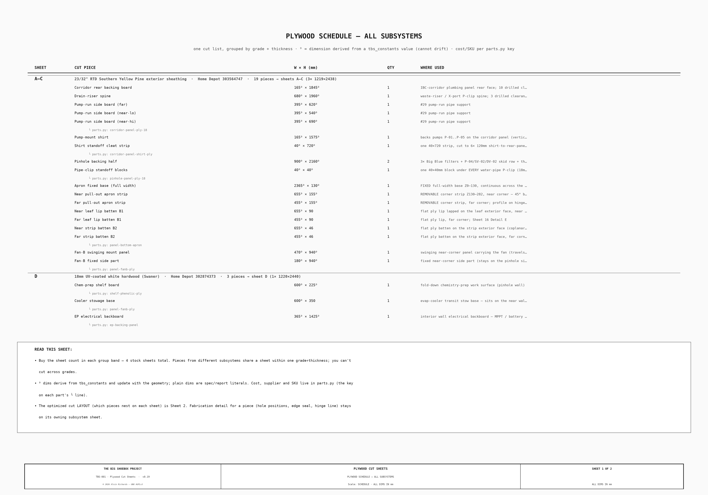
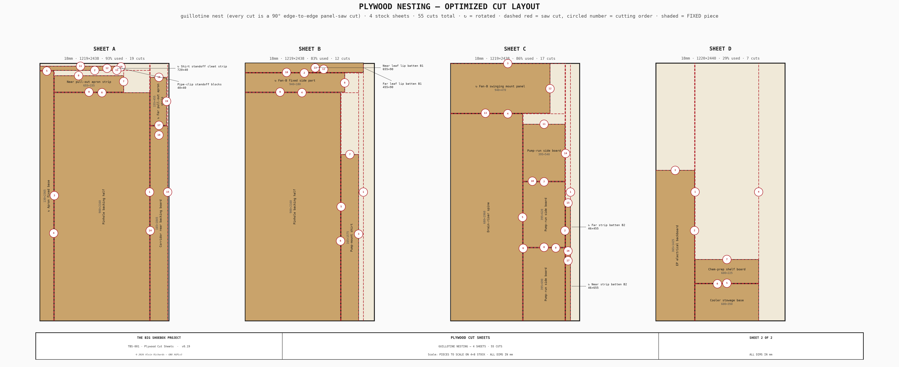

<!-- SPDX-License-Identifier: AGPL-3.0-only -->
<!-- © 2026 Alvin Richards -->
# Plywood Cut Sheets — TBS-001

## 1. Purpose

This document is the **single cut sheet** the buyer and fabricator work
from: every plywood part in one schedule, grouped by grade and thickness so same-stock parts nest on
one sheet.

Geometry-driven dimensions derive from `tbs_constants` and are marked ᴰ on the schedule; the rest
are spec literals. Cost, supplier and SKU live in `parts.py`, keyed on each part's registry entry.
Fabrication detail for a piece (hole positions, edge seal, hinge line) stays on its owning
subsystem sheet; this document is the stock and cut index.

## 2. Schedule

Every plywood cut piece, grouped by stock. The `parts.py` key under each part is where its cost and
supplier live.

## 3. Nesting Layout

A bin-packer nests all pieces of one grade and thickness onto the fewest 4×8 sheets, **mixing
pieces across subsystems**. Every layout is **guillotine-cuttable**: each cut is a straight 90°
edge-to-edge pass. The drawing numbers the cuts (dashed red) in
cutting order and gives the sheet and cut counts. The packer works to a **5mm cut tolerance**, so a
near-full-width piece may overhang a sheet edge by up to 5mm rather than forcing a new sheet. It
minimizes the sheet count first, then the number of cuts. ↻ marks a piece rotated 90° to fit, and
shaded pieces are fixed.

## 4. Stock Sheets

| Sheets | Thickness | Grade | Parts |
|---|---|---|---|
| A–C | 18mm (23/32") | RTD Southern Yellow Pine exterior sheathing ([Home Depot 303564747](https://www.homedepot.com/p/23-32-in-x-4-ft-x-8-ft-RTD-Southern-Yellow-Pine-Wood-Sheathing-Plywood-129323/303564747)) | corridor plumbing panel, pump-mount shirt, pipe-clip standoff blocks, pinhole-wall backing, pull-out corner apron (fixed base, corner strips, lip battens), Fan-B mount band |
| D | 18mm | UV-coated white hardwood, Swaner ([Home Depot 302874373](https://www.homedepot.com/p/302874373)) | chem-prep shelf board, EP backboard, cooler stowage base |
| | | **Total** | **4 sheets** |

Sheets A–C are one SKU, so their parts nest together across subsystems. The pinhole-wall backing is
wider than a sheet, so it is cut as two butt-jointed halves. Sheet D's UV-white stock yields the
chem-prep work surface, the EP backboard and the cooler stowage base: the backboard and base need
only a sealed, wipeable face, which the UV coating gives, and moving the base here lets the pine pack
onto three sheets. Sheet D is a different finish from A–C, so it cannot cross-nest. All plywood is
standard exterior grade; no part carries a water-immersion load, so none is marine or
pressure-treated.

## 5. Source References

- Cut geometry — [`tbs_constants.py`](https://github.com/alvinr/tbs/blob/main/src/generators/tbs_constants.py) (single source), drawn by
  [`generate_plywood_cutsheets.py`](https://github.com/alvinr/tbs/blob/main/src/generators/generate_plywood_cutsheets.py).
- Cost / supplier / SKU — [`parts.py`](https://github.com/alvinr/tbs/blob/main/src/generators/parts.py) (`timber-ply` registry entries).
- Fabrication detail per piece — the owning subsystem reports: [Plumbing](plumbing-report.md),
  [Electrical](electrical-report.md), [Hinged Light-Trap Panel](hinged-panel-report.md),
  [Chemistry Prep Shelves](chemistry-prep-shelves.md).
