<!-- SPDX-License-Identifier: AGPL-3.0-only -->
<!-- © 2026 Alvin Richards -->
# Processing Tray & Spray Bar Assembly

## 1. Purpose

Cyanotype prints on muslin substrate (<!-- BEGIN fact:film_plane_width_mm -->4,389<!-- END fact:film_plane_width_mm --> × <!-- BEGIN fact:film_plane_height_mm -->2,094<!-- END fact:film_plane_height_mm -->mm) require a controlled flood wash
to remove unexposed sensitizer chemistry after UV exposure. The processing tray provides
the containment surface and the spray bar delivers even water distribution across the
full print width. Together they form the print washing subsystem of the
[water system](water-system-report.md).

**Design goals:**

- Flood the entire print surface uniformly in a single pass (~44 seconds)
- Contain all wash water within a sealed tray — no penetration of the container floor
- Drain water to a sump for pump-out and recycling via the Brown circuit
- Single-operator use from the walkway — no stepping on the print surface
- Permanently installed — no removal required for transport mode conversion

<!-- brochure:skip -->
**Interactive 3D model** — the processing tray, spray-bar gantry, carriages, feed manifold, and push pole. Drag to orbit, scroll to zoom.

  

    <iframe title="TBS-001 Spraybar Model" frameborder="0" allowfullscreen mozallowfullscreen="true" webkitallowfullscreen="true" allow="autoplay; fullscreen; xr-spatial-tracking" execution-while-out-of-viewport execution-while-not-rendered web-share src="https://sketchfab.com/models/18fb381fbf48459cac25dcaa23958387/embed" style="position:absolute;top:0;left:0;width:100%;height:100%;border:0;"></iframe>
  

  
<a href="https://sketchfab.com/3d-models/tbs-001-spraybar-model-18fb381fbf48459cac25dcaa23958387?utm_medium=embed&utm_campaign=share-popup&utm_content=18fb381fbf48459cac25dcaa23958387" target="_blank" rel="nofollow" style="font-weight: bold; color: #1CAAD9;">TBS-001 Spraybar Model</a> by <a href="https://sketchfab.com/alvin91403?utm_medium=embed&utm_campaign=share-popup&utm_content=18fb381fbf48459cac25dcaa23958387" target="_blank" rel="nofollow" style="font-weight: bold; color: #1CAAD9;">alvin91403</a> on <a href="https://sketchfab.com?utm_medium=embed&utm_campaign=share-popup&utm_content=18fb381fbf48459cac25dcaa23958387" target="_blank" rel="nofollow" style="font-weight: bold; color: #1CAAD9;">Sketchfab</a>

<!-- brochure:endskip -->

---

## 2. Processing Tray

### 2.1 Specification

| Parameter | Value | Rationale |
|-----------|-------|-----------|
| Material | 16-gauge (1.5mm) 304 stainless steel, 2B mill finish | Chemically inert to ferricyanide wash water; resists pitting from citric acid pH adjustment. 2B (not #4 brushed) — the brush is a cosmetic upcharge unneeded for a drain pan ([tray research](tray-research.md)) |
| Overall footprint | 4,349 × 2,200mm (2 panels, field-bolted) | Fits inside film plane rails (X=<!-- BEGIN fact:film_plane_left_x_mm -->260<!-- END fact:film_plane_left_x_mm -->–<!-- BEGIN fact:film_plane_right_x_mm -->4,649<!-- END fact:film_plane_right_x_mm -->) with 20mm clearance per side |
| Panel size (each) | 2,195 × 2,200mm | Two equal panels ((4,349 + 40mm lap)/2), joined at the midpoint by a ~40mm shingle-oriented lap (silicone-sealed, 12× M6×16). Each panel fits through the cargo door opening (2,340 × 2,280mm) |
| Rim height | 50mm (all four sides) | Contains 6mm flood depth with margin; constrained to ≤75mm by film plane carriage clearance |
| Floor-to-rim height | 50mm | Tray sits on tapered HDPE shim strips on the container floor |
| Fall | 1:200 **Yd-only** (10mm over 2,200mm, far rim → near rim); level across X | Level-across-X keeps the full-width spray beam level so it clears the walkway arms; lateral drainage is off the surface via the near-rim gutter |
| Near-rim gutter + center pickup | full-width gutter falls 1:200 inward to a 180 × 100mm × 20mm center pickup well (X=2,386) | Self-draining to one pickup; well bottom rests on the container floor (Z0) |
| Weight (empty) | ~114 kg (2 panels × ~57 kg) | 304 SS, 1.5mm × 4.78 m² per panel × 7.93 kg/m² per mm |
| Weight (operating, 6mm flood) | ~171 kg | Tray + ~57 kg water (6mm over the 4,349 × 2,200mm tray ≈ 57 L) |

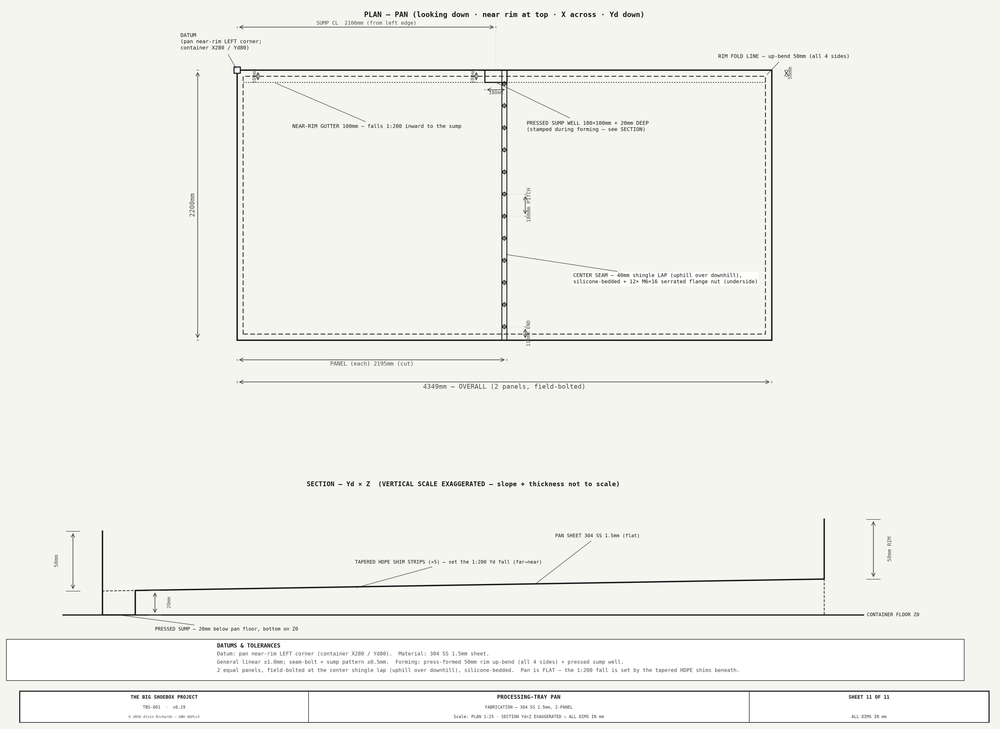

### 2.2 Slope Support — Tapered HDPE Shim Strips

The tray's 1:200 **Yd-only** slope (far rim → near rim, level across X) is achieved by tapered
HDPE shim strips bonded to the container floor beneath the tray. No risers, no under-tray plumbing —
the tray sits directly on the shims; the surface sheets to the near-rim gutter, which falls inward to
the single center pickup.

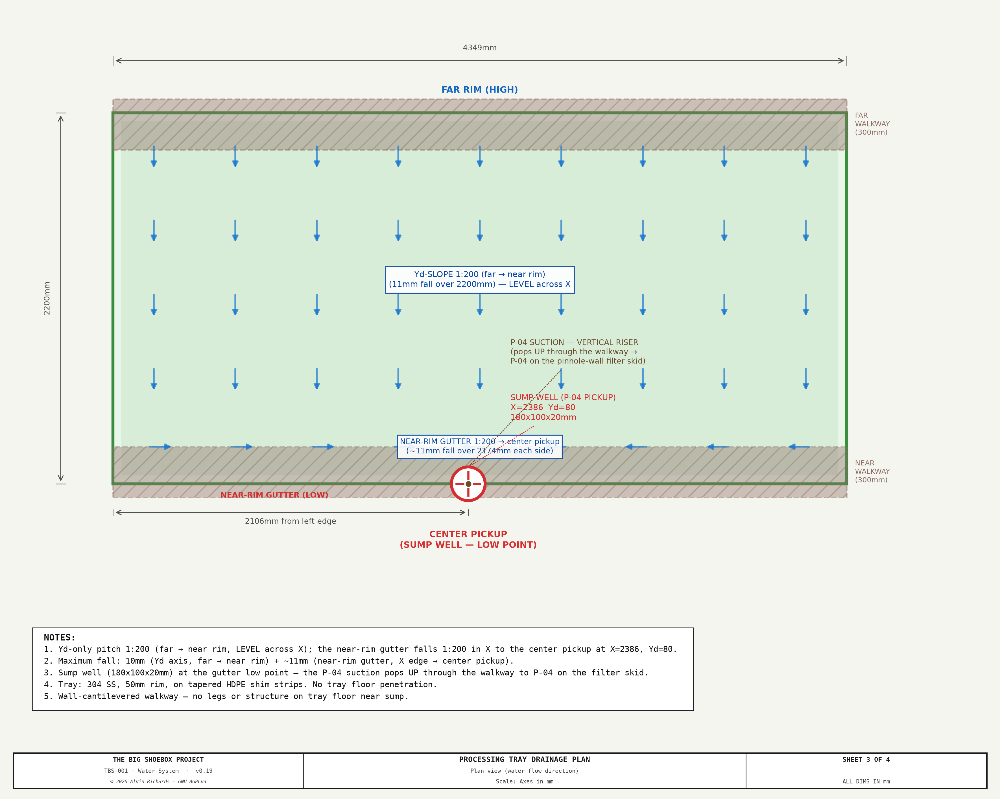

| Parameter | Value |
|-----------|-------|
| Material | HDPE flat bar, 50mm wide |
| Quantity | 5 strips running full tray depth |
| Spacing | ~1,000mm apart across tray width (X direction) |
| Profile | Tapered: ~20mm at near rim (drain end — raised so the 20mm sump well bottom rests on the container floor) → ~30mm at far rim |
| Attachment | Construction adhesive (Loctite PL Premium or equivalent) to container floor |
| Function | Creates the Yd-axis slope; the surface is **level across X** (no crown) — lateral drainage is via the near-rim gutter to the center pickup |

### 2.3 Sump Well and Pickup

Instead of a through-floor drain fitting, the near-rim gutter drains to a shallow pickup well
pressed into the floor at the **center** low point. P-04 draws from the well via a suction pickup
that rises through the walkway grate, turns to the pinhole wall at deck level, rises up the wall
clear of the walkway cantilever brackets, and runs along the pinhole wall to P-04 on the filter
skid — no penetration of the tray or container floor.

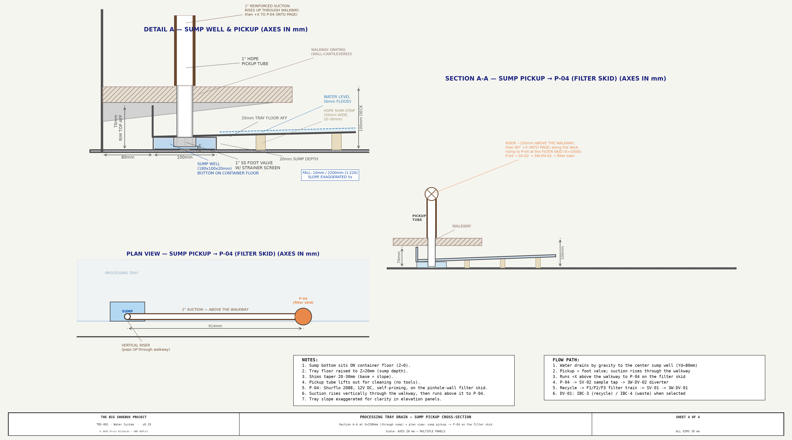

| Parameter | Value |
|-----------|-------|
| Sump dimensions | 180mm (X) × 100mm (Yd) × 20mm deep |
| Pickup location | near-rim gutter low point, **X=2,386 (center)** |
| Forming | Pressed/stamped into tray panel during fabrication |
| Pickup tube | 1" PVC dip tube, stainless foot valve with strainer screen |
| Pickup height | Tube bottom 5mm above sump floor (leaves ~0.75 L residual) |
| Suction line | 1" flexible reinforced hose — rises through the walkway grate, turns to the pinhole wall, up the wall clear of the cantilever brackets, then along the wall → P-04 on the filter skid |
| Pump | P-04 (Shurflo 2088, 12V DC, 3.5 GPM, 45 PSI, self-priming) |
| Discharge | P-04 → SV-02 → 3W-DV-02 → filter train → IBC-3 (Brown buffer), or straight to IBC-4 (Waste) ([Water System Report §4.2](water-system-report.md)) |

**Why sump pickup instead of a through-floor drain:**

1. **No penetration** — eliminates leak risk from a bulkhead fitting seal
2. **No under-tray clearance needed** — tray sits flat on shim strips
3. **Simpler fabrication** — pressed sump is cheaper and more reliable than a welded bulkhead union
4. **Easier to protect** — no exposed plumbing beneath the tray during transport
5. **Field-serviceable** — pickup tube lifts out for cleaning; no tools required

### 2.4 Containment Liner

A fresh 6-mil black LDPE sheet is laid over the tray surface before each session. The
liner prevents direct stainless-to-print contact (avoiding metallic marks on wet
cyanotype) and simplifies cleanup. The liner overlaps the tray rims by 50mm and is cut or
folded around the sump pickup tube ([Operating Manual §0.5](operating-manual.md)).

### 2.5 Clearance Verification

| Constraint | Clearance | Status |
|------------|-----------|--------|
| Film plane carriage blocks | 90mm above tray rim (140 − 50) | Clear |
| Film plane rails at X=<!-- BEGIN fact:film_plane_left_x_mm -->260<!-- END fact:film_plane_left_x_mm --> and X=<!-- BEGIN fact:film_plane_right_x_mm -->4,649<!-- END fact:film_plane_right_x_mm --> | 20mm gap between tray edge and rail | Clear |
| Spray-bar carriage (rides on the raised/sloped tray floor beneath the walkway grating) | ~30mm at the worst (far-left) carriage — Ø32 wheels + 1½in-square SS beam, (see [Walkway Routing Sections](walkway-routing-sections.md) §H-H) | Clear |
| IBCs (X=4,674+, right end zone) | Tray ends — 45mm gap | Clear |
| Tray-sump suction hose | Routes exterior to the tray basin (up the walkway grate + pinhole wall) | Clear |

### 2.6 Permanent Installation

The processing tray is permanently installed — it remains in place during both
operational and transport modes. The two panels are positioned between the film plane
rails and joined at the center seam by a **~40mm lap** — the uphill panel laps *over* the
downhill one (shingle-oriented) so water sheets down over the step without damming on the
sloped floor — bedded in silicone and bolted with 12× M6×16 + serrated flange nuts on the
underside, with a silicone bead along the top lap edge. The P-04 suction pickup sits in the
center pickup well permanently. The 50mm rim height is below all transport-mode clearance
envelopes, so no removal is required for mode conversion.

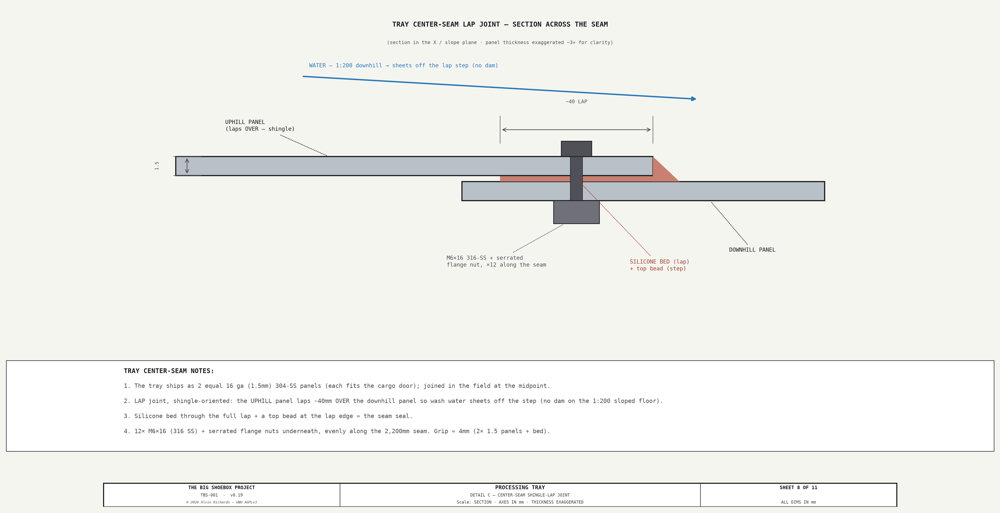

### 2.7 Why This Slope + Drainage Design

The drainage geometry is set by one requirement chain:

1. **The spray nozzles run the full print width.** They are 90° down-jets firing *down* onto the
   print, and the walkway grate sits *above* the beam — so there is no reason to stop the jets at
   the open zone. The beam therefore spans the full tray width (X=310–4,599).
2. **A full-width beam that rides the tray floor must stay level across X.** The beam is rigid and
   its wheels ride the floor. If the floor slopes across X (a dual-axis fall to one corner), the
   beam's far end rides up ~24mm into the *level* walkway support arms. So the surface **falls in Yd
   only** and is **level across X** — the beam stays level and clears the arms.
3. **Lateral drainage is handled off the surface.** A Yd-only surface would strand water along the
   near rim, so a **near-rim gutter** collects it and **falls 1:200 inward to a single center
   pickup** — self-draining (no squeegee), with gravity running toward the operator on the wash
   sweep, within the same 20mm vertical budget as the sump well.

The result is edge-to-edge direct spray, effortless single-pickup drainage, and a walkway whose
support arms the beam clears — see the sections below.

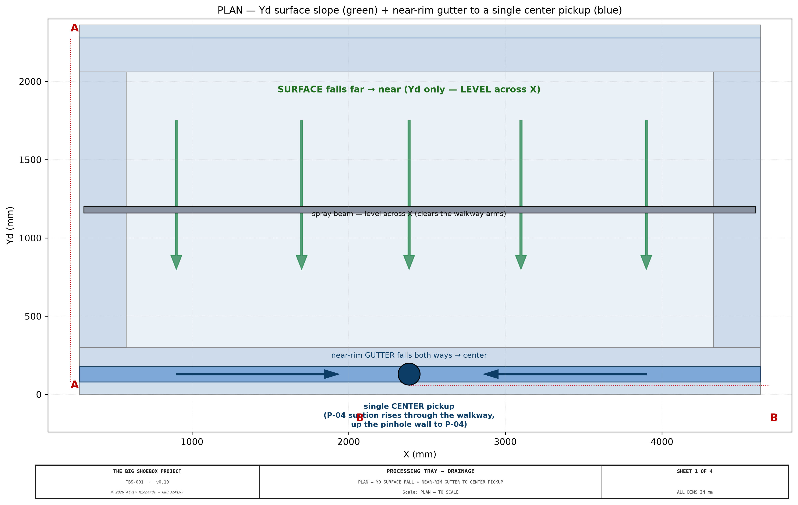

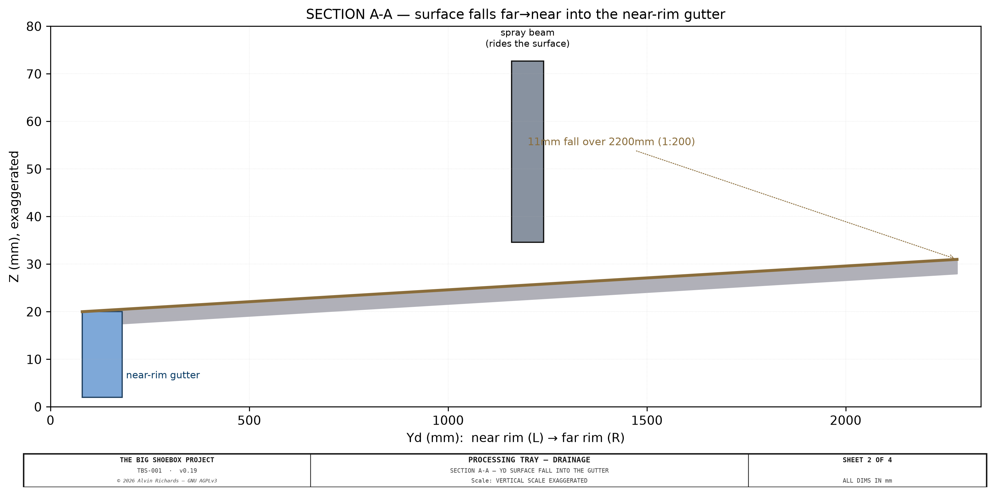

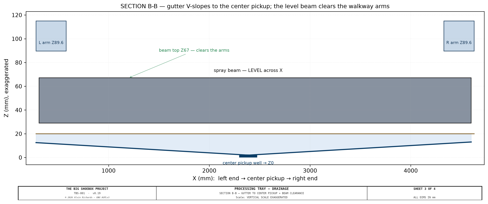

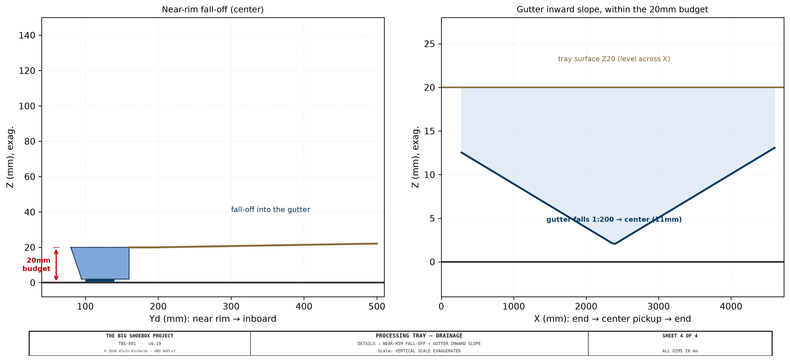

---

## 3. Spray Bar Assembly — Gantry Design

### 3.1 Design Concept

The spray bar delivers wash water evenly across the processing tray — recycled Brown for the
first wash, clean Blue for the rest. The operator slides the bar along the tray (Yd direction, from film-plane side
toward the pinhole wall), flooding the print surface progressively.

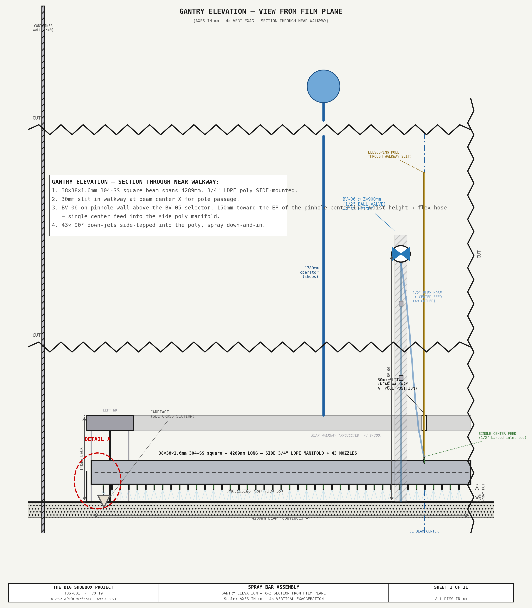

The beam spans <!-- BEGIN fact:spray_beam_span_mm -->4,289<!-- END fact:spray_beam_span_mm -->mm between the inner edges of the left and right walkways, extending under the walkway grating at each end. At each end, a
two-wheel carriage rolls on the processing tray floor beneath the grating. A 3/4" LDPE irrigation poly pipe clipped to the beam's inboard side face serves as the
spray manifold — the supply hose feeds it at its center through a single barbed inlet tee by
the ball joint. The 3/4" bore is far larger than the 3.5 GPM flow demands, so pressure holds
uniform end-to-end (~0.1 PSI drop across the full span) from that one feed — no multi-point
distribution is needed. Water exits through <!-- BEGIN fact:spray_bar_nozzle_count -->43<!-- END fact:spray_bar_nozzle_count --> barbed 90° down-jets that side-tap the
manifold and spray straight down, at 100mm pitch along the beam.

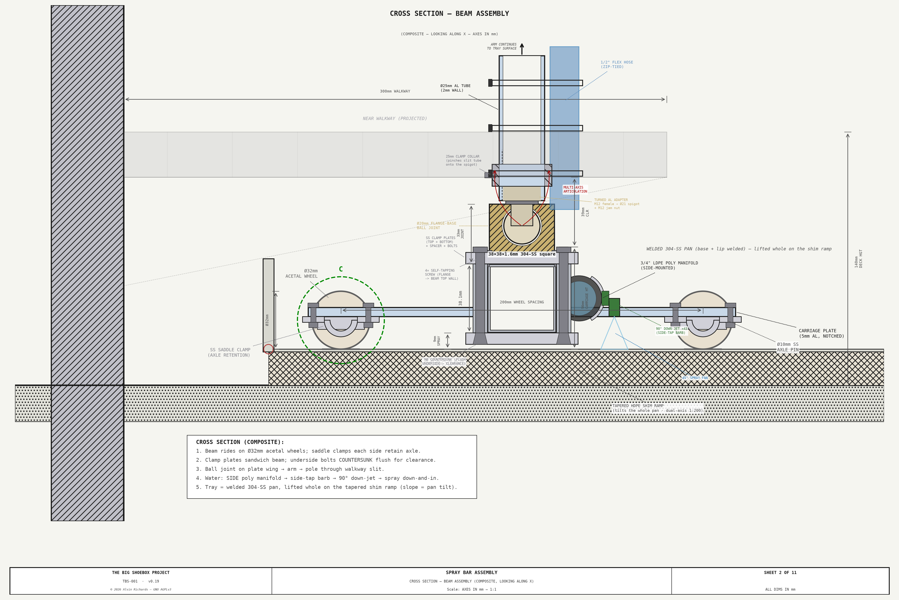

**Design constraints:**

- Carriage plate top must clear walkway grating underside — no contact during travel
- Wheels must fit within the 50mm tray rim height, rolling on the tray floor beneath walkways
- Single-operator use — push/pull from the near walkway via telescoping pole through a 30mm slit
- Must travel 2,200mm (tray depth, near rim to far rim)
- Tray rim walls provide lateral guidance — no separate guide rails required
- Must accommodate a flexible water connection that follows the bar as it moves

### 3.2 Assembly Components

| Component | Specification | Qty | Purpose |
|-----------|--------------|-----|---------|
| Beam | 304 SS 1½×1½×0.062in square tube, <!-- BEGIN fact:spray_beam_span_mm -->4,289<!-- END fact:spray_beam_span_mm -->mm long (single 17ft4in length, no weld); ~12mm pre-camber | 1 | Full-width structural beam; carries the side manifold |
| Side spray manifold | 3/4" LDPE irrigation poly pipe (OD 25mm, ID 19mm) | 1 | Water distribution; clipped to the beam's inboard side face |
| 90° down-jets | DIG 110B barbed saddle-tee inlet, irrigation-type, 90° cone (spray straight down) | <!-- BEGIN fact:spray_bar_nozzle_count -->43<!-- END fact:spray_bar_nozzle_count --> | Side-tapped into the manifold, spray straight down (100mm pitch) |
| Center-feed inlet | 1/2" PVC barbed tee (DripDepot 1084), flex hose → manifold center | 1 | Single feed point at the beam center (the over-bored manifold needs no multi-point distribution) |
| Retainer clips | SS or nylon, for 3/4" LDPE fold-back closure | 2 | Seal both ends of poly pipe (fold-back termination) |
| [Acetal (Delrin) roller wheels](https://www.mcmaster.com/products/acetal-round-stock/) | Ø32 × 20mm wide, Ø10 plain bore, flat tread | 4 | Low-profile, roll on tray floor beneath walkway grating (2 per carriage, 200mm Yd spacing) |
| [Axle pins (4-pack)](https://www.amazon.com/uxcell-Single-Hole-Clevis-Pins/dp/B0816MQ5T6) | 10mm × 60mm 304 SS axle pin, flat head | 4 (1 pack) | Wheel spindles |
| [Axle retention saddle clamps (10-pack)](https://www.amazon.com/Boxonly-Fixing-Stainless-Saddle-Tension/dp/B0CG1CNQKX) | 304 SS, curved conduit-style saddle, 10mm, two bolt holes | 8 | Retain the wheel axles — bolted to the carriage plate underside |
| Carriage plates | 6061-T6 AL plate 5mm, wings extend in to meet beam faces | 2 | Carry wheels; captured between beam clamp plates |
| Beam clamp plates | SS, top + bottom plate (**1/4″ / 6.35mm**, 304) sandwiching the 38mm (1½in) square beam; countersunk underside bolts | 4 (2 per carriage) | Clamp beam to carriage plate, bolted vertically — stiff enough that the bolts grip the beam, not bend the plates |
| Spacer blocks | 6061-T6 AL, between top & bottom clamp plates, one each side of beam | 4 | Set clamp gap to beam height so bolts grip the beam rather than bend the plates |
| Ball joint | Ø20mm SS ball, zinc socket, M12 stud, 50mm flange base | 1 | Multi-axis arm articulation on beam top face |
| Self-tapping screws | SS thread-forming, into the 1.6mm (0.062in) beam top wall (no internal access for nuts) | 4 | Fasten the ball-joint flange to the beam |
| Arm tube | 6061-T6 AL round tube, 25mm OD × 2mm wall, ~500mm | 1 | Vertical arm from ball joint to pole |
| Arm adapter | Turned 6061-T6 AL: M12 female bore (onto the stud + M12 jam nut) → Ø21 male spigot | 1 | Reduces the M12 stud to the Ø21 tube bore |
| Clamp collar | 25mm/1" bore clamp-style shaft collar (SS), integral clamp screw | 1 | Pinches the slit arm-tube bottom onto the adapter spigot |
| Push pole | Telescoping aluminum pool pole, 1.2–2.4 m | 1 | Operator controls bar position from walkway |
| Flexible hose | 1/2" reinforced braided PVC, ~4 m coiled | 1 | Connects BV-06 to the manifold center inlet |
| Zip ties | Nylon, 200mm | ~6 | Secure flex hose to arm tube |

### 3.3 Beam / Spray Pipe

The structural beam carries a 3/4" LDPE irrigation poly manifold clipped to its inboard side face. A 304 SS
square tube (1½×1½×0.062in) spans <!-- BEGIN fact:spray_beam_span_mm -->4,289<!-- END fact:spray_beam_span_mm -->mm — the full tray width (X=310 to X=4,599).

**Beam properties:**

| Property | Value |
|----------|-------|
| Material | 304 stainless steel |
| Section | 1½×1½×0.062in (38×38×1.6mm) square tube |
| Internal bore | ~35×35mm |
| Span | <!-- BEGIN fact:spray_beam_span_mm -->4,289<!-- END fact:spray_beam_span_mm -->mm (X=310 to X=4,599, the full tray width) |
| Second moment of area (I) | 51,300mm⁴ |
| Cross-sectional area | 241mm² |
| Linear mass (beam only) | 1.93 kg/m |
| Beam mass (<!-- BEGIN fact:spray_beam_span_mm -->4,289<!-- END fact:spray_beam_span_mm -->mm) | 8.5 kg |
| Bending stiffness (EI) | 9.9×10⁹ N·mm² |
| Pre-camber | ~12mm up at mid-span (offsets the wet self-weight sag, L/378, so the beam runs flat under load) |

**Sourcing:** A **single 17 ft 4 in (5,283mm)** length of 304-SS 1½×1½×0.062in square tube (Metals Depot) spans the full-width <!-- BEGIN fact:spray_beam_span_mm -->4,289<!-- END fact:spray_beam_span_mm -->mm beam with margin — **no butt weld, no splice** (§3.8).

**Spray nozzles:**

| Property | Value |
|----------|-------|
| Nozzle type | 90° down-jet, barbed inlet (DIG 110B) |
| Number of nozzles | <!-- BEGIN fact:spray_bar_nozzle_count -->43<!-- END fact:spray_bar_nozzle_count --> |
| Nozzle spacing | 100mm center-to-center |
| Spray pattern | 90° cone, directed straight down |
| Manifold OD / ID | 25mm / 19mm (3/4" LDPE) |
| Manifold mounting | Clipped to the beam's inboard side face (cushioned pipe clips + the nozzle saddle-tees) |

The <!-- BEGIN fact:spray_bar_nozzle_count -->43<!-- END fact:spray_bar_nozzle_count --> nozzle saddle-tees plus the single center feed tee tap directly into the side
manifold and grip it by their barb ridges. Because the manifold is external, no beam-wall
drilling is needed; the tees plus cushioned pipe clips locate the manifold along the beam.

**Beam ends (open):**

The SS RHS ends are simply capped (welded or plug). The side 3/4" LDPE manifold
terminates just outside each beam end with a standard fold-back closure: the pipe
folds 180° back on itself and is secured with a stainless steel or nylon retainer
clip (see Sheet 4, Detail A). The fold-back and retainer clip provide a watertight
seal; the SS beam is purely structural.

- **Feed point (1, at the beam center):** A single barbed feed tee taps the side manifold
  at the beam center, connecting the flex supply hose to the poly pipe bore; the
  over-bored 3/4" manifold distributes the supply evenly along the pipe with no
  multi-point feeding needed.
- **Both ends (X=310 and X=4,599, the beam ends):** LDPE fold-back with retainer clip — fully sealed.

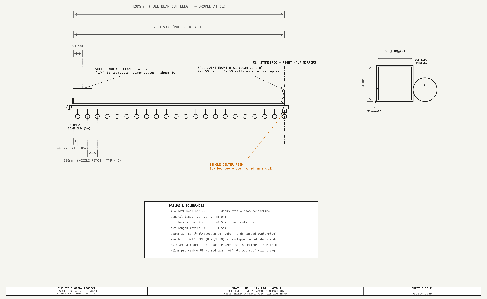

### 3.4 Wheel Carriage Assemblies

Each end of the beam is supported by a wheel carriage that rolls on the processing tray
floor beneath the walkway grating. Two carriages (left and right), each carrying two
wheels spaced 200mm apart in the Yd direction for stability against tipping.

**Wheel specification:**

| Property | Value |
|----------|-------|
| Type | Fixed (non-swivel) acetal (Delrin) wheel |
| Diameter | 32mm |
| Width | 20mm |
| Bore | 10mm |
| Load rating | Light-duty — actual load ~3.0 kg per wheel wet (a solid acetal wheel carries this easily) |
| Tread profile | Flat (rolls on the stainless tray floor, raised on the shim ramp) |
| Material | Solid acetal (Delrin), plain bore — corrosion-immune, self-lubricating on the 304 SS axle (no carbon-steel bearings for the wet wash) |

**Vertical geometry (all dimensions mm above finished floor):**

| Reference point | Z (mm AFF) |
|-----------------|------------|
| Container floor | 0 |
| Raised tray floor (near/low rim, on the shim ramp) — the wheels roll here | 20 |
| Bottom clamp plate (under beam, 1/4″) | 22.6–29 |
| Beam bottom | 29 |
| Wheel axle centerline | 36 |
| Carriage plate (2mm above axle) | 38–43 |
| Wheel top | 52 |
| Beam top | 54 |
| Top clamp plate (1/4″) | 54–60.4 |
| Left-walkway support arm bottom (over spray bar) | 75 |
| Walkway grating bottom | 115 |
| Walkway grating top (deck surface) | 130 |

(Full stack-up — clamp plates, carriage plate, side manifold/nozzle — is drawn on Sheet 2; the poly manifold is side-mounted per §3.3.)

**Clearances:**

| Interface | Gap | Notes |
|-----------|-----|-------|
| Beam bottom → tray floor | 9mm | Spray gap; pre-camber offsets the self-weight sag so the beam runs flat under load (§3.3) |
| Wheel top → left-walkway support arm bottom | 23mm | Wheels roll freely beneath the walkway structure |
| Carriage stack → walkway grating bottom | ~30mm at the worst (far-left) carriage | See §2.5 and [Walkway Routing Sections](walkway-routing-sections.md) §H-H |

**Axle retention:** Each wheel axle (10mm SS axle pin) is held by a curved saddle strap formed
from 1/8" (3.18mm) × 3/4" (19mm) 304 SS flat bar, bolted to the underside of the carriage plate.
The saddle cradles the axle pin with 1mm clearance; two M5 bolts pass up through the ~12mm saddle
feet and carriage plate to lock the axle in position. All eight saddles are cut from one 18"
(457mm) length of flat bar (~48mm developed each).

### 3.5 Carriage Plate Design

Each carriage uses a flat aluminum plate positioned 2mm above the wheel axle.
The plate wings extend inward to meet the beam faces; the beam is gripped by a top and
bottom clamp plate that sandwich it vertically, with the carriage plate wing captured in
the same bolted stack. The beam stays at its design height.

Formed from 5mm 6061-T6 aluminum plate:

- **Plate wings:** Two flat sections extending from the beam faces out to the
  wheel axle positions. Total plate width spans both wheel positions plus 18mm
  overhang on each side; the outer edge is flush with the beam end.
- **Center notch:** The wings butt against the 38mm beam faces (no gap), so the
  carriage and beam read as one continuous body.
- **Beam clamp:** A bottom clamp plate (under the beam) and a top clamp
  plate (over the beam) are drawn together by bolts on each side of the
  beam. A solid aluminum spacer block beside each beam face fills the gap between the
  plates so tightening grips the beam instead of bending the plates.
- **Ball joint mount:** The ball joint flange is fastened to the beam top face with self-tapping screws,
  keeping the socket housing below grating level).

**Lateral guidance:** The tray rim walls (50mm high) act as
lateral guides. The wheel carriages roll between the tray rim and the walkway support
structure. The 200mm wheel spacing in Yd prevents significant skew.

### 3.6 Carriage Fabrication

Each carriage is built from two sub-assemblies: a carriage plate, and wheel-and-axle
units retained by curved saddle clamps. The beam is then sandwiched between a top and
bottom clamp plate bolted through the carriage plate. Two identical carriages are
required (left end and right end of beam).

#### 3.6.1 Carriage Plate Fabrication (2 required)

Each carriage plate is a flat 5mm 6061-T6 aluminum plate whose wings meet the beam
faces. The plate sits 2mm above the wheel axle; the beam clamp bolts pass
through it, capturing the plate between the top and bottom clamp plates.

**Blank:** Cut two pieces from 5mm plate, each 280mm long × 60mm wide.

| Step | Operation | Detail |
|------|-----------|--------|
| 1 | Mark notch | Scribe the central notch so the wings butt the 38mm beam faces (outer edge flush with beam end) |
| 2 | Cut notch | Jigsaw or bandsaw the center notch from one long edge |
| 3 | Mark axle saddle positions | On each wing, mark two Ø5.5mm clearance holes (M5) per saddle clamp for axle retention |
| 4 | Mark beam clamp bolt positions | Two Ø5.5mm holes on each side of the beam, aligning with the top/bottom clamp plate bolts |
| 5 | Drill all holes | Drill press for accuracy — 8 axle saddle holes + 4 beam clamp holes per plate |
| 6 | Deburr | Remove all burrs from edges, notch, and holes |

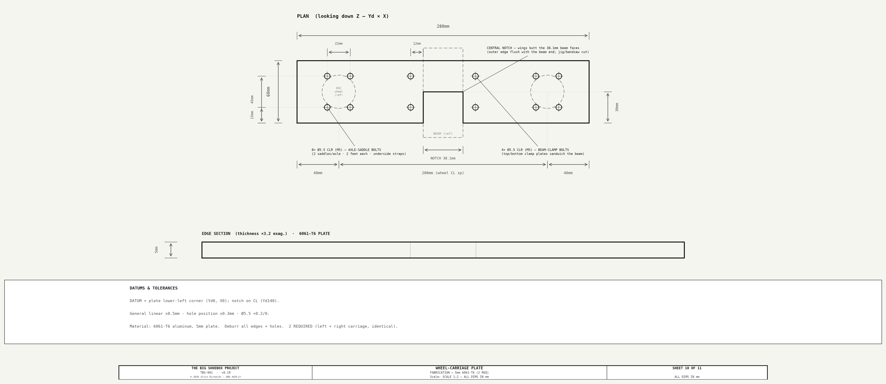

#### 3.6.2 Wheel Assembly (2 per carriage, 4 total)

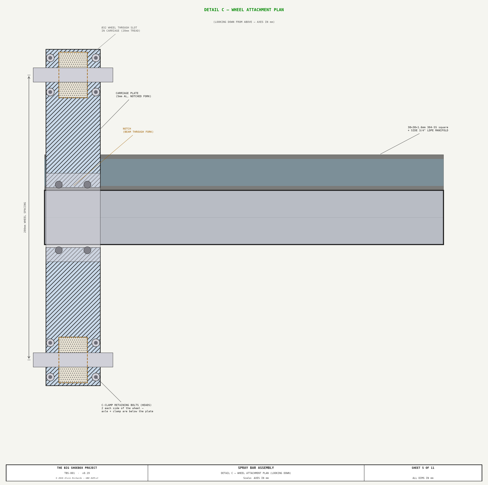

Each wheel axle is retained by a curved 3.18mm (1/8") 304 SS saddle strap (formed) bolted to the
carriage plate underside. The saddle cradles the 10mm axle pin with 1mm clearance.

| Step | Operation |
|------|-----------|
| 1 | Place the acetal wheel (32mm × 20mm, 10mm bore) in position under the carriage plate |
| 2 | Insert 10mm SS axle pin through wheel bore |
| 3 | Position the saddle clamp over the axle, feet against the plate underside |
| 4 | Insert 2× M5 bolts up through the saddle feet and carriage plate; secure with nyloc nuts on top |
| 5 | Tighten finger-tight only until all wheels are installed |
| 6 | Spin wheel by hand — confirm free rotation with no lateral wobble |

#### 3.6.3 Carriage Assembly (2 required)

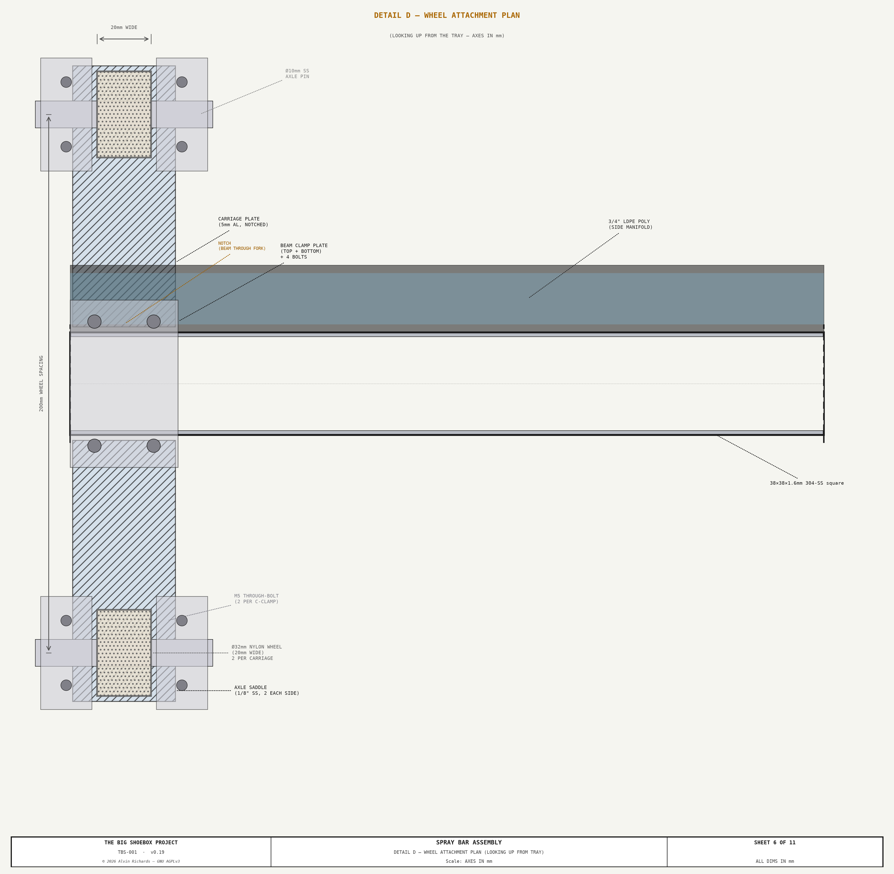

| Step | Operation |
|------|-----------|
| 1 | Place carriage plate flat on bench, notch centered |
| 2 | Install the near wheel-and-saddle unit (wheel hanging below bench edge) — finger-tight |
| 3 | Install the far wheel-and-saddle unit (200mm Yd spacing) |
| 4 | Verify 200mm wheel spacing (center-to-center, Yd direction) |
| 5 | Tighten all nyloc nuts to 4 Nm |
| 6 | Stand the carriage on a flat surface — both wheels must contact simultaneously. Shim if needed before final torque |

#### 3.6.4 Beam Attachment

The carriages attach to the beam with a top + bottom clamp plate that sandwich the SHS
vertically. The bottom plate sits under the beam and the top plate over it; a solid aluminum spacer block beside each beam face fills the gap so the
bolts grip the beam rather than bending the plates. Four bolts per carriage pass through
the top plate, spacer, carriage plate wing, and bottom plate, with nuts top and bottom.

| Step | Operation |
|------|-----------|
| 1 | Position the bottom clamp plate under the beam SHS, with its outer edge flush with the beam end |
| 2 | Set the carriage plate over the beam so the wings butt the beam faces |
| 3 | Place a spacer block against each beam face, between the plate wings |
| 4 | Lay the top clamp plate over the beam, aligning the bolt holes with the bottom plate |
| 5 | Pass four bolts down through top plate + spacer + carriage wing + bottom plate; thread nuts top and bottom and tighten evenly until the beam is gripped |
| 6 | Set the assembled spray bar on the processing tray floor. Confirm the top clamp plate clears the walkway grating bottom. Confirm all wheels roll freely on the tray floor |
| 7 | Push the bar through its full travel to verify it tracks straight between the tray rim walls without binding |

### 3.7 Structural Analysis

**Loading (simply supported, uniform distributed load across <!-- BEGIN fact:spray_beam_span_mm -->4,289<!-- END fact:spray_beam_span_mm -->mm span):**

| Component | Linear mass (kg/m) | Linear weight (N/m) |
|-----------|-------------------|---------------------|
| Beam (304 SS, 1½×1½×0.062in square) | 1.93 | 18.93 |
| LDPE side manifold (OD 25mm, ID 19mm, wall 3mm) | 0.193 | 1.89 |
| Water in manifold (19mm ID bore) | 0.283 | 2.78 |
| **Total UDL** | **2.406** | **23.60** |

Water volume in the manifold: π × 9.5² × 4,289 = 1.22 L (1.22 kg), carried in the LDPE
manifold, not the beam.

**Deflection — δ = 5wL⁴ / 384EI, E = 193,000 MPa (304 SS), I = 51,300mm⁴:**

| Condition | w (N/m) | δ center (mm) | Span ratio |
|-----------|---------|---------------|------------|
| Dry (beam only) | 18.93 | 9.3 | L/471 |
| Dry (beam + manifold) | 20.82 | 10.3 | L/429 |
| Wet (beam + manifold + water) | 23.60 | 11.6 | L/378 |

The 1½in-square SS section has a bending stiffness of EI ≈ 9.9×10⁹ N·mm²; its raw wet
deflection is ~12mm (L/378).
This is a beam-flatness matter only — it does not affect the **carriage-to-grate
clearance** (deflection is zero at the supports, where the ~30mm clearance is measured),
and the sagged midspan beam bottom still clears the thin wash film.

**Pre-camber (required):** Fabricate the beam with **~12mm upward pre-camber** at midspan
so it deflects to flat under full water load. Method: hold the two halves at a shallow
upward angle in the fabrication jig (the tube is a single length — no midspan joint). With ~9mm beam-to-floor
clearance at the supports and the camber applied, the beam runs level under load.

**Weight summary:**

| Component | Mass (kg) |
|-----------|-----------|
| Beam (1½×1½×0.062in 304 SS × <!-- BEGIN fact:spray_beam_span_mm -->4,289<!-- END fact:spray_beam_span_mm -->mm) | 8.5 |
| LDPE manifold (OD 25mm × <!-- BEGIN fact:spray_beam_span_mm -->4,289<!-- END fact:spray_beam_span_mm -->mm) | 0.74 |
| Water in manifold | 1.22 |
| Carriage plates (2×) | 0.35 |
| Wheel assemblies (4× Ø32 wheel + axle + 8 saddle clamps) | 0.45 |
| Nozzles (43×) + feed manifold/fittings | 0.50 |
| Hardware (bolts, clips, clamp plates) | 0.35 |
| **Dry total** | **~10.9 kg** |
| **Wet total (operating)** | **~12.1 kg** |

Per wheel load (wet): 12.1 / 4 ≈ 3.0 kg — well within a small solid acetal wheel's rating.
The assembly mass is carried into the walkway/CG budget in [Weight Distribution](weight-distribution-report.md).

### 3.8 Beam — Single Length, No Splice

The beam is a **single 17 ft 4 in (5,283mm) length** of 1½×1½×0.062in 304-SS square tube — it
spans the full 4,289mm width with margin, so there is **no butt weld and no splice**. A joint at
mid-span would sit at the point of maximum bending moment. The **~12mm pre-camber**
is set over the full length in the fabrication jig.

### 3.9 Flow Analysis

| Parameter | Value |
|-----------|-------|
| Supply pump | P-01 (Blue) or P-02 (Brown) — Shurflo 2088, 3.5 GPM at 45 PSI |
| Pipe bore (LDPE) | 19mm ID = 283.5mm² |
| Feed point (manifold) | 1 (beam center) — single center feed into the over-bored manifold |
| Spray nozzles | <!-- BEGIN fact:spray_bar_nozzle_count -->43<!-- END fact:spray_bar_nozzle_count --> × 90° down-jets (DIG 110B) |
| Flow per nozzle | 0.08 GPM (0.31 L/min) |

Feeding the over-bored 3/4" manifold at a single center point from the ball joint keeps the
supply pressure uniform along the pipe: the manifold bore is over-sized relative to the nozzle
saddle-tees, so it acts as a low-loss plenum and each of the <!-- BEGIN fact:spray_bar_nozzle_count -->43<!-- END fact:spray_bar_nozzle_count --> nozzles sees nearly the same
flow regardless of its distance from the inlet, with no multi-point feeding needed. The
19mm bore provides adequate flow capacity at 3.5 GPM. Each jet delivers a **90° cone directed
straight down** — chosen over a flat-fan/180° pattern so the wash lands on the print rather
than spraying sideways (180°) or up and away (360°), which wastes water and wets the container.
A 90° cone at the ~50mm nozzle height footprints ~100mm, so the nozzles sit at 100mm pitch
(<!-- BEGIN fact:spray_bar_nozzle_count -->43<!-- END fact:spray_bar_nozzle_count --> across the full beam width) for edge-to-edge coverage along the <!-- BEGIN fact:spray_beam_span_mm -->4,289<!-- END fact:spray_beam_span_mm -->mm beam span; the traverse sweeps the other axis.

### 3.10 Water Connection

BV-06 (1/2" ball valve, spray-bar on/off) is mounted on the pinhole wall (Yd=0), 150mm toward the EP of the
pinhole centerline (clear of the tray-sump suction riser), at Z=900mm — waist height from the walkway deck,
directly above the Blue/Brown selector BV-05 (Z=700mm). A 1/2" PVC riser runs up from BV-05 to BV-06. A 4 m length of 1/2"
reinforced braided PVC hose connects from BV-06 down to the manifold center inlet at the
ball joint. The hose coils when the bar is near the pinhole wall and extends as the bar is
pushed toward the far wall. The hose trails along the near tray rim, staying clear of
the print surface.

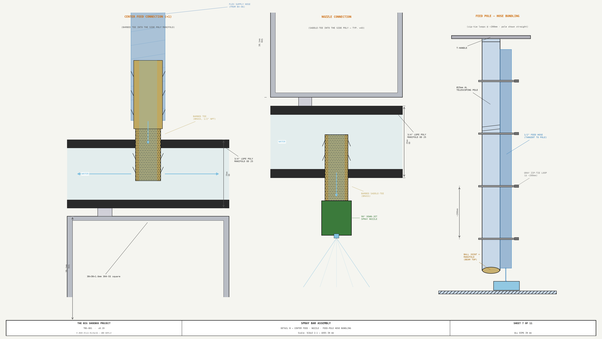

**Supply path:** P-01 → ACC-01 → rigid 1/2" PVC pipe along the pinhole wall (Blue), or P-02 → ACC-02 (Brown) → BV-05
(Blue/Brown selector) → BV-06 (spray on/off) → coiled flexible hose → manifold center inlet (single feed) → over-bored 3/4"
manifold bore → <!-- BEGIN fact:spray_bar_nozzle_count -->43<!-- END fact:spray_bar_nozzle_count -->× spray nozzles.

### 3.11 Walkway Slit

The operator controls the spray bar position from the near walkway using a telescoping
aluminum pool pole (1.2–2.4 m). The pole passes through a 30mm wide slit cut into the
walkway grating at the beam centerline. A matching slit is cut into the far
walkway grating at the same X position. The slit positions are shown on the
[walkway plan view](all-diagrams.md#12-perimeter-walkway).

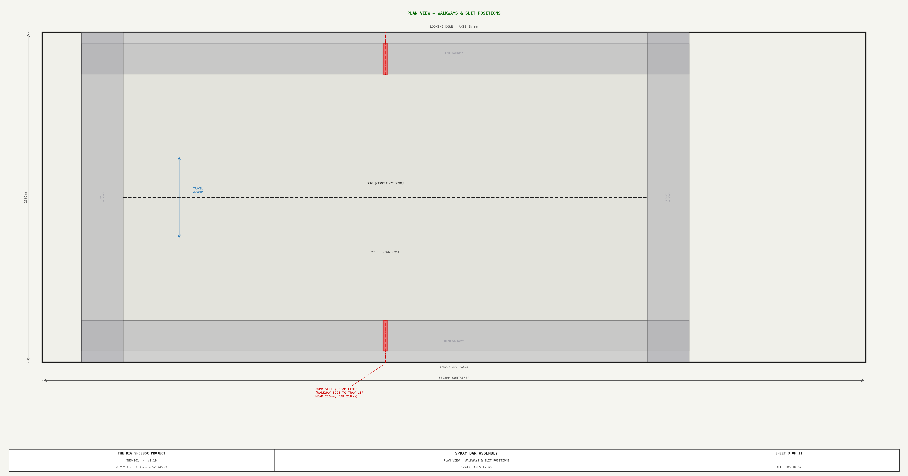

### 3.12 Ball Joint and Arm

A Ø20mm stainless steel ball joint on the beam top face provides multi-axis
articulation between the beam and the operator's pole. The ball sits in a zinc socket
housing on a 50mm flange base. The flange is fastened to the beam top with four
self-tapping (thread-forming) stainless screws driven into the 1.6mm beam top wall — the
beam is sealed, so there is no internal access to tighten nuts. Nothing overhangs the
ball, so the arm articulates freely in every direction.

A 25mm OD × 2mm wall aluminum round tube (~500mm long) connects from the ball joint
stud to the telescoping pole. Because the M12 stud is too small to pinch inside the Ø21 tube bore, a **turned aluminum adapter** reduces the M12 stud to a **Ø21 spigot** (threaded onto the stud, locked with an M12 jam nut); the tube bottom is **slit ~30mm** and a **25mm clamp-style shaft collar** pinches the tube onto the spigot — rotationally adjustable, and it lifts off for transport. The
1/2" flexible hose is zip-tied to the arm tube at ~200mm intervals.

---

## 4. Operation

The step-by-step spray bar setup, wash pass procedure, Brown water recycling passes, and storage are documented in the [Operating Manual — Phase 4: Development](operating-manual.md#42-development-in-water).

### 4.1 Muslin Fit — Cut to the Washable Tray Area

The muslin is cut to fit the **washable area of the tray**, not the full image plane: <!-- BEGIN fact:muslin_cut_width_mm -->4,249<!-- END fact:muslin_cut_width_mm --> × <!-- BEGIN fact:muslin_cut_height_mm -->2,000<!-- END fact:muslin_cut_height_mm -->mm — **narrower and shorter** than the film-plane ACM+frame (<!-- BEGIN fact:film_plane_width_mm -->4,389<!-- END fact:film_plane_width_mm --> × <!-- BEGIN fact:film_plane_height_mm -->2,094<!-- END fact:film_plane_height_mm -->mm). It is inset 50mm from each side rim and from the far rim, and its near edge clears the near-rim **sump well** (Yd 80–180). It therefore lies dead flat with no edge draping a rim or sagging into the sump, and mounts inside the frame (~70mm/side of bare ACM), clamped **inboard on the ACM face** (a field detail). The tray — not the optics — is the size constraint here.

### 4.2 Loading the Muslin — Park-and-Roll (no beam lift)

Loading needs **no lift mechanism**. The gantry parks at the **near (pinhole-wall) end** of its Yd travel, and the exposed muslin enters through the **far muslin-drop slot** (image-plane side) and is drawn across the tray toward the parked beam until it lies flat over the washable area.

The beam then **rolls back over the laid muslin** to wash — its wheels run on the bare tray floor at the X-edges (centers X≈310/4,599, ~20mm outboard of the muslin's X≈330/4,579 edges), and the beam body clears the thin fabric: the **9mm beam-to-floor gap** (§3.4 — wheel radius 16 − bracket drop 7, held constant across the traverse) less the 0.5mm muslin = **~8.5mm clearance**. Verified from the geometry constants, so **no lift-out mechanism is required**.

### 4.3 Beam Removal for Maintenance

Deep cleaning and nozzle service reach the beam through the **right walkway grate**: the grate lifts out and the beam extracts through that opening. No in-tray lift-out or quick-release is built into the gantry — the removable walkway grate *is* the access path.

---

## 5. Engineering Drawings

Eleven sheets cover the spray bar assembly and processing tray:

| Sheet | Title | Content |
|-------|-------|---------|
| 1 | Gantry Elevation | X-Z section from film plane (4× vert exag) — beam, BV-06, pole, walkway slit, operator silhouette |
| 2 | Cross Section — Beam Assembly | Yd-Z composite at 1:1 — wheels, carriage plate, beam clamp plates, saddle clamps, ball joint, arm, hose |
| 3 | Plan View | Container floor plan — walkways, slit positions, beam travel range |
| 4 | Detail A — Beam End | Longitudinal section at 2:1 — LDPE fold-back end closure with retainer clip |
| 5 | Detail C — Wheel Attachment | Section along axle at 4:1 — carriage plate, acetal wheel, axle pin, saddle clamp |
| 6 | Detail D — Wheel Plan | Plan view of carriage — beam, carriage plate, beam clamp plate, saddle clamps, wheels |
| 7 | Detail B — Manifold Feed | Longitudinal section at 2:1 — single center-feed barbed connection and nozzle connection details |
| 8 | Center-seam lap joint | Shingle-oriented lap joint of the two tray panels (§2.6) |
| 9 | Beam + manifold stations | Full-length station layout — cut length, nozzle + feed-tee pitch, carriage-clamp + ball-joint stations (§3.3) |
| 10 | Wheel-carriage plate | Carriage plate fabrication — notch + drilling (§3.6.1) |
| 11 | Processing-tray pan | Pan fabrication — rim fold, pressed sump, seam-bolt pattern (§2.1) |

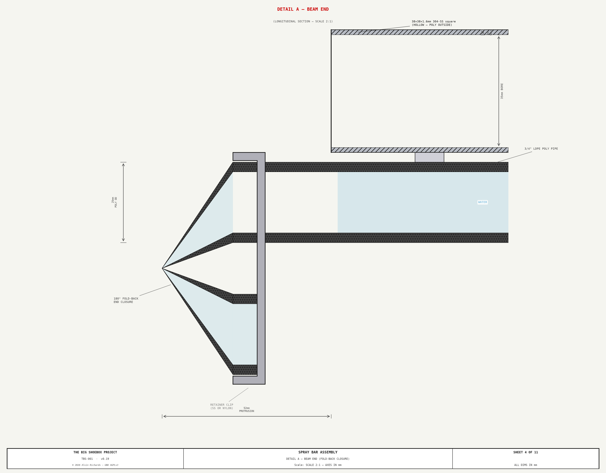

Additional processing tray drainage detail is shown in the
[water system drawings](all-diagrams.md#8-processing-water-system) (sheets 3–4:
tray drainage plan and sump cross-section).

---

## 6. Parts List

See the **[Master Shopping List, filtered to this report's systems](master-shopping-list.md?system=tray,spray)** for the same parts with suppliers, current prices, and click-to-sort/filter.

### Cost Summary

| Subsystem | Cost Range |
|-----------|-----------|
| Processing tray | <!-- BEGIN costing:tray-low -->$1,473<!-- END costing:tray-low -->–<!-- BEGIN costing:tray-high -->$2,121<!-- END costing:tray-high --> |
| Spray bar assembly | <!-- BEGIN costing:spray-low -->$595<!-- END costing:spray-low -->–<!-- BEGIN costing:spray-high -->$615<!-- END costing:spray-high --> |
| **Total** | **<!-- BEGIN costing:tray-spray-total-low -->$2,068<!-- END costing:tray-spray-total-low -->–<!-- BEGIN costing:tray-spray-total-high -->$2,736<!-- END costing:tray-spray-total-high -->** |

---

## 7. Maintenance

The assembly is built for tool-free cleaning: the liner is replaced each session (§2.4), the sump
pickup tube lifts out of its well (§2.3), and the beam extracts through the right walkway grate (§4.3).
The cleaning and inspection schedule is in the
[Operating Manual — Maintenance](operating-manual.md#maintenance).

---

## 8. Source References

- [Shurflo 2088 Series datasheet](https://www.shurflo.com/products/2088-series) — SHURflo / Pentair. Performance curves, priming capability, electrical specifications.
- [304 stainless steel rectangular tube](https://www.onlinemetals.com/en/buy/stainless-steel/stainless-steel-rectangle-tube-304) — Online Metals / Metal Supermarkets catalog (spray-bar beam). Mechanical properties per [ASTM A554](https://www.astm.org/a0554-21.html). Aluminum plate/pole per [6061-T6](https://www.onlinemetals.com/en/buy/aluminum) ([ASTM B221](https://www.astm.org/b0221-21.html)).
- [304 stainless steel sheet](https://www.onlinemetals.com/en/buy/stainless-steel/304-stainless-steel-sheet) — AK Steel Product Data Bulletin. Chemical resistance, mechanical properties per [ASTM A240](https://www.astm.org/a0240_a0240m-22a.html).
- [HDPE chemical resistance](https://www.cpchem.com/what-we-do/solutions/polyethylene/polyethylene-resources) — Chevron Phillips Chemical Company. Flat bar available from [McMaster-Carr (catalog #8619K)](https://www.mcmaster.com/8619K).
- **Cyanotype chemistry** — Ware, Mike. [*Cyanotype: The History, Science & Art of Photographic Printing in Prussian Blue*](https://www.mikeware.co.uk/mikeware/Cyanotype_Monograph.html) (2014). Wash water composition and pH requirements.
