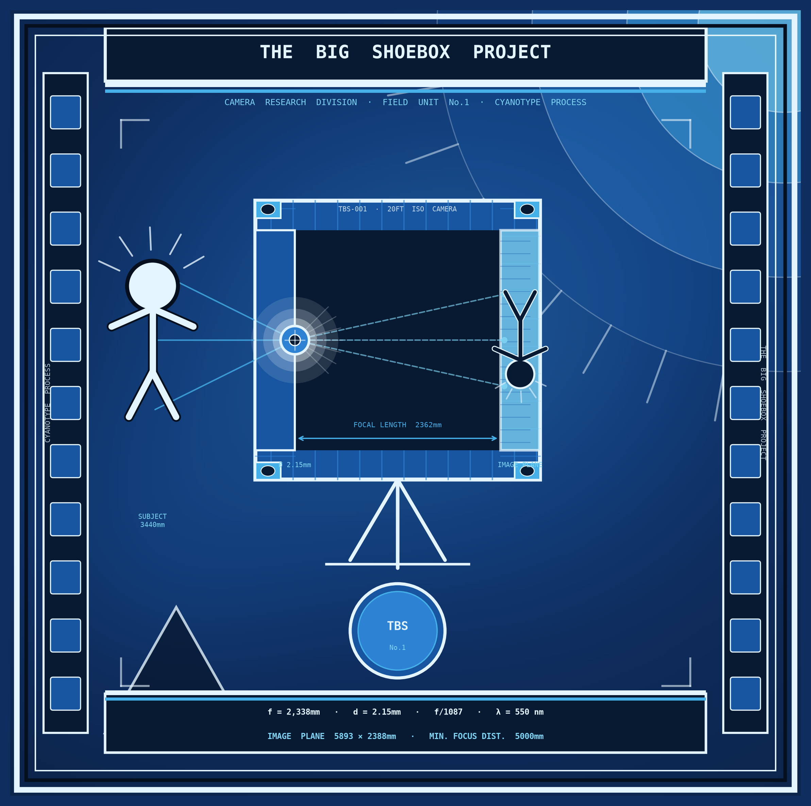

<!-- SPDX-License-Identifier: AGPL-3.0-only -->
<!-- © 2026 Alvin Richards -->
# The Big Shoebox — Project Summary

  

---

## What Is It

A pinhole camera the size of a shipping container — and I mean that literally. It's built inside a standard 20-foot ISO container: light comes in through a pinhole on one face, crosses the width of the box, and lands as an image roughly <!-- BEGIN fact:film_plane_width_feet -->14<!-- END fact:film_plane_width_feet --> feet wide on the far wall, caught as a cyanotype on cotton muslin. It's transportable, runs off-grid, and processes its own prints.

One thing up front. This isn't an installation that resembles a camera. It's a camera — and it makes photographs no other camera can.

<!-- brochure:skip -->

  

    <iframe title="TBS-001 Overview" frameborder="0" allowfullscreen mozallowfullscreen="true" webkitallowfullscreen="true" allow="autoplay; fullscreen; xr-spatial-tracking" execution-while-out-of-viewport execution-while-not-rendered web-share src="https://sketchfab.com/models/e624e210bf3d4de08b1a7b7261a66c45/embed" style="position:absolute;top:0;left:0;width:100%;height:100%;border:0;"></iframe>
  

  
<a href="https://sketchfab.com/3d-models/tbs-001-overview-e624e210bf3d4de08b1a7b7261a66c45?utm_medium=embed&utm_campaign=share-popup&utm_content=e624e210bf3d4de08b1a7b7261a66c45" target="_blank" rel="nofollow" style="font-weight: bold; color: #1CAAD9;">TBS-001 Overview</a> by <a href="https://sketchfab.com/alvin91403?utm_medium=embed&utm_campaign=share-popup&utm_content=e624e210bf3d4de08b1a7b7261a66c45" target="_blank" rel="nofollow" style="font-weight: bold; color: #1CAAD9;">alvin91403</a> on <a href="https://sketchfab.com?utm_medium=embed&utm_campaign=share-popup&utm_content=e624e210bf3d4de08b1a7b7261a66c45" target="_blank" rel="nofollow" style="font-weight: bold; color: #1CAAD9;">Sketchfab</a>

<!-- brochure:endskip -->

---

## The Scale

| Parameter | Value |
|-----------|-------|
| Image plane (active) | <!-- BEGIN fact:film_plane_width_mm -->4,389<!-- END fact:film_plane_width_mm --> × <!-- BEGIN fact:film_plane_height_mm -->2,094<!-- END fact:film_plane_height_mm -->mm (~<!-- BEGIN fact:film_plane_width_ftin -->14'5"<!-- END fact:film_plane_width_ftin --> × <!-- BEGIN fact:film_plane_height_ftin -->6'10"<!-- END fact:film_plane_height_ftin -->) |
| Container interior | <!-- BEGIN fact:container_interior_length_mm -->5,893<!-- END fact:container_interior_length_mm --> × <!-- BEGIN fact:container_height_mm -->2,388<!-- END fact:container_height_mm -->mm (~19'4" × 7'10") |
| Image area | ~<!-- BEGIN fact:image_area_sqft -->99<!-- END fact:image_area_sqft --> sq ft |
| Focal length | <!-- BEGIN fact:focal_length_mm -->2,338<!-- END fact:focal_length_mm -->mm (container interior depth) |
| Optimal pinhole | Ø<!-- BEGIN fact:pinhole_diameter_mm -->2.15<!-- END fact:pinhole_diameter_mm -->mm (Lord Rayleigh formula, λ = 550 nm) |
| f-number | f/<!-- BEGIN fact:f_number -->1087<!-- END fact:f_number --> |
| Baseline exposure | ~30–45 min (Ware New Cyanotype on muslin, f/<!-- BEGIN fact:f_number -->1087<!-- END fact:f_number -->, full sun — no reciprocity correction) |
| Process | Cyanotype (Ware formula) — water-based, non-toxic, no silver |
| Per-print cost | ~<!-- BEGIN costing:summary-perprint -->$34<!-- END costing:summary-perprint --> |
| 50-print run | ~<!-- BEGIN costing:summary-50run -->$1,680<!-- END costing:summary-50run --> |

---

## The Technology

**The front board doesn't move — all the perspective control is in the film plane.**
The pinhole disc clamps against a neoprene light-seal washer under a retaining ring on four thumb screws, so carriers swap in seconds: a different pinhole, or a large-format lens board (Copal/Compur) on the same Ø80 carrier. Why fixed? A pinhole is a single point, and the image is a projection *through* that point — so tilting it doesn't change the perspective. This is not a view camera, so all the perspective control is in the the film plane, which is not fixed.

**The film plane is where it earns its keep (±<!-- BEGIN fact:film_plane_max_tilt -->40<!-- END fact:film_plane_max_tilt -->° tilt, ±<!-- BEGIN fact:film_plane_max_swing -->28<!-- END fact:film_plane_max_swing -->° swing).**
Its four corners move independently — each can slide by hand in an aluminum depth rail and lock with a clamp — which buys the full vocabulary of a large-format view camera at pinhole focal lengths: Scheimpflug focus, twisted-plane projections, convergence control. The [distortion renders](distortion-renders.md) show what that looks like — geometry you can't get any other way.

Every number here traces to a peer-reviewed source or a datasheet. The optics aren't approximated.

**It runs off-grid.** A self-contained three-circuit water system covers ~<!-- BEGIN fact:prints_per_resupply -->15<!-- END fact:prints_per_resupply --> full-size prints between resupply runs, recycling 40% of its water, all on 12V DC. No power connection needed.

**It runs off-grid.** A self-contained three-circuit water system covers ~<!-- BEGIN fact:prints_per_resupply -->15<!-- END fact:prints_per_resupply --> full-size prints between resupply runs, recycling 40% of its water. Everything runs on 12V DC from one or two 100Ah battery, topped up by a 600W solar array — solar-positive in full sun, so it generates more than it uses and keeps running indefinitely. No power or water connection needed to operate.

---

## The Process

Cyanotype on cotton muslin, using **Mike Ware's New Cyanotype formula** (ammonium iron(III) oxalate + potassium ferricyanide). About 30–45 minutes in full sun at f/<!-- BEGIN fact:f_number -->1087<!-- END fact:f_number --> — 4–8× faster than the old Herschel recipe — then developed in plain cold water. No silver, no darkroom, nothing toxic.

Getting it there is deliberately unremarkable: a commercial hire truck, no CDL, no oversize permits — it's an empty 20-foot container on the Interstate.

---

## Documents

| Document | Description |
|----------|-------------|
| [Pinhole Optics Report](pinhole-optics-report.md) | Lord Rayleigh formula, f-numbers, exposure calculations |
| [Container Optics](pinhole-option-b-optics.md) | Detailed optics for the shipping container configuration |
| [Container Selection & Construction](container-report.md) | Container options, US transport compliance, interior conversion, light-sealing |
| [Lens Options](lens-options.md) | Coverage problem, thin lens equations, DoF, distortion, recommendations |
| [Lens vs Pinhole](lens-vs-pinhole-exposure.md) | Why the exposure difference is ~5,500× — full derivation |
| [Photosensitive Materials](photosensitive-plane-options.md) | All process options, ISO equivalents, spectral response, per-image costs |
| [Processing System](water-system-report.md) | Off-grid three-circuit water system design and Bill of Materials |
| [Wash-Water Classification](wash-water-classification.md) | Regulatory basis for disposing of the wash water, with and without the dichromate option |
| [Film Plane Mechanism](film-plane-mechanism-report.md) | 4-corner independent actuation — design, drawings, shopping list |
| [Film Clamp Mechanism](film-clamp-mechanism-report.md) | Nylon spring-clamp muslin system — 58 clamps at <!-- BEGIN fact:clamp_spacing_mm -->150<!-- END fact:clamp_spacing_mm -->mm spacing, parts list |
| [Pinhole Report](pinhole-report.md) | Pinhole wall interface — the wall aperture and the adapter the front board bolts to |
| [Pinhole Disc Holder (Front Board)](pinhole-disc-holder-report.md) | Quick-change pinhole disc holder — retaining ring, thumb screws, interchangeable discs/lens, drawings |
| [Cost Breakdown](project-cost-breakdown.md) | Full itemized build cost — three scenarios, all sources cited |
| [Chem Shopping List](chemistry-shopping-list.md) | 50-print quantities with supplier URLs and confirmed prices |
| [Transportation](container-transport-options.md) | Commercial hire vs. self-haul analysis |
| [Operating Manual](operating-manual.md) | Single-operator step-by-step workflow — coating, exposure, development, cleanup |
| [Electrical & Systems](electrical-report.md) | Power architecture, revolving drum light trap, lighting, wiring diagrams |
| [Ventilation & Cooling](ventilation-report.md) | Fan system, evaporative cooler, light-safe baffle ducts, shade canopy, and operating modes |
| [Master Shopping List](master-shopping-list.md) | All components consolidated by build area — electrical, water, chemistry, drum light trap, cooling |
| [License](licensing.md) | GNU AGPLv3 — © 2026 Alvin Richards |
| [Light Trap Selection](light-trap-selection.md) | Revolving light trap options, pricing, and custom fabrication specification |
| [Engineering Diagrams](engineering-diagrams.md) | All TBS-001 construction drawings — assembly overview, fabrication, subsystems |
| [All Diagrams](all-diagrams.md) | Complete visual gallery of every engineering diagram on a single page |
| [Distortion Renders](distortion-renders.md) | Ray-traced projections for the film-plane movement configurations |
| [Equipment Layout](equipment-layout-report.md) | Shadow-free end-zone layout — where each piece of equipment sits, and the optical clearance proof |

## See Also

- [Proposal](funding-proposal.md) — the funding case
- [Cost Breakdown](project-cost-breakdown.md) — the project budget
- [Operating Manual](operating-manual.md) — how the instrument is run
