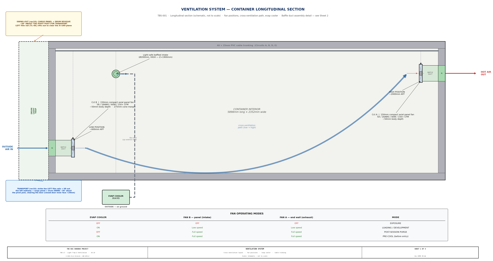
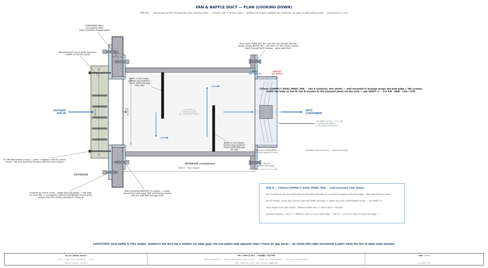
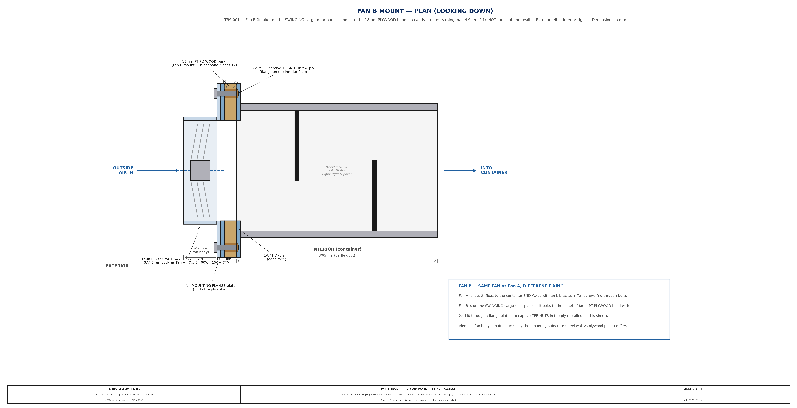
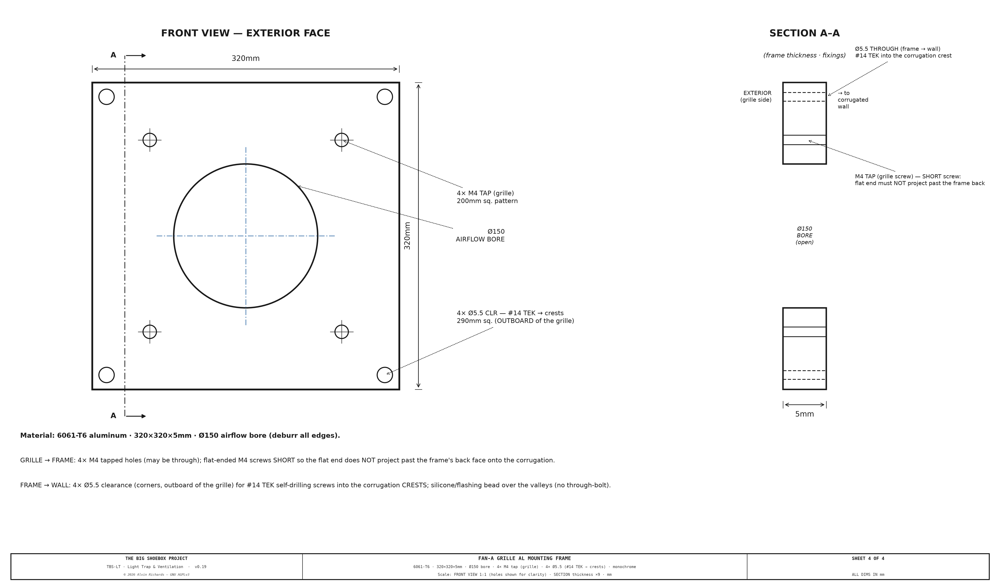
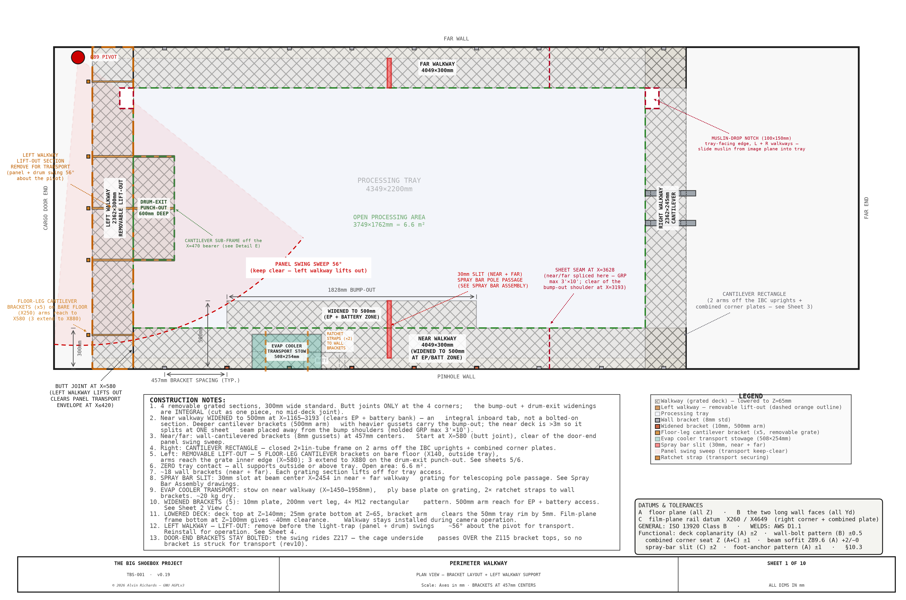

<!-- SPDX-License-Identifier: AGPL-3.0-only -->
<!-- © 2026 Alvin Richards -->
# Ventilation & Cooling

## 1. Purpose

TBS-001 requires active ventilation and cooling to maintain safe operator working conditions and acceptable chemistry coating temperatures inside a sealed steel container. This report consolidates the complete ventilation and cooling specification: thermal analysis, fan system, evaporative cooler, light-safe duct penetrations, shade canopy, and operating modes.

All ventilation and cooling components run at 12V DC from the solar/battery power system. See [Electrical Report](electrical-report.md) for circuit assignments and wiring.

---

## 2. Thermal Problem

Using a Plam Spring summer deployment as a reference point (ambient 40–45°C, direct irradiance 1,000 W/m²), A 20ft ISO steel container in direct sun reaches interior temperatures of 65–75°C without intervention. Two constraints drive the cooling design:

| Constraint | Limit | Source |
|-----------|-------|--------|
| Operator safety | Interior < 40°C | OSHA heat illness prevention guidelines |
| Chemistry coating | Interior < 35°C | Cyanotype sensitizer application window |

Without any mitigation, the container is unusable in summer daytime. The system uses three complementary strategies to bring the interior within working range.

---

## 3. Cooling Strategy

| Method | Interior ΔT | Cost | Power | Required? |
|--------|------------|------|-------|-----------|
| 70% shade cloth canopy over container | −15 to −20°C | ~<!-- BEGIN costing:vent-shade -->$236<!-- END costing:vent-shade --> | None | **Yes — always** |
| Scheduling (shoot before 09:00 / after 18:00 in summer) | −10 to −15°C effective | $0 | None | Recommended |
| Evaporative cooler (swamp cooler) — 120V AC via 12V inverter | −10 to −15°C additional | ~<!-- BEGIN costing:vent-cooler-inverter -->$242<!-- END costing:vent-cooler-inverter --> (cooler + inverter) | <!-- BEGIN fact:evap_cooler_w_bus -->97<!-- END fact:evap_cooler_w_bus -->W on 12V bus | **Yes — in temperatures above 30°C ambient** |

Combined (shade canopy + cooler + scheduling): interior temperature reaches 25–32°C — within operator working range.

> **Why evaporative cooling works in hot climates (e.g. Palm Springs):** Evaporative (swamp) cooling is most effective when ambient relative humidity is low. Palm Springs in summer averages 10–18% RH — optimal for this technology. At 15% RH and 42°C ambient, an evaporative cooler can reduce temperature by 15–18°C, bringing 42°C down to 24–27°C after the shade canopy's contribution. At the same conditions, a standard 9,000 BTU mini-split uses 900W vs. the evaporative cooler's ~<!-- BEGIN fact:evap_cooler_w_bus -->97<!-- END fact:evap_cooler_w_bus -->W on the 12V bus (<!-- BEGIN fact:evap_cooler_w_ac -->85<!-- END fact:evap_cooler_w_ac -->W AC through the inverter) — a ~9× power saving.

---

## 4. Ventilation Fans

For operator comfort during processing in warm conditions, but also to ensure there is fresh air exchange within the space.

Longitudinal section showing the cross-flow ventilation path: Fan B intake at the cargo door panel (low position), diagonal airflow up through the container volume, Fan A exhaust at the sealed end wall (high, in the plumbing corridor below the X1 fill port). Evaporative cooler intake duct on the pinhole wall.

**Sheet 1 — Container Ventilation Section**

| Parameter | Specification |
|-----------|---------|
| Fan diameter |  6" (150mm) |
| Airflow per fan |  ~200 CFM |
| Total airflow | ~400 CFM |
| Power draw (each) |  ~60W |
| Circuit fuse | 5A |
| Cost  | ~<!-- BEGIN costing:vent-fans -->$50<!-- END costing:vent-fans --> |

### 4.1 Fan Positions

| Fan | Location | Mounting | Function |
|-----|----------|----------|----------|
| Fan B (intake) | Hinged panel, near corner zone by the pinhole wall | Flush-mounted in 40mm corner zone panel | Fresh air intake — draws cooler air near floor level |
| Fan A (exhaust) | Sealed end wall, in the plumbing corridor below the X1 fill port | Flush-mounted in wall penetration | Exhaust warm, humid air during processing and drying |

Both fans are 12V DC, **150×150×50mm axial panel fans** (e.g. GDSTIME/Wathai 15050-12V). Fan bodies (50mm deep) do not protrude beyond either panel face. Cross-flow ventilation runs diagonally: **low intake at the cargo door end → high exhaust at the sealed end** — fresh air enters near the floor, sweeps the working volume, and warm air discharges high.

> **Why this layout:** The intake sits on the cargo door panel (low) and the exhaust on the sealed end wall (high). With the v1,000L direct-stack the totes reach Z=<!-- BEGIN fact:ibc_stack_height_mm -->2,336<!-- END fact:ibc_stack_height_mm -->mm against the end wall in both flanking columns, leaving only the **<!-- BEGIN fact:corridor_width_mm -->270<!-- END fact:corridor_width_mm -->mm plumbing corridor** clear full-height. Fan A is therefore placed in that corridor — the only channel where its 300mm baffle duct projects into clear space rather than into a tote — while preserving the diagonal low-in / high-out flow.

### 4.2 Fan A — Sealed End Wall Exhaust

Fan A is flush-mounted in a wall penetration at the sealed end wall, in the plumbing corridor directly below the X1 fill port, the <!-- BEGIN fact:corridor_width_mm -->270<!-- END fact:corridor_width_mm -->mm corridor between the two 1,000L tote columns is the only full-height clear channel at this end. Its 300mm baffle duct projects into the clear corridor, clearing the X1 fill trunk above. The fan body sits inside a light-safe baffle duct (see §4.4) bolted to the interior face of the wall. A weatherproof louvre grille on the exterior face protects the penetration from rain and debris. Because a flat grille cannot seat against the corrugated side wall, it mounts to a flat **~5mm aluminum frame** (wider than the grille) on the exterior face: the frame is #14 TEK self-drilled to the corrugation **crests** — the TEK screws sit **outboard of the grille** so they drive from outside — and sealed with a silicone/flashing bead over the valleys (no through-bolt — the corrugated wall can't be cleanly bolted through); the grille then fixes to the frame with **4× flat-ended M4 screws into tapped holes** — short, so the flat end does not project past the frame's back face onto the wall. See Sheet 2 for the assembly and **Sheet 4 for the frame blueprint**. The fan, duct, and grille are permanently installed — no removal is required for mode conversion or transport.

**Wiring:** Fan A's wire run routes from the fuse block along the ceiling cable trunking to the sealed end wall, then drops down the plumbing corridor to the fan. The entire run is inside the container — no flex cable or weatherproof connectors are needed.

### 4.3 Fan B — Panel-Mounted Intake

Fan B is mounted low on the swinging hinged panel, so it travels with the panel during mode conversion (the ~56° transport swing about the pivot). The fan and baffle duct are interior-mounted (same as Fan A); a weatherproof louvre grille on the panel exterior face is the only external component. During operation, the cargo doors are open (personnel access is via the revolving light trap drum), so fresh outside air is drawn in through the grille near floor level.

**Wiring:** Fan B's wire run routes from the fuse block along the ceiling cable trunking to the fixed door frame, then crosses to the panel via a 1m coiled cable (16 AWG, 2-conductor, coiled cable) with Deutsch DT 2-pin weatherproof connectors at each end. The coiled cable accommodates the ~56° transport swing about the pivot (with slack) without binding. The fixed end anchors to the door frame top rail; the panel end anchors to the swinging frame near the pivot. The service loop hangs in the ceiling zone; the wire drops down the panel to the low fan.

### 4.4 Light-Safe Baffle Ducts

Both fan penetrations include L-shaped offset baffles inside a duct stub to prevent light ingress while allowing unrestricted airflow:

- **Construction:** Black sheet metal, L-shaped offset — two flat baffle plates, each the **full 200mm duct height** (welded to the duct top and bottom so no light passes over or under them) × 125mm wide, set one against each side wall so each leaves a **75mm airflow gap** on the opposite side; air winds left↔right on a horizontal S-path while the overlap blocks the line of sight, inside a 300mm deep duct stub
- **Light path:** No straight line of sight from exterior to interior at any incidence angle — the full-height plates block top/bottom, the left/right offset blocks the center (horizontal S-path)
- **Airflow resistance:** Minimal — the L-path increases duct length by ~150mm but maintains full 150mm diameter cross-section at each turn

**Sheet 2 — Fan & Baffle Duct Assembly**
Detail views of the L-shaped light-safe baffle duct construction for both the 6" ventilation fans and the 8" cooler intake duct. Shows offset baffle geometry, duct stub dimensions, and light path verification.

The fan body and baffle duct are identical for both fans, but the **mounting substrate differs** — Fan A bolts to the steel container end wall, while Fan B bolts to the swinging cargo-door panel's plywood band (see Sheet 3). Both fans and ducts are fully interior-mounted — only the weatherproof louvre grille is on the exterior face.

**Sheet 3 — Fan B Mount (plywood panel, tee-nut fixing)**
Fan B is on the swinging cargo-door (hinge) panel, so it cannot use Fan A's steel-wall fixing (an L-bracket wrapping the hole edge + Tek self-drilling screws). Instead the fan flange plate bolts to the panel's **18mm PT plywood band** with **2× M8 through captive tee-nuts** set in the ply (detailed on this sheet). The fan body and light-tight baffle duct are otherwise identical to Fan A.

**Sheet 4 — Fan-A Grille AL Mounting Frame (fab blueprint)**

The Fan-A grille can't seat on the corrugated wall, so it mounts to a flat 6061-T6 aluminum frame (320×320×5mm, Ø150 bore). The frame carries **4× M4 tapped holes** for the grille (short flat-ended screws that must not project past the frame back) and **4× Ø5.5 clearance holes at the corners** — outboard of the grille — for the #14 TEK screws that fix it to the corrugation crests.

---

## 5. Evaporative Cooler

### 5.1 Specification

| Parameter | Specification |
|-----------|--------------|
| Model | **Hessaire MC18M** (120V AC) on a dedicated 12V→120V pure-sine inverter (Victron Phoenix 12/375 GFCI). Sizing justified in the [dimension audit](component-dimension-audit.md). |
| Dimensions | 559 × 305 × 711mm (22 × 12 × 28 in) |
| Weight | ~7.3 kg (16 lb) dry |
| Power draw | <!-- BEGIN fact:evap_cooler_w_ac -->85<!-- END fact:evap_cooler_w_ac -->W AC → **~<!-- BEGIN fact:evap_cooler_w_bus -->97<!-- END fact:evap_cooler_w_bus -->W on the 12V bus** (÷0.88 inverter efficiency) |
| Airflow | <!-- BEGIN fact:cooler_cfm_rated -->1,300<!-- END fact:cooler_cfm_rated --> CFM rated — **run on LOW** to match the Ø200 light-safe duct |
| Water consumption | ~4.8 gal tank; ~3 L/hour evaporated |
| Circuit | E — inverter DC feed 40A / 10 AWG; AC output GFCI-protected ([Electrical §7.6](electrical-report.md#ac-safety)) |
| Water source | Onboard 4.8 gal reservoir, topped up from the Blue circuit IBC tote |

### 5.2 Light-Safe Cooler Intake

The cooler sits on the ground outside the container, adjacent to the pinhole wall. A Ø200mm flexible insulated duct rises vertically from the cooler outlet and turns through a 90° elbow into the wall penetration, so it meets both the cooler and the wall stub at right angles. The penetration carries light-safe baffles. Power (Circuit E) is **120V AC** from the interior inverter, presented at a **GFCI-fed weatherproof outlet (in-use cover)** on the external power panel — the same flush-mount panel that carries the solar and shore power inputs. A 1.5m outdoor SJOOW cord connects the panel outlet to the cooler; both the cord and flex duct are disconnected and stowed inside the container for transport. The AC isolation/GFCI/equipotential-bonding design is in [Electrical Report §7.6](electrical-report.md#ac-safety); the full wire path is in §7.3.

This arrangement requires no permanent external mounting — the cooler is simply placed, connected (duct + power), and removed each session.

| Parameter | Value |
|-----------|-------|
| Duct size | 200mm (8") — sized for ~300 CFM at low velocity |
| Penetration location | Pinhole wall at X=1,000mm, Z=1,900mm |
| Flexible duct | Ø200mm insulated flex, ~1.2m length, aluminum foil jacket |
| Elbow | Ø200mm (8") 90° galvanized elbow — vertical riser to horizontal wall entry |
| Interior baffles | Two 200 × 200mm flat steel baffles, offset 100mm, inside a 300mm duct stub |
| Light path | Broken by offset baffles — no direct line of sight |
| Exterior coupling | Ø200mm duct collar on wall stub; flex duct secured with hose clamp |
| Exterior cap | Removable weatherproof cap on wall stub when cooler is not connected |

### 5.3 Transport Stowage

The cooler is stowed inside the container for transport; the stowage and securing procedure is in the [Operating Manual §5.5](operating-manual.md).

From the walkway design, the location of the cooler (green rectangle) can be seen for transportation, secured by straps and D-rings.

| Parameter | Value |
|-----------|-------|
| Stowage zone | Near walkway wide section, X=1,450–2,050mm |
| Base plate | 12mm plywood, 600 × 350mm (load distribution) |
| Securing | 2 × 25mm ratchet straps to cantilever bracket arms |
| Clearance to panel swing sweep | ~55mm (the swing reaches X≈1,395; the cooler starts at X=1,450) |

---

## 6. Shade Canopy

| Parameter | Specification |
|-----------|--------------|
| Material | 70% shade cloth, 20 × 10 ft |
| Frame | 1" EMT conduit + fittings |
| Installation | Erected over the container before solar noon |
| Temperature reduction | −15 to −20°C interior |
| Power requirement | None |
| Approximate cost | ~<!-- BEGIN costing:vent-shade -->$236<!-- END costing:vent-shade --> (70% cloth ~$30 + 1" EMT frame ~$131 + fittings) |

The shade canopy is the most effective single mitigation — it eliminates direct solar irradiance on the container roof and walls, reducing the primary heat source before any active cooling is applied. It is required at all deployments regardless of season.

---

## 7. Operating Modes

The table sets the fan, cooler and shade duty for each phase of a session; the switching steps are in [Operating Manual §1.6 and §5.1](operating-manual.md).

| Mode | Intake (Fan B) | Exhaust (Fan A) | Evap cooler | Shade |
|------|---------------|----------------|-------------|-------|
| Pre-cooling (before entry) | Full speed | Full speed | ON (30 min minimum) | Erected |
| Loading / coating (safelight) | Low speed | Low speed | ON | Erected |
| Exposure | OFF | OFF | OFF or standby | Erected |
| Development / washing | Low speed | Low speed | ON if > 30°C | Erected |
| Post-session ventilation | Full speed | Full speed | OFF | — |

**Forced ventilation for darkroom chemistry:** Cyanotype chemistry uses ammonium iron(III) oxalate and potassium ferricyanide, which give off low-level fumes during mixing and application, so the fans run whenever chemistry is handled. Fan B (intake) and Fan A (exhaust) work in series, so the fresh-air exchange is the **~200 CFM through-flow** — giving roughly **14 air changes per hour** in the container's ~25 m³ free-air volume — above the **≥10 ACH** recommended for darkroom dilution ventilation ([Kodak / darkroom-safety guidance](https://nontoxic-print.com/safety-of-darkroom-photography/), which also gives an equivalent **170 CFM** per processor). When the evaporative cooler runs it supplies a further **~300 CFM of 100% outside air** (its <!-- BEGIN fact:cooler_cfm_rated -->1,300<!-- END fact:cooler_cfm_rated --> CFM rated output, run on LOW to match the Ø200 duct), lifting the turnover past **30 ACH** during coating and development.

---

## 8. Electrical Integration

| Circuit | Device | Fuse | Wire gauge | Run length |
|---------|--------|------|-----------|-----------|
| A | Ventilation fan — exhaust (6", sealed end wall, corridor below X1) | 5A | 16 AWG | ~2.5m |
| B | Ventilation fan — intake (6", panel-mounted, low) | 5A | 16 AWG | ~8m + flex connector |
| E | Evaporative cooler (inverter DC feed) | 40A | 10 AWG | ~1m |

All circuits originate from the Blue Sea 5026 fuse block in the main electrical enclosure. See [Electrical Report](electrical-report.md) §10 for full wiring specification.

---

## 9. Parts List

The ventilation & cooling **Bill of Materials** lives in the single-source parts registry, rendered as the
[**Master Shopping List, filtered to the ventilation system**](master-shopping-list.md?system=ventilation) —
suppliers, current prices, and click-to-sort/filter. The strategy-level cost band (fans · evaporative cooler +
inverter · light-safe baffle-duct fab · shade canopy) is line 5b of the [Project Cost Breakdown](project-cost-breakdown.md) summary.

---

## 10. Maintenance

The system's wear items are the evaporative cooler pads (mineral buildup reduces airflow), the
fan blades and baffle-duct interiors (dust reduces airflow), the Deutsch DT connectors on the
Fan B flex cable (exposed to corrosion), the baffle-duct welds, and the shade cloth (UV
degradation lowers its shade factor below the 70% the thermal analysis assumes). The cooler
reservoir drains and the exterior duct stubs take weatherproof caps for transport, so no water
travels in the cooler and no rain enters the ducts. Session checks are in
[Operating Manual §1.6](operating-manual.md), transport preparation in §5.4–5.5, and the
recurring schedule in the Maintenance section.

---

## 11. Source References

1. [150mm 12V DC axial fan 15050](https://www.coolingfanfactory.com/product/DC-Fan-15050-12V-24V-48V-150mm.html) — 150×150×50mm axial panel fan specifications.
2. [Hessaire MC18M](https://hessaire.com/mobile-cooling/1300-cfm-mobile-cooler) — 120V AC evaporative cooler (<!-- BEGIN fact:cooler_cfm_rated -->1,300<!-- END fact:cooler_cfm_rated --> CFM, <!-- BEGIN fact:evap_cooler_w_ac -->85<!-- END fact:evap_cooler_w_ac -->W) specifications. Driven by a [Victron Phoenix 12/375 GFCI inverter](https://www.victronenergy.com/inverters/phoenix-inverter-vedirect-250va-800va).
3. [OSHA Heat Illness Prevention](https://www.osha.gov/heat-exposure) — Workplace heat exposure guidelines and permissible limits.
4. [Electrical Report](electrical-report.md) — Circuit assignments (A, B, E), wiring specification, and fuse block layout.
5. [Hinged Panel Report](hinged-panel-report.md) — Panel corner zone construction and Fan B mounting.
6. [Equipment Layout Report](equipment-layout-report.md) — Evaporative cooler position and transport stowage specification.
7. [Operating Manual](operating-manual.md) — Ventilation and cooling operational procedures (Phase 1.6) and maintenance schedule.
8. [Darkroom ventilation safety](https://nontoxic-print.com/safety-of-darkroom-photography/) — Kodak's recommended darkroom dilution-ventilation rate: ≥10 air changes per hour, or 170 CFM per processor/work station.
