<!-- SPDX-License-Identifier: AGPL-3.0-only -->
<!-- © 2026 Alvin Richards -->
# Walkway System

## 1. Purpose

The perimeter walkway provides dry-foot operator access around all four sides of
the processing tray without wading through chemical solution. It serves four
access functions:

- **Near walkway** (pinhole wall side) — access to the electrical panel, battery
  bank, inverter, chemistry prep shelf, spray-bar slit, and the pinhole carrier.
- **Far walkway** (film plane wall side) — access to film plane carriage clamps,
  rail end-stops, and far-side spray bar pole slot.
- **Left walkway** (cargo door end) — access to hinged light-trap panel latches
  and revolving drum. Removable for panel transport.
- **Right walkway** (IBC end) — access to the IBC valves and the corridor
  plumbing panel (pumps + filters). Carried on a cantilever frame off the IBC frame to clear the IBC stack below.

All four sections share a common 140mm deck height,
creating a level perimeter walking surface. The standard width is 300mm. Two sections _punch out_ wider for easier access: the left walkway at the light-trap
exit and the near walkway in front of the electrical panel and battery bank.

The design enforces **zero processing tray contact** — all walkway supports are
either wall-mounted, carried on the cantilever frame off the IBC frame, or placed outside the tray footprint. This
prevents chemical contamination of walkway structures and avoids disrupting the
tray's watertight seal.

<!-- brochure:skip -->
**Interactive 3D model** — the four removable grated sections, the wall-cantilevered near/far brackets, the right walkway on its cantilever frame, the removable left lift-out grate on 5 floor-leg cantilever brackets, and the processing tray, inside a ghost of the container. Drag to orbit, scroll to zoom.

  

    <iframe title="TBS-001 Walkway Model" frameborder="0" allowfullscreen mozallowfullscreen="true" webkitallowfullscreen="true" allow="autoplay; fullscreen; xr-spatial-tracking" execution-while-out-of-viewport execution-while-not-rendered web-share src="https://sketchfab.com/models/96b3d0e5fc8b4fc18c528f64bda028bc/embed" style="position:absolute;top:0;left:0;width:100%;height:100%;border:0;"></iframe>
  

  
<a href="https://sketchfab.com/3d-models/tbs-001-walkway-model-96b3d0e5fc8b4fc18c528f64bda028bc?utm_medium=embed&utm_campaign=share-popup&utm_content=96b3d0e5fc8b4fc18c528f64bda028bc" target="_blank" rel="nofollow" style="font-weight: bold; color: #1CAAD9;">TBS-001 Walkway Model</a> by <a href="https://sketchfab.com/alvin91403?utm_medium=embed&utm_campaign=share-popup&utm_content=96b3d0e5fc8b4fc18c528f64bda028bc" target="_blank" rel="nofollow" style="font-weight: bold; color: #1CAAD9;">alvin91403</a> on <a href="https://sketchfab.com?utm_medium=embed&utm_campaign=share-popup&utm_content=96b3d0e5fc8b4fc18c528f64bda028bc" target="_blank" rel="nofollow" style="font-weight: bold; color: #1CAAD9;">Sketchfab</a>

<!-- brochure:endskip -->

---

## 2. System Specifications

| Parameter | Value |
|-----------|-------|
| Standard walkway width | 300mm |
| Deck height (floor to grate top) | 140mm (sets the arm underside at Z89.6, clear of the floor-level spray bar) |
| Grating | 1" (25mm) molded GRP, vinyl-ester, grit top (§8) |
| Bracket arm height | 115mm above finished floor |
| Bracket spacing (near/far) | 457mm (18") — one bracket per corrugation rib |
| Container rib spacing | 457mm (18") nominal — not set by ISO; measured on the purchased container |
| Near walkway widened section | <!-- BEGIN fact:walkway_near_wide_w_mm -->500<!-- END fact:walkway_near_wide_w_mm -->mm at X≈<!-- BEGIN fact:walkway_near_wide_x_l_mm -->1,165<!-- END fact:walkway_near_wide_x_l_mm -->–<!-- BEGIN fact:walkway_near_wide_x_r_mm -->3,193<!-- END fact:walkway_near_wide_x_r_mm -->mm (5 widened brackets) |
| Spray bar slit width | 30mm (near and far walkways) |
| Total walkway sections | 4 (all removable) |

**Width.** The 300mm standard width follows the AS 1657 minimum (Australian). US guidance is wider:
an [OSHA interpretation](https://www.osha.gov/laws-regs/standardinterpretations/1995-05-26-0) accepts
18in (457mm) for a walkway used for maintenance and equipment access, and stair-served walkways
follow the 22in [stair width](https://www.osha.gov/laws-regs/regulations/standardnumber/1910/1910.25).
The 300mm width is kept for now. Widening to 457mm would cover more of the open tray and lengthen
every wall-bracket arm (the 500mm widened arm already needs the 3×1 tube at SF 1.83), so it would
mean re-sizing the brackets and re-checking tray access.

The grating is cut as nine pieces from two molded GRP stock panels (2× 36″×120″). The cut plan below takes each piece outline from the walkway 3D model and nests them; the near and far decks each carry one seam at the 10 ft panel length, landed over a support bracket.

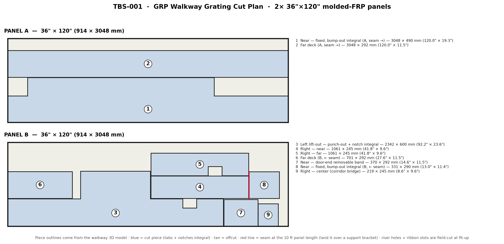

---

## 3. Near and Far Walkways — Wall-Cantilevered

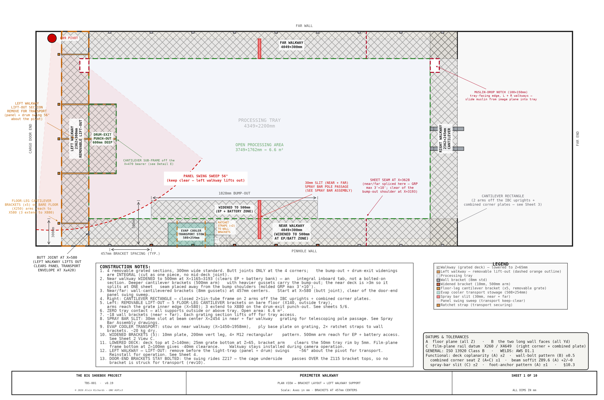

The near (pinhole wall) and far (film plane wall) walkways run the full length of
the processing tray, butting the left and right walkways at each end.

### 3.1 Cantilever Bracket Design

Each bracket is a welded assembly — an 8mm steel plate (vertical mounting leg + gusset) with a
**2×1×0.120in steel tube arm** welded on, which carries the US IBC/OSHA 300 lbf tip load at SF 2.1 (§9).

| Component | Dimensions | Function |
|-----------|-----------|----------|
| Vertical mounting plate | 8×200mm (height), flat against wall rib | Bolted to container corrugation rib interior face |
| Horizontal arm | **2×1×0.120in steel tube** (50.8×25.4), 300mm cantilever (**3×1** in the widened zone) | Supports grating; sized to IBC/OSHA (§9) |
| Triangular gusset | Right triangle, 70mm reach from wall | Braces the arm root; reach stops before tray rim |

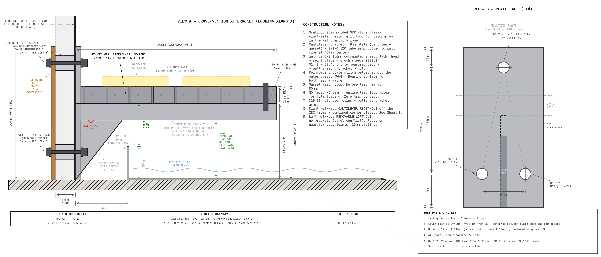

**Attachment:** 3× M12×70 through-bolts per bracket, in a triangular pattern. The container
side wall is a single 1.6mm corrugated Corten sheet. The bracket leg (8mm) bolts against the
inner face of a corrugation, and a 6mm exterior reinforcing plate (100×200mm), welded across
the corrugation on the outside, gives the bolt heads a bearing face. Each bolt therefore passes
through the leg, the wall sheet and the ~30mm corrugation depth to the plate: a 44mm grip (46mm
on the widened bracket), which the M12×70 covers with a flat washer each end, a split-lock and
the nut, with 6–8mm protruding (§9). A steel **crush sleeve** (1in OD × 0.188in wall DOM tube,
WF6) on each bolt fills the corrugation hollow between the sheet and the plate, so the 90 N·m
preload clamps plate, sleeve, sheet and leg instead of collapsing the corrugation. Each sleeve
is cut to the hollow measured on the purchased container (~28.4mm at the assumed 30mm depth). The two lower bolts straddle the gusset at ±27mm X; the
upper bolt sits just above the arm on the gusset centerline. See View B.

**Spacing:** Brackets mount at every container rib — 457mm (18") nominal centers. Neither ISO 668 nor a US standard fixes the corrugation pitch, so the bracket stations and the reinforcing-plate width are confirmed against the purchased container's wall profile before fabrication.

### 3.2 Near Walkway Widened Section

The near walkway widens from 300mm to 500mm, extending past the spray bar slit to the
next rib. It gives the operator full-width standing room in front of the electrical
panel, battery bank, and spray-bar slit — wall-mounted equipment that needs front
access for operation and maintenance.

Five heavier brackets carry the 500mm arm. The zone runs past the slit so a 500mm-arm
bracket supports the grating on both sides of it — no unsupported overhang.

**Sheet 9 — Detail F: Near-Walkway Bump-Out (pinhole wall, plan).** The 500mm-deep standing
band over X<!-- BEGIN fact:walkway_near_wide_x_l_mm -->1,165<!-- END fact:walkway_near_wide_x_l_mm -->–<!-- BEGIN fact:walkway_near_wide_x_r_mm -->3,193<!-- END fact:walkway_near_wide_x_r_mm -->, its 5 widened wall-cantilever brackets on the ribs, the 100mm deck
overhang past each end bracket, and the spray-bar pole slit at the pinhole (X2,454) — the
pinhole-side counterpart to the left drum-exit punch-out (Sheet 5).

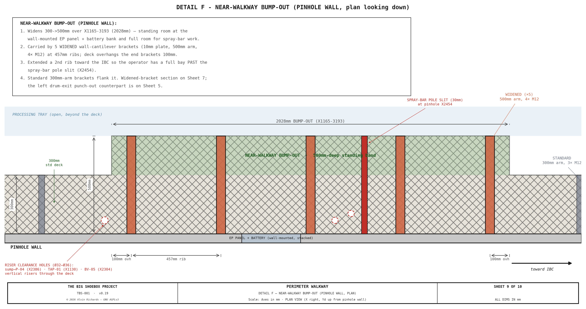

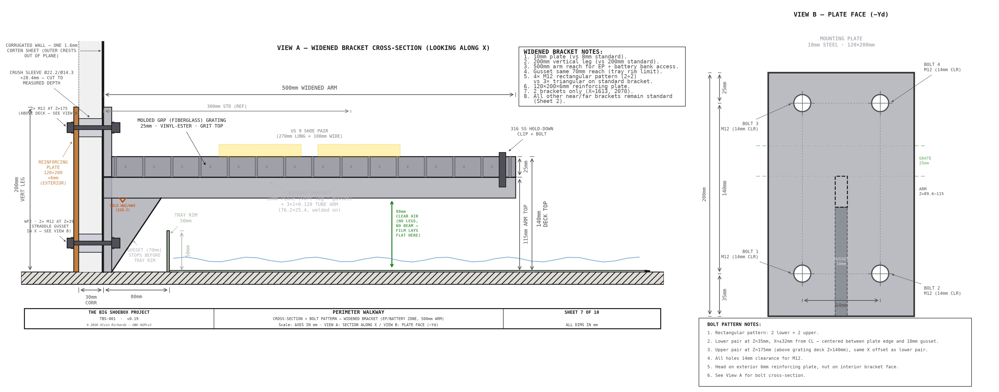

| Parameter | Standard bracket | Widened bracket |
|-----------|-----------------|-----------------|
| Plate thickness (leg + gusset) | 8mm | 10mm |
| Vertical leg height | 200mm | 200mm |
| Arm section | 2×1×0.120in tube (SF 2.1) | 3×1×0.120in tube (SF 1.83, defl-governed) |
| Arm reach | 300mm | 500mm |
| Gusset reach | 70mm | 70mm (tray rim constrained) |
| Bolt pattern | 3x M12 triangular (2+1) | 4x M12 rectangular (2+2) |
| Reinforcing plate | 100x200x6mm | 120x200x6mm |

The gusset reach remains 70mm on both bracket types — limited by the processing
tray rim. Both bracket types share the 200mm vertical leg (sized so the raised
upper wall-bolt clears the grate deck by 25mm); the widened bracket compensates
for its longer arm with heavier (10mm) plate, a wider blank for greater wall
engagement, and the additional bolt for higher moment capacity.

**Attachment:** same through-wall stack-up as §3.1, but **4× M12** in a rectangular
pattern — two lower bolts straddling the 10mm gusset at ±32mm X, two upper 30mm above
the deck — through a 120×200×6mm reinforcing plate. See Sheet 7, View B.

**Width transition:** At the two transition brackets,
the grating changes from 300mm to 500mm width (or vice versa). Both the
narrow and wide grating sections rest on the same 500mm bracket arm. A
40×500×5mm flat bearing plate is welded to the bracket arm top surface at each
transition, providing a wider landing surface so both grating sections have
adequate bearing. The narrow section occupies the inner 300mm of the plate;
the wide section occupies the full 500mm. Stainless hold-down clips retain each grating
section independently on either side of the transition.

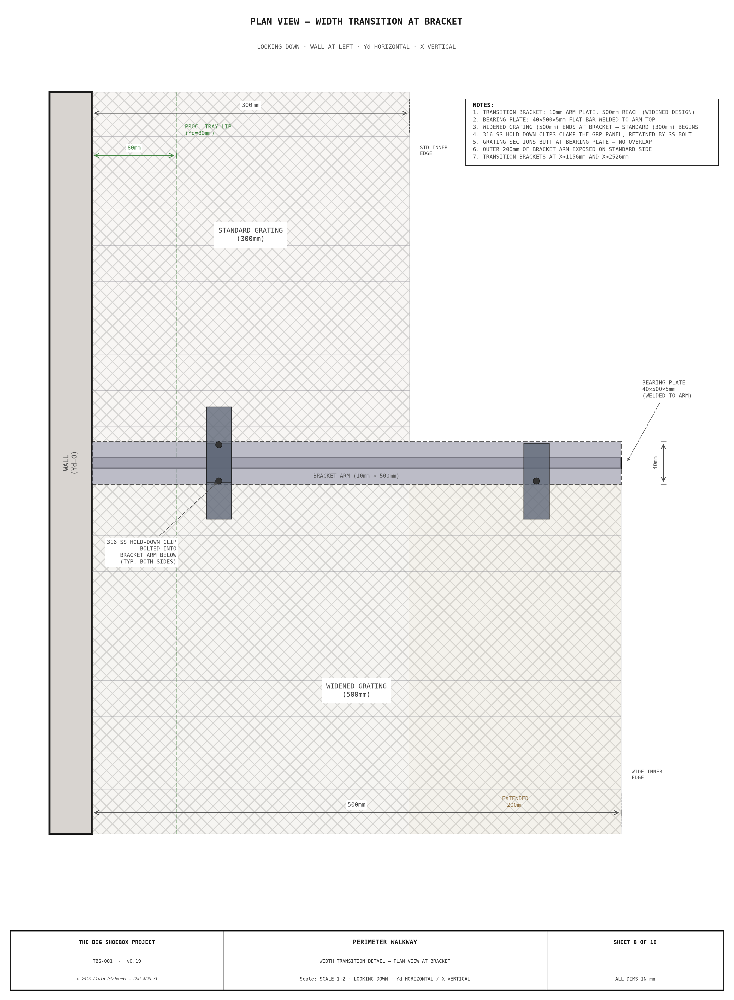

### 3.3 Spray Bar Slit

A 30mm wide slot is cut through both near and far walkway grating at the beam
center X position, providing clearance for the spray bar telescoping pole to
pass through the walkway during processing operations.

On both walkways, the slit extends from the inner walkway edge inward only to
the processing tray lip — not the full walkway depth. The remaining grating
between the tray lip and the wall stays solid, maintaining structural
continuity across the slit.

| Walkway | Inner edge (Yd) | Tray lip (Yd) | Slit depth | Solid remaining |
|---------|----------------|---------------|-----------|----------------|
| Near (widened) | 500mm | 80mm | 420mm | 80mm |
| Far (standard) | 2,062mm | 2,280mm | 218mm | 82mm |

See [Processing Tray & Spray Bar](processing-tray-and-spray-bar.md) for pole
assembly details.

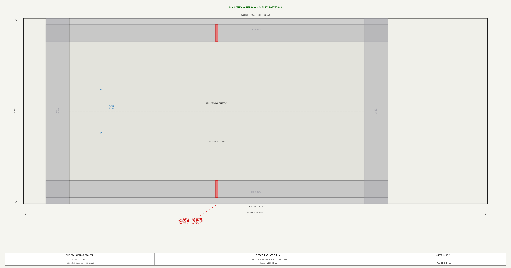

---

## 4. Right Walkway — Cantilever Rectangle

The right walkway is supported by cantilevers off the IBC frame: the IBC stack fills the floor below it and there is no end wall within reach to bracket from.

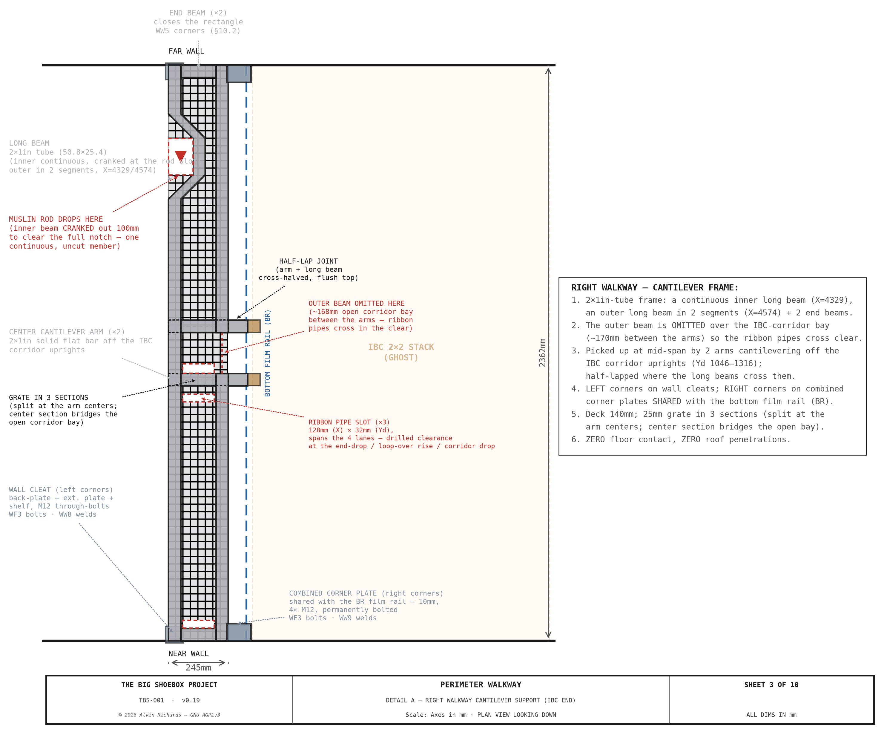

### 4.1 The Cantilever Rectangle

A rectangular frame sits directly under the deck,
its 1in dimension the depth so the full-width 1½in spray beam — which rides the Yd-sloped tray floor —
clears the soffit (Z89.6) by **11.6mm** at every travel position. A shallow section is less stiff on its
own, so the rectangle is **picked up at mid-span by two center cantilever arms** (§4.2); with them the
deflection stays well under 1mm. The frame:

- **Two long beams** run the container width, with the 245mm grating spanning between them
  (the deck's outer edge lands on the shared combined corner plate). The **inner** beam
  is continuous; the **outer** beam is run in **two simply‑supported segments** (combined corner
  plate → cantilever arm) with an **open bay over the IBC corridor** (see below).
- **Two short end beams** (≈245mm) close the near and far ends, joining the beams into a
  torsionally stiff frame (no free bearer ends to droop).

**Open corridor bay in the outer beam.** The four under‑walkway ribbon pipes cross the outer
beam line to enter the IBC corridor. Rather than notch the outer beam — an open‑top notch would
gut the 2×1 section to a ~2.4mm web, a near‑hinge in a primary bending member — the outer beam
is **omitted over the ~170mm open bay between the two cantilever arms**,
so the pipes cross in the clear. Each outer segment is then a short simply‑supported span (wall
combined plate at one end, cantilever‑arm half‑lap at the other), and the only continuous member
across the corridor is the inner beam. The grating is **split at the two cantilever‑arm centers**
into near, center, and far sections; the **center section bridges the open bay**, its ends landing on
the two arms. That short center span carries a little flex, accepted
over the low‑traffic corridor.

**Cranked inner beam at the muslin-rod slot.** The muslin-drop notch on the right walkway
sits at the tray-facing edge, directly over the **inner** long beam — and the
rigid batten on the muslin's bottom edge has to drop straight down through it into the tray. Rather
than cut the beam (which would sever a continuous member at mid-span of its ~1.1m end bay), the inner
beam is **cranked outboard 100mm** — the full notch depth — over the notch, with ~100mm angled ramps
each side, vacating the entire notch footprint
so the rod passes clear, while the beam stays **one continuous, uncut member** — bending and tension
continuity fully preserved. The grating loses no support (the notch already voids the deck there; the
outboard strip still bears on the cranked beam and the outer beam). The left-walkway notch needs no
such treatment — it falls between floor-leg brackets, with no beam beneath it. See **Sheet 3 (Detail A)**.

### 4.2 Center Cantilever Arms

Two **solid 2×1 bar arms** cantilever inward off the **IBC corridor uprights**
and pick the rectangle up at mid-span. Each arm is **half-lapped (cross-halved)** where
the long beams cross it, so the beams seat down into the arm and the two members share
a flush top face. The arms carry the central span that the 1in-deep beams could not
carry stiffly on the corner supports alone — see the [cantilever study](right-walkway-cantilever-study.md).

### 4.3 Corner Supports

| Corner | Support | Fixing |
|--------|---------|--------|
| Left, near + far | **Wall cleat** — 8mm steel back-plate + exterior reinforcing plate + a shelf the long beam lands on | M12 through-bolts (sandwich the wall, sealed) |
| Right, near + far | **Combined corner plate** — a single 10mm plate that carries BOTH the walkway right beam AND the bottom-right film rail (BR) | 4× M12, permanently bolted (interior + exterior plate sandwich the wall) |

The **combined corner plate** is the key coupling: the walkway's right long beam
and the film plane's bottom-right rail terminate at the same position, so a
single plate seats both — the walkway beam on a 70mm seat, the film
rail on a 150mm seat.

### 4.4 Design Rationale

The cantilever rectangle achieves three goals:

1. **Zero floor contact** — clears the IBC stack entirely; no legs on the floor in
   the IBC zone.
2. **Zero tray contact** — the rectangle floats above the processing tray.
3. **Consolidated film-rail anchor** — the combined corner plate does double duty,
   removing a separate BR saddle.

The pipe-routing space under this walkway — past the IBC frame feet, the tray rims,
and the cantilever arms — is detailed in the [Walkway Routing Sections](walkway-routing-sections.md).

---

## 5. Left Walkway — Removable Lift-Out

The left walkway at the cargo door end cannot use wall-cantilevered
brackets because the hinged light-trap panel occupies the end wall and swings ~56°
about the pivot for transport (its sweep passes over this zone). Its **inner edge
sits over the processing tray**, so it cannot be supported from below
either. The left walkway is therefore a removable lift-out grate carried by **5
floor-leg cantilever brackets** — each a post standing on the bare floor *outside*
the tray with an arm that cantilevers over the tray to the grate inner
edge. The 140mm deck height puts these arms clear of the floor-level spray bar.

### 5.1 Support System

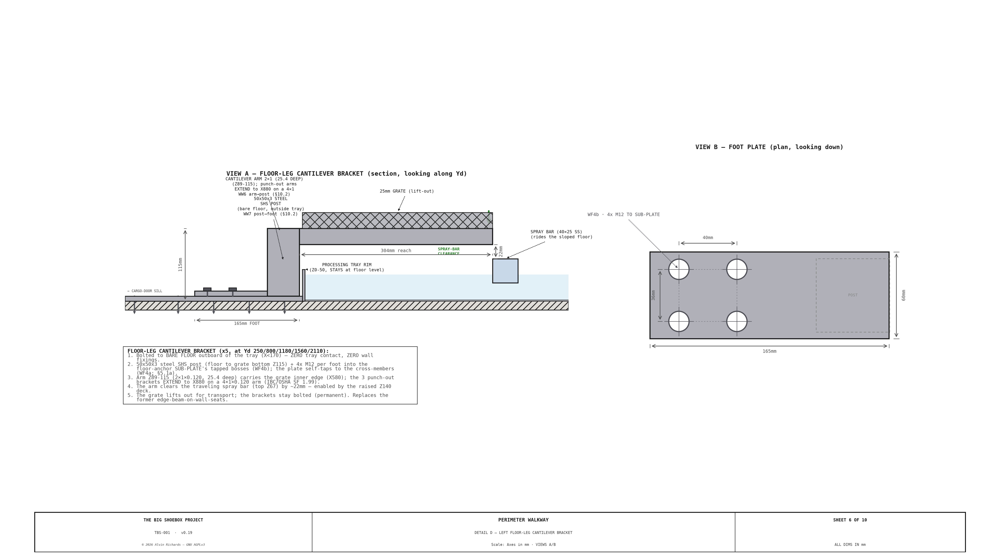

| Component | Specification |
|-----------|--------------|
| Post (×5) | 2×2×0.120in steel SHS, ~115mm tall, on the floor-anchor sub-plate at X≈250 (outside the tray; trimmed by the plate thickness so deck level and clearances hold) |
| Foot plate | 165×60×8mm steel plate, bolted with **4× M12×30** into the sub-plate's tapped bosses (§5.2) |
| Arm — standard (×2) | 2×1×0.120in steel tube reaching X=580mm, the grate inner edge (SF 2.06) |
| Arm — punch-out (×3) | **4×1×0.120in** steel tube extended to X=880mm under the drum-exit punch-out (SF 1.99) |
| Positions | Yd 250 / 800 / 1,180 / 1,560 / 2,110 |

The grate rests on the arms, located laterally by butting the near/far grate edges, and lifts
straight out — no fasteners, no kerb — with **zero tray contact**: the posts stand on bare floor
outside the tray and the arms cantilever over it. Every arm and right-rectangle beam has its
underside at Z89.6; across the 1:200 tray profile that clears the traveling spray beam by at
least 11.5mm and the tray rim by at least 8.6mm, both at the far (high) rim (§9). The brackets sit outside the panel's transport-swing
footprint, so the grate lifts out before the panel swings and the floor-bolted posts stay put. No
through-wall hardware is needed.

**Load path.** Operator load travels grate → arm → post → foot plate → sub-plate → sill and
cross-members. The longest cantilever is the punch-out arm (605mm); under the US IBC/OSHA 300 lbf
tip load it needs the 4×1 tube, while the standard 305mm arms stay 2×1 and the post carries SF 2.68
(§9, `walkway_load.py`). Each leg's ~2.4 kN overturning uplift goes through the foot into the
continuous sub-plate (§5.2), whose self-drillers spread it across several fixings in the door-end
sill and steel cross-members, each good for ~5.3 kN in 4mm steel.

### 5.2 Floor Anchoring — Sub-Plate (Strongback)

The five floor-legs do **not** screw straight into the floor. They bolt to one continuous steel **sub-plate** (a strongback) that lies flat on the floor, self-taps down into the door-end sill and the cross-members it spans (WF4a), and carries tapped bosses the leg feet bolt up into (WF4b). This is the project-wide floor-anchoring standard, shared with the IBC frame feet (see [IBC Stacking Report §3.6](ibc-stacking-report.md#36-floor-anchoring-sub-plate-strongback-standard)).

A plate is needed because container cross-members are **not dimensionally standardized**: [ISO 1496-1](https://law.resource.org/pub/us/cfr/ibr/004/iso.1496-1.1990.pdf) fixes only that intermediate transverse members sit **≤1,000mm apart** (or the container is flat-bottomed), and [the pitch and stations vary by maker](https://www.discovercontainers.com/shipping-container-components-classifications/) — [CIMC](https://www.cimc-equilink.com/media/3659.html) uses a ~45mm-flange C-section at ~300mm, but it is not guaranteed. The continuous plate removes the lottery: it runs from the door-end sill (guaranteed bottom-end-rail steel) across the first cross-members, and self-drillers ([#14×3½″, 410 SS](https://www.cedengineering.com/userfiles/D06-006%20-%20Shipping%20Containers%20-%20US.pdf)) fix it down wherever the steel actually is. The map and the standard are drawn on the floor-anchoring sheets:

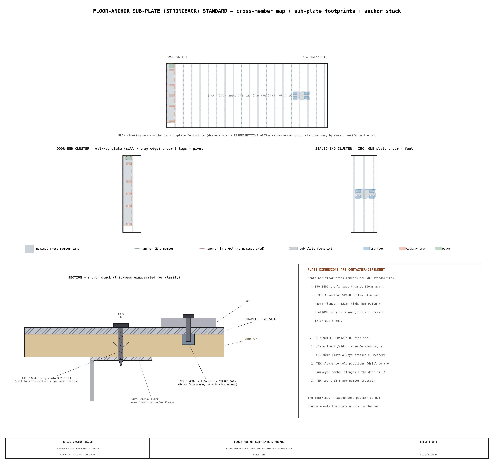

> **Plate dimensions are container-dependent.** The ~1,900×350×8mm plate size, the number of members spanned, and the TEK count are **finalized against the actual acquired container** — survey the sill and cross-member stations (and any forklift pockets) on receipt, then cut the plate and drill its TEK clearance holes to the surveyed steel. The leg positions and their foot bolt pattern do **not** change — only the plate adapts to the box.

### 5.3 Drum-Exit Punch-Out

The operator steps out of the revolving-door light lock at its interior face, where a standard
300mm walkway would leave only ~20mm of landing before the processing-tray basin. The left
walkway is therefore **deepened to 600mm over the drum opening** (Yd 800–1,560) — a ~600 × 760mm
landing centered on the exit, the counterpart of the near-walkway widened section (§3.2). It is
carried by the 3 middle floor-leg brackets on their extended 4×1 arms (§5.1) and lifts out with the
rest of the left walkway; no separate sub-frame or edge beam is needed.

**Optical clearance.** The punch-out lies within the film plane's X span, but its deck (Z140) sits
below the film's bottom edge (Z160), so every pinhole sight line to the film passes above it
(`generate_line_of_sight.py` — no equipment intersects the cone).

The punch-out is shown on **Sheet 5 (Detail C)** with the rest of the left-walkway floor-leg system:

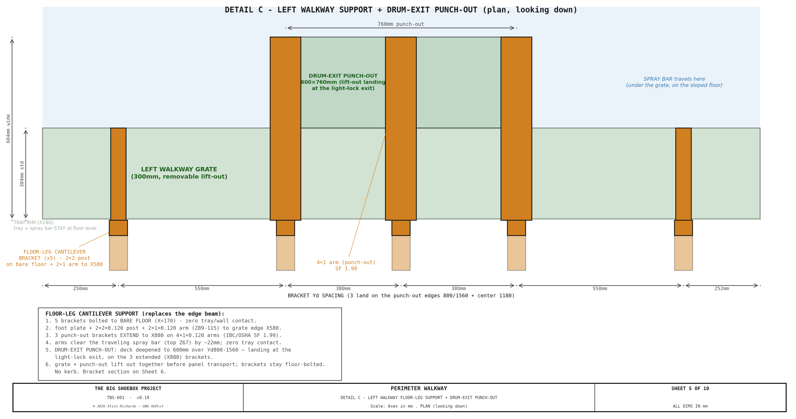

### 5.4 Panel Transport Clearance

| Parameter | Value |
|-----------|-------|
| Panel transport motion | SWING ~56° about the Ø89 pivot |
| Swing sweep reach (near-walkway zone) | X≈1,395mm |
| Butt joint / near-far walkway start | X=580mm |
| Drum-cage underside | Z=130mm (10mm below the Z140 grate top) |
| Panel bottom edge | Z=217mm (panel floor gap) |

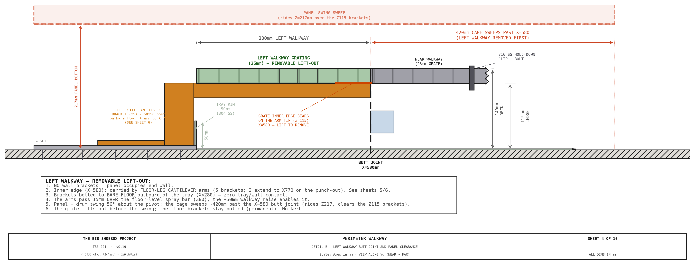

The left walkway grate — together with the door-end near-deck lift-out
section — must be lifted out before the panel can swing — the 5 floor-leg posts stay
bolted to the floor. As the panel + drum swing ~56° about the pivot, the cage sweeps past
the butt joint into the vacated zone, its **cage underside passing over the
door-end floor-leg posts** — so no floor-leg post is struck.
The relevant standing clearance is vertical: the drum-cage underside sits at Z130 —
15mm over the Z115 posts and well clear of the tray rim (the panel bottom rides higher
still, at the 217mm floor gap). See hinged-panel Sheet 16.

---

## 6. Corner Joints

All four corners use butt joints (not miter joints). The near and far walkway
grating sections terminate at the butt joint lines, and the left and right
walkway grating sections rest on or abut the near/far bracket arms at these
intersections.

| Corner | Butt joint X | Design |
|--------|-------------|--------|
| Near-left / Far-left | X=580mm | Left walkway grate rests on the floor-leg cantilever arms; butts the near/far grate |
| Near-right / Far-right | X=4,629mm | Right walkway grating abuts near/far grating |

Butt joints are used rather than miters for two reasons:

1. **Panel clearance** — near/far walkways start at X=580mm, clear of the door-end
   panel swing sweep, so only the left walkway + the door-end near-deck section need
   removal for transport mode.
2. **Simplicity** — each grating section lifts off independently without
   affecting adjacent sections.

---

## 7. Evaporative Cooler Transport Stowage

During transport, the evaporative cooler (~<!-- BEGIN fact:cooler_weight_kg -->7<!-- END fact:cooler_weight_kg --> kg / <!-- BEGIN fact:cooler_weight_lb -->16<!-- END fact:cooler_weight_lb --> lb dry, Hessaire MC18M, 508 × 254 × 711mm) is stowed on the
near walkway grating — in the widened section, so it clears the panel swing sweep. The cooler sits on a
12mm plywood base plate that distributes
load across the grating and prevents the housing from catching in grate openings.
Two 25mm ratchet straps loop over the cooler and hook to near walkway cantilever
bracket arms. Its 254mm depth sits within the 500mm-wide deck, so nothing overhangs the tray.

---

## 8. Grating Specification

All four walkway sections use the same grating:

| Parameter | Value |
|-----------|-------|
| Type | Molded GRP (fiberglass) grating |
| Thickness | 1" (25mm) — McNichols MS-S-100, the thinnest molded FRP made |
| Resin | Vinyl-ester ([corrosion-resistant](https://www.fibergrate.com/products/molded-gratings/) against the cyanotype chemistry and wash water) |
| Mesh | ~38×38mm square, molded |
| Open area | ~70% |
| Surface finish | Grit top (slip-resistant) |

The four sections' overall sizes, cut features, GRP panel seams, and
hold-down-clip positions are dimensioned on the **Sheet 10 grate cut-plan**
— a nesting/fabricator drawing:

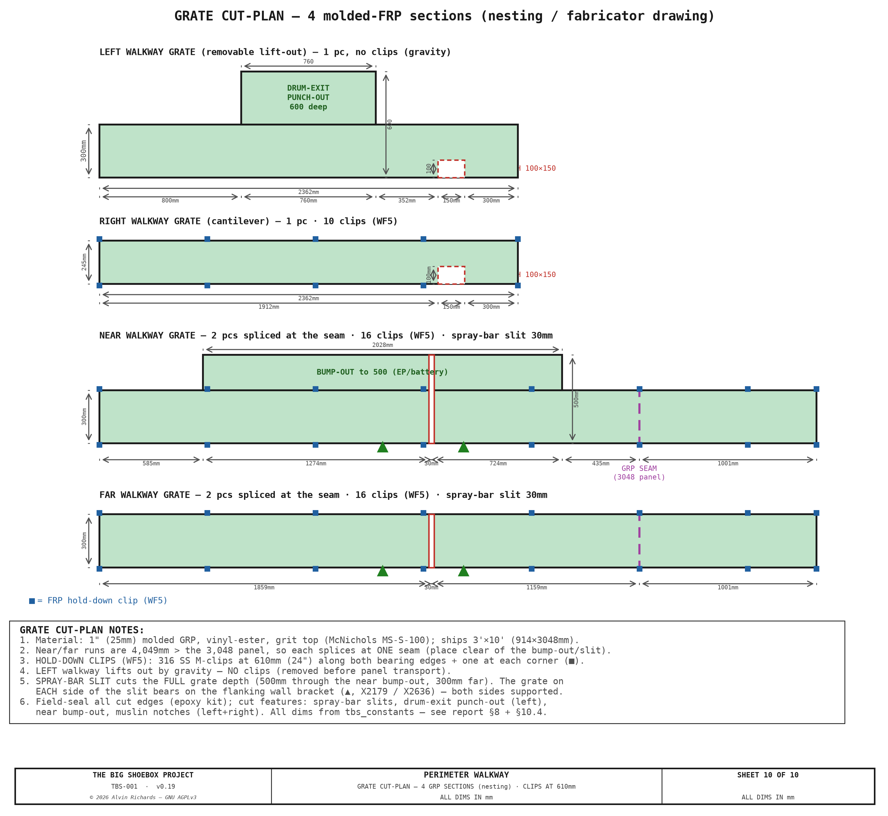

### 8.1 Grating Retention by Walkway Section

| Walkway | Retention Method | Attachment Point | Removal |
|---------|-----------------|------------------|---------|
| Near (pinhole wall) | 316 SS hold-down clips | Bracket arm top surface | Release clips, lift grating |
| Far (film plane wall) | 316 SS hold-down clips | Bracket arm top surface | Release clips, lift grating |
| Right (IBC end) | 316 SS hold-down clips | Rectangle long beams | Release clips, lift grating |
| Left (cargo door) | Gravity (floor-leg arms) | Floor-leg cantilever arms | Lift straight up — no fasteners |

**Near and far walkways** use 316 SS hold-down clips that clamp the GRP panel
down onto the bracket arm (a stainless clamp clip — not a TEK screw driven into a
steel bearing bar, since FRP isn't screwed through). Clips are spaced at 610mm (24in) along the
bearing edges, plus one at each panel corner (WF5).

**Right walkway** uses the same stainless hold-down clips, clamped to the 2×1 long beams of the
cantilever rectangle (§4.1).

**Left walkway** uses gravity retention only (§5.1), so it can be removed quickly
before the hinged panel swings for transport.

---

## 9. Structural Validation

Every walkway element is checked to the **US IBC/OSHA** load basis — [IBC-2021
Table 1607.1](https://codes.iccsafe.org/content/IBC2021P2/chapter-16-structural-design#IBC2021P2_Ch16_Sec1607)
for walkways / elevated platforms: a **60 psf (2.87 kPa) uniform** live load and a **300 lbf (1.33 kN)
concentrated** load applied at the location of maximum stress, mirrored by [OSHA 29 CFR
1910.28](https://www.osha.gov/laws-regs/regulations/standardnumber/1910/1910.28) for the workplace. Per IBC
1607.1 the two need not be combined; for every cantilever the **concentrated load at the free tip governs**.
The figures below are computed by `src/generators/walkway_load.py` (safety factors on yield, target ≥ 2.0),
so they cannot drift from the geometry.

<!-- BEGIN load:validation -->
| Element | Design demand | Capacity | SF | Basis |
|---------|---------------|----------|----|-------|
| Grate — uniform | 60 psf | 2360 psf max-rec | 39 | Fibergrate 1" 1×4 molded FRP; span ≤ 12" tabulated min |
| Grate — concentrated | 300 lbf | 0.8 mm defl | — | 0.03" @ 18" span (Fibergrate); less at our shorter span |
| Wall bracket STD arm | 400 N·m | 838 N·m | 2.09 | 2×1×0.120 tube, 300 mm; tip defl 1.4 mm (L/213) |
| Wall bracket WIDE arm | 667 N·m | 1222 N·m | 1.83 | 3×1×0.120 tube, 500 mm; deflection-governed, tip L/112 |
| Wall bolt tension (M12 8.8) | 3010 N | 60696 N | 20 | root-moment couple, 133 mm lever |
| Reinforcing plate → outer crests (WW4) | 3010 N | 203616 N | 68 | 5 mm stitch welds, 200 mm (2 × 50 mm on each bridged crest) |
| Crush sleeve under preload | 122 MPa | 250 MPa | 2.05 | Ø25.4/Ø15.9 tube, 37.5 kN at 90 N·m; bears on the 1.6 mm sheet at SF 2.83 (Corten 345 MPa) |
| Wall-bolt length (M12×70) | needs 68 mm | 70 mm | — | grip 44 mm std / 46 mm widened = 6 plate + 30 corrugation (one 1.6 mm sheet) + 8/10 leg; protrudes 5.7–7.7 mm past the nut |
| Floor-leg STD arm | 406 N·m | 838 N·m | 2.06 | 2×1×0.120, 305 mm cant. |
| Floor-leg punch-out arm | 807 N·m | 1605 N·m | 1.99 | 4×1×0.120, 605 mm cant. |
| Floor-leg post | 807 N·m | 2158 N·m | 2.68 | 2×2×0.120 SHS |
| Floor-leg uplift → sub-plate | 2445 N/fixing | 5300 N | 2.17 | leg bolts to the sub-plate (§5.2); self-drilling TEKs carry the couple into the sill/members, 2 outboard over the 165 mm foot |
| Combined corner plate | 1612 N | 161856 N | 100 | 10 mm plate, 4× M12; shared with the BR film rail |
| Soffit clearance — tray rim | rim Z70–81 | soffit Z89.6 | — | min 8.6 mm at the far rim (Yd2280); 19.6 mm at the near rim |
| Soffit clearance — spray beam | beam top Z67–78 | soffit Z89.6 | — | min 11.5 mm at the far end of travel (Yd2280) |
| RWK long beam (cross-ref) | person + grate | SF 7.1 | 7.1 | ibc_frame_load.outer_beam_frame_check — two SS segments (open corridor bay), full section |
| RWK arm half-lap notch (cross-ref) | 334 N·m | SF 2.03 | 2.03 | ibc_frame_load.arm_notch_check — solid-bar rebalanced split |
| Arm→upright CJ (IBC-owned) | 395 N·m | SF 20 | 20 | ibc_frame_load.service_loads — drawn on IBC-frame Sheet 5, cross-ref only |
<!-- END load:validation -->

**Reading the table.** The grate is far over-capacity (SF ≈ 39 on the 245–300mm span — well below the
manufacturer's shortest tabulated 12" span). The wall-cantilever bracket arms are a **2×1×0.120in tube**
(standard, SF 2.1) and a **3×1×0.120in tube** (widened, SF 1.83). The widened bracket is **deflection-governed** — at the
25.4mm depth the spray bar allows, its 500mm reach gives L/112 tip deflection under the worst-case corner point
load (a rare position; distributed standing deflects far less). The **left-walkway floor-leg** punch-out arm
is a **4×1×0.120in tube** (SF 1.99) for its 605mm reach. The wall-bolt tension
does not punch the 1.6mm sheet: the exterior plate carries it into the outer crests through its WW4 stitch welds
(SF 68), and the crush sleeve carries the bolt preload across the corrugation hollow (SF 2.05; the sheet bears on it
at SF 2.83). Two items carry fabrication conditions rather than a clean margin: the wall-bolt grip and sleeve length
depend on the corrugation depth measured on the purchased container, and the **floor-leg overturning uplift** (~2.4 kN/leg) is carried
into the continuous floor-anchor sub-plate (§5.2), whose self-drillers engage the door-end sill and the
steel cross-members (~5.3 kN each).

The **right walkway** is a **2×1×0.120in cantilever frame** — a continuous inner beam, two outer-beam
segments, and two end beams, with an **open bay in the outer rail over the corridor** — picked up at mid-span
by two arms off the IBC corridor uprights and at its corners by wall cleats (left) + combined corner plates
(right). Its long/end beams and the arm half-lap notch are validated in `ibc_frame_load.py` (`outer_beam_frame_check`, SF 7.1;
`arm_notch_check`, SF 2.03) and cross-referenced above; the **arm→upright connection (joint CJ) is IBC-frame-owned**
and drawn on IBC-frame Sheet 5, so it is cross-referenced, not re-validated here (see the
[cantilever study](right-walkway-cantilever-study.md)).

---

## 10. Fabrication Schedules

Walkway-scoped marks (**WF#** fasteners, **WW#** welds). The center-arm end-plate bolts and the half-lap hold-down screws belong to
the **IBC-frame CJ** schedule and are cross-referenced, not scheduled here. Governing weld throats are
load-checked in `walkway_load.py`; the rest are [AWS D1.1](https://www.aws.org/standards/) minimum
practical fillets for the plate thickness.

### 10.1 Fastener Schedule

<!-- BEGIN load:fasteners -->
| Mark | Joint | Fastener | Grade | Qty | Torque | Washer | Locker |
|------|-------|----------|-------|-----|--------|--------|--------|
| WF1 | Standard bracket → wall rib | M12×70 hex, [91280A732](https://www.mcmaster.com/91280A732/) | Gr.8.8 zinc | 3/brkt × 11 = 33 | ~90 N·m | flat both ends | plain nut + split-lock |
| WF2 | Widened bracket → wall rib | M12×70 hex, [91280A732](https://www.mcmaster.com/91280A732/) | Gr.8.8 zinc | 4/brkt × 5 = 20 | ~90 N·m | flat both ends | plain nut + split-lock |
| WF3 | Right-walkway wall cleat + combined corner plate → wall | M12×70 hex, [91280A732](https://www.mcmaster.com/91280A732/) | Gr.8.8 zinc | 20 | ~90 N·m | flat both ends | plain nut + split-lock |
| WF6 | Crush sleeve in the corrugation, every wall bolt (WF1–WF3) | Ø25.4/Ø15.9 DOM steel tube × 28.4 mm, cut to measured depth | 1020 DOM | 73 | — | — | — |
| WF4a | Floor-anchor sub-plate → sill + cross-members (§5.2) | #14×3½″ self-driller (90822A536) | 410 SS | container-dependent (~20) | driven to seat (no torque spec) | bonded washer | thread-forming (self-locking) |
| WF4b | Floor-leg foot plate → sub-plate (tapped boss) | M12×30 into tapped boss | Gr.8.8 zinc | 4/foot × 5 = 20 | snug + locker | split-lock under head | thread-locker (tapped boss) |
| WF5 | Grating hold-down clip → bracket arm / long beam | M-type FRP grating clip + bolt | 316 SS | 610 mm (24") along bearing edges + corners | snug | — | — |
| CJ (IBC-owned) | Center-arm end-plate → IBC upright + half-lap hold-down | M12×100 + #14 TEK | Gr.8.8 / 410 SS | cross-ref | — | — | see IBC-frame Sheet 5 |
<!-- END load:fasteners -->

### 10.2 Weld Schedule

<!-- BEGIN load:welds -->
| Mark | Weld | Leg | Basis / check |
|------|------|-----|---------------|
| WW1 | Std bracket 2×1 arm → 8mm leg (GOVERNING) | 5mm all-round | root M 400 N·m → 310 N/mm vs 1018 N/mm, SF 3.3 |
| WW2 | Widened 3×1 arm → 10mm leg (GOVERNING) | 5mm all-round | root M 667 N·m → SF 3.0 |
| WW3 | Gusset → leg + gusset → arm | 5mm | braces the arm root; AWS D1.1 min for 8/10mm plate |
| WW4 | Reinforcing plate → outer corrugation crests | 5mm stitched, 2 × 50mm per crest | carries the wall-bolt tension into the wall (§9) |
| WW5 | Rectangle long ↔ end-beam corners (right walkway) | 5mm | closed-frame corners; AWS D1.1 min (tube ≤6mm) |
| WW6 | Floor-leg 4×1 arm → 2×2 post (GOVERNING) | 5mm all-round | root M 807 N·m → 313 N/mm vs 1018 N/mm, SF 3.3 |
| WW7 | Floor-leg post → foot plate (GOVERNING) | 5mm all-round | base M 807 N·m → SF 3.3; also carries the 1334 N vertical in shear |
| WW8 | Wall cleat — back-plate + shelf + upstand | 5mm | AWS D1.1 min; the long beam bears on the shelf, TEK-locked |
| WW9 | Combined corner plate — beam seat + upstand | 5mm | AWS D1.1 min; shared with the BR film rail |
| CJ/W (IBC-owned) | Half-lap seat + arm end-plate welds | 5mm | IBC-frame schedule — cross-ref, not scheduled here |
<!-- END load:welds -->

**Weld-location map** — each mark is ticked at its joint on the detail sheets: **WW1/WW3** on Sheet 2
(standard bracket), **WW2/WW3** on Sheet 7 (widened), **WW6/WW7** on Sheet 6 (floor-leg), and
**WW5/WW8/WW9** on Sheet 3 (right cantilever rectangle). **WF1–WF5** land on the same sheets; **WF5**
(grating clips) is dimensioned on the Sheet 10 cut-plan.

All M12 Gr.8.8 wall bolts torque to **~90 N·m** (dry, matching the IBC-frame WH/CJ wall bolts) with a
flat washer each end, a plain nut, and a split-lock washer. The floor-anchor sub-plate's self-drillers
(WF4a) are driven to seat (no torque spec — thread-forming); each leg foot bolts to the plate's tapped bosses
(WF4b, M12×30, snug + thread-locker). Grating hold-down clips sit at 610mm (24in) pitch along the bearing
edges (WF5).

### 10.3 Datums & Tolerances

Three datums register the walkway to the container **and** the film plane, so it lands in the same frame
as the subsystems it interfaces (the traveling spray bar, the film-plane rail):

<!-- BEGIN load:datums -->
| Datum | Definition | References |
|-------|-----------|------------|
| **A** | Floor plane — the container floor / floor-anchor sub-plate underside (Z0; the leg posts are trimmed by the plate thickness so deck + clearances hold) | all heights: deck Z140, arm top Z115, bolt Z42/Z175, beam soffit Z89.6 |
| **B** | The two long wall faces — pinhole wall (Yd0) + film-plane wall (Yd2362) interior faces the brackets bolt to | all Yd bracket/deck positions, bracket spacing 457 |
| **C** | Rail datum — film-plane rail X260 (left) / X4649 (right) | the right-walkway outer edge (X4574) + combined corner plate register to C (shared with the film plane) |
<!-- END load:datums -->

General weldment tolerance is [**ISO 13920**](https://www.iso.org/standard/23282.html) **Class B**
(medium — appropriate for a bolted-and-welded steel walkway); welds are qualified to
[**AWS D1.1**](https://www.aws.org/standards/). The following features carry tighter **functional**
tolerances because a fit or a clearance depends on them:

<!-- BEGIN load:tolerances -->
| Feature | Datum | Tolerance | Why |
|---------|-------|-----------|-----|
| Deck coplanarity — grate-bearing tops, all 4 sections | A | ±2 mm | level walking surface |
| Bracket arm reach (tip X) | B | ±2 mm | grate-edge bearing only |
| Wall-bolt pattern (±27/±32 X, Z42/Z175) | B | ±0.5 mm | must align reinf-plate + wall holes |
| Foot-anchor pattern (X +20/+60, ±18 Yd) | A | ±1 mm | M12 in Ø13 holes over the sub-plate's tapped bosses |
| Spray-bar slit position (X2454) | C | ±2 mm | align to the traveling spray bar |
| Muslin notch / drum-exit punch-out position | B/C | ±3 mm | clearance features |
| Combined corner-plate seat Z (walkway beam + film rail) | A+C | ±1 mm | shared level interface with the film plane |
| Rectangle beam soffit Z89.6 (spray-bar clearance) | A | +2 / −0 mm | must NOT drop below the spray-bar clearance |
| *General (all else)* | — | **ISO 13920 Class B** | weldment linear/angular; welds per **AWS D1.1** |
<!-- END load:tolerances -->

A **DATUMS & TOLERANCES** callout carrying this scheme lands on the Sheet 1 plan.

### 10.4 Member Cut List

Every steel member computed from `tbs_constants.py` (so the lengths can't drift), with a net stock
linear-feet summary to order from — add kerf/handling waste at the shop. The two IBC-post center arms
are in the **IBC-frame** cut list, not here.

<!-- BEGIN load:cutlist -->
| Member | Stock | Length (mm) | Qty |
|--------|-------|-------------|-----|
| Near/far bracket arm — standard | 2×1×0.120in tube | 300 | 11 |
| Near/far bracket arm — widened | 3×1×0.120in tube | 500 | 5 |
| Right-rectangle long beam (inner cranked + outer) | 2×1×0.120in tube | 2362 | 2 |
| Right-rectangle end beam | 2×1×0.120in tube | 143 | 2 |
| Floor-leg post | 2×2×0.120in SHS | 115 | 5 |
| Floor-leg arm — standard | 2×1×0.120in tube | 305 | 2 |
| Floor-leg arm — drum-exit punch-out | 4×1×0.120in tube | 605 | 3 |
| **Stock summary (net, add kerf/waste)** | | | |
| 2×1×0.120in tube | — | 8920 = 29.3 ft | — |
| 3×1×0.120in tube | — | 2500 = 8.2 ft | — |
| 4×1×0.120in tube | — | 1815 = 6.0 ft | — |
| 2×2×0.120in SHS | — | 575 = 1.9 ft | — |
| *IBC-post center arms (×2, solid 2×1 bar)* | | | *IBC-frame cut list* |
<!-- END load:cutlist -->

### 10.5 Plate Fabrication Schedule

Flat-plate parts with their hole sizes and positions (the bolt patterns are referenced to the datums of
§10.3). The CJ arm end/backing plates are on the **IBC-frame** plate schedule.

<!-- BEGIN load:plates -->
| Plate | Blank (mm) | Thk (mm) | Holes | Positions / PCD | Qty |
|-------|-----------|----------|-------|-----------------|-----|
| Foot plate | 165×60 | 8 | 4× Ø13 (M12) | X +20/+60 from left edge × Yd ±18 | 5 |
| Reinforcing plate — std | 100×200 | 6 | 3× Ø13 (M12) | ±27 X @ Z42; 0 @ Z175 (triangular) | 11 |
| Reinforcing plate — widened | 120×200 | 6 | 4× Ø13 (M12) | ±32 X @ Z35 & Z175 (rectangular) | 5 |
| Bracket vertical leg — std / widened | 100×200 / 120×200 | 8 / 10 | matches reinf plate | same bolt pattern; arm + gusset welded on | 11 / 5 |
| Combined corner plate | 150×~271 | 10 | 4× Ø13 corner | shared with the BR film rail (fp_combined_corner_plate) | 2 |
| Wall cleat (back + ext + shelf) | 90×(bolt span) | 8 | 2× Ø13 horizontal | below-shelf + above-beam, clear of the beam edge | 2 |
| Transition bearing plate | 40×500 | 5 | — | welded to the arm top at each 300↔500 width step | 2 |
| *CJ arm end + backing plates (×4)* | 65×190 | 8 | 2× Ø13 | *IBC-frame plate schedule* | — |
<!-- END load:plates -->

---

## 11. Parts List

See the **[Master Shopping List, filtered to the walkway system](master-shopping-list.md?system=walkway)** for the same parts with suppliers, current prices, and click-to-sort/filter.

*Evap-cooler transport-stowage hardware (plywood base plate + ratchet straps, §7) is costed in the [Ventilation & Cooling parts list](ventilation-report.md), not here.*

---

## 12. Maintenance

The walkway is a bolted steel structure with GRP grating, so its upkeep is fastener tightness (bracket, CJ end-plate, combined-plate and floor-anchor bolts), corrosion on the exterior reinforcing plates and the right-walkway welds and cleats, and wear of the GRP grit top. The left-walkway lift-out and re-fit for transport are [Operating Manual §1.3 and §5.5](operating-manual.md); the recurring inspection schedule is in the [Operating Manual — Maintenance](operating-manual.md#maintenance).

---

## 13. Source References

1. [ISO 668:2020](https://www.iso.org/standard/76912.html) — Series 1 freight containers: Classification, dimensions and ratings.
   Sets external dimensions and ratings only; the 457mm (18") rib spacing is a nominal value to be measured on the purchased container.
2. [Fibergrate — Molded Grating load/engineering data](https://www.fibergrate.com/products/molded-gratings/) — molded FRP grating load tables + chemical-resistance guide (vinyl-ester resin selection)
3. [AS 1657-2018](https://www.standards.org.au/standards-catalogue/sa-snz/building/sf-013/as--1657-colon-2018) — Fixed platforms, walkways, stairways and ladders: Design,
   construction and installation (Australian). 300mm minimum clear width for walkways.
4. [OSHA interpretation letter, 1995-05-26](https://www.osha.gov/laws-regs/standardinterpretations/1995-05-26-0) and [OSHA 29 CFR 1910.25](https://www.osha.gov/laws-regs/regulations/standardnumber/1910/1910.25) — US guidance on walkway width (18in for maintenance access; 22in for stairs).
5. [Shurflo 2088 Series datasheet](https://www.shurflo.com/products/2088-series) — Pump dimensions for manifold access clearance.
6. [Equipment Layout Report](equipment-layout-report.md) — Component positions
   and access requirements.
7. [Processing Tray & Spray Bar Report](processing-tray-and-spray-bar.md) — Tray
   dimensions, rim height, spray bar slit requirements.
8. [Hinged Panel Report](hinged-panel-report.md) — Panel swing sweep, transport
   swing, floor gap.
9. [Light Trap Selection Report](light-trap-selection.md) — Panel and drum
   dimensions at cargo door end.
10. [IBC Stacking Report](ibc-stacking-report.md) — IBC stack dimensions and
   floor zone clearance requirements.
11. [Walkway Routing Sections](walkway-routing-sections.md) — Under-walkway
    pipe-routing cross-sections and clearances at each junction.
12. Floor cross-member structure + non-standardization (§5.2): [ISO 1496-1](https://law.resource.org/pub/us/cfr/ibr/004/iso.1496-1.1990.pdf)
    (intermediate transverse members ≤1,000mm apart, or a flat underside); [CED Engineering D06-006 — Shipping Containers](https://www.cedengineering.com/userfiles/D06-006%20-%20Shipping%20Containers%20-%20US.pdf)
    (box/C/Z/I cross-member sections); [CIMC cross-member spec](https://www.cimc-equilink.com/media/3659.html)
    (C-section SPA-H Corten ~4–4.5mm, ~45mm flange, ~122mm high); [Discover Containers](https://www.discovercontainers.com/shipping-container-components-classifications/)
    (cross-member size + spacing not standardized, varies by manufacturer).
