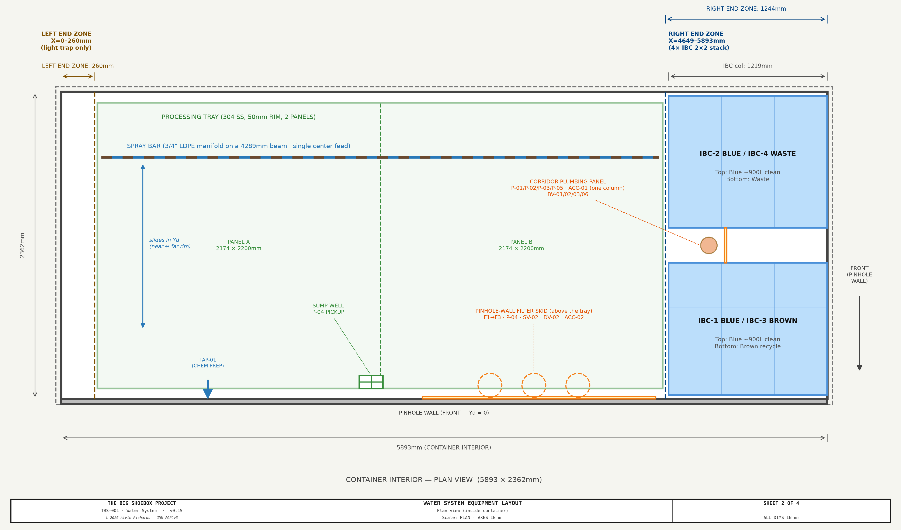
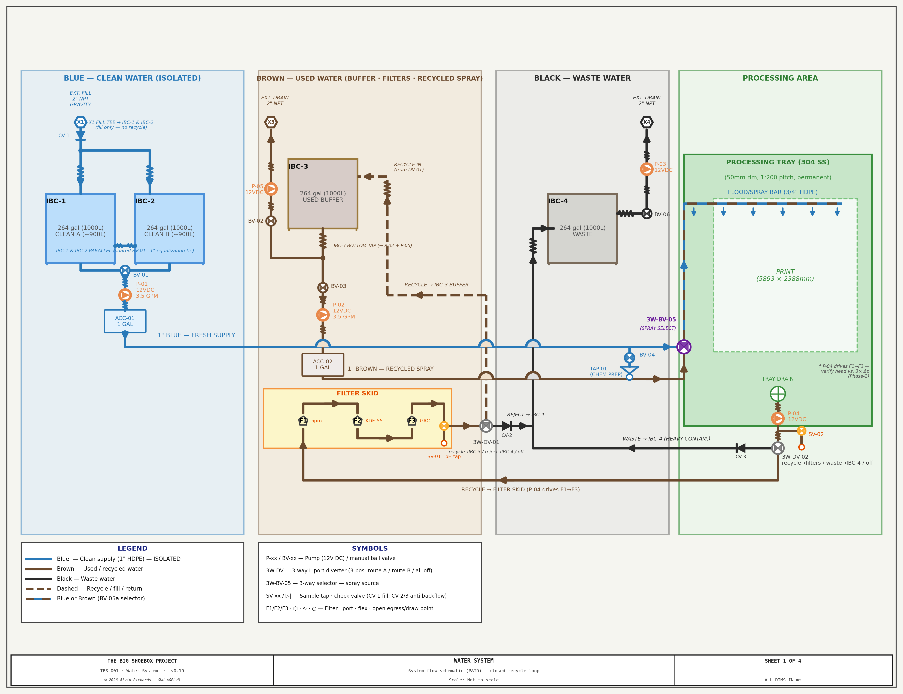

<!-- SPDX-License-Identifier: AGPL-3.0-only -->
<!-- © 2026 Alvin Richards -->
# Water Processing Report

## 1. Purpose

The camera operates in remote locations with no municipal water or drainage. This report specifies a self-contained three-circuit water system that:

- Stores clean water for ~<!-- BEGIN fact:prints_no_recycle -->10<!-- END fact:prints_no_recycle --> full-size prints per resupply run on fresh Blue alone, or **~<!-- BEGIN fact:prints_per_resupply -->15<!-- END fact:prints_per_resupply --> prints** with Brown wash-1 recycling (§3)
- Recycles used wash water through a three-stage filter train, extending usable supply by ~<!-- BEGIN fact:recycle_supply_gain_pct -->50<!-- END fact:recycle_supply_gain_pct -->%
- Holds all waste water in a closed IBC, pumped out through an end-wall port for off-site disposal
- Runs entirely on 12V DC from the solar/battery system



**Three circuits:**

| Circuit | Purpose | Storage |
|---------|---------|---------|
| **Blue** — clean | Fresh water for processing | IBC-1 + IBC-2, top tier — <!-- BEGIN fact:blue_supply_l -->1,800<!-- END fact:blue_supply_l -->L working fill (<!-- BEGIN fact:blue_fill_per_tote_l -->900<!-- END fact:blue_fill_per_tote_l -->L each) |
| **Brown** — used | Collected wash water, filtered into a buffer and reused for wash 1 | IBC-3, bottom tier |
| **Black** — waste | Rejected or heavily contaminated water, held for off-site disposal | IBC-4, bottom tier |

All four totes are identical 1,000L caged IBCs; the fills above are working levels, not tote sizes.



---

## 2. Cyanotype Wash Water — Chemistry and Constraints

### What is in the wash water?

When a cyanotype print is washed, the water picks up:

| Compound | Source | Notes |
|----------|--------|-------|
| Ferric ammonium citrate (FAC) | Unexposed sensitizer | Water-soluble, pale yellow; low toxicity |
| Potassium ferricyanide | Sensitizer component | Water-soluble, yellow-orange; low acute toxicity |
| Prussian blue particles | Exposed image pigment wash-off | Fine blue solid particles, ~1–10 micron |
| Iron(III) compounds | Oxidation products | Color the water blue-gray |

**pH:** Wash water starts slightly acidic to neutral (pH 6–7) and may drift alkaline as iron compounds accumulate. Avoid alkaline conditions (pH >8) — they accelerate the slow breakdown of ferricyanide to ferrocyanide and trace cyanide ions.

**Disposal:** Cyanotype wash water is low-toxicity and is generally accepted to the municipal sewer in dilute volumes. With no sewer access in the field, it must be contained and transported for disposal. Do not pour it on soil or into waterways.

**Source:** [Photrio — Cyanotype wash water composition](https://www.photrio.com/forum/threads/composition-of-cyanotype-wash-water.126234/) · [Ask MetaFilter — Disposing of cyanotyping water](https://ask.metafilter.com/374714/Disposing-of-cyanotyping-water)

### What filtration can and cannot do

A sediment + heavy-metal + activated-carbon filter train will:
- Remove the Prussian blue particle load (sediment stage)
- Reduce dissolved iron, organics, and iron-complex color (KDF and carbon stages)
- Restore water to usable intermediate-wash quality for 1–3 passes

It will **not**:
- Restore water to fresh-water quality
- Remove dissolved iron salts fully
- Make the water safe for discharge to ground

**Reuse rule:** Recycled Brown water is used only for the **first wash**, where the unexposed sensitizer leaches out and the bath is dirtiest regardless of what it starts as. Washes 2 and 3 use Blue, so the print finishes in clean water and iron compounds are not re-deposited. After 3 recycle passes, Brown water goes to Black.

Iron compounds in the wash water react with copper and galvanized steel — the plumbing is PVC throughout ([Plumbing Report §5](plumbing-report.md)).

---

## 3. Water Volume Calculations

### Per-print water requirement

One wash floods the processing tray (~103 sq ft) to 6mm (¼") depth — **<!-- BEGIN fact:tray_flood_gal -->15<!-- END fact:tray_flood_gal --> gal per wash**.

| Wash cycle | Water source | Volume | Drains to |
|-----------|-------------|--------|---------|
| Wash 1 — 5 min | Brown (recycled) | <!-- BEGIN fact:tray_flood_gal -->15<!-- END fact:tray_flood_gal --> gal | Brown |
| Wash 2 — 5 min | Blue (clean) | <!-- BEGIN fact:tray_flood_gal -->15<!-- END fact:tray_flood_gal --> gal | Brown |
| Wash 3 — 5 min | Blue (clean) | <!-- BEGIN fact:tray_flood_gal -->15<!-- END fact:tray_flood_gal --> gal | Brown → Black after 3 recycles |
| **Total per print** | | **~<!-- BEGIN fact:blue_per_print_gal -->30<!-- END fact:blue_per_print_gal --> gal net Blue consumed** | |

### Storage capacity vs. print count

| Scenario | Blue washes per print | Prints from <!-- BEGIN fact:blue_supply_gal -->476<!-- END fact:blue_supply_gal --> gal Blue |
|----------|----------------------|--------------------------|
| No recycling | 3 | ~<!-- BEGIN fact:prints_no_recycle -->10<!-- END fact:prints_no_recycle --> prints |
| With recycling (wash 1 from Brown) | 2 | **~<!-- BEGIN fact:prints_per_resupply -->15<!-- END fact:prints_per_resupply --> prints** |

The first print after a resupply finds IBC-3 empty, so it runs wash 1 on Blue; that one extra Blue wash does not change the count.

**Water balance — recovered vs. consumed.** Of the <!-- BEGIN fact:blue_supply_l -->1,800<!-- END fact:blue_supply_l -->L Blue supply,
~<!-- BEGIN fact:recovered_l -->1,245<!-- END fact:recovered_l -->L is recovered into the collection totes (Brown + Waste,
~<!-- BEGIN fact:collection_fill_l -->622<!-- END fact:collection_fill_l -->L each) and ~<!-- BEGIN fact:lost_l -->465<!-- END fact:lost_l -->L (~<!-- BEGIN fact:loss_per_print_l -->31<!-- END fact:loss_per_print_l -->L per print) is open-process loss: water
**carried out in the wet prints** (each full-plane muslin sheet, ~<!-- BEGIN fact:image_area_m2 -->9.19<!-- END fact:image_area_m2 --> m², leaves saturated),
**evaporation** from the open spray-wash tray, and **unrecovered residual** (tray-surface film, the sump
dead-volume below the P-04 pickup, hose and manifold hold-up). The loss is why two collection totes
balance the supply — they are sized for the recovered fraction, not full throughput. The
[Weight Distribution Report §4.2](weight-distribution-report.md) uses the same recovered figure for the
exhausted-state transport mass.

#### Extending capacity

**Maximizing the initial load.** Filling both Blue totes toward their 1,000L limit buys ~1–2 more
prints, capping a single hauled load at ~<!-- BEGIN fact:prints_max_fill -->17<!-- END fact:prints_max_fill --> prints; the
max-fill transport case is validated in [Weight Distribution Report §4.4](weight-distribution-report.md).
The collection totes must rise in proportion to realize those prints.

**On-site top-up — extended deployment.** A deployment can run past the single-load ceiling through the
end-wall bulkhead ports, with no cargo-door access: **resupply Blue** from a bowser or tanker through
**X1**, and **discharge Brown/Waste** through **X3 / X4** to a holding tank. The totes then act as
**buffers, not caps** — print count is set by water logistics (bowser visits, disposal access). For
transport the totes return to their validated fill states. The procedure is in the
[Operating Manual](operating-manual.md).

**Cooling-water overhead (hot weather).** The evaporative cooler draws from the same Blue circuit (TAP-01
on the pinhole wall). One deployment uses about one reservoir (~18L; [Ventilation Report §5](ventilation-report.md)) —
less than one print's Blue draw and ~1% of the supply. It does not change the print count for a short
outing; plan a resupply spent entirely on hot, multi-print sessions at one or two prints fewer. The
print counts above cover processing water only.

---

## 4. System Architecture

### 4.1 Blue System — Clean Water Supply

```
IBC-1 ──┐
        ├──→ Manifold → BV-01 → P-01 → ACC-01 → BV-05 → Spray bar → Processing tray
IBC-2 ──┘
```

- The two Blue totes feed a 1" PVC manifold with isolation valves, and are tied at the base by a **1" equalization cross-tie** so their levels self-balance as P-01 draws and X1 refills. Like every tote connection, the tie lands on each tote through a short 1" flex jumper, so the rigid PVC run can't fatigue as the two totes settle independently
- **P-01:** Shurflo 2088 12VDC diaphragm pump — 3.5 GPM, 45 PSI, self-priming
- **ACC-01:** 0.75L pressure accumulator — smooths pump cycling and holds pressure when the pump is off
- **Check valves:** **CV-1** on the X1 gravity fill — the one flow path with no pump. The Shurflo 2088s carry an **integral check valve** ([2088-554-144 datasheet](https://www.pumpagents.com/pdf/ShurfloPumps/2088-554-144.pdf)), so the pumped supply legs does not need an additional check value. The two waste legs are the exception (§4.3)
- **Fill:** one external bulkhead (X1) gravity-feeds both Blue totes in parallel (§7)

### 4.2 Brown System — Used Water Recycling

```
Processing tray sump (P-04 suction pickup)
        │
   P-04 (tray drain transfer pump)
        │
     SV-02 SAMPLE TAP (meter incoming pH → set DV-02 routing)
        │
   3W-DV-02 ────────────────────────────→ IBC-4 waste (if heavily loaded)
        │
       F-1 (5-micron MPP sediment)
        │
       F-2 (KDF-55 heavy-metal)
        │
       F-3 (GAC carbon block)
        │
     SV-01 SAMPLE TAP (meter filtered pH)
        │
   3W-DV-01 ──→ pH 6–7, visually acceptable: IBC-3 (Brown buffer)
        │
        └──→ pH drift / discolored: IBC-4 (waste)

   IBC-3 (Brown buffer)
        │
       P-02 ──→ ACC-02 (pulsation damper) ──→ BV-05 ──→ spray bar   (wash 1)
```

**Filter train:** three 4.5"×20" Big Blue housings in a bank high on the pinhole wall. Housings, plumbing, and cartridge replacement intervals are in [Plumbing Report §3.1](plumbing-report.md).

| Stage | Cartridge | Removes |
|-------|-----------|---------|
| F-1 | MPP 5-micron melt-blown polypropylene sediment | Gross sediment, fiber lint, Prussian blue particles |
| F-2 | KDF-55 heavy-metal removal | Dissolved iron compounds from ferricyanide wash water |
| F-3 | CTO coconut-shell activated carbon block | Residual organics, color |

**pH management:** **SV-02** meters the incoming used water so the operator can choose the DV-02 route — filter train or straight to waste. **SV-01** meters the filtered water before DV-01 returns it. Slightly acidic (pH <6) is fine. If pH >7.5, dose citric acid solution (10g per liter of water) at the IBC-3 outlet dosing port, stir, and retest. Never return water above pH 8 to IBC-3.

### 4.3 Black System — Waste Containment

```
FROM 3W-DV-01 (filtered water out of pH range)
FROM 3W-DV-02 (heavily contaminated drain water — operator judgment)
        │
   IBC-4 (waste)
        │
   P-03 → X4 (end-wall camlock)
        │
   Liquid-waste hauler's tanker → wastewater treatment plant
```

- The DV-01 and DV-02 waste legs join at a tee just before IBC-4. Each leg carries a check valve below the tee — **CV-2** (DV-01) and **CV-3** (DV-02) — so one leg cannot back-feed the other and the IBC-4 riser cannot drain back through DV-01 into the filter train
- IBC-4 stays in the stacking frame. It has a DN50 butterfly valve (S60×6 thread) and is pumped out by **P-03** through **X4** into a liquid-waste hauler's tanker, without opening the cargo doors
- The contents are the same dilute cyanotype chemistry as the wash water (§2), non-hazardous but more concentrated than the Brown stream, so they go to a wastewater treatment plant rather than to a storm drain, soil or waterway. Confirm with the hauler that the receiving plant accepts it before the first pump-out
- Keep the IBC-4 cap and valve closed between pump-outs — evaporation and UV exposure can drive the ferricyanide chemistry

### 4.4 Processing Tray and Spray Bar

The tray and the spray-bar gantry are specified in the [Processing Tray & Spray Bar Report](processing-tray-and-spray-bar.md). Their role in the water system:

- **Tray** — a permanent stainless steel tray on the optical-zone floor, sloped to a center pickup well. P-04 draws from the well through a hose that rises through the walkway grate, so neither the tray floor nor the container floor is penetrated.
- **Spray bar** — a rolling gantry fed from BV-05 by a flexible hose; its <!-- BEGIN fact:spray_bar_nozzle_count -->43<!-- END fact:spray_bar_nozzle_count --> down-jet nozzles deliver either Blue (P-01) or Brown (P-02).
- **Liner** — a fresh 6-mil black LDPE sheet covers the tray each session, keeping prints off the stainless and simplifying cleanup.

---

## 5. Plumbing Specification

Pipe sizing, fittings, joints, and the PVC Sch-40 material choice are specified in the
[Plumbing Report §5](plumbing-report.md). All pump-driven runs are 1/2", matching the Shurflo 2088 ports;
larger pipe is used only for the gravity fill/drain lines at the bulkhead ports and the filter outlet.

---

## 6. Electrical — 12V DC Power

All five pumps are Shurflo 2088s drawing <!-- BEGIN fact:pump_current_a -->5.2<!-- END fact:pump_current_a -->A at 12V on Circuit C
([Electrical Report §7.3](electrical-report.md)). Per-print pump energy is budgeted in the
[Daily Energy Report](daily-energy-report.md).

**Continuous flow-through wash.** The supply pump (P-01 Blue or P-02 Brown) and the tray-drain pump P-04
run **concurrently** at the same 3.5 GPM, so the drain keeps pace with the spray bar and the tray holds a
**shallow, stable flowing film** instead of filling and dwelling. The two pumps are on separate fuses
(Circuit C1/C2) under one 2-pole master switch. Water per print is unchanged (§3); only P-04's runtime
rises.

---

## 7. Equipment Layout

Sheet 2 (§1) is the water-system plan view. The four totes stand in a 2×2 stack in the
shadow-free right end zone ([Equipment Layout Report](equipment-layout-report.md); frame and stacking in the
[IBC Stacking Report](ibc-stacking-report.md)):

| Column | Top | Bottom |
|--------|-----|--------|
| Near | IBC-1 Blue | IBC-3 Brown |
| Far | IBC-2 Blue | IBC-4 Waste |

The <!-- BEGIN fact:corridor_width_mm -->270<!-- END fact:corridor_width_mm -->mm plumbing corridor between the columns carries all supply and return lines.

**Equipment placement.** The corridor pumps (P-01, P-02, P-03, P-05) and ACC-01 mount on the **Corridor
Plumbing Panel** at the IBC front, so pump-to-tote lines are short and stay inside the corridor. P-04, the
filter bank, and the sample taps sit on the **Pinhole Wall filter skid**. The longest run is the Blue
supply from P-01 along the pinhole wall to BV-05 and the spray bar. The lines between the corridor and the
skid run as a flat ribbon under the right-walkway grate. Routing detail is in the
[Plumbing Report](plumbing-report.md) §8 and [Walkway Pipe Routing](walkway-routing-sections.md).

**External ports.** Three 2" NPT bulkheads with camlocks, stacked on the end-wall centerline, let the
system be filled and drained from a bowser or tanker without opening the cargo doors:

| Port | Function | Connects to |
|------|----------|-------------|
| X1 — Fill Blue | Fresh-water fill (gravity) | Both Blue totes, side-entry near the top |
| X3 — Drain Brown | Used-water drain (P-05) | IBC-3 |
| X4 — Drain Waste | Waste drain (P-03) | IBC-4 |

The fill side-enters each Blue tote because the stacked totes leave only <!-- BEGIN fact:ibc_ceiling_clearance_mm -->52<!-- END fact:ibc_ceiling_clearance_mm -->mm
of ceiling headroom — no top-cap access.

---

## 8. Parts List and Cost

Parts, suppliers, and current prices: the **[Master Shopping List, filtered to the water system](master-shopping-list.md?system=water)**.
The water-system budget, including the processing tray, spray bar, and IBC stacking frame, is in the
[Project Cost Breakdown §5](project-cost-breakdown.md).

---

## 9. Maintenance

Filter cartridges, pipe joints, pumps, and the accumulator are maintained per the
[Plumbing Report §10](plumbing-report.md). The storage-side tasks:

| Task | Frequency | Notes |
|------|-----------|-------|
| Flush Brown IBC-3 | Every 5 prints | Rinse with clean water, inspect for sediment |
| Drain and rinse Blue IBCs | Annually, or before long storage | Prevents biofilm |
| Inspect IBC-4 valve and cap | Before every transport | Check for leaks |

---

## 10. Safety Notes

1. **Ferricyanide in alkaline conditions:** Keep IBC-4 waste away from strong alkalis (sodium hydroxide, bleach). Under alkaline + UV conditions ferricyanide can release trace cyanide ions. Keep pH <7.5 in all containers. The risk is theoretical rather than acute at these concentrations, but worth managing.

2. **Prussian blue is non-toxic** — it is an approved antidote medication — but the fine particles irritate skin and eyes. Wear nitrile gloves and eye protection when handling wash trays.

3. **Citric acid dosing:** Dissolve the acid in a separate container before adding it to a tank. Dry acid added to iron-rich water can briefly react exothermically and bubble.

4. **IBC-4 waste transport:** Seal the cap, close the outlet valve, and label the contents before transport. The liquid is not DOT-hazardous at these concentrations, but keep it upright and clearly labeled.

---

## 11. Source References

- [Photrio — Composition of cyanotype wash water](https://www.photrio.com/forum/threads/composition-of-cyanotype-wash-water.126234/)
- [Ask MetaFilter — Disposing of cyanotyping water](https://ask.metafilter.com/374714/Disposing-of-cyanotyping-water)
- [Shurflo 2088-554-144 pump datasheet](https://www.pumpagents.com/pdf/ShurfloPumps/2088-554-144.pdf) — flow, pressure, integral check valve

Suppliers and part links are in the [Master Shopping List](master-shopping-list.md?system=water).
